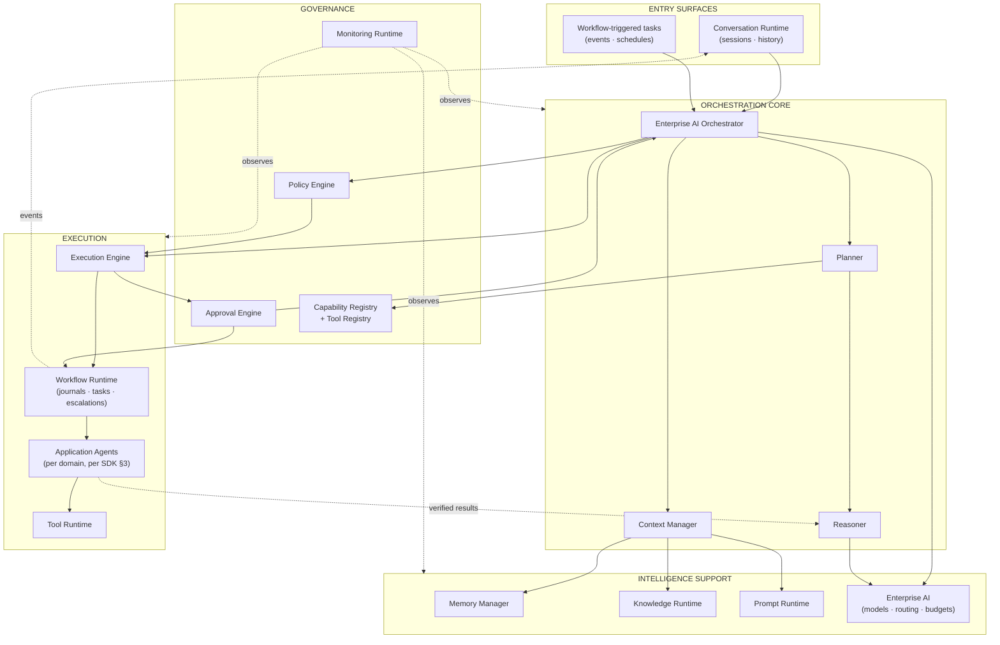
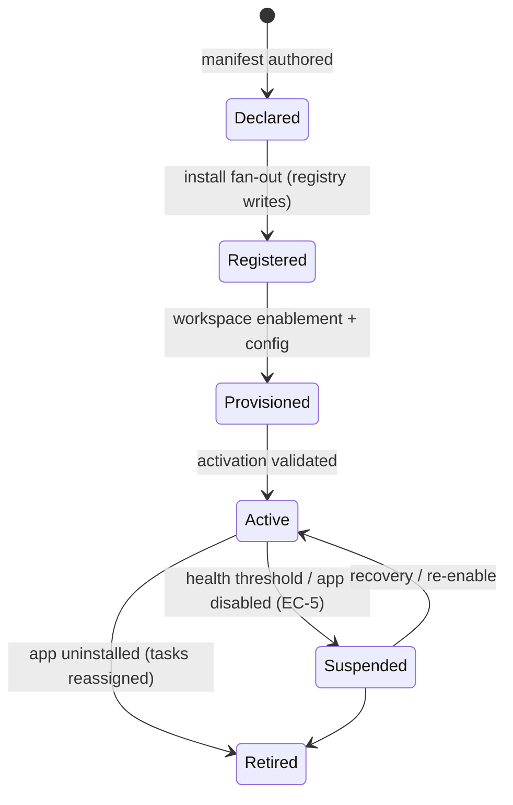
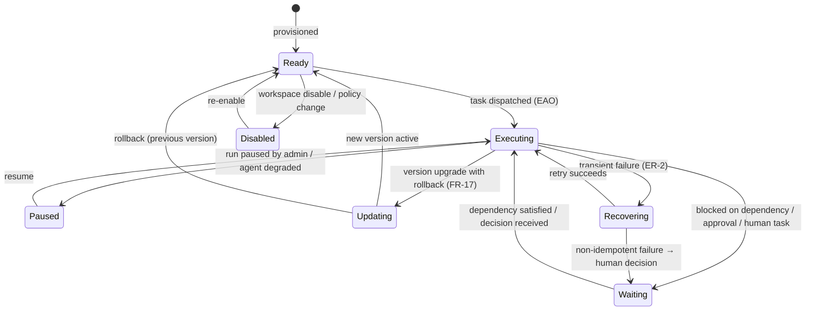
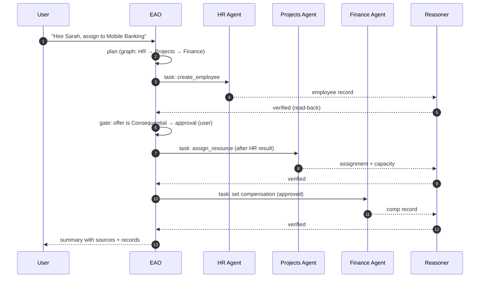

# Nexora — AI Runtime & Agent Framework Specification

**Product:** Nexora — _Work. Orchestrated by AI._
**Document Type:** AI Runtime Specification (AIR)
**Version:** 1.0
**Owner:** AI Platform Architecture
**Audience:** AI engineering, agent SDK teams, platform engineering, security, ML/platform ops
**Related documents:** PRD v1.0 · PSD v1.0 · SAD v1.0 · DOMAIN_MODEL v1.0

---

## 0. Purpose & Consistency

### 0.1 Purpose

This document specifies the **AI Runtime and Agent Framework** that powers Nexora: the runtime architecture, the orchestrator's decision model, the Agent SDK contract, planning, reasoning, memory, knowledge, tools, multi-agent collaboration, human approval, policies, explainability, AI Studio, and AI observability. It is the foundation for the Agent SDK, Planner, Reasoner, Memory, Tool Calling, Capability Discovery, Workflow Execution, Human Approval, and AI Studio.

It contains **no implementation code, no prompts, no APIs, and no database schemas** — only AI runtime architecture and runtime behavior.

### 0.2 Consistency contract

This document is fully derived from the PRD, PSD, SAD, and DOMAIN_MODEL, and never contradicts them. Every normative element is reused verbatim:

| Prior element                                                                                                | Used here                                                                                     |
| ------------------------------------------------------------------------------------------------------------ | --------------------------------------------------------------------------------------------- |
| PSD §7 (AIX-1…19)                                                                                            | The 15 runtime components (§1)                                                                |
| PSD §7.20 safety taxonomy & autonomy tiers                                                                   | §12, §13 (side-effect classes; Assist → Confirm → Approve-with-rules → Supervised-autonomous) |
| SAD §8 AI Runtime, ADR-001/005/006/007/008/009/011                                                           | Orchestrator, discovery, approval, grounding, models, journaling, decision-time recording     |
| SAD §9 Agent Architecture; DDD §14.7 agent lifecycle                                                         | Agent SDK (§3) and two-plane lifecycle (§4)                                                   |
| DDD §2.3 registry ownership (App Platform writes; AI Platform owns the discovery read-model)                 | §5 Capability Discovery                                                                       |
| DDD §7 services (IntentMatching, CapabilityDiscovery, Verification, ModelGovernance, Memory, Explainability) | §2, §6–§7                                                                                     |
| PSD AIX-5 memory scopes; DDD §8 policy ownership                                                             | §8 Memory, §13 Policy                                                                         |

**New concepts introduced here** (all extensions, none contradict prior documents): the two-plane agent state model (§4), memory scope×function matrix (§8), tool lifecycle (§10), and collaboration protocols (§11). Each is justified with reasoning and marked where it extends prior decisions.

---

## 1. AI Runtime Overview

### 1.1 The runtime as a system

The AI Runtime is the **intelligence layer (L3) of the SAD**, decomposed into **15 cooperating runtimes**. Every runtime has one coherent responsibility (AP-14), communicates by events and defined interfaces (AP-2/8), and is independently scalable (SAD §15). The runtime exists to honor the product's non-negotiables: human control (BR-13), grounded answers (AI-6), explainability (AI-10), and policy conformance (BR-14) — on every interaction.

### 1.2 The fifteen runtimes

| #   | Runtime                  | PSD/SAD anchor      | Responsibility                                                                                                              | Owned state                            |
| --- | ------------------------ | ------------------- | --------------------------------------------------------------------------------------------------------------------------- | -------------------------------------- |
| R1  | **Enterprise AI**        | AIX-1               | Language capability service: intent parsing, generation, summarization, grounding; model routing, budgets (NFR-14, ADR-008) | Stateless (models behind gateway)      |
| R2  | **Planner**              | AIX-3               | Intent → validated execution plan over registered capabilities (§6)                                                         | Plan drafts, plan templates            |
| R3  | **Reasoner**             | AIX-4               | Verification (read-back), explanation, narration (AI-6, AI-10)                                                              | Verification evidence                  |
| R4  | **Execution Engine**     | SAD §8.1 (AIX-9/10) | Drives plan steps as tasks: ordering, dispatch, retries, completion within a run                                            | Task state                             |
| R5  | **Context Manager**      | AIX-12              | Minimal, permission-filtered context assembly for every AI call (AC-14)                                                     | Assembled context (transient, audited) |
| R6  | **Memory Manager**       | AIX-5               | Scoped memory: conversation, user, workspace, company, agent, workflow (§8)                                                 | Memory entries (tenant-isolated)       |
| R7  | **Workflow Runtime**     | AIX-9; SAD §5.10    | Durable execution substrate: journals, human tasks, escalations, compensation (FR-22…26, ADR-009)                           | Workflow journals                      |
| R8  | **Policy Engine**        | SAD §5.12           | Synchronous evaluation of permissions, approvals, and guardrails at every decision point (PRM-8, ADR-005)                   | Decision logs                          |
| R9  | **Approval Engine**      | AIX-11/18           | Human-gate lifecycle: requests, routing, first-decision-wins, superseding, timeout (BR-15, EC-8, EC-4)                      | Approval requests                      |
| R10 | **Capability Registry**  | SAD §10; DDD §2.3   | Discovery read-model over registered capabilities/skills/tools/agents (write-owned by App Platform)                         | Registry projection                    |
| R11 | **Tool Registry**        | AIX-8               | Catalog of executable tools with schemas, side-effect classes, health (§10)                                                 | Tool metadata                          |
| R12 | **Knowledge Runtime**    | AIX-6               | Access-filtered grounding retrieval with citation and versioning (BR-7, ADR-007)                                            | Knowledge index (projection)           |
| R13 | **Conversation Runtime** | AIX-16              | Session state, multi-turn context, durable history (FR-7)                                                                   | Conversations                          |
| R14 | **Prompt Runtime**       | AIX-13              | Governed, versioned prompts and policy injections; structural separation of instructions from content                       | Prompt versions                        |
| R15 | **Monitoring Runtime**   | AIX-19              | Quality/cost/safety telemetry, SLOs, anomaly alerting (PRD §18.3, NFR-15)                                                   | Metrics, traces, timelines             |

### 1.3 Runtime overview diagram



### 1.4 Runtime interaction invariants

1. **Single entry:** every AI-driven interaction — conversational, scheduled, or event-triggered — enters through the orchestration pipeline (§2.3); there is no back door to agent or tool execution (ADR-001, WRK-15).
2. **Governance before execution:** policy evaluation and, where required, approval precede every side-effecting tool call; ordering is enforced by the pipeline (BR-13).
3. **Decision-time recording:** every runtime persists its decisions and explanations at decision time (ADR-011) — nothing is reconstructed later.
4. **Stateless core, durable sides:** the orchestration core is horizontally scalable; conversations, plans, journals, and approvals live in durable stores (SAD §8.3).
5. **Containment:** a failing agent, tool, or runtime is contained to its workflow; other tenants and workflows are unaffected (NFR-13).

---

## 2. Enterprise AI Orchestrator

Realizes: PSD AIX-2, FR-10; SAD ADR-001; DDD §11 (EAO); WRK-15.

### 2.1 Role

The **Enterprise AI Orchestrator (EAO)** is the single coordinator of all agents and workflows (PRD §12.1). It owns the **conversation**, the **plan**, and the **outcome narrative**. It performs **no domain actions itself** — only application agents do, and only when dispatched by the EAO through the governed pipeline (ADR-001).

### 2.2 Responsibilities (normative)

| #     | Responsibility      | Behavior                                                                                                                                                                                                              |
| ----- | ------------------- | --------------------------------------------------------------------------------------------------------------------------------------------------------------------------------------------------------------------- |
| AOE-1 | **Intent intake**   | Receives utterances, tasks, and event-triggers; delegates parsing to Enterprise AI; runs the clarify loop on low confidence (FR-5).                                                                                   |
| AOE-2 | **Plan governance** | Requests plan synthesis from the Planner; validates plans against the invoking user's effective permissions _before_ presentation (PRM-8); routes plans through Explainability and, where gated, the Approval Engine. |
| AOE-3 | **Dispatch**        | Converts approved plans into tasks for the Execution Engine; binds each task to the user's delegated authority envelope and the Workspace context (AC-14).                                                            |
| AOE-4 | **Observation**     | Monitors task progress, verification outcomes, and gates; receives verified results from agents via the Reasoner.                                                                                                     |
| AOE-5 | **Replanning**      | On logical failure, replans around the failed step with a valid alternative (AIX-3); never replans around a Prohibited action (BR-14).                                                                                |
| AOE-6 | **Narration**       | Composes the final response: outcome, sources, approvals, and next steps (FR-6); records the AiDecision (ADR-011).                                                                                                    |
| AOE-7 | **Scope fidelity**  | Never executes an action the invoking user could not perform; never escalates its own authority (PRM-8, BR-9).                                                                                                        |

### 2.3 Decision boundaries

The EAO decides **how work is orchestrated**, never **what the domain allows**:

| The EAO decides                             | The EAO never decides                                                                  |
| ------------------------------------------- | -------------------------------------------------------------------------------------- |
| Which capabilities/agents/tools a plan uses | Whether an action is permitted (Policy Engine — synchronous, single point, ADR-005)    |
| The order and parallelization of steps      | Whether an action is Consequential and requires approval (side-effect classes — BR-13) |
| When to clarify, replan, or escalate        | What data a user may read (access-filtered retrieval — BR-7)                           |
| How to narrate the outcome                  | What an App's business rules are (owning BC)                                           |
| Which model tier to use within budget       | Whether an autonomy tier applies (admin-configured, AIX-14/15)                         |

### 2.4 Planning lifecycle

```
Trigger (utterance / event / schedule)
  → 1. Context assembly (Context Manager; permission-filtered)
  → 2. Intent parsing (Enterprise AI; clarify loop on low confidence)
  → 3. Capability matching (Planner × Capability Registry; permission-filtered candidates)
  → 4. Plan synthesis (task graph; steps + gates; §6)
  → 5. Plan validation (Policy Engine: feasibility under user's permissions)
  → 6. Plan presentation (Explainability; plan preview with sources)
  → 7. Plan authorization (Approval Engine where gated; Confirm tier default in v1)
  → 8. Plan commitment (journaled; immutable once executing)
```

### 2.5 Execution lifecycle

```
Commit plan → Execution Engine enqueues tasks (Task Planner semantics)
  → for each step: Policy re-check at execution time (USR-R2) → dispatch agent
  → agent invokes tools (Tool Runtime) → Reasoner verifies (read-back, AI-6)
  → verified step recorded; next step (dependencies honored; fan-out/fan-in)
  → gates pause the run (Approval Engine → Work Inbox) → resume on decision
  → all steps verified → completion → narration → AiDecision recorded
```

### 2.6 Retry, failure, escalation behavior

| Condition                        | EAO behavior                                                                                                   | Source       |
| -------------------------------- | -------------------------------------------------------------------------------------------------------------- | ------------ |
| Transient tool failure           | Idempotent steps retry with backoff (ER-2); non-idempotent steps never auto-retry — surface for human decision | FR-13        |
| Verification failure             | Reported as **unverified**, never done; run pauses for inspection or manual completion                         | AI-6, ER-3   |
| Logical failure with alternative | EAO replans around the failed step; the alternative is explained                                               | AI-3, AOE-5  |
| Agent/tool unavailable           | Contained pause with deterministic-UI fallback; other workflows unaffected                                     | NFR-13, EC-5 |
| Approval timeout                 | Escalation chain fires (EC-4); never auto-approval                                                             | FR-24        |
| Intent exhaustion                | After N clarify attempts, offers search + manual mode; never a guessed action                                  | ER-1         |
| Unrecoverable failure            | Run enters `Failed` with full explanation + audit; user can retry or run manually                              | ER-8         |

### 2.7 Human escalation (design rule)

The EAO treats **escalation as a first-class outcome**, not a failure: any condition the runtime cannot resolve _under the current user's authority_ escalates to the next authorized human with complete context (what, why, options, records) — consistent with the autonomy-tier model (Assist → Confirm → Approve-with-rules → Supervised-autonomous, PSD §7.20) where escalation breadth is configured by admins, never by the AI (AIX-14).

---

## 3. Agent SDK

Realizes: PSD §7.7 (Agent Registry), §5.3 (App Contract); SAD §7 (Plugin SDK), §9 (Agent Architecture); DDD §11.

The **Agent SDK** is the contract every agent must satisfy — first-party or third-party, marketplace or system. It defines **14 mandatory elements**. Uniformity is what makes governance, discovery, and isolation possible at platform scale (ADR-003).

### 3.1 The fourteen agent contract elements

| #   | Element           | Specification                                                                                                                                                                               |
| --- | ----------------- | ------------------------------------------------------------------------------------------------------------------------------------------------------------------------------------------- |
| 1   | **Identity**      | Globally unique agent ID, namespaced by App (e.g., `hr.agent`); display name; publisher. Immutable for the life of the App (AC-13).                                                         |
| 2   | **Manifest**      | Machine-readable declaration: version, SDK-version requirement, agent type, capabilities (§5). The manifest is the only thing the platform reads about an agent at registration.            |
| 3   | **Capabilities**  | Semantic business-level statements of what the agent achieves (DDD §12) — the discovery vocabulary.                                                                                         |
| 4   | **Skills**        | Typed executable operations: input/output schema, side-effect class (BR-13), idempotency flag, cost class, verification requirements (§6). Skills are the only way an agent acts (ADR-001). |
| 5   | **Tools**         | Executable implementations behind skills, registered in the Tool Registry with health metadata (§10).                                                                                       |
| 6   | **Policies**      | Declared domain policies the agent honors (leave rules, budget rules); the Policy Engine encodes them; the agent does not self-enforce (DDD §13).                                           |
| 7   | **Permissions**   | Declared permission requirements per skill; enforced by the Policy Engine under the delegated envelope (PRM-8) — never self-checked.                                                        |
| 8   | **Knowledge**     | Declared knowledge contribution (policies, reference content) ingested by the Knowledge Runtime; access-filtered (BR-7).                                                                    |
| 9   | **Events**        | Declared published/subscribed event types (EVT-*); agents never subscribe directly — event work enters the orchestration pipeline (§1.4-1).                                                 |
| 10  | **Memory**        | Declared memory schema and scopes the agent may read/write (conversation/user/workflow by default; workspace/company/agent per manifest — §8).                                              |
| 11  | **Lifecycle**     | Declared lifecycle hooks (`onActivate`, `onSuspend`, `onUpdate`, `onRetire`) — housekeeping only, no cross-App side effects (PSD §5.3).                                                     |
| 12  | **Health**        | Health probes: success rate, verification-pass rate, latency vs. SLO (SAD §9.8); declared thresholds feed the Monitoring Runtime.                                                           |
| 13  | **Version**       | Semantic version tied to the App version; major versions require re-approval (FR-17, AC-13).                                                                                                |
| 14  | **Configuration** | Typed configuration schema (Company/Workspace scoped): skill toggles, autonomy-tier bounds, budgets, prompt overrides — validated against safety invariants (R-35).                         |

### 3.2 Why every agent follows the same contract (reasoning)

1. **Uniform governance** — one Policy Engine, one Approval Engine, one audit shape for every agent, first- or third-party (ADR-001/006).
2. **Uniform discovery** — the EAO plans over registry records, so an agent is only as good as its manifest; quality is contractual (ADR-005).
3. **Uniform isolation** — every agent runs in its App's container with the same quotas and no platform-store access (§10.9, SAD §7.13).
4. **Uniform verification** — the Reasoner verifies every agent's results the same way (read-back, AI-6), regardless of domain. This is what lets the product promise "the AI never fabricates" scale beyond the first-party apps (PRD §12.3).

---

## 4. Agent Lifecycle

Realizes: SAD §9.2; DDD §14.7 (Declared → Registered → Provisioned → Active → Suspended → Retired); EC-5.

The agent state model has **two planes**: the **lifecycle plane** (administrative existence, per DDD §14.7) and the **runtime plane** (execution behavior, new in this document). They are orthogonal: a `Registered` agent can be `Disabled`; an `Active` agent can be `Waiting`. This preserves the DDD lifecycle exactly while adding the runtime states needed to specify the framework.

### 4.1 Lifecycle plane (administrative)



### 4.2 Runtime plane (execution)



### 4.3 State semantics (normative)

| State                                             | Plane     | Meaning                                                                                               | Entry              | Exit                                     |
| ------------------------------------------------- | --------- | ----------------------------------------------------------------------------------------------------- | ------------------ | ---------------------------------------- |
| **Declared / Registered / Provisioned / Retired** | Lifecycle | Administrative existence (DDD §14.7)                                                                  | §4.1               | §4.1                                     |
| **Active / Suspended**                            | Lifecycle | Administrative operational flag                                                                       | §4.1               | §4.1                                     |
| **Ready**                                         | Runtime   | Provisioned and enabled, awaiting tasks                                                               | Activation         | Disabled / Executing                     |
| **Executing**                                     | Runtime   | Holding a task; at most one active task per agent (serial per task; concurrency via fan-out of tasks) | Task dispatch      | Waiting / Paused / Recovering / Updating |
| **Waiting**                                       | Runtime   | Blocked on approval, dependency, or human task (EC-4, FR-24)                                          | Blocking condition | Unblock                                  |
| **Paused**                                        | Runtime   | Run paused by authorized admin (FR-25) or agent degraded (EC-5)                                       | Pause              | Resume                                   |
| **Disabled**                                      | Runtime   | No new tasks; in-flight tasks pause at boundary (EC-3)                                                | Disable            | Enable                                   |
| **Updating**                                      | Runtime   | Version swap with rollback (FR-17)                                                                    | Upgrade start      | New/old version ready                    |
| **Recovering**                                    | Runtime   | Transient failure handling (ER-2)                                                                     | Failure            | Retry / Waiting (human)                  |

**Reasoning for two planes:** the DDD lifecycle expresses _whether an agent exists and may exist in a workspace_; the runtime plane expresses _what the agent is doing right now_. Mixing them (as in many naive frameworks) forces impossible states (an agent cannot be both "Active" and "Waiting" in one axis). The two-plane model keeps DDD §14.7 authoritative for lifecycle and gives the Monitoring Runtime a precise execution-state vocabulary (AIO-2).

---

## 5. Capability Discovery

Realizes: SAD §10 (discovery protocol + guarantees), ADR-005; DDD §2.3 (registry ownership), §12.2.

The EAO and Planner **never hardcode** applications, agents, or tools (ADR-005). Everything they can do is discovered — which is what makes FR-16 (future Apps without platform changes) and the marketplace vision (SAD §18) architecturally real. Discovery is driven by **seven manifests**, all declared in the App manifest and validated at install (§7.12 SAD).

### 5.1 The seven discovery manifests

| Manifest                | Declares                                                                                 | Consumed by                                                                 | Guarantees                                                                   |
| ----------------------- | ---------------------------------------------------------------------------------------- | --------------------------------------------------------------------------- | ---------------------------------------------------------------------------- |
| **Capability Manifest** | Semantic business capabilities with descriptions, examples, and constraints (DDD §12)    | Planner (intent→capability matching)                                        | Discovery quality is contractual; validated at install (§10.4 SAD)           |
| **Skill Manifest**      | Typed skills: input/output schemas, side-effect classes, idempotency, verification needs | Planner, Execution Engine, Approval Engine (gating)                         | Every skill is typed; no free-form tool use (ADR-001)                        |
| **Tool Manifest**       | Executable tools behind skills, health metadata, cost class                              | Tool Registry, Execution Engine                                             | Tools are executable only via skills under the envelope                      |
| **Policy Manifest**     | Declared domain policies the App requires the platform to encode/enforce                 | Policy Engine (encoding), AI Studio (visibility)                            | Agents never self-enforce (DDD §13)                                          |
| **Workflow Manifest**   | Published workflow templates the App offers (WRK-*)                                      | Workflow Runtime (template registry), Planner (intent-to-template matching) | Templates versioned; approval-logic changes re-reviewed (R-25)               |
| **Knowledge Manifest**  | Declared knowledge contributions for grounding ingestion                                 | Knowledge Runtime (ingest), AI Studio                                       | Access-filtered by the same permissions as the source (BR-7)                 |
| **Permission Manifest** | Required permissions per capability/skill                                                | Policy Engine (feasibility), Marketplace validation (§7.12)                 | Permission-filtered discovery: invisible if the user lacks authority (PRM-8) |

### 5.2 Discovery protocol (behavior)

```
App install → manifest validated → registration fan-out (App Platform, DDD §2.3)
  → seven manifests indexed into the Capability Registry projection
  → events: PluginInstalled / AgentRegistered / PluginUpgraded

Planning time:
  Planner query (intent + user authority + workspace + autonomy tier)
  → registry returns permission-filtered candidate capabilities (R10)
  → intent-matching ranks candidates (IntentMatchingService, DDD §7)
  → plan synthesized over matched skills (§6)

Change time:
  PluginUpgraded → re-index; deprecation window → entries expire (AC-13)
  PolicyChanged / RoleChanged → registry visibility re-filtered per user
```

### 5.3 Discovery guarantees (normative)

1. **No hardcoding** — the Planner operates only on registry records (ADR-005).
2. **Permission-filtered visibility** — a capability invisible to the user is invisible to the plan (PRM-8).
3. **Freshness** — event-driven re-indexing; versioned entries with deprecation windows (AC-13).
4. **Semantic quality** — descriptors include examples and constraints; validated at install and measured in monitoring (discovery-miss rate is a quality signal, §16).
5. **Traceability** — every discovery query is traced (NFR-15) and its outcome recorded (ADR-011).

---

## 6. Planning Engine

Realizes: PSD AIX-3 (Planner), AI-2; DDD §7 (IntentMatchingService, CapabilityDiscoveryService).

The **Planning Engine** converts user intent into an executable, governed plan. It is part of the EAO's pipeline (R2) and produces the artifact — the **Plan** — that everything downstream honors.

### 6.1 The planning pipeline

```mermaid
flowchart LR
    I[User Intent] --> D[Intent Detection
(Enterprise AI, clarify loop FR-5)]
    D --> C[Capability Matching
(Planner x Capability Registry, permission-filtered)]
    C --> G[Task Graph
(dependency-ordered steps + gates)]
    G --> A[Agent Selection
(Agent Registry; authority envelope per step)]
    A --> T[Tool Selection
(Tool Registry; side-effect classes)]
    T --> V[Plan Validation
(Policy Engine: feasibility under permissions)]
    V --> P[Plan Presentation
(Explainability: preview + sources)]
    P --> AP[Authorization
(Approval Engine where gated)]
    AP --> X[Execution
(Execution Engine -> Workflow Runtime)]
    X --> VR[Verification
(Reasoner read-back, AI-6)]
    VR --> C1[Completion
(narration + AiDecision recorded)]
```

### 6.2 Plan artifact (normative structure)

A **Plan** contains: a set of typed **steps** (agent + skill + inputs), **dependencies** between steps, **gates** (approval checkpoints by side-effect class), **alternative branches** (for replanning), the **authority envelope** it was validated under, and the **explanation**. Plans are versioned and immutable once committed (§2.4-8); replanning produces a new plan version linked to the old (AI-3).

### 6.3 Planning rules

| Rule  | Behavior                                                                                                                  | Source        |
| ----- | ------------------------------------------------------------------------------------------------------------------------- | ------------- |
| PLN-1 | A plan step is always a registered skill — never free-form "LLM do something"                                             | ADR-001       |
| PLN-2 | The plan is validated against the user's effective permissions _before_ presentation                                      | PRM-8         |
| PLN-3 | Consequential steps carry mandatory gates; the planner cannot omit them                                                   | BR-13         |
| PLN-4 | Prohibited actions are excluded at synthesis; the planner never plans around them                                         | BR-14         |
| PLN-5 | Plans prefer template reuse (cached, versioned) over novel synthesis when a template matches (cost + reliability)         | AIX-3, NFR-14 |
| PLN-6 | Every plan records its decision-time explanation and sources                                                              | ADR-011       |
| PLN-7 | Plans degrade gracefully: if no capability matches, offer clarification, search, and manual mode — never a guessed action | ER-1          |

### 6.4 Task graph semantics

- **Dependencies** produce a DAG; the Execution Engine honors fan-out (parallelizable steps) and fan-in (join before dependent steps) (AIX-10).
- **Gates** pause the run at approval checkpoints; the graph remains paused until decisions arrive (EC-4/8).
- **Branches** record documented alternatives so replanning is deterministic rather than improvisational (AOE-5).

---

## 7. Reasoning Pipeline

Realizes: PSD AIX-1/4/12; DDD §7 (VerificationService).

The Reasoning Pipeline is the **nine-stage decision path** every AI interaction traverses. Stages are sequential and audited; each stage records its inputs and outputs at decision time (ADR-011). The pipeline is what makes the runtime _deterministic in governance_ while stochastic in generation (core principle: **Deterministic Orchestration**).

| #   | Stage                   | Runtime                       | Behavior                                                                                                    | Failure handling                                  |
| --- | ----------------------- | ----------------------------- | ----------------------------------------------------------------------------------------------------------- | ------------------------------------------------- |
| 1   | **Intent Detection**    | Enterprise AI                 | Parse utterance/task into intent + slots; confidence scoring; clarify loop on low confidence (FR-5)         | After N clarifies: search + manual mode (ER-1)    |
| 2   | **Context Building**    | Context Manager               | Assemble minimal, permission-filtered context: actor, workspace, history, memory, relevant records (AIX-12) | No context beyond authority (BR-7)                |
| 3   | **Knowledge Retrieval** | Knowledge Runtime             | Access-filtered grounding retrieval; sources with versions (BR-7, §9)                                       | Empty/conflicting: say so, never fabricate (EC-6) |
| 4   | **Capability Matching** | Planner × Capability Registry | Rank candidate capabilities for the intent under the user's permissions (§6.1)                              | No match: clarify/search/manual (PLN-7)           |
| 5   | **Risk Analysis**       | Reasoner                      | Classify side effects (Read-only/Update/Consequential) and risk signals (money, people, deletion, external) | High-risk → gates + explanation (BR-13)           |
| 6   | **Policy Validation**   | Policy Engine                 | Synchronous evaluation: permissions, guardrails, prohibited actions, approval rules (PRM-8, BR-14)          | Denied → refusal with explanation (BR-14)         |
| 7   | **Execution Planning**  | Planner                       | Synthesize the task graph with gates (§6)                                                                   | Replan on logical failure (AOE-5)                 |
| 8   | **Result Verification** | Reasoner                      | Read-back verification of executed actions; state check before claiming done (AI-6)                         | Unverified → reported unverified, paused (ER-3)   |
| 9   | **Explainability**      | Reasoner/Explainability       | Compose the decision record: intent, reasoning, sources, policies, approvals, confidence (§14)              | Always present; never retrofitted (ADR-011)       |

**Pipeline invariant:** stages 5–6 (risk + policy) precede stage 7 (planning) so that no plan is ever formed that policy will later reject — governance shapes synthesis rather than merely auditing it (ADR-005/006).

---

## 8. Memory Architecture

Realizes: PSD AIX-5 (memory scopes); DDD §7 (MemoryService).

Memory is organized along **two orthogonal dimensions** — **scope** (where it lives and who may see it) and **function** (how it is used) — producing a matrix rather than a flat bag of stores. This preserves AIX-5's scopes exactly while adding the functional types needed to specify behavior.

### 8.1 Scope dimension (where)

| Scope                           | Owned by             | Visibility & lifecycle                                                                                    | Source                 |
| ------------------------------- | -------------------- | --------------------------------------------------------------------------------------------------------- | ---------------------- |
| **Session/Conversation memory** | Conversation Runtime | Current conversation; TTL = session; feeds multi-turn context (FR-7)                                      | AIX-16, AIX-5 scope 1  |
| **User memory**                 | Memory Manager       | Per-user preferences/entities; visible to the user; deletable; feeds context across sessions              | AIX-5 scope 2          |
| **Workspace memory**            | Memory Manager       | Facts scoped to a Workspace (team norms, terms); visible to Workspace members per roles                   | AIX-5 scope 3 + WS-R3  |
| **Company memory**              | Memory Manager       | Tenant-level facts (org terminology, approved glossaries); Company-scoped                                 | CO-2, AC-14            |
| **Agent memory**                | Memory Manager       | Per-agent operational state (last verified context, workflow-local facts); ephemeral, never authoritative | SAD §9 (configuration) |
| **Workflow memory**             | Workflow Runtime     | Facts learned during executions (e.g., "Sarah prefers email"); versioned with runs                        | AIX-5 scope 3          |

### 8.2 Function dimension (how)

| Function                 | Definition                                                     | Behavior                                                                   |
| ------------------------ | -------------------------------------------------------------- | -------------------------------------------------------------------------- |
| **Short-term (working)** | Immediately needed context (recent turns, current task inputs) | Bounded, evicted by recency; lives in Context Manager's assembled window   |
| **Long-term (episodic)** | Facts about past events ("we approved X for Acme in March")    | Durable, queryable, summarized to prevent context bloat                    |
| **Semantic memory**      | Meaning: org terms, product glossary, domain vocabulary        | Derived from Company/Workspace knowledge; grounds interpretation (stage 1) |
| **Procedural memory**    | How-to knowledge: process preferences, recurring patterns      | Expressed as workflow-template reuse and user-preference defaults (PLN-5)  |

### 8.3 Memory matrix (which functions exist in which scopes)

|                          | Session | User | Workspace | Company | Agent | Workflow |
| ------------------------ | ------- | ---- | --------- | ------- | ----- | -------- |
| **Short-term**           | ✓       | —    | —         | —       | ✓     | ✓        |
| **Long-term (episodic)** | —       | ✓    | ✓         | ✓       | —     | ✓        |
| **Semantic**             | —       | ✓    | ✓         | ✓       | —     | ✓        |
| **Procedural**           | —       | ✓    | ✓         | ✓       | ✓     | ✓        |

### 8.4 Lifecycle, retention, expiration

| Rule  | Behavior                                                                                                    | Source              |
| ----- | ----------------------------------------------------------------------------------------------------------- | ------------------- |
| MEM-1 | Memory is **per-Company and per-Workspace isolated**; never shared across Companies                         | FR-1                |
| MEM-2 | Memory never overrides permission checks or approval rules (it is context, not authority)                   | AIX-5               |
| MEM-3 | Users can view and delete their user memory; deletion propagates within one Company                         | AIX-5, U2           |
| MEM-4 | Session memory expires at session end; agent memory expires with the task/run                               | §8.1                |
| MEM-5 | Long-term entries carry retention policies per Company (configurable; AUD-7 alignment)                      | NFR-10              |
| MEM-6 | Memory writes are audited (who, scope, kind) and appear in the Memory Timeline (§16)                        | AUD-1, AIO-4        |
| MEM-7 | Memory summarization is lossy and flagged as such; original facts remain retrievable where retention allows | FR-7 context budget |

**Reasoning:** the two-dimensional model keeps every prior memory statement intact (AIX-5 scopes, tenant isolation, user visibility) while giving the Memory Manager a precise contract for what lives where, who sees it, and when it expires — the minimum needed before implementation (DDD §7 MemoryService).

---

## 9. Knowledge Runtime

Realizes: PSD AIX-6; SAD §5.8; BR-7, EC-6; ADR-007.

The **Knowledge Runtime** is the grounding substrate: it answers "what may this model see?" with permission-filtered, versioned, citable content — the architectural guarantee that AI claims are grounded (AC-7).

### 9.1 Knowledge sources

| Source                        | Producer                           | Ingest trigger                         | Governance                                      |
| ----------------------------- | ---------------------------------- | -------------------------------------- | ----------------------------------------------- |
| KB articles/policies          | Knowledge BC (APP-11)              | `KnowledgeUpdated`, `ArticlePublished` | Publication flow; access = source permissions   |
| Documents (approved versions) | Documents BC (APP-08)              | `DocumentUploaded`, `DocumentApproved` | **Only approved versions ground** (BR-12, R-22) |
| App-owned knowledge           | Any App (Knowledge Manifest, §5.1) | `PluginInstalled` + content events     | Declared scopes; source permissions             |
| User memory (semantic)        | Memory Manager                     | Memory writes                          | User-visible scope (BR-7)                       |

### 9.2 Retrieval & filtering pipeline

```
Query (context, actor, workspace)
  → source selection (enabled sources for workspace)
  → permission filtering (actor's read permissions per source record — BR-7)
  → version pinning (retrieve the authoritative version — BR-12)
  → ranking (relevance to context)
  → citation assembly (source + version + passage ref)
  → answer grounding (Enterprise AI constrained to retrieved passages)
  → conflict detection (contradictory sources surfaced, never asserted — EC-6)
```

### 9.3 Knowledge runtime guarantees

| Guarantee                   | Behavior                                                                                              | Source   |
| --------------------------- | ----------------------------------------------------------------------------------------------------- | -------- |
| **Workspace isolation**     | Retrieval is scoped to the Workspace; cross-Workspace requires explicit grants (WS-R3)                | AC-14    |
| **Permission filtering**    | The model can only ground on content the invoking user may read; filtering is query-time (ADR-007)    | BR-7     |
| **Citation**                | Every grounded claim cites source + version + passage with drill-down (FR-6)                          | AIX-6    |
| **Freshness**               | Event-driven re-indexing (`KnowledgeUpdated`, `DocumentUploaded`); staleness is flagged, never silent | §5.8 SAD |
| **Versioning**              | Retrieval honors content versions; an answer cites the exact version consulted (BR-12)                | AC-13    |
| **Conflict handling**       | Contradictory sources are surfaced as a conflict with both citations; escalation to KB owner offered  | EC-6     |
| **No fabricated grounding** | If no source supports a claim, the answer refuses to assert it (AC-7)                                 | AI-6     |

**Reasoning:** retrieval-time permission filtering (ADR-007) was chosen over index-time ACL snapshots because revocation must be immediate (USR-R2) and because guest/external users (BR-8) need safe read-only grounding without separate indexes.

---

## 10. Tool Runtime

Realizes: PSD AIX-8; SAD §10; DDD §12 (tools); FR-13, ER-2/5, BR-13.

The **Tool Runtime** is the execution gatekeeper for everything an agent does: it validates, invokes, verifies, retries, compensates, and isolates tool calls. No tool executes outside this runtime (ADR-001).

### 10.1 Tool lifecycle (behavior)

| Stage            | Behavior                                                                                                                                                                 |
| ---------------- | ------------------------------------------------------------------------------------------------------------------------------------------------------------------------ |
| **Discovery**    | Tools are registered via Tool Manifest (§5.1) into the Tool Registry; the Execution Engine resolves them by skill ID                                                     |
| **Validation**   | Pre-invocation: schema validation of inputs, side-effect class check, permission check under the envelope (PRM-8), policy/guardrail check (BR-14), budget check (NFR-14) |
| **Invocation**   | Execution inside the owning App container (isolation, quotas); the agent is the caller; the EAO is the only dispatcher                                                   |
| **Results**      | Structured result with state references; the Reasoner read-back verifies before acceptance (AI-6)                                                                        |
| **Retry**        | Idempotent tools retry with backoff (ER-2); non-idempotent tools never auto-retry — surface to human decision (FR-13)                                                    |
| **Timeout**      | Per-tool timeout budgets; timeout → classify (transient) → retry or escalate (EC-4/5)                                                                                    |
| **Compensation** | Declared compensation behavior per side-effect class; runs in reverse dependency order (ADR-009, §12.3 SAD)                                                              |
| **Idempotency**  | Idempotency keys on every tool call; duplicate invocations have no duplicate effect (EVT-G1)                                                                             |
| **Security**     | Tools cannot access platform stores, secrets, or other Apps' data (AC-15, §7.13 SAD); egress and rate limited; tool health monitored (§16)                               |

### 10.2 Tool execution guarantees

| Guarantee | Behavior                                                                                             | Source         |
| --------- | ---------------------------------------------------------------------------------------------------- | -------------- |
| TLR-1     | A tool executes **only** as a registered skill under the delegated envelope                          | ADR-001, PRM-8 |
| TLR-2     | Consequential tools always pass the Approval Engine gate; cannot be invoked otherwise                | BR-13          |
| TLR-3     | Unverified results are never reported as done                                                        | AI-6           |
| TLR-4     | Tool failures are contained to the invoking workflow (no cascade)                                    | NFR-13         |
| TLR-5     | Every invocation is audited with inputs, result, and verification evidence                           | AUD-1, ADR-011 |
| TLR-6     | Tool health (latency, failure rate, verification-pass rate) feeds agent health and suspension (EC-5) | AIX-19         |

**Reasoning:** centralizing all tool execution in one runtime (rather than letting agents call tools directly) is what makes side-effect classification, idempotency, and compensation enforceable for _all_ agents — first-party and third-party alike. This is the operational realization of ADR-001 and BR-13.

---

## 11. Multi-Agent Collaboration

Realizes: SAD §9.5 (no agent-to-agent calls; orchestrator-mediated); ADR-001; WRK-15; PRD §12.1.

Nexora's collaboration model is **orchestrator-mediated**: agents never call each other (AC-15); the EAO sequences and coordinates them. This preserves one governance point and one audit trail (ADR-001). Within that constraint, the runtime defines ten collaboration behaviors.

### 11.1 Collaboration behaviors

| Behavior                 | Architecture                                                                                                                                            | Example                                                                    |
| ------------------------ | ------------------------------------------------------------------------------------------------------------------------------------------------------- | -------------------------------------------------------------------------- |
| **Delegation**           | The EAO delegates a step to the agent owning the required skill; delegation carries the authority envelope + workspace context                          | HR Agent creates the employee; Projects Agent assigns the resource (WRK-1) |
| **Negotiation**          | Where two agents' results conflict (e.g., capacity vs. deadline), the EAO — not the agents — reconciles by evidence, policy, or escalation              | Capacity conflict → EAO proposes alternatives (WRK-1)                      |
| **Shared context**       | Agents share _verified facts_ via workflow state and events — never internal reasoning; each agent's context is assembled by the Context Manager        | Employee ID created by HR feeds Projects assignment                        |
| **Parallel execution**   | Independent branches of the task graph execute concurrently (fan-out) with fan-in joins (§6.4)                                                          | Finance budget check + Inventory availability in parallel (WRK-6/11)       |
| **Sequential execution** | Dependent steps execute in graph order; each waits on verified predecessors                                                                             | Offer approval before onboarding (WRK-1)                                   |
| **Conflict resolution**  | Policy-grounded: the EAO resolves conflicts by precedence rules (domain invariants → tenant policy → user preference); unresolvable conflicts escalate  | Duplicate record conflict (EC-7)                                           |
| **Consensus**            | Where multiple agents' evidence is needed (e.g., cross-domain status), the Reasoner weighs verified evidence; no voting on facts — verification decides | Executive reporting across apps (WRK-14)                                   |
| **Recovery**             | Failed steps retry/replan per §2.6; partial progress is journaled; compensation runs in reverse order (ADR-009)                                         | Mid-plan integration failure (ER-5)                                        |
| **Timeout**              | Per-step timeouts with escalation; the graph marks blocked branches; never auto-approval (EC-4)                                                         | Approval SLA expiry                                                        |
| **Escalation**           | Unresolvable conditions escalate to the next authorized human with full context (§2.7)                                                                  | New vendor policy missing                                                  |

### 11.2 Collaboration sequence (hire & assign)



### 11.3 Collaboration rules

| Rule  | Behavior                                                                                         | Source         |
| ----- | ------------------------------------------------------------------------------------------------ | -------------- |
| MAC-1 | No agent-to-agent calls, ever; all coordination via EAO                                          | AC-15, ADR-001 |
| MAC-2 | Shared facts are verified before propagation; unverified claims never enter shared context       | AI-6           |
| MAC-3 | Every collaboration step is audited with its correlation ID (traceable timelines)                | ADR-011, OBS-* |
| MAC-4 | Parallelism never exceeds the plan's dependency semantics; gates serialize where policy requires | §6.4, BR-13    |
| MAC-5 | Escalation is the default resolution for irreconcilable agent outcomes                           | §2.7           |

---

## 12. Human Approval

Realizes: PSD AIX-11/18, BR-13/15, EC-4/8/10; SAD ADR-006; FR-28.

Human approval is the architectural gate that makes "Human Always In Control" (PRN-2) true. It is **non-bypassable** for Consequential actions (AC-3, BR-13) and cannot be configured away or learned around (R-28).

### 12.1 Approval lifecycle behaviors

| Behavior               | Specification                                                                                                                                                                                                        |
| ---------------------- | -------------------------------------------------------------------------------------------------------------------------------------------------------------------------------------------------------------------- |
| **Approval requests**  | Generated by the Approval Engine at plan gates: bound to one action + exact inputs (BR-15); carry full context (§12.2); actionable from Work Inbox, notification, or conversation (FR-28).                           |
| **Approval rules**     | Sourced from the Policy Engine (L6 approval authority): chains (single/multi-level/4-eyes), value tiers, SoD (PRM-6, EC-10); cannot be relaxed by AI or config (AC-3).                                               |
| **Approval context**   | Always includes: what, on which records (with links), who requested, what happens next, what happens on rejection, policy basis, and the plan reference (AIX-17).                                                    |
| **Approval history**   | Complete chain per request: requested → routed → decided/superseded → outcome; preserved even when superseded (EC-8); audited (AUD-5).                                                                               |
| **Approval timeout**   | SLA timer → reminder → escalation chain; final: pause `AwaitingManualAction`; **never auto-approval** (EC-4).                                                                                                        |
| **Delegated approval** | Approvers may delegate within their authority; delegation is itself an audited decision (FR-21, AUD-5).                                                                                                              |
| **Rejected plans**     | Rejection with reason returns the workflow to the defined rejection path; the plan's branch records the alternative (BR-15, §6.4); user can revise inputs and resubmit — resubmission is a new request, not a retry. |
| **Modified plans**     | "Approve with changes": the approver may edit action inputs; the modification is recorded as part of the decision and re-verified before execution (approval binds to the _modified_ action, BR-15).                 |

### 12.2 Approval state machine (behavior)

```
Gate reached → ApprovalRequest created (action + inputs + context)
  → routed per chain (SoD-aware) → Pending
  → first decision wins (Granted / Rejected with reason) → rest superseded (EC-8)
  → Granted: execution proceeds with the *approved* inputs
  → Rejected: rejection path + reason; resubmit = new request
  → Timeout: escalate per chain → final pause (EC-4)
```

### 12.3 Approval guarantees

| Guarantee                                                                                 | Source       |
| ----------------------------------------------------------------------------------------- | ------------ |
| Consequential actions always gated; gate cannot be bypassed, cached, or delayed by the AI | BR-13, AC-3  |
| Approval binds to the specific action+inputs; never a blanket authorization               | BR-15        |
| First-decision-wins; superseded decisions recorded, never applied                         | EC-8         |
| Self-approval impossible (SoD); routed to backup                                          | PRM-6, EC-10 |
| Timeout never yields approval                                                             | EC-4         |
| Every request, decision, delegation, and modification is audited with reason              | AUD-5        |

---

## 13. Policy Engine

Realizes: SAD §5.12; DDD §13 (policy ownership); PRM-1…10, BR-13/14; ADR-005.

The **Policy Engine** is the single synchronous evaluation point for every authorization, approval, and guardrail decision in the runtime (ADR-005). Domains _define_ policies; the Policy Engine _enforces_ them (DDD §13). It is never bypassed by any path — conversational, scheduled, or event-triggered.

### 13.1 Policy layers (evaluation order)

| Layer                    | Policies                                                                                                   | Evaluated for                 | Source                     |
| ------------------------ | ---------------------------------------------------------------------------------------------------------- | ----------------------------- | -------------------------- |
| **Company policies**     | Tenant-wide rules: residency, retention, default approval chains, AI budgets                               | Every Company-scoped decision | DDD §13 (Tenancy), NFR-10  |
| **Workspace policies**   | App enablement, autonomy tiers, knowledge visibility, workflow defaults                                    | Workspace-scoped decisions    | WS-*, DDD §13              |
| **Application policies** | App-declared domain rules (leave limits, budget thresholds, discount limits)                               | Actions on that App's records | App Policy Manifest (§5.1) |
| **AI policies**          | Side-effect classes (BR-13), prohibited actions (BR-14), no-learning-around (R-28), grounding rules (AC-7) | Every AI action               | AIX-7, DDD R-28…30         |
| **Compliance policies**  | GDPR/CCPA obligations, retention, evidence export, residency                                               | Data operations               | NFR-6, AUD-7               |
| **Security policies**    | Zero-trust, least privilege (PRM-4), guest containment (BR-8), no cross-tenant access (AC-1)               | Every access                  | AC-*, NFR-5                |
| **Approval policies**    | Chains, value tiers, SoD, delegation bounds, timeouts (L6)                                                 | Approval routing              | PRM-6, FR-21               |

### 13.2 Evaluation behavior

| Behavior             | Specification                                                                                                                                                                                |
| -------------------- | -------------------------------------------------------------------------------------------------------------------------------------------------------------------------------------------- |
| **Single point**     | All decisions flow through PolicyEvaluationService; no component re-implements authorization (ADR-005)                                                                                       |
| **Order**            | Layers compose: Company → Workspace → Application → AI → Compliance/Security; **explicit deny wins** at any layer (PRM-3)                                                                    |
| **Freshness**        | Effective permission re-evaluated per request (USR-R2); no cached authority for Consequential actions                                                                                        |
| **Decision records** | Every evaluation logs its inputs, rules applied, and outcome (DecisionLog, AUD-3) — the substrate of the Policy Timeline (§16)                                                               |
| **Invariants**       | Security and approval invariants (AC-1/3/4, BR-13) are non-relaxable; configuration that weakens them is rejected, not stored (R-35)                                                         |
| **AI integration**   | The Planner queries feasibility (PLN-2); the Tool Runtime re-checks at execution (TLR-1); the Approval Engine reads chains (L6) — evaluation happens at every stage where a decision is made |

### 13.3 Policy change propagation

`PolicyChanged` (EVT-31) invalidates cached grants, re-filters capability discovery visibility (§5.3-2), re-evaluates in-flight workflow checkpoints (EC-1), and is itself audited (AUD-1) — so policy changes take effect on the next decision, with zero window of stale authority.

---

## 14. Explainability

Realizes: PSD AIX-17, FR-36; ADR-011; PRD AI-10, §12.3.

Every AI action must explain **ten elements** — recorded at decision time (ADR-011), never reconstructed. The explanation panel renders these at three depths: quick summary, step-level, and full audit reference (AIX-17).

| #   | Element               | Recorded content                                                                                                   | Produced by                      |
| --- | --------------------- | ------------------------------------------------------------------------------------------------------------------ | -------------------------------- |
| 1   | **Intent**            | The parsed intent, slots, and clarification exchanges                                                              | Enterprise AI (stage 1)          |
| 2   | **Reasoning**         | The plan-level rationale: why this capability, why this order, why this alternative                                | Planner + Reasoner (stages 4, 7) |
| 3   | **Knowledge used**    | Sources consulted with version + passage citations (BR-7, §9.3)                                                    | Knowledge Runtime (stage 3)      |
| 4   | **Policies applied**  | Every rule that constrained the action (permission, side-effect, guardrail) with rule references                   | Policy Engine (stage 6)          |
| 5   | **Capabilities used** | Which capabilities matched and were selected (discovery trace)                                                     | Capability Registry + Planner    |
| 6   | **Agents used**       | Which agents executed which steps, with their versions                                                             | Execution Engine                 |
| 7   | **Tools used**        | Which tools ran, with inputs, idempotency keys, and results                                                        | Tool Runtime                     |
| 8   | **Approvals**         | The full approval chain: who, when, what inputs, decision, reason (AUD-5)                                          | Approval Engine                  |
| 9   | **Final decision**    | The outcome: completed/partial/unverified/failed, with verification evidence                                       | Reasoner (stage 8)               |
| 10  | **Confidence**        | Confidence signals per stage (intent confidence, verification certainty) — displayed, never used to override gates | Enterprise AI + Reasoner         |

**Explainability guarantees:**

| Guarantee                                                                                       | Source              |
| ----------------------------------------------------------------------------------------------- | ------------------- |
| Recorded at decision time; never retrofitted                                                    | ADR-011             |
| Every claim links to its audit record (drill-down)                                              | AUD-4, AIX-17       |
| Refusals always include a reason                                                                | AIX-17, BR-14       |
| Explanations respect permissions (a viewer sees only what their role allows)                    | OBS-* cross-cutting |
| The AI Timeline (OBS-3) is rendered _from_ these records — same data, no second source of truth | PSD §16             |

---

## 15. AI Studio

Realizes: PSD AIX-14 (AI Studio), AIX-15 (AI Configuration); FR-37; SAD §7.10 (SDK governance).

**AI Studio** is the admin environment for configuring, testing, tuning, and governing the runtime. It is a surface over the governed runtimes — never a bypass: everything AI Studio changes is versioned, audited, and validated against safety invariants (R-35).

| Surface                  | Behavior                                                                                                                                                                                                                           |
| ------------------------ | ---------------------------------------------------------------------------------------------------------------------------------------------------------------------------------------------------------------------------------- |
| **Prompt Management**    | Browse/author/version prompts in the Prompt Library (AIX-13); policy-language overrides per Company/Workspace; safety-behavior prompt changes require admin review (structural separation of instructions from content, §1.2-R14). |
| **Knowledge Management** | Review knowledge sources, ingestion health, retrieval conflicts, and per-source grounding coverage (§9); adjust source enablement per Workspace; inspect citations and staleness.                                                  |
| **Agent Management**     | Agent registry browser: skills, tools, health, versions; autonomy-tier assignment per Workspace/workflow (PSD §7.20 — tiers are admin-set, never AI-set); skill toggles; budgets.                                                  |
| **Workflow Builder**     | Author/version workflow templates (FR-23); design gates, approval chains, and escalations; **approval-logic changes require re-review** (R-25); publish to the Workflow Manifest (§5.1).                                           |
| **Policy Management**    | Policy browser per layer (§13.1); approval chains (L6); prohibited actions; residency/retention; every change is `PolicyChanged` (EVT-31) with decision logs.                                                                      |
| **Capability Browser**   | Browse the Capability Registry projection (§5): what the AI _can_ discover, per Workspace and per role; permission-filtered preview exactly as the Planner sees it; inspect discovery-miss statistics.                             |
| **Monitoring**           | AI observability dashboards (§16): agent health, timelines, token usage, latency, cost, failure analysis — tenant-scoped (NFR-15).                                                                                                 |
| **Testing**              | Skill sandbox with a clear test watermark and **no side effects**; scenario testing of workflow templates before publication (AIX-14).                                                                                             |
| **Evaluation**           | Quality evaluation: golden datasets for intent→plan→verification; run regression suites before prompt/model/agent changes; guardrail metrics from PRD §18.3 tracked over releases.                                                 |
| **Simulation**           | Workspace-scoped simulation of autonomy tiers and policies against historical or synthetic events — approving nothing real, exercising the same pipeline (deterministic orchestration, §7).                                        |

**AI Studio governance rules:**

1. No AI Studio change can weaken AC-3/4/5 (Consequential approval, isolation, audit) — configuration is rejected, not stored (R-35).
2. Every change is versioned and audited (`PolicyChanged`, `PromptVersion`), with before/after and reason (AUD-1).
3. Rollout controls: enable changes per Workspace or role before global effect (AIX-14).
4. Studio surfaces respect admin roles (Super/Enterprise/Delegated/Workspace Admin, PRD §14.1) and never grant the AI self-administration (BR-16).

---

## 16. AI Observability

Realizes: PSD AIX-19 (AI Monitoring), §16 (OBS-*); PRD §18.3 (guardrail metrics); NFR-15.

The **Monitoring Runtime (R15)** observes the entire runtime: agents, execution, reasoning, memory, knowledge, policy, and economics. All telemetry is tenant-scoped (NFR-15) and every timeline is rendered from decision-time records (ADR-011) — one source of truth.

| Surface                | Behavior                                                                                                      | Key signals                      |
| ---------------------- | ------------------------------------------------------------------------------------------------------------- | -------------------------------- |
| **Agent Health**       | Per-agent and per-tool health: success rate, verification-pass rate, latency vs. SLO, suspension state (EC-5) | health score, degradation alerts |
| **Execution Timeline** | Per-run view: steps, order, parallel branches, gates, delays, retries, failures (OBS-4 Workflow Timeline)     | step durations, gate counts      |
| **Reasoning Timeline** | Per-interaction view of the nine pipeline stages (§7): what each stage produced                               | stage-level latency & outcomes   |
| **Memory Timeline**    | Memory writes/reads/deletions per scope (MEM-6): what was stored, by whom, when, and where it was used        | memory growth, retention events  |
| **Knowledge Timeline** | Ingestion events, retrieval coverage, staleness, conflicts surfaced (EC-6), citations served                  | ingestion lag, coverage %        |
| **Policy Timeline**    | Every evaluation: rules applied, decisions (allow/deny/gate), overrides, `PolicyChanged` history (AUD-3)      | deny rates by rule class         |
| **Token Usage**        | Tokens per interaction, per model tier, per agent, per tenant (NFR-14)                                        | tier mix, waste signals          |
| **Latency**            | Pipeline-stage latencies vs. budgets (NFR-1/2)                                                                | p95 per stage, budget breaches   |
| **Cost Tracking**      | Cost per interaction, per workflow, per tenant; automation value correlation (PRD §18.1)                      | $ per workflow completed         |
| **Failure Analysis**   | Error classification (ER-1…8): intent, verification, agent, tool, approval, concurrency; drill-down to traces | error mix, top failure paths     |

**Guardrail metrics (PRD §18.3) are monitored continuously:** escalation-to-human rate (too high = trust issue; too low = over-autonomy), confirmation rates, discovery-miss rate (§5.3-4), and unverified-outcome rate. Anomalies alert platform ops and Company admins (`AiAnomalyDetected`) — and feed AI Studio's evaluation suites (§15).

**Reasoning:** observability is a runtime invariant (AP-10), not a feature: because every stage records at decision time (ADR-011), all six timelines and all ten surfaces share the same underlying records — there is no second telemetry source to drift out of sync with truth.

---

## 17. Future Evolution

Realizes: PRD §17 (roadmap); SAD §18 (future evolution); ADR-008 (model abstraction).

The runtime is designed so every evolution below is an **addition to existing seams** — no core rewrite, no contract change (AC-13, SAD §15.3). Each is stated with its architectural consequence and the invariant it preserves.

| Evolution              | Architectural seam                                                                                                                      | Consequence                                                                                              | Invariants preserved                                                |
| ---------------------- | --------------------------------------------------------------------------------------------------------------------------------------- | -------------------------------------------------------------------------------------------------------- | ------------------------------------------------------------------- |
| **Multi-LLM**          | Model abstraction via the Enterprise AI gateway (ADR-008): routing, budgets, per-tenant tiers                                           | Models become interchangeable; routing heuristics tuned in AI Studio; no product change on provider swap | Grounding (AC-7), budgets (NFR-14), decision-time records (ADR-011) |
| **Local models**       | Gateway supports privately deployed/local model endpoints with the same contracts                                                       | Regulated tenants can ground in-region; latency/cost profile changes only                                | Residency (NFR-10), isolation (FR-1), evaluation gates (§15)        |
| **Vision**             | Knowledge Runtime ingests image content with permission filtering; tool runtime gains image tools                                       | Documents/images join the grounding corpus with citations                                                | Access-filtered retrieval (BR-7), no ungrounded claims (AC-7)       |
| **Speech**             | Conversation Runtime adds voice I/O as another surface into the same orchestration pipeline                                             | Voice is an input modality, never a bypass; same intent→plan→approval path                               | Single-entry invariant (§1.4-1), clarify loop (FR-5)                |
| **Code agents**        | New agents registered via the Agent SDK with code-execution tools isolated in sandboxes (Tool Runtime security)                         | Code tools obey side-effect classes and verification like any tool                                       | TLR-1…6, BR-13                                                      |
| **Developer agents**   | Developer Platform (SAD §18) exposes SDK/registry/observability seams to third-party developer agents                                   | Marketplace agents governed identically to first-party                                                   | Uniform contract (§3), delegated envelope (PRM-8)                   |
| **Marketplace agents** | Agent Registry + discovery (ADR-005) accept third-party registrations; AI Studio governs them                                           | New agents are discoverable content, not platform changes                                                | No hardcoding, permission-filtered discovery (§5.3)                 |
| **Digital employees**  | Long-running, scheduled agent personas with their own delegated authority and budgets (autonomy tier: Supervised-autonomous, PSD §7.20) | Proactive, governed autonomy inside the same pipeline (AI-8); approval breadth admin-configured          | Human control (AC-3), escalation (§2.7), observability (§16)        |
| **Autonomous teams**   | Multi-agent collaboration (§11) evolves into persistent teams with shared goals; EAO remains the coordinator                            | Team behavior is orchestrated, journaled, and escalated exactly as single runs are                       | No agent-to-agent calls (MAC-1), first-class escalation (MAC-5)     |

**Evolution invariants (unchanged from v1):**

1. **One pipeline** — every new modality, agent, or autonomy shape enters the same orchestration pipeline (§2.5).
2. **One contract** — every new agent satisfies the 14-element Agent SDK (§3); no special cases.
3. **One gate** — Consequential actions always require human approval (AC-3); no evolution relaxes it.
4. **One record** — decision-time recording (ADR-011) means every evolution is immediately auditable and explainable.
5. **One discovery fabric** — new capabilities are registered content (ADR-005); the EAO never hardcodes them.

---

## Appendix A — Consistency index

| This document                     | Prior anchor                                  |
| --------------------------------- | --------------------------------------------- |
| 15 runtimes (§1)                  | PSD AIX-1…19; SAD §8.1                        |
| EAO decision boundaries (§2.3)    | ADR-001; DDD §11 (EAO)                        |
| Agent SDK 14 elements (§3)        | PSD §5.3 App Contract; SAD §9; DDD §11        |
| Two-plane lifecycle (§4)          | DDD §14.7 (lifecycle plane preserved exactly) |
| Seven manifests (§5)              | SAD §10.2; DDD §2.3 (registry ownership)      |
| Planning pipeline (§6)            | PSD AIX-3, AI-2; DDD §7                       |
| Nine reasoning stages (§7)        | PSD AIX-1/4/12; DDD §7 (VerificationService)  |
| Memory matrix (§8)                | PSD AIX-5 scopes; DDD §7 (MemoryService)      |
| Knowledge guarantees (§9)         | PSD AIX-6; BR-7; ADR-007; EC-6                |
| Tool guarantees (§10)             | PSD AIX-8; FR-13; BR-13; ADR-001              |
| Collaboration behaviors (§11)     | SAD §9.5; AC-15; ADR-001; WRK-15              |
| Approval behaviors (§12)          | PSD AIX-11/18; BR-13/15; EC-4/8/10            |
| Policy layers (§13)               | SAD §5.12; DDD §13; PRM-_; AC-_               |
| Ten explainability elements (§14) | PSD AIX-17; FR-36; ADR-011                    |
| AI Studio surfaces (§15)          | PSD AIX-14/15; FR-37; R-35                    |
| Observability surfaces (§16)      | PSD AIX-19, §16 OBS-*; NFR-15; PRD §18.3      |
| Future evolution (§17)            | PRD §17; SAD §18; ADR-008                     |

_End of document — Nexora AI Runtime & Agent Framework Specification v1.0. Successor artifacts: Agent SDK developer contracts, prompt library governance, evaluation datasets, and runtime configuration schemas — derived from this specification._
