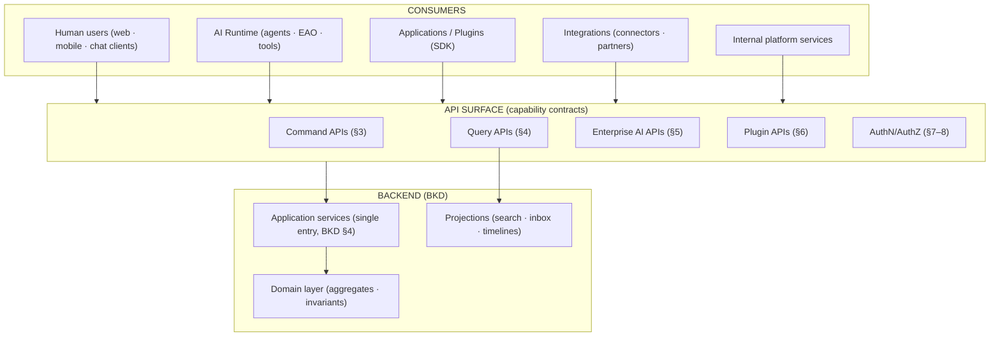

# Nexora — API Contract Specification

**Product:** Nexora — _Work. Orchestrated by AI._
**Document Type:** API Contract Specification (API)
**Version:** 1.0
**Owner:** Platform API Architecture
**Audience:** Backend, client engineering, AI runtime, plugin SDK, integrations, QA
**Related documents:** PRD v1.0 · PSD v1.0 · SAD v1.0 · DOMAIN_MODEL v1.0 · AIR v1.0 · BKD v1.0

---

## 0. Purpose & Consistency

### 0.1 Purpose

This document defines the **complete logical API surface** of Nexora — the business contracts exposed to human users, the AI Runtime, Applications, Plugins, internal services, and future integrations. It specifies **behavior**: purpose, actor, permissions, expected result, and events of every capability. It contains **no implementation code, no HTTP routes, no OpenAPI, and no JSON schemas**.

### 0.2 Consistency contract

| Anchor                                                   | Used here                                                                                  |
| -------------------------------------------------------- | ------------------------------------------------------------------------------------------ |
| BKD §4 (application services = single entry)             | Every API operation maps to an application service; the AI and the API are co-faces (§1.2) |
| BKD §8 (CQRS)                                            | §3 Commands vs §4 Queries — commands mutate aggregates; queries read projections           |
| DDD §1–3 (23 BCs), §6 (aggregates), §8 (events)          | API categories (§2), events mapping (§9)                                                   |
| AIR §2/§6/§12 (EAO, plan lifecycle, approvals)           | Enterprise AI APIs (§5)                                                                    |
| PSD §8 (EVT-_), §10 (PRM-_), AUD-*                       | Events (§9), authorization (§8), errors (§10)                                              |
| BKD §6/§7 (outbox, event layer), §15 (observability)     | §13 observability                                                                          |
| SAD AP-8 (API First), FR-38, AC-13 (versioned contracts) | Philosophy (§1), versioning (§12)                                                          |

---

## 1. API Philosophy

### 1.1 Capabilities, not database entities (reasoning)

Nexora's APIs are designed around **business capabilities** — the operations that carry business value — not around database tables or CRUD shapes. Five reasons:

| Reason                                              | Explanation                                                                                                                                                   |
| --------------------------------------------------- | ------------------------------------------------------------------------------------------------------------------------------------------------------------- |
| **The unit of value is orchestrated work** (PRD §1) | A `HireEmployee` capability spans several aggregates and emits several events; a CRUD "employees" resource could not express it without leaking orchestration |
| **Invariants live in aggregates** (DDD §6)          | Capability APIs invoke application services that load aggregate roots and enforce invariants (BR-*); entity-shaped CRUD would expose ways to violate them     |
| **One governance path** (BKD §4.2-2)                | The same capability is invoked by the UI, the AI (via agent skills), and event-triggered workflows — one contract, one authorization, one audit               |
| **Plugins and integrations** (FR-16, FR-39)         | A capability catalog is discoverable and versioned (AC-13); an entity schema is an implementation detail that would change when persistence changes           |
| **Evolution**                                       | Capabilities evolve semantically (add a step, change a rule) without breaking callers; entity schemas churn with implementation                               |

### 1.2 API consumer model

### 1.3 API principles (normative)

| #       | Principle                    | Meaning                                                                                                  |
| ------- | ---------------------------- | -------------------------------------------------------------------------------------------------------- |
| API-P1  | **API First**                | Every capability is reachable through a defined contract before it is surfaced anywhere (AP-8, FR-38)    |
| API-P2  | **Domain Driven**            | Operations are named in the ubiquitous language of the owning BC (DDD)                                   |
| API-P3  | **Resource Oriented**        | Capabilities act on named business resources (Project, Employee, Invoice) — but never expose persistence |
| API-P4  | **Command/Query Separation** | Commands mutate and return outcomes; queries read projections and never mutate (§8 BKD)                  |
| API-P5  | **Versioned**                | Every contract is versioned; additive changes are compatible; breaking changes are gated (AC-13, §12)    |
| API-P6  | **Secure**                   | Every call is authenticated, authorized at a single point (ADR-005), and audited                         |
| API-P7  | **Idempotent**               | Mutating commands accept idempotency keys; safe retries by construction (EVT-G1)                         |
| API-P8  | **Observable**               | Every call carries request/correlation/trace IDs and records its outcome (§13)                           |
| API-P9  | **Backward Compatible**      | Evolution is additive; callers never break without a deprecation window (§12)                            |
| API-P10 | **Multi Tenant**             | Company + Workspace context is mandatory on every call (AC-14)                                           |

---

## 2. API Categories

API categories map 1:1 to backend modules and DDD bounded contexts (BKD §3, DDD §1). A category is the contract surface of one module.

| Category                | Module (BKD §3)        | DDD BC | Primary consumers        | Capability examples                                          |
| ----------------------- | ---------------------- | ------ | ------------------------ | ------------------------------------------------------------ |
| **Identity APIs**       | Identity & Access      | DOM-02 | Users, clients, SCIM     | Provision user, grant membership, manage sessions            |
| **Organization APIs**   | Tenancy                | DOM-01 | Super/Enterprise admins  | Create organization, manage companies (multi-company groups) |
| **Workspace APIs**      | Tenancy                | DOM-01 | Company/Workspace admins | Provision workspace, enable app, archive                     |
| **Project APIs**        | Projects               | DOM-05 | PMs, members, AI         | Create project, assign resource, status, capacity            |
| **HR APIs**             | HR                     | DOM-04 | HR, employees, AI        | Hire, onboard, offboard, leave, org chart                    |
| **CRM APIs**            | CRM                    | DOM-06 | Sales, AI                | Manage accounts/deals, log activity, merge                   |
| **Finance APIs**        | Finance                | DOM-08 | Finance, AI              | Invoice, expense, budget, payment, close                     |
| **Inventory APIs**      | Inventory              | DOM-10 | Ops, AI                  | Stock, transfer, reorder, counts                             |
| **Sales APIs**          | Sales                  | DOM-07 | Sales, AI                | Quote, order, forecast                                       |
| **Procurement APIs**    | Procurement            | DOM-09 | Buyers, AI               | Requisition, PO, vendor, receipt, match                      |
| **Documents APIs**      | Documents              | DOM-11 | All members, AI          | Upload, version, approve, share, template                    |
| **Knowledge APIs**      | Knowledge              | DOM-12 | All members, AI          | Publish article, grounded search, answers                    |
| **Analytics APIs**      | Analytics              | DOM-13 | Analysts, executives, AI | KPI query, report, narration, schedule                       |
| **Calendar APIs**       | Calendar               | DOM-14 | All members, AI          | Book, availability, reschedule                               |
| **Workflow APIs**       | Workflow               | DOM-16 | Ops, AI, admin           | Define, run, control, escalate, history                      |
| **Approval APIs**       | AI Platform (Approval) | DOM-17 | All approvers, AI        | Request, decide, delegate, history                           |
| **Notification APIs**   | Notifications          | DOM-15 | All users                | Feed, inbox, preferences, batch                              |
| **Marketplace APIs**    | App Platform           | DOM-18 | Admins, publishers       | Catalog, install, subscribe                                  |
| **AI APIs**             | AI Platform            | DOM-17 | Clients, AI runtime      | Conversation, plan, explain, discover (§5)                   |
| **Administration APIs** | Administration         | DOM-19 | Admins, delegated admins | Admin commands, delegation, audit access                     |
| **Plugin APIs**         | App Platform           | DOM-18 | Plugin developers, SDK   | Register, validate, upgrade, remove (§6)                     |
| **Search APIs**         | Search                 | DOM-20 | All consumers            | Unified permission-filtered search                           |
| **Configuration APIs**  | Configuration          | DOM-21 | Admins, modules          | Read/update config (versioned, validated)                    |
| **Audit APIs**          | Audit                  | DOM-22 | Auditors, compliance     | Query, export, retention                                     |
| **Observability APIs**  | Observability          | DOM-23 | Ops, internal            | Timelines, metrics, health, SLOs                             |
| **Policy APIs**         | Policy                 | DOM-03 | Internal services (sync) | Authorize, guardrail evaluation, approval validation (§8)    |

---

## 3. Command APIs

Realizes: BKD §4 (application services), §8 (command side); DDD §6 (aggregates); PSD FR-*. Commands are the **only** operations that mutate business state. Each command: loads the owning aggregate, enforces invariants, publishes domain events via the outbox (same transaction, BKD §6.1-4), and returns the outcome. Every command accepts an **idempotency key** (API-P7). All commands require Company + Workspace context (API-P10) and are authorized by the Policy Engine _before_ invocation (PRM-8).

### 3.1 Platform & core commands

| Command                                             | Purpose                                                        | Actor                         | Permissions         | Expected result                                                     | Events generated                                                 |
| --------------------------------------------------- | -------------------------------------------------------------- | ----------------------------- | ------------------- | ------------------------------------------------------------------- | ---------------------------------------------------------------- |
| **CreateOrganization**                              | Create a multi-company group (CO-1)                            | Super Admin                   | Organization:create | Organization provisioned                                            | `CompanyProvisioned` (linked)                                    |
| **CreateCompany**                                   | Provision a tenant (FR-3)                                      | Super Admin                   | Company:create      | Company with default Workspace active                               | `CompanyProvisioned`                                             |
| **CreateWorkspace**                                 | Provision a scoping container (WS-R5)                          | Enterprise/Workspace Admin    | Workspace:create    | Workspace provisioned with type template                            | `WorkspaceProvisioned`                                           |
| **ArchiveWorkspace**                                | Archive a workspace (BR-3, WS-R5)                              | Enterprise Admin              | Workspace:archive   | Workspace archived after active-workflow check                      | `WorkspaceArchived`                                              |
| **EnableApp / DisableApp**                          | Enable/disable an App in a Workspace (EC-3)                    | Workspace Admin               | App:enable          | App enabled; registries unchanged until used                        | `AppEnabled` / `AppDisabled`                                     |
| **ProvisionUser**                                   | Create/activate a user (USR-R1)                                | Enterprise Admin / SCIM       | User:provision      | User active with memberships                                        | `UserProvisioned`                                                |
| **DeactivateUser**                                  | Revoke all access immediately (BR-4)                           | Enterprise Admin              | User:deactivate     | Access revoked incl. mid-workflow (EC-1)                            | `UserDeactivated`                                                |
| **GrantMembership**                                 | Grant role in a Workspace (PRM-1)                              | Workspace/Enterprise Admin    | Membership:grant    | Membership effective on next request (USR-R2)                       | `MembershipChanged`, `RoleChanged`                               |
| **InviteGuest**                                     | Issue time-boxed read-only access (BR-8)                       | Admin                         | Guest:invite        | Guest with scoped expiry                                            | `UserProvisioned` (guest)                                        |
| **GrantRole / RevokeRole**                          | Change role definitions/assignments (PRM-10)                   | Admin                         | Role:manage         | Effective next request; audit recorded                              | `RoleChanged`                                                    |
| **UpdatePolicyRule**                                | Create/change a policy or approval chain (FR-20)               | Enterprise/Delegated Admin    | Policy:manage       | Rule versioned; caches invalidated (AIR §13.3)                      | `PolicyChanged`                                                  |
| **DefineWorkflow**                                  | Version a workflow template (FR-23)                            | Workspace/Enterprise Admin    | Workflow:define     | Template versioned; approval-logic change flagged for review (R-25) | `WorkflowDefinitionPublished`                                    |
| **StartWorkflow**                                   | Start a run from template or AI plan (WRK-15)                  | Member (with plan approval)   | Workflow:run        | Run journaled; triggers honored                                     | `WorkflowStarted`                                                |
| **PauseWorkflow / ResumeWorkflow / CancelWorkflow** | Control a run (FR-25)                                          | Run owner / Admin             | Workflow:control    | Run state transitions; audited                                      | `WorkflowPaused/Resumed/Cancelled`                               |
| **ExecuteWorkflow**                                 | Execute a plan end-to-end (WRK-15; the AI's primary entry)     | EAO (delegated envelope)      | Plan:execute        | Plan committed; steps dispatched                                    | `OrchestrationPlanApproved`, `WorkflowStarted`, `AgentExecuted`* |
| **CompleteHumanTask**                               | Complete a Work-Inbox task (FR-24)                             | Assignee                      | Task:complete       | Task done; workflow continues                                       | `TaskCompleted`                                                  |
| **Approve / RejectApproval**                        | Decide an ApprovalRequest (AIR §12; first-decision-wins, EC-8) | Authorized approver (L6, SoD) | Approval:decide     | Decision recorded; superseded preserved; workflow resumes           | `ApprovalGranted` / `ApprovalRejected`                           |
| **DelegateApproval**                                | Delegate an approval (AIR §12)                                 | Approver                      | Approval:delegate   | Delegation recorded and audited                                     | `ApprovalTaskCreated`                                            |
| **SendNotification**                                | Deliver a notification/inbox item (FR-27)                      | System/Approval Engine        | Notification:send   | Preference-aware delivery                                           | `NotificationSent`                                               |
| **UpdateConfiguration**                             | Change a scoped config (R-35)                                  | Admin                         | Config:update       | Versioned; safety invariants validated at write                     | `ConfigChanged`                                                  |
| **InstallPlugin**                                   | Install an App for a Company (FR-14/15)                        | Enterprise Admin              | App:install         | Validated + registered; registries updated                          | `PluginInstalled`, `AgentRegistered`                             |
| **UpgradePlugin**                                   | Upgrade an App version (FR-17)                                 | Enterprise Admin              | App:upgrade         | New version active; rollback retained                               | `PluginUpgraded`                                                 |
| **RemovePlugin**                                    | Uninstall an App (PSD §5.5)                                    | Enterprise Admin              | App:remove          | Export-confirmed, quarantined, unregistered                         | `PluginRemoved`                                                  |
| **RegisterAgent**                                   | Register a plugin's agent (AIR §5)                             | App Platform (system)         | App:register        | Agent discoverable via registry                                     | `AgentRegistered`                                                |

_`AgentExecuted` is emitted per verified skill invocation (AUD-1)._

### 3.2 Application (domain) commands

| Command                             | Purpose                                            | Actor                    | Permissions             | Expected result                              | Events generated                                |
| ----------------------------------- | -------------------------------------------------- | ------------------------ | ----------------------- | -------------------------------------------- | ----------------------------------------------- |
| **HireEmployee**                    | Create employee + offer (WRK-1)                    | HR/Recruiter + approvers | HR:hire                 | Employee active; offer issued (4-eyes gated) | `EmployeeCreated`, `EmployeeOnboarded`          |
| **ApproveLeave**                    | Approve a leave request (WRK-10)                   | Manager                  | HR:leave-approve        | Balance checked; approved/rejected           | `LeaveApproved` / `LeaveRejected`               |
| **CreateProject**                   | Create a project with owner (WRK-4, BR-2)          | Member/PM                | Project:create          | Project active with owner, milestones        | `ProjectCreated`                                |
| **AssignEmployee** (AssignResource) | Allocate a person to a project (WRK-1)             | PM/Resource Manager      | Project:assign          | Assignment with capacity check               | `ResourceAssigned`, `CapacityConflictDetected`* |
| **UpdateProjectStatus**             | Move project status (BR-2 lifecycle)               | PM                       | Project:update          | Status transition guarded                    | `ProjectStatusChanged`                          |
| **CreateCustomer**                  | Create an account (WRK-5)                          | Sales Admin/Rep          | CRM:create              | Account with duplicate check (EC-7)          | `CustomerAdded`                                 |
| **UpdateDealStage**                 | Move a deal (WRK-11)                               | Owner                    | CRM:deal-update         | Stage transition; Won/Lost exclusivity       | `DealStageChanged`, `DealWon`*                  |
| **MergeDuplicates**                 | Merge duplicate records (EC-7)                     | Account Owner/Admin      | CRM:merge               | Merge applied with approval if Consequential | `CustomerMerged`                                |
| **CreateQuote / ConvertToOrder**    | Quote and order (WRK-11)                           | Sales Rep/Manager        | Sales:quote/order       | Quote → order with discount policy           | `QuoteCreated`, `OrderCreated`                  |
| **GenerateInvoice**                 | Create an invoice from verified data (WRK-7, BR-5) | Finance Preparer         | Finance:invoice-create  | Invoice referencing customer                 | `InvoiceGenerated`                              |
| **ApproveExpense**                  | Approve an expense (WRK-9)                         | Manager/Finance Approver | Finance:expense-approve | Approved within policy                       | `ExpenseApproved` / `ExpenseRejected`           |
| **SchedulePayment**                 | Schedule a payment (Consequential)                 | Finance Approver         | Finance:payment         | Payment queued after approval                | `PaymentScheduled`                              |
| **CreateRequisition**               | Submit a requisition (WRK-6)                       | Any Member               | Procurement:request     | Requisition with budget check                | `RequisitionCreated`                            |
| **CreatePurchaseOrder**             | Issue a PO (WRK-6, BR-6)                           | Buyer                    | Procurement:po-create   | PO referencing approved requisition          | `PurchaseOrderCreated`, `PurchaseApproved`      |
| **RecordReceipt**                   | Record goods received (WRK-6)                      | Buyer/Warehouse          | Procurement:receipt     | Receipt recorded; stock intent updated       | `ReceiptRecorded`                               |
| **AdjustStock**                     | Change stock levels (BR-11)                        | Warehouse Operator       | Inventory:adjust        | Negative adjustments gated                   | `StockAdjusted`                                 |
| **CreateTransfer**                  | Move stock between locations                       | Warehouse Operator       | Inventory:transfer      | Transfer conserved quantities                | `TransferCreated`, `TransferCompleted`          |
| **ProposeReorder**                  | Raise a reorder proposal (WRK-12)                  | Inventory Agent (system) | Inventory:reorder       | Proposal routed to procurement               | `ReorderProposed`                               |
| **UploadDocument**                  | Add a document (WRK-8)                             | Member                   | Documents:upload        | Document with version 1                      | `DocumentUploaded`                              |
| **ApproveDocument**                 | Approve a document version (BR-12)                 | Reviewer                 | Documents:approve       | Version becomes authoritative                | `DocumentApproved`                              |
| **PublishArticle**                  | Publish a knowledge article                        | KB Editor/Reviewer       | Knowledge:publish       | Article published; indexed                   | `KnowledgeUpdated`, `ArticlePublished`          |
| **BookMeeting**                     | Book a calendar event (AIR §11)                    | Member                   | Calendar:book           | Event booked; external sends gated           | `EventCreated`, `MeetingBooked`                 |
| **GenerateReport**                  | Create/schedule a report (WRK-14)                  | Analytics Creator        | Analytics:report        | Report with traceable metrics                | `ReportGenerated`                               |

_`CapacityConflictDetected` and `DealWon` are emitted conditionally on conflict/outcome._

**Command contract rules (reasoning):** (1) A command returns an **outcome** (result reference + events emitted), not a projection — callers never read back state through the command (CQRS, BKD §8). (2) Commands are **idempotent by key**: retrying a completed command returns the original outcome without duplicate effect (EVT-G1). (3) Consequential commands carry **approval preconditions** checked by the Approval Engine before execution (BR-13) — the API does not bypass gates. (4) Every command is **audited** with actor, reason, before/after, and result (AUD-1).

---

## 4. Query APIs

Realizes: BKD §8.2 (query side — projections); PSD FR-30; BR-7 (filtering); OBS-*. Queries **never mutate** (CQRS). They read projections (search index, knowledge index, inbox, timelines, analytics views, registries) that are eventually consistent and rebuildable from events (EVT-G3). All queries are **permission-filtered at query time** by the same Policy Engine (BR-7, PRM-7).

| Query                                     | Purpose                                         | Reads from                        | Permissions                           | Notes (pagination/streaming per §11)             |
| ----------------------------------------- | ----------------------------------------------- | --------------------------------- | ------------------------------------- | ------------------------------------------------ |
| **GetWorkspace / ListWorkspaces**         | Workspace state and scopes                      | Tenancy (current state)           | Workspace:read                        | Cursor pagination for lists                      |
| **SearchEmployees**                       | Find people across HR + identity                | HR/identity projections           | HR:read (scoped)                      | Unified search; filters: dept, status, workspace |
| **FindProjects**                          | Project discovery                               | Projects projection + search      | Project:read                          | Filters: owner, status, portfolio                |
| **GetDashboard**                          | User's home summary (tasks, approvals, updates) | Work Inbox + timeline projections | Member (own)                          | Aggregated read; freshness SLA                   |
| **GetProject / GetEmployee / GetInvoice** | Single-record reads by ID                       | Module projection                 | Record:read (scoped)                  | Strong consistency not required; version-aware   |
| **KnowledgeSearch**                       | Grounded answers with citations (WRK-13)        | Knowledge index                   | Knowledge:read (BR-7-filtered)        | Citation + version in every result               |
| **WorkflowHistory**                       | Run history and status (OBS-4)                  | Workflow journal projections      | Workflow:read (scoped)                | Cursor pagination; filters by status/template    |
| **ActivityTimeline**                      | User-centric feed (OBS-2)                       | Audit/event projections           | User (own) / manager (scoped)         | Time-based cursor pagination                     |
| **NotificationFeed**                      | Inbox + notifications (FR-29)                   | Inbox projection                  | User (own)                            | Actionable items inline (FR-28)                  |
| **ApprovalQueue**                         | Pending approvals for the user                  | Approval + inbox projections      | Approval:view                         | Batch actions supported                          |
| **AnalyticsQuery**                        | KPI/report/narration queries (APP-09)           | Analytics views                   | Analytics:read                        | Every number traceable to definition             |
| **SearchCapabilities**                    | What the AI can do (discovery preview)          | Registry projection               | Capability:read (permission-filtered) | Same filter as Planner (AIR §5)                  |
| **GetAgentStatus**                        | Agent health/state (AIR §16)                    | Monitoring projection             | Ops/Admin                             | Liveness + state + health score                  |
| **GetAuditLog**                           | Audit queries and exports (FR-34)               | Audit store (authoritative)       | Auditor / Admin (AUD-8)               | Export via dedicated capability                  |
| **GetConfiguration**                      | Effective config with provenance                | Configuration module              | Config:read                           | Resolved hierarchy + level provenance            |
| **ListPlugins / GetCatalog**              | Marketplace catalog                             | Catalog projection                | Catalog:read                          | Filters: category, publisher, version            |
| **ExplainDecision**                       | Explanation of an AI decision (FR-36)           | AiDecision records                | User/Admin/Auditor (scoped)           | Rendered from decision-time records (ADR-011)    |
| **SearchAll**                             | Unified cross-App search (FR-30)                | Search index                      | Per-resource read scopes              | Permission-filtered per result type              |

**Query contract rules (reasoning):** (1) Queries return **read models** (projections), never internal state — callers are insulated from persistence (BKD §8.2). (2) Permission filtering is applied **at query time**, so revocation is immediate (USR-R2, ADR-007). (3) Queries are **cached aggressively** with event-driven invalidation (BKD §6); staleness is disclosed via freshness metadata where it matters (knowledge, §9 AIR). (4) Long-running or streaming reads (conversation, report generation) use the streaming contract (§11.6).

---

## 5. Enterprise AI APIs

Realizes: AIR §1–2, §5–6, §12; WRK-15. These are the contracts by which clients and the AI Runtime itself interact with the intelligence layer. They expose the orchestration pipeline (AIR §1.4) as business contracts; the runtime's internal component calls are _implementation_, not API.

| AI API                                         | Purpose                                                       | Actor                    | Permissions      | Expected result                                    | Events                               |
| ---------------------------------------------- | ------------------------------------------------------------- | ------------------------ | ---------------- | -------------------------------------------------- | ------------------------------------ |
| **CreateConversation**                         | Open a scoped conversation session (FR-7)                     | Any Member               | AI:converse      | Session bound to Workspace                         | `ConversationCreated`                |
| **SendMessage**                                | Submit an utterance; receive the response with sources (FR-6) | Member                   | AI:converse      | Grounded response + plan preview where applicable  | `OrchestrationPlanProposed`*         |
| **RequestClarification / AnswerClarification** | The clarify loop (FR-5)                                       | Member                   | AI:converse      | Intent resolved or abandoned to manual mode (ER-1) | —                                    |
| **ProposePlan**                                | Ask for a plan without executing (AIX-3)                      | Member                   | AI:plan          | Validated plan + permission check                  | `OrchestrationPlanProposed`          |
| **ApprovePlan**                                | Approve a presented plan (Confirm tier)                       | Member                   | AI:plan-approve  | Plan committed for execution                       | `OrchestrationPlanApproved`          |
| **ExecutePlan**                                | Run an approved plan (WRK-15)                                 | EAO (delegated envelope) | Plan:execute     | Tasks dispatched; run journaled                    | `WorkflowStarted`, `AgentExecuted`   |
| **GetPlanStatus**                              | Watch a plan/run (OBS-4)                                      | Invoker/owner            | Plan:read        | Live progress + gates                              | —                                    |
| **ExplainDecision**                            | Get the ten-element explanation (AIR §14)                     | Invoker/Admin/Auditor    | Explain:read     | Decision-time record rendered                      | —                                    |
| **VerifyResult**                               | Request re-verification of an action (AI-6)                   | Invoker/owner            | AI:verify        | Verified/unverified classification                 | `AgentExecuted` (verified)           |
| **QueryCapabilities**                          | Discover capabilities (AIR §5)                                | Member/AI                | Capability:read  | Permission-filtered catalog                        | —                                    |
| **GroundedSearch**                             | Access-filtered retrieval with citations (BR-7)               | Member/AI                | Knowledge:read   | Cited passages + versions                          | —                                    |
| **RequestApproval**                            | Create an ApprovalRequest (AIR §12)                           | EAO (system)             | Approval:request | Request routed to approvers                        | `ApprovalRequested`                  |
| **DecideApproval**                             | Grant/reject with reason (first-decision-wins)                | Authorized approver      | Approval:decide  | Decision recorded; superseded preserved (EC-8)     | `ApprovalGranted`/`ApprovalRejected` |
| **GetAgentStatus**                             | Agent health and runtime state (AIR §4)                       | Ops/Admin                | Agent:read       | Two-plane state + health score                     | —                                    |
| **SubmitFeedback**                             | Rate an outcome / correct the agent (AI-9, v1.1)              | Member                   | AI:feedback      | Feedback recorded; feeds eval loop                 | `FeedbackRecorded`                   |

*`OrchestrationPlanProposed` is emitted when a message yields a plan.

**AI API rules (reasoning):** (1) The conversational surface is a thin adapter over the same application services (BKD §4) — the AI has no privileged back door (ADR-001). (2) All AI-API results carry **sources and explanation links** (FR-6, AIX-17). (3) Consequential actions reached through AI APIs always pass the Approval Engine — never implicit (BR-13). (4) The AI APIs are **human-observable**: every invocation appears on the AI Timeline (OBS-3) and in audit (AUD-4).

---

## 6. Plugin APIs

Realizes: PSD §5/§7 (App Contract, Plugin SDK); BKD §10 (Plugin Runtime); ADR-003/012; FR-14…17/39. Plugin APIs are the contracts of the **Plugin SDK**: how a plugin declares, registers, installs, and interoperates — identical for first-party modules and third-party plugins (dogfooding, BKD §10.1).

| Plugin API               | Purpose                                            | Actor                    | Permissions     | Expected result                                         | Events                                    |
| ------------------------ | -------------------------------------------------- | ------------------------ | --------------- | ------------------------------------------------------- | ----------------------------------------- |
| **SubmitManifest**       | Declare a plugin's contract (PSD §5.3)             | Plugin publisher         | App:publish     | Manifest accepted for validation                        | `PluginSubmitted`                         |
| **ValidatePlugin**       | Run validation gates (SAD §7.12)                   | App Platform (system)    | App:validate    | Validation report (permissions, side effects, security) | `PluginValidated`                         |
| **PublishPlugin**        | List a validated plugin in the catalog             | Publisher                | App:publish     | Catalog entry versioned                                 | `PluginPublished`                         |
| **DiscoverCapabilities** | Query the registry projection (AIR §5)             | Any authorized caller    | Capability:read | Permission-filtered catalog                             | —                                         |
| **RegisterCapabilities** | Registration fan-out (DDD §2.3)                    | App Platform (system)    | App:register    | Capability/agent/tool/event/knowledge records written   | `AgentRegistered`, `CapabilityRegistered` |
| **InstallPlugin**        | Install for a Company after admin approval (FR-15) | Enterprise Admin         | App:install     | Validated + registered; Workspaces can enable           | `PluginInstalled`                         |
| **EnablePlugin**         | Enable per Workspace (WS-R*)                       | Workspace Admin          | App:enable      | App usable in that Workspace                            | `AppEnabled`                              |
| **UpgradePlugin**        | Version upgrade with preview + rollback (FR-17)    | Enterprise Admin         | App:upgrade     | New registrations active; rollback retained             | `PluginUpgraded`                          |
| **RemovePlugin**         | Uninstall with export confirmation (PSD §5.5)      | Enterprise Admin         | App:remove      | Quarantined, unregistered, audited                      | `PluginRemoved`                           |
| **QueryPluginHealth**    | Health/state of an App instance                    | Ops/Admin                | App:health      | Two-plane state + quotas                                | —                                         |
| **CallSkill**            | Invoke a registered skill (via Tool Runtime)       | EAO (delegated envelope) | Skill:use       | Verified result or gate                                 | `AgentExecuted`                           |
| **EmitEvent**            | Publish a plugin's domain event                    | Plugin runtime (system)  | App:emit-event  | Event delivered per EVT-G*                              | (the emitted event)                       |

### 6.1 Plugin contract rules (reasoning)

1. **Manifest is the contract** — the platform only reads manifests; validation gates reject non-conforming or over-permissioned plugins (ADR-003, SAD §7.12).
2. **Registration is fan-out, not integration** — the plugin writes nothing to platform stores; it registers records and interoperates by events + skills (AC-15, DDD §2.3).
3. **Isolation is enforced, not requested** — sandbox, quotas, and the Storage Contract are platform guarantees (BKD §10.2); no plugin API can opt out.
4. **Dogfooding** — first-party Apps use the same Plugin APIs, keeping the contract honest (PRD P5).

---

## 7. Authentication APIs

Realizes: PSD §9 (USR-_, USR-R_); FR-18; SAD §13.1; BKD §12. Behavior-level contracts — no tokens-by-wire detail here; the _semantics_ are normative.

| API                       | Purpose                                           | Behavior                                                                             | Permissions         | Result                                      |
| ------------------------- | ------------------------------------------------- | ------------------------------------------------------------------------------------ | ------------------- | ------------------------------------------- |
| **Authenticate**          | Primary sign-in (SSO or credentials)              | Initiates SSO flow (SAML/OIDC) or validates credentials; enforces MFA policy (FR-18) | None (public)       | Session established or MFA challenge issued |
| **CreateSession**         | Establish an authenticated session                | Session bound to User + Company + active Workspaces (USR-R2); short TTL              | Authenticated       | Session with scoped claims                  |
| **IssueToken**            | Issue scoped credentials for clients/integrations | Token carries identity + scopes; least privilege; expiry                             | Authenticated       | Scoped token                                |
| **RefreshSession**        | Extend a session                                  | Re-validates identity and permissions fresh (USR-R2); no blind renewal               | Active session      | Renewed session                             |
| **Logout**                | Terminate a session/token                         | Immediate revocation (BR-4); revokes dependent tokens                                | Session holder      | Session invalidated                         |
| **ResetPassword**         | Self-service recovery                             | Verified identity → reset; audit + notification (security)                           | Identity-verified   | Password reset applied                      |
| **EnrollMfa / VerifyMfa** | MFA enrollment and challenges                     | Enrollment recorded; challenges enforced per policy (FR-18)                          | Authenticated       | MFA factor active / verified                |
| **InitiateSso**           | Begin SSO (SAML/OIDC) with IdP                    | Discovery of configured IdP; redirect semantics                                      | Public              | IdP redirect / assertion handling           |
| **ProvisionScim**         | SCIM provisioning of users/groups (FR-18)         | Creates/updates/deactivates identities (USR-R1)                                      | SCIM token (scoped) | Identity changes applied + events           |

### 7.1 Authentication rules (reasoning)

1. **Sessions are short-lived; authority is revalidated per request** (USR-R2) — permission changes and deactivations take effect immediately (BR-4).
2. **Least-privilege tokens** — integrations get scoped tokens (Company + specific capabilities), never blanket access (PRM-4).
3. **SSO-ready by default** — SAML/OIDC and SCIM are first-class (FR-18); MFA is policy-enforced, not optional.
4. **All auth events are audited** — sign-ins, failures, resets, and revocations (AUD-1).

---

## 8. Authorization

Realizes: PSD §10 (PRM-1…10), DDD §13; SAD §5.12 (Policy Engine — single evaluation point, ADR-005); BKD §12. Authorization APIs are the **synchronous Policy Engine contracts** — the only place permission decisions are made. Every other API and every tool call consults them (PRM-8).

| API                       | Purpose                                          | Evaluates                                        | Behavior                                                   | Result                                |
| ------------------------- | ------------------------------------------------ | ------------------------------------------------ | ---------------------------------------------------------- | ------------------------------------- |
| **EvaluatePermission**    | Can this actor do this action on this resource?  | 6-level model (L1…L5) with deny-wins (PRM-2/3)   | Fresh evaluation per request; decision logged (AUD-3)      | allow/deny + applicable grants/denies |
| **EvaluatePolicy**        | Guardrail check (AI actions, BR-14)              | Tenant policies + prohibited actions             | Refusal with explanation for AI callers (BR-14)            | allow/refuse + policy refs            |
| **ValidateApproval**      | May this actor authorize this action? (L6, SoD)  | Approval chains + value tiers (PRM-6, FR-21)     | Self-approval routed to backup (EC-10); never auto-granted | authorized / routed / denied          |
| **ResolveWorkspaceScope** | Effective data scope for an actor in a Workspace | Workspace + team + record scoping (PRM-7, WS-R*) | Returns applicable scope (own/team/workspace/company)      | scope + conditions                    |
| **ResolveCompanyScope**   | Company-level authority                          | Company roles + grants                           | Returns company-level effective roles                      | roles + expiry                        |
| **CheckContext**          | Validate the context contract (AC-14)            | Company/Workspace context vs. caller claims      | Rejects context-less or mismatched calls                   | valid / invalid                       |

### 8.1 Authorization rules (reasoning)

1. **Single decision point** — no module, tool, or agent re-implements authorization (ADR-005); the Policy Engine's decisions are the only authority.
2. **Evaluated fresh** — no cached authority for Consequential actions; permission changes take effect on the next request (USR-R2, PRM-5).
3. **Decisions are audited** — every evaluation is a DecisionLog record (AUD-3), the substrate of the Policy Timeline (AIR §16).
4. **Explicit deny wins at every level** (PRM-3) — including for AI callers (delegated envelope, PRM-8).

---

## 9. Events

Realizes: PSD §8 (EVT-*), DDD §8, BKD §7. Events are the **outcome** of commands and the **trigger** of workflows — never a request/response channel (ADR-002, trigger-not-action). Every event conforms to the envelope (companyId, workspaceId, correlationId, traceId — PSD §8.2) and guarantees (EVT-G1…G6).

### 9.1 API → event mapping (summary)

| API group                       | Typical events generated                                                                                                             |
| ------------------------------- | ------------------------------------------------------------------------------------------------------------------------------------ |
| Identity/Org/Workspace commands | `CompanyProvisioned`, `WorkspaceProvisioned`, `UserProvisioned`, `UserDeactivated`, `RoleChanged`, `MembershipChanged`               |
| App/Plugin commands             | `PluginInstalled`, `PluginUpgraded`, `PluginRemoved`, `AppEnabled`, `AgentRegistered`, `CapabilityRegistered`                        |
| HR commands                     | `EmployeeCreated`, `EmployeeOnboarded`, `EmployeeOffboarded`, `LeaveApproved`, `LeaveRejected`                                       |
| Project commands                | `ProjectCreated`, `ProjectUpdated`, `ResourceAssigned`, `TaskCompleted`, `MilestoneReached`, `CapacityConflictDetected`              |
| CRM commands                    | `CustomerAdded`, `ContactCreated`, `DealStageChanged`, `DealWon`, `DealLost`, `CustomerMerged`                                       |
| Sales commands                  | `QuoteCreated`, `QuoteApproved`, `OrderCreated`, `OrderFulfilled`                                                                    |
| Finance commands                | `InvoiceGenerated`, `InvoiceApproved`, `InvoicePaid`, `ExpenseApproved`, `PaymentScheduled`, `BudgetExceeded`                        |
| Procurement commands            | `RequisitionCreated`, `RequisitionApproved`, `PurchaseOrderCreated`, `PurchaseApproved`, `ReceiptRecorded`, `MatchExceptionDetected` |
| Inventory commands              | `StockAdjusted`, `TransferCompleted`, `ReorderProposed`, `StockoutDetected`                                                          |
| Documents commands              | `DocumentUploaded`, `DocumentApproved`, `DocumentRejected`, `DocumentShared`                                                         |
| Knowledge commands              | `KnowledgeUpdated`, `ArticlePublished`, `AnswerGenerated`                                                                            |
| Calendar commands               | `EventCreated`, `EventRescheduled`, `MeetingBooked`                                                                                  |
| Workflow commands               | `WorkflowStarted`, `WorkflowPaused`, `WorkflowCompleted`, `WorkflowFailed`                                                           |
| Approval APIs                   | `ApprovalRequested`, `ApprovalGranted`, `ApprovalRejected`, `ApprovalTaskCreated`                                                    |
| AI APIs                         | `ConversationCreated`, `OrchestrationPlanProposed`, `OrchestrationPlanApproved`, `AgentExecuted`, `AiAnomalyDetected`                |
| Notifications                   | `NotificationSent`, `NotificationRead`                                                                                               |

### 9.2 Event contract rules

1. **Events are facts about the past** — a command's event stream is the authoritative record of what happened (ADR-011).
2. **Queries and authentication generate no domain events** — they generate audit records and telemetry only.
3. **Correlation:** every event of a workflow/conversation shares `correlationId`; every API call's `requestId` joins to it (§13) — full reconstructability (AG-7).
4. **Consumers are idempotent** and ordering is per-subject (EVT-G1/G2); DLQ + replay keep the stream trustworthy (BKD §7).
5. **Event schemas are versioned** (AC-13, EVT-G4) — the same evolution rules as APIs (§12).

---

## 10. Errors

Realizes: PSD §14 (ER-1…8), AIR §2.6, BKD §14. Nexora uses a **standard enterprise error model**: every failure is a typed, stable, actionable error — never a leak of internals, never silent.

### 10.1 Error taxonomy

| Error class                            | Meaning                                     | Retryable?                     | Examples                                                                               | Source         |
| -------------------------------------- | ------------------------------------------- | ------------------------------ | -------------------------------------------------------------------------------------- | -------------- |
| **Validation**                         | Input violates the contract or domain rules | No (fix input)                 | Missing required field; invalid status transition (BR-*)                               | ER-1/7         |
| **Authorization**                      | Caller lacks permission                     | No (unless permission changes) | Permission denied; context mismatch (AC-14)                                            | PRM-*, EC-1    |
| **Business rules**                     | Domain invariant prevented the action       | No (fix state)                 | Invoice without customer (BR-5); project without owner (BR-2); budget exceeded (BR-10) | DDD §6         |
| **Policy violations**                  | Guardrail/prohibited action (incl. AI)      | No                             | Prohibited action refused with explanation (BR-14)                                     | AIR §13        |
| **AI errors**                          | Intent, verification, or refusal            | Mixed                          | Intent not understood (ER-1); unverified outcome (ER-3); grounding absent (AC-7)       | AIR §7         |
| **Workflow errors**                    | Run-time execution failure                  | Mixed                          | Step failure (ER-2); agent unavailable (ER-4/5); unrecoverable (ER-8)                  | BKD §14        |
| **Plugin errors**                      | App runtime failure                         | Mixed                          | Sandbox violation; quota exceeded; uninstall conflict (EC-3)                           | BKD §10        |
| **NotFound / Conflict / Concurrency**  | Resource state mismatches                   | No (re-query)                  | Record missing; first-decision-wins superseded (EC-8); optimistic-lock conflict (EC-9) | EC-8/9         |
| **Timeout / Rate limit / Unavailable** | Platform protective responses               | Yes (with backoff)             | Budget exhausted (NFR-14); circuit open (BKD §14); DLQ'd event                         | NFR-13/14      |
| **Idempotency conflict**               | Same key, different payload                 | No                             | Replay with mismatched inputs rejected                                                 | API-P7, EVT-G1 |

### 10.2 Error envelope (behavioral fields)

Every error carries: a **stable code** (never free text); a **human message** and **actionable hint**; the **requestId / traceId / correlationId** (join to logs and timelines); a **retryable flag**; the **source layer** (API / domain / AI / plugin / integration); and **references** to the affected record, plan, or approval — all without leaking internals or tenant-crossing data.

### 10.3 Error rules (reasoning)

1. **Stable codes over text** — clients can branch on codes; messages are for humans; codes survive versioning (additive only).
2. **Actionable** — every error tells the caller what to do next (fix input, request access, retry after X, approve, or escalate).
3. **AI errors are explained** — refusals and verification failures include their reasons and sources (AIX-17, BR-14).
4. **Never leak** — stack traces, secrets, and cross-tenant data never appear in errors (AC-1, NFR-5).
5. **Fail-safe defaults** — timeout/rate-limit errors are retryable with guidance; authorization errors never bypass to allow (fail closed, BKD §12.1).

---

## 11. Pagination, Filtering, Sorting, Search, Streaming

Realizes: BKD §8 (projections), §13 (performance); FR-30; NFR-1/2. These read-semantics apply to all Query APIs and searchable command responses.

| Concern                | Contract                                                                                                                                                        | Reasoning                                                                                                               |
| ---------------------- | --------------------------------------------------------------------------------------------------------------------------------------------------------------- | ----------------------------------------------------------------------------------------------------------------------- |
| **Cursor pagination**  | Opaque cursor tokens; stable sort key included in the cursor; forward/backward navigation                                                                       | Scales to any list size; stable under inserts (BKD §13); opaque = no implementation coupling                            |
| **Offset pagination**  | Allowed only on admin/backoffice lists with explicit size caps                                                                                                  | Acceptable for small, admin-scoped lists; never on tenant-facing hot lists                                              |
| **Filtering**          | Typed field filters over declared filterable fields only                                                                                                        | Bounded filter surface keeps projections indexable (BKD §6) and safe                                                    |
| **Sorting**            | Sort only over declared sortable fields; single + multi-field with stable tie-breakers                                                                          | Guarantees cursor stability and index support                                                                           |
| **Unified search**     | `SearchAll`/`SearchEmployees` style queries over the Search projection with per-result-type permission filtering (BR-7, FR-30)                                  | One index, query-time authorization (ADR-007)                                                                           |
| **Streaming**          | Conversational responses stream progress (FR-4, NFR-1); long operations (report generation, plan execution) stream incremental status with final result + links | Perceived latency budget (NFR-1); users see progress without polling; final payload always includes sources/explanation |
| **Freshness metadata** | Projection reads disclose staleness where it matters (knowledge, analytics)                                                                                     | Eventual consistency is honest and observable (BKD §8.3)                                                                |

### 11.1 Read-semantic rules

1. **Queries are reproducible** — the same query + cursor yields a consistent window; mutations between pages are permitted but disclosed.
2. **Result limits are universal** — every list has a maximum page size; larger needs use search or export capabilities.
3. **Streaming never hides the final state** — a streamed operation always terminates with the complete outcome (result refs + events), never a dangling partial.
4. **Filters never bypass permissions** — filtering and search apply the same query-time authorization (BR-7, PRM-7).

---

## 12. Versioning Strategy

Realizes: AC-13 (versioned contracts), EVT-G4 (event versioning), BKD §10.3 (plugin versions), PRD FR-17. The API surface, event schemas, and plugin contracts follow **one versioning philosophy**: additive evolution within a version, gated breaking changes across versions.

### 12.1 Versioning model

| Surface                  | Versioning                                    | Compatible change                                                                | Breaking change                                                                                     |
| ------------------------ | --------------------------------------------- | -------------------------------------------------------------------------------- | --------------------------------------------------------------------------------------------------- |
| **API capabilities**     | Semantic-style major.minor per contract group | Add a command/query, add optional input, widen a value set, add an outcome field | Remove/rename a capability, change required inputs, change outcome semantics, tighten authorization |
| **Event schemas**        | Versioned per event type (EVT-G4)             | Add optional fields, widen enums                                                 | Remove/rename fields, change semantics → new event type + deprecation window                        |
| **Plugin/App contracts** | Semantic; major = re-approval (FR-17)         | Add skills/tools/events                                                          | Change skill schemas, permission requirements, event contracts                                      |
| **Skill schemas**        | Versioned per skill (AC-13)                   | Add optional inputs, widen outputs                                               | Change required inputs/outputs → new major skill version                                            |

### 12.2 Evolution rules (reasoning)

| Rule                    | Behavior                                                                                                                                                                         |
| ----------------------- | -------------------------------------------------------------------------------------------------------------------------------------------------------------------------------- |
| **Additive first**      | New capabilities, fields, and events ship within the current major; callers are never required to change (API-P9)                                                                |
| **Deprecation windows** | A deprecated capability is announced, remains functional for a defined window (with `Deprecated` signal in metadata), then removed per a published sunset policy (EVT-G4 analog) |
| **Dual-run**            | During a major transition, old and new major versions run in parallel; migration tooling maps between them                                                                       |
| **Semantic honesty**    | Renames/removals are always breaking — never disguised as minor changes                                                                                                          |
| **Contract governance** | The frozen App Contract (ADR-003) and platform contracts change only via the versioned cadence with developer-preview tier (SAD §7.10)                                           |
| **Compatibility tests** | A compatibility suite runs on every release: old callers against new implementations must pass                                                                                   |

**Reasoning:** the multi-consumer surface (users, AI, plugins, integrations — §1.2) means a breaking change is expensive; additive-first with gated breaking changes keeps the platform extensible (FR-16) without a breaking-change treadmill (SAD §7.10, §18).

---

## 13. Observability

Realizes: BKD §15, AIR §16, NFR-15, AUD-*, PSD §16. Every API call is observable end-to-end: identified, traced, audited, and measured.

| Concern             | Contract                                                                                                                                        |
| ------------------- | ----------------------------------------------------------------------------------------------------------------------------------------------- |
| **Request IDs**     | Every call carries a unique `requestId` (client-supplied or issued); echoed in responses and errors; join key into logs                         |
| **Correlation IDs** | `correlationId` joins a call to its conversation/workflow; all events of that work share it (PSD §8.2)                                          |
| **Tracing**         | `traceId` per logical operation spans API → application service → domain → events → AI calls (NFR-15); a single user request is reconstructable |
| **Audit**           | Every command is audited (AUD-1); AI calls record plan/prompt/sources (AUD-4); queries log access where policy requires                         |
| **Latency**         | Per-API-class latency budgets (NFR-1/2): conversational streaming excludes perceived latency; queries meet read SLOs; commands meet action SLOs |
| **Metrics**         | Per capability: rate, errors (by ERR class), duration; guardrail metrics (PRD §18.3); automation value (PRD §18.1)                              |
| **Timelines**       | AI/Workflow/Activity timelines render from the same decision-time records (ADR-011, OBS-2/3/4)                                                  |

### 13.1 Observability rules

1. **IDs everywhere** — a call without request/correlation/trace IDs is a defect (AC-14, BKD §15).
2. **Tenant-scoped telemetry** — no cross-tenant visibility in any metric, log, or trace (NFR-15).
3. **Decision-time recording** — observability and audit never reconstruct history from scratch (ADR-011).
4. **SLO-driven** — API classes have defined SLOs; burn-rate alerts drive capacity and fixes (BKD §15.1-4).

---

## 14. Future Evolution

Realizes: BKD §17, SAD §18, PRD G3/G4; V1-12. The API surface is designed so every evolution is an **addition to existing contract seams** — never a breaking rewrite (API-P9, AC-13).

| Evolution            | API surface                                                                                                                         | What stays constant                                                               |
| -------------------- | ----------------------------------------------------------------------------------------------------------------------------------- | --------------------------------------------------------------------------------- |
| **Public APIs (GA)** | The current internal capability contracts graduate to a governed public surface with SLAs, docs, and compatibility guarantees       | Contract semantics, versioning rules (§12), security model                        |
| **Partner APIs**     | Connector-facing contracts for partners (payroll, tax, GL, e-signature — PRD NG-6/7): narrower, audited, quota-bound                | Connector contract (§9 BKD): side-effect classes, idempotency, scoped credentials |
| **Developer APIs**   | The Developer Platform's surface: sandbox management, test data, publishing pipelines, extension analytics (SAD §18)                | Plugin APIs (§6), observability (§13)                                             |
| **Marketplace APIs** | Third-party apps subscribe to install/monetization contracts; revenue-share seams (PRD G3)                                          | App Contract (frozen, ADR-003); registries; discovery (AIR §5)                    |
| **Webhook APIs**     | Outbound event delivery to customer systems: signed payloads, retries with backoff, dedupe keys, delivery receipts (SAD §5.x, V1-9) | Event envelope + guarantees (EVT-G1…G6); tenant context (AC-14)                   |

### 14.1 Evolution invariants

1. **Same contracts, new surfaces** — public/partner/developer APIs are governance + packaging layers over the same capability contracts, not new API families.
2. **Backward compatibility is contractual** — any new surface inherits §12 versioning and §10 error semantics.
3. **Webhooks are events, not APIs** — webhook delivery extends the event backbone (trigger-not-action, ADR-002); it never mutates on delivery.
4. **The AI keeps no special API** — marketplace agents and developer agents use the same skill/tool contracts (AIR §17), preserving the single-governance invariant (ADR-001).

---

## Appendix A — Traceability index

| This document                | Prior anchor                         |
| ---------------------------- | ------------------------------------ |
| §1 Philosophy (capabilities) | BKD §1.1, §4; DDD §6; FR-38; ADR-001 |
| §2 Categories (26)           | BKD §3 (modules), DDD §1–2 (BCs)     |
| §3 Commands                  | BKD §4/§8; DDD §6; EVT-_; BR-_       |
| §4 Queries                   | BKD §8.2; BR-7; FR-30; OBS-*         |
| §5 Enterprise AI APIs        | AIR §1–2, §5–6, §12; WRK-15          |
| §6 Plugin APIs               | PSD §5/§7; BKD §10; ADR-003/012      |
| §7 Authentication            | PSD §9; FR-18; SAD §13.1             |
| §8 Authorization             | PSD §10 (PRM-*); ADR-005; SAD §5.12  |
| §9 Events                    | PSD §8 (EVT-*); DDD §8; BKD §7       |
| §10 Errors                   | PSD §14 (ER-*); AIR §2.6; BKD §14    |
| §11 Read semantics           | BKD §8/§13; FR-30; NFR-1/2           |
| §12 Versioning               | AC-13; EVT-G4; FR-17                 |
| §13 Observability            | BKD §15; AIR §16; NFR-15; AUD-*      |
| §14 Future evolution         | BKD §17; SAD §18; PRD G3             |

_End of document — Nexora API Contract Specification v1.0. Successor artifact: wire-level API design (routes, schemas, OpenAPI) — derived from these business contracts and the Domain Model._
