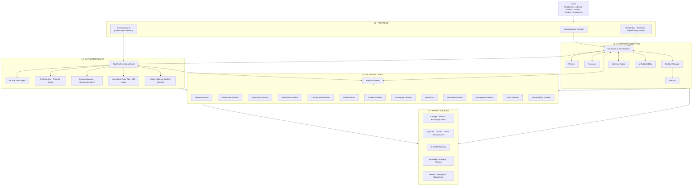
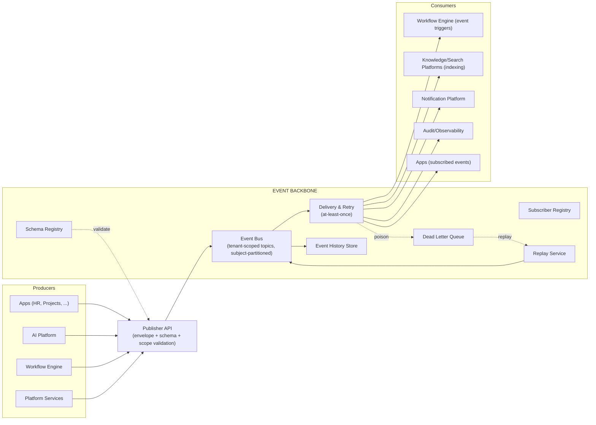
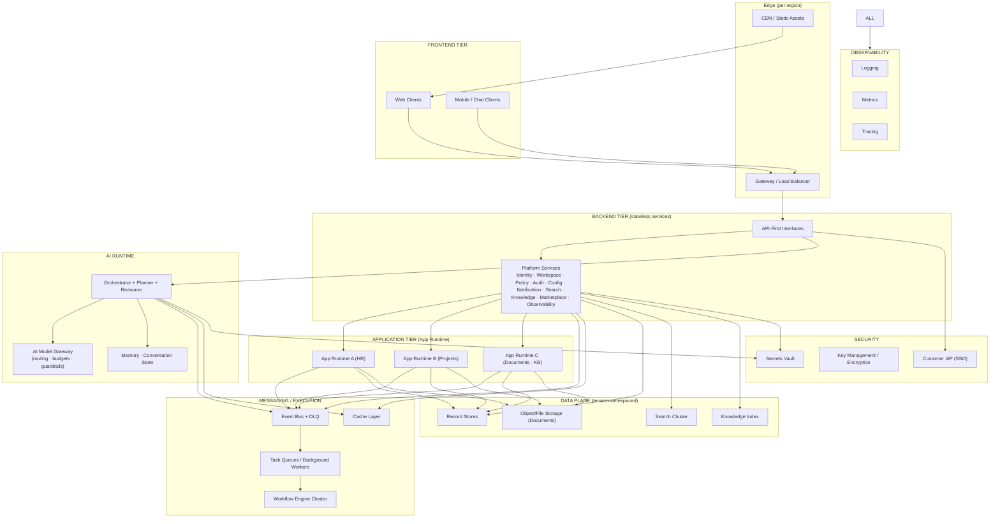

# Nexora — Software Architecture Document (SAD)

**Product:** Nexora — _Work. Orchestrated by AI._
**Document Type:** Software Architecture Document (SAD) — master architecture blueprint
**Version:** 1.0
**Owner:** Principal Architecture
**Audience:** Engineering teams, Architecture review, Product, Security, Platform Ops
**Related documents:** PRD v1.0 (`PRD.md`, product intent) · PSD v1.0 (`PRODUCT_SPEC.md`, behavioral specification)

---

## 0. How to Read This Document

This document is **architecture-only**: it describes components, responsibilities, interactions, and decisions — it contains **no implementation code, no API endpoints, no database schemas, and no class diagrams**. Technology choices are intentionally absent; where the text says "service", "store", or "bus" it refers to a logical architectural element.

**Consistency contract.** This SAD is fully derived from the PRD and the PSD. Every normative ID from the PSD (AIX-_, EVT-_, WRK-_, BR-_, EC-_, AUD-_, OBS-_, PRM-_, USR-_, APP-_, V1-*) is reused verbatim. Where this document makes an architectural decision, it is recorded as an **ADR** (§17) with full reasoning, and §0.1 tracks which specifications it realizes.

**Convention.** "Platform" refers to the stable platform core; "App" refers to an installable Application (PSD §5); "Runtime" refers to the execution environment hosting a class of components.

### 0.1 Specification traceability

| Architecture element                                                          | Realizes (PSD / PRD)                             |
| ----------------------------------------------------------------------------- | ------------------------------------------------ |
| Layering (User → Frontend → Enterprise AI → Apps → Platform → Infrastructure) | PSD §2.4 anatomy                                 |
| 13 Platform services (§5)                                                     | PSD AIX-* components, §3–§10, §15–§16, APP-12/13 |
| App Container & App Contract (§6)                                             | PSD §5.2/5.3 (PRN-12, FR-16)                     |
| Plugin SDK (§7)                                                               | PSD §5.4/5.5, V1-12, PRD FR-39                   |
| AI Runtime (§8)                                                               | PSD §7 (AIX-1…19)                                |
| Agent runtime (§9)                                                            | PSD §7.7, APP-* agent columns, BR-13/14          |
| Capability Registry (§10)                                                     | PSD AIX-7/8, PRD FR-9                            |
| Event Backbone (§11)                                                          | PSD §8 (EVT-1…36, EVT-G1…G6)                     |
| Workflow Engine (§12)                                                         | PSD AIX-9/10, WRK-1…15, BR-13/15                 |
| Security (§13)                                                                | PSD §9–§10, PRM-1…10, AUD-1…8, NFR-5…10          |
| Deployment & Scalability (§14–§15)                                            | PRD NFR-1…4, 9, 10                               |
| Observability (§16)                                                           | PSD §16 (OBS-1…5), AIX-19, NFR-15                |

---

## 1. Architecture Goals

The architecture exists to make the product goals in PRD §5 and PSD §17 _architecturally inevitable_ — not merely possible.

| #    | Goal                                                          | Derivation                 | Architectural consequence                                                                                                                                                                |
| ---- | ------------------------------------------------------------- | -------------------------- | ---------------------------------------------------------------------------------------------------------------------------------------------------------------------------------------- |
| AG-1 | **The AI is the primary interface; apps exist to support it** | PRN-1, PSD §2              | The intelligence layer must be the center of gravity: every capability is reachable through the AI Runtime, and the AI must be able to _discover_ capabilities without hardcoding (§10). |
| AG-2 | **Any future App installs without platform changes**          | FR-16, PRN-12, PSD §5.3    | The App Contract is frozen; the platform depends only on the manifest, never on an App's internals (§6–§7).                                                                              |
| AG-3 | **Human always in control**                                   | PRN-2, BR-13               | The approval path is architecturally un-bypassable for Consequential actions; it cannot be configured away (§8, §13, ADR-006).                                                           |
| AG-4 | **Every action is auditable and explainable**                 | PRN-5/10, AUD-_, OBS-_     | Audit, explainability, and observation are platform invariants enforced at the layer boundaries, not App responsibilities (§16, ADR-011).                                                |
| AG-5 | **Multi-tenant by design, horizontally scalable**             | PRN-7, NFR-1…4             | Tenant context is an explicit architectural dimension (isolation, residency, scaling) threaded through every layer (§13, §15).                                                           |
| AG-6 | **Event-driven loose coupling**                               | PRN-11, PSD §8             | Apps and platform services are decoupled by an event backbone; no point-to-point automation (§11, ADR-002).                                                                              |
| AG-7 | **Observable end-to-end**                                     | NFR-15, OBS-*              | Every user, AI, and workflow journey is reconstructable from logs, timelines, and traces (§16).                                                                                          |
| AG-8 | **Future-ready**                                              | PRD §17 roadmap, PSD §18.4 | The architecture admits marketplaces, industry packs, and a developer platform by evolving _content_, not the core (§18).                                                                |

---

## 2. Architecture Principles

The 15 architecture principles below are the SAD's constitution. Each is stated architecturally and maps to its product principle (PRN-*, PSD §2.2).

| #     | Principle            | Architectural meaning                                                                                                                                                                                         |
| ----- | -------------------- | ------------------------------------------------------------------------------------------------------------------------------------------------------------------------------------------------------------- |
| AP-1  | **AI First**         | The AI Runtime is a first-class layer, not an adapter on top of CRUD. All domain behavior is expressed as agent-executable Skills; the deterministic UI is a projection of the same capability model. (PRN-1) |
| AP-2  | **Event Driven**     | State changes are the system's nervous system. Services publish facts and react to facts; direct synchronous calls are confined to request/response where semantics demand it. (PRN-11)                       |
| AP-3  | **Modular**          | Capability ships in Apps; Apps are independent deployables with their own lifecycle. No App is required for the platform to operate. (PRN-6)                                                                  |
| AP-4  | **Multi-Tenant**     | Tenant (Company) context is a first-class dimension in every component, every event, every store, and every policy. Isolation is by construction, not convention. (PRN-7)                                     |
| AP-5  | **Extensible**       | Extension points are frozen contracts (App Contract, Event types, Capability Registry). Growth happens by registration, never by modification. (PRN-12)                                                       |
| AP-6  | **Enterprise Grade** | SLAs, security, audit, and compliance are properties of the platform, verified continuously, and cannot be weakened by configuration. (PRN-13)                                                                |
| AP-7  | **Secure By Design** | Zero-trust, least privilege, and tenant isolation are architectural invariants. AI is an attack surface like any other and is secured as such (§13). (PRN-8)                                                  |
| AP-8  | **API First**        | Every capability is exposed through defined interfaces consumed by the conversational surface, the deterministic UI, and external systems alike. (PRN-9)                                                      |
| AP-9  | **Plugin Based**     | Apps are plugins to a plugin host (§7). The platform core never references an App by name.                                                                                                                    |
| AP-10 | **Observable**       | Everything that happens is recorded in logs, metrics, traces, and timelines. Observability is an invariant, not a feature. (PRN-5, OBS-*)                                                                     |
| AP-11 | **Explainable AI**   | The AI layer records intent, plan, sources, and verification for every decision; explanation is produced at decision time, not retrofitted. (PRN-10)                                                          |
| AP-12 | **Human Approval**   | Human authorization is an architectural gate in the execution path for Consequential actions; it cannot be bypassed, cached, or learned around. (PRN-2, BR-13)                                                |
| AP-13 | **Loose Coupling**   | Components communicate through contracts (events, registries, declared interfaces). Dependencies are directional and minimal.                                                                                 |
| AP-14 | **High Cohesion**    | Each component owns one coherent responsibility (a platform service, an App, an agent) and its own data; there is no god-service.                                                                             |
| AP-15 | **Future Ready**     | Decisions favor evolution over replacement: versioned contracts, additive extension points, and marketplace-ready seams (§18).                                                                                |

**Decision priority** (when principles conflict): Security → Isolation → Auditability/Explainability → Human Control → AI First → Scalability → Modularity → Extensibility (consistent with PRN-15).

---

## 3. Architecture Constraints

Constraints are binding conditions the architecture must satisfy. They are derived from the PRD (requirements) and PSD (behavioral rules).

### 3.1 Product-derived constraints

| ID    | Constraint                                                                           | Source               |
| ----- | ------------------------------------------------------------------------------------ | -------------------- |
| AC-1  | No cross-Company data access under any configuration                                 | FR-1                 |
| AC-2  | The App Contract is frozen at v1; future Apps must install without platform changes  | FR-16, PRN-12        |
| AC-3  | Consequential actions require human approval; not configurable away                  | AI-12, BR-13, PRN-2  |
| AC-4  | Audit log is append-only and tamper-evident                                          | NFR-8, AUD-2         |
| AC-5  | Apps coordinate only via defined interfaces and events; no point-to-point automation | PSD §8.1, PRN-11     |
| AC-6  | Agents never exceed the invoking user's authority                                    | PRD §14.3-4, PRM-8   |
| AC-7  | AI claims must be grounded; no fabricated or unverified outcomes                     | PRD §12.3, AI-6      |
| AC-8  | Model abstraction: no single-model lock-in; per-tenant cost control                  | AI-11, NFR-14        |
| AC-9  | Data residency configurable per Company; enforcement at the data plane               | NFR-10, FR-35        |
| AC-10 | Multi-industry support without architectural change                                  | PRD NG-3, §8.2       |
| AC-11 | Deterministic UI fallback for every AI capability                                    | FR-8                 |
| AC-12 | System Apps (Notifications, Administration) always present                           | PSD §5.4, §6.12–6.13 |

### 3.2 Non-functional constraints (quantified targets)

| Constraint                      | Target                                                             | Source |
| ------------------------------- | ------------------------------------------------------------------ | ------ |
| Conversational response latency | p95 ≤ 2s (excluding streamed perceived latency)                    | NFR-1  |
| Action execution latency        | p95 ≤ 5s                                                           | NFR-1  |
| Orchestration overhead per hop  | ≤ 500ms p95                                                        | NFR-2  |
| Availability                    | 99.9% monthly; RPO ≤ 15 min; RTO ≤ 1 hr                            | NFR-3  |
| Scale ceiling                   | 10M+ workflow executions/day; 100k concurrent users (largest tier) | NFR-4  |
| Compliance                      | SOC 2 Type II, ISO 27001, GDPR, CCPA; HIPAA optional later         | NFR-6  |
| Accessibility                   | WCAG 2.1 AA                                                        | NFR-12 |
| Failure containment             | Failing agent/integration never cascades                           | NFR-13 |

### 3.3 Implicit architectural constraints

- **AC-13. Contract stability:** once a contract (event type, skill schema, manifest field, permission) ships in a released version, it is versioned, never mutated in place (EVT-G4).
- **AC-14. Tenant context propagation:** every request, job, and event carries Company + Workspace context; components must reject context-less operations in production paths.
- **AC-15. No direct cross-App data access:** App data is reachable only through the App's own interfaces (PSD §5.3).
- **AC-16. Determinism of audit:** auditing occurs at the point of action, inside the same logical transaction where feasible, so no action exists without its record.

---

## 4. High-Level System Architecture

### 4.1 Layers

The system is organized in six layers, each with a single responsibility and strict downward dependency:

| Layer                      | Responsibility                                           | Key elements                                                                                                                                                                                   |
| -------------------------- | -------------------------------------------------------- | ---------------------------------------------------------------------------------------------------------------------------------------------------------------------------------------------- |
| **L1 — User**              | Humans and external parties                              | Employees, managers, admins, auditors, guests, vendors, customers (USR-*)                                                                                                                      |
| **L2 — Frontend**          | Presentation & interaction                               | Conversational console (primary), deterministic UI (fallback/power layer, FR-8), Work Inbox, AI timelines; thin clients that hold no business logic                                            |
| **L3 — Enterprise AI**     | Intelligence: understand, plan, execute, verify, explain | Enterprise AI Runtime (EAO, Planner, Reasoner, Context Manager, Memory, Approval Engine, Explainability…) — PSD §7                                                                             |
| **L4 — Application Layer** | Domain capability                                        | Installable Apps (HR, Projects, Documents, KB…) running in the App Runtime; each App owns its agent, logic, data, UI, events, tools, knowledge (PSD §5–6)                                      |
| **L5 — Platform Layer**    | Horizontal platform services                             | 13 platform services (§5): Identity, Workspace, Application, Notification, Configuration, Audit, Search, Knowledge, AI, Workflow, Marketplace, Policy, Observability — plus the Event Backbone |
| **L6 — Infrastructure**    | Durable foundations                                      | Storage, search, knowledge index, queues, caches, event backbone infrastructure, AI model gateway, secrets, compute, networking, monitoring/logging/tracing                                    |

### 4.2 High-level diagram



### 4.3 Interactions between layers (normative)

| Interaction                           | Semantics                                                                                                                                                       |
| ------------------------------------- | --------------------------------------------------------------------------------------------------------------------------------------------------------------- |
| **User → Frontend**                   | Natural-language requests, commands, questions; approval decisions; UI navigation.                                                                              |
| **Frontend → Enterprise AI**          | Utterances and follow-ups bound to a Workspace context (WS-R3). Responses carry sources, plan previews, and explainability links (FR-6, AIX-17).                |
| **Frontend → Application Layer**      | Deterministic UI calls App capabilities through the platform's API-first interfaces (AP-8); the App Runtime enforces permissions (PRM-*).                       |
| **Enterprise AI → Application Layer** | The EAO dispatches tasks to application **agents** only — never directly to App internals (PSD §8.1, ADR-001).                                                  |
| **Enterprise AI ↔ Platform Layer**    | AI consults Policy, Knowledge, Search, Audit, and Observability platforms; the Workflow Platform executes plans; the Approval Engine gates Consequential steps. |
| **Application ↔ Platform Layer**      | Apps register via the Application/Marketplace platforms; emit/subscribe to events; read platform services (identity, audit, notifications) through contracts.   |
| **All layers → Infrastructure**       | Durability, retrieval, messaging, model access, security, and observability substrates.                                                                         |

### 4.4 Key cross-cutting behaviors

1. **Tenant context threading:** Company + Workspace context flows through every layer and is re-validated at every boundary (AC-14).
2. **The AI never bypasses:** conversational requests, scheduled jobs, and event-triggered workflows all enter the same orchestration pipeline (WRK-15); there is no "back door" to App capabilities.
3. **Audit at the boundary:** every layer boundary that mutates state produces an audit record (AUD-1, AC-16).
4. **Failure containment:** layer boundaries are also failure boundaries; a failing App or agent cannot degrade the platform (NFR-13, ER-4/5).

---

## 5. Core Platform Architecture

The Platform Layer (L5) is **13 coherent platform services** plus the **Event Backbone**. Each service owns one responsibility (AP-14), exposes defined interfaces (AP-8), and communicates by events (AP-2). None of them contains domain logic (PRN-3).

### 5.1 Identity Platform

| Aspect                    | Specification                                                                                                                                                                               |
| ------------------------- | ------------------------------------------------------------------------------------------------------------------------------------------------------------------------------------------- |
| **Responsibility**        | The single source of truth for who can act: users, groups, roles, memberships, external identities, and credentials (PSD §9, USR-*).                                                        |
| **Key elements**          | Identity graph (Organization → Company → Workspace → Team → User/Group); SSO (SAML/OIDC), MFA, SCIM (FR-18); session & token issuance with short TTL and per-request revalidation (USR-R2). |
| **Owned data**            | Identity records, memberships, role assignments, external identity links.                                                                                                                   |
| **Interactions**          | Issues identity claims consumed by every layer (AC-14). Publishes `UserProvisioned`, `UserDeactivated`, `RoleChanged` (EVT-31/32). Consumes nothing.                                        |
| **Key quality attribute** | The identity graph is authoritative; every component re-validates claims, never trusts cached authority for sensitive actions (PRM-8).                                                      |

### 5.2 Workspace Platform

| Aspect                    | Specification                                                                                                                                                   |
| ------------------------- | --------------------------------------------------------------------------------------------------------------------------------------------------------------- |
| **Responsibility**        | Lifecycle and scoping of Workspaces: the operational containers that own Apps, agents, permissions, knowledge, and workflows (PSD §4, WS-*).                    |
| **Key elements**          | Workspace registry; membership and scoping rules (WS-R2/R3); type templates (Engineering, HR, Finance, … — configuration only, WS-R4); archive/restore (WS-R5). |
| **Owned data**            | Workspace records, memberships, type templates, scoping rules.                                                                                                  |
| **Interactions**          | Publishes `WorkspaceProvisioned`; consumed by every service for context (AC-14). Cooperates with Identity (membership) and Policy (scoping).                    |
| **Key quality attribute** | Workspace context is an immutable part of every event and request (WS-R3).                                                                                      |

### 5.3 Application Platform

| Aspect                    | Specification                                                                                                                                                                                                                              |
| ------------------------- | ------------------------------------------------------------------------------------------------------------------------------------------------------------------------------------------------------------------------------------------ |
| **Responsibility**        | Hosts and governs installed Apps: the **App Runtime** (plugin host), App lifecycle, registration into platform registries, and isolation of third-party code (PSD §5.4/5.5, §6).                                                           |
| **Key elements**          | App manifest processing; App instance registry (per Company + Workspace enablement); version/rollback management (FR-17); sandboxing and resource limits; capability registration fan-out to Capability/Agent/Tool/Event registries (§10). |
| **Owned data**            | App install records, enablement states, runtime resource quotas. App data itself is owned by each App's Storage Contract (§6.12).                                                                                                          |
| **Interactions**          | Publishes `AppInstalled`, `AppDisabled`, `AppUpdated` (EVT-31). Consumes installation commands from the Marketplace Platform and Administration App.                                                                                       |
| **Key quality attribute** | The platform never references an App by name (AP-9); all behavior flows through contracts and registries.                                                                                                                                  |

### 5.4 Notification Platform

| Aspect                    | Specification                                                                                                                                                                                                |
| ------------------------- | ------------------------------------------------------------------------------------------------------------------------------------------------------------------------------------------------------------ |
| **Responsibility**        | Reliable, preference-aware delivery of notifications and the unified Work Inbox (PSD §6.12, APP-12; FR-27/28/29).                                                                                            |
| **Key elements**          | Notification model (types, channels, preferences); Work Inbox projection (approvals, tasks, exceptions); actionable notifications (approve/reject/comment inline, FR-28); digest and quiet-hours scheduling. |
| **Owned data**            | User preferences, inbox state, delivery records.                                                                                                                                                             |
| **Interactions**          | Subscribes to all approval/task/exception events (EVT-*); publishes `NotificationSent`, `NotificationRead`, `ApprovalTaskCreated` (EVT-29).                                                                  |
| **Key quality attribute** | Delivery is at-least-once; inbox state is derived and rebuildable from events (EVT-G1, G3).                                                                                                                  |

### 5.5 Configuration Platform

| Aspect                    | Specification                                                                                                                                                                                                                                                  |
| ------------------------- | -------------------------------------------------------------------------------------------------------------------------------------------------------------------------------------------------------------------------------------------------------------- |
| **Responsibility**        | Versioned, scoped configuration for everything: Company settings, Workspace settings, App configuration, AI configuration, policies' inputs (PSD AIX-15, APP-13).                                                                                              |
| **Key elements**          | Config schema registry; hierarchical override model (Company → Workspace → App → runtime); versioning with rollback; **safety invariant enforcement** — config that would weaken mandatory guarantees (e.g., BR-13, AC-4) is rejected, not stored (PSD §7.15). |
| **Owned data**            | Configuration documents with audit lineage.                                                                                                                                                                                                                    |
| **Interactions**          | Consumed by all services at startup and on change; publishes `PolicyChanged` and config-change events for re-evaluation (EVT-31).                                                                                                                              |
| **Key quality attribute** | Configuration is data with schema + validation, never code; change is audited (AUD-1).                                                                                                                                                                         |

### 5.6 Audit Platform

| Aspect                    | Specification                                                                                                                                                                                                      |
| ------------------------- | ------------------------------------------------------------------------------------------------------------------------------------------------------------------------------------------------------------------ |
| **Responsibility**        | The append-only, tamper-evident record of everything that happened (PSD §15, AUD-1…8; FR-33/34).                                                                                                                   |
| **Key elements**          | Audit record pipeline (anatomy per PSD §15.1); chained tamper-evidence (NFR-8); retention & residency policies (AUD-7); export service (FR-34); read APIs for Auditors (AUD-8) and explainability panels (AIX-17). |
| **Owned data**            | The immutable audit store (log-structured; append-only by construction, AC-4).                                                                                                                                     |
| **Interactions**          | Consumes audit-worthy facts from every layer boundary (AC-16); serves Audit App + Compliance exports; publishes `AuditRecordWritten` for observability.                                                            |
| **Key quality attribute** | Immutability is enforced by the storage model, not by convention; no role can edit or delete (AUD-2).                                                                                                              |

### 5.7 Search Platform

| Aspect                    | Specification                                                                                                                                                                 |
| ------------------------- | ----------------------------------------------------------------------------------------------------------------------------------------------------------------------------- |
| **Responsibility**        | Unified cross-App search and record lookup (FR-30): one index, permission-filtered at query time.                                                                             |
| **Key elements**          | Indexing pipeline fed by events (EVT-*); unified record model (any record retrievable by ID/name, FR-30); permission-aware query rewriting (PRM-7); near-real-time freshness. |
| **Owned data**            | The search index (derived, rebuildable from events — EVT-G3).                                                                                                                 |
| **Interactions**          | Subscribes to record events; serves search from conversational console, deterministic UI, and the AI's Context Manager (AIX-12).                                              |
| **Key quality attribute** | Query-time permission filtering; an index never returns a record the requester cannot read (BR-7).                                                                            |

### 5.8 Knowledge Platform

| Aspect                    | Specification                                                                                                                                                                                                  |
| ------------------------- | -------------------------------------------------------------------------------------------------------------------------------------------------------------------------------------------------------------- |
| **Responsibility**        | The grounding corpus for AI: indexed, access-controlled, version-aware content from the KB App, Documents App, and app-owned knowledge (PSD AIX-6; FR-31; AI-5).                                               |
| **Key elements**          | Ingestion pipeline (event-driven: `KnowledgeUpdated`, `DocumentUploaded`); chunked, versioned index; retrieval API that applies the requester's read permissions (BR-7); citation metadata (source + version). |
| **Owned data**            | The knowledge index and retrieval metadata (derived from content stores).                                                                                                                                      |
| **Interactions**          | Consumes content events; serves the Context Manager and KB answers; publishes freshness metrics to AI Monitoring.                                                                                              |
| **Key quality attribute** | Retrieval is access-filtered: the model can only ground on content the invoking user may read (ADR-007).                                                                                                       |

### 5.9 AI Platform

| Aspect                    | Specification                                                                                                                                                                                                            |
| ------------------------- | ------------------------------------------------------------------------------------------------------------------------------------------------------------------------------------------------------------------------ |
| **Responsibility**        | The AI Runtime's platform services: model abstraction, budgets, prompt governance, conversation history, and AI monitoring (PSD §7: AIX-1, AIX-11…19).                                                                   |
| **Key elements**          | Model gateway (routing, cost, budgets — NFR-14); Prompt Library (AIX-13); Conversation History (AIX-16); Approval Engine service (AIX-11/18); AI Studio (AIX-14); AI Monitoring (AIX-19); Explainability store (AIX-17). |
| **Owned data**            | Conversations, prompt versions, AI decisions and their explanations, monitoring telemetry.                                                                                                                               |
| **Interactions**          | Consumed by the Enterprise AI Runtime; publishes `AgentExecuted`, `OrchestrationPlanProposed`, `AiAnomalyDetected` (EVT-26/33); reports to Observability.                                                                |
| **Key quality attribute** | Every AI decision is recorded with its explanation at decision time (AP-11).                                                                                                                                             |

### 5.10 Workflow Platform

| Aspect                    | Specification                                                                                                                                                                                   |
| ------------------------- | ----------------------------------------------------------------------------------------------------------------------------------------------------------------------------------------------- |
| **Responsibility**        | Durable execution of workflow definitions and AI plans (PSD AIX-9/10; FR-22…26; §12 of this document).                                                                                          |
| **Key elements**          | Workflow Engine (definitions, steps, journaling, recovery); Task Planner (task queues, deadlines, SLAs); approval/human-task routing to the Work Inbox; escalation engine; template versioning. |
| **Owned data**            | Workflow definitions, executions, journals, timelines.                                                                                                                                          |
| **Interactions**          | Subscribes to triggers (events, schedules, manual); publishes `WorkflowStarted/Completed/Failed`, `StepCompleted` (EVT-30); receives task outcomes from agents.                                 |
| **Key quality attribute** | Journaled, resumable execution with compensation semantics (§12, ADR-009).                                                                                                                      |

### 5.11 Marketplace Platform

| Aspect                    | Specification                                                                                                                                                                                                       |
| ------------------------- | ------------------------------------------------------------------------------------------------------------------------------------------------------------------------------------------------------------------- |
| **Responsibility**        | App catalog, distribution, and monetization seams (PRD §17 roadmap; FR-14/15; PSD §5.4).                                                                                                                            |
| **Key elements**          | Catalog & listing service; package validation (manifest, signature, permission declarations); install orchestration with admin approval (FR-15); version distribution; (future) billing and revenue share (PRD G3). |
| **Owned data**            | Listings, packages, install records, (future) transactions.                                                                                                                                                         |
| **Interactions**          | Publishes `AppInstalled`/`AppUpdated`; commands the Application Platform to instantiate; consumed by the Administration App.                                                                                        |
| **Key quality attribute** | Installing an App is a validated, reversible, audited operation (FR-14/17).                                                                                                                                         |

### 5.12 Policy Platform

| Aspect                    | Specification                                                                                                                                                                                                         |
| ------------------------- | --------------------------------------------------------------------------------------------------------------------------------------------------------------------------------------------------------------------- |
| **Responsibility**        | Authoritative evaluation of permissions and policies at every decision point: RBAC (PRM-*), approval rules (L6), AI guardrails (BR-13/14), and tenant policy (PSD §10, §12).                                          |
| **Key elements**          | Permission engine (6-level model, deny-wins, PRM-2/3); policy rule store (side-effect classes, approval chains, prohibited actions, residency constraints); decision log (each evaluation recorded for audit, AUD-3). |
| **Owned data**            | Roles, grants, policies, decision logs.                                                                                                                                                                               |
| **Interactions**          | Called synchronously by every action boundary (request/response semantics are required for authorization); publishes `PolicyChanged` for cache invalidation.                                                          |
| **Key quality attribute** | Single evaluation point: no component re-implements authorization (PRM-10, ADR-005).                                                                                                                                  |

### 5.13 Observability Platform

| Aspect                    | Specification                                                                                                                                                                                                          |
| ------------------------- | ---------------------------------------------------------------------------------------------------------------------------------------------------------------------------------------------------------------------- |
| **Responsibility**        | Logs, metrics, traces, timelines, and system health across the entire system (PSD §16; NFR-15; §16 of this document).                                                                                                  |
| **Key elements**          | Structured log pipeline; metrics (RED/USE + product metrics per PRD §18); distributed tracing (`traceId`, `correlationId`); timeline stores (AI, Workflow, Activity — OBS-2/3/4); SLO dashboards and anomaly alerting. |
| **Owned data**            | Logs, metrics, traces, timeline projections (derived from events + audit).                                                                                                                                             |
| **Interactions**          | Consumes telemetry from every layer; serves dashboards to Administration and internal platform ops.                                                                                                                    |
| **Key quality attribute** | End-to-end reconstructability of any user/AI/workflow journey (AG-7).                                                                                                                                                  |

### 5.14 Event Backbone (cross-cutting)

The Event Backbone is the messaging substrate shared by all services (PSD §8; §11 of this document). All services publish and subscribe through it; no service talks to another service's internals.

---

## 6. Application Architecture

Realizes: PSD §5 (Application Model), §6 (catalog); PRD FR-14…17, FR-16; PRN-3/4/9/12.

### 6.1 The App Container

An Application is a **self-contained unit** executed in the **App Runtime** (a plugin host). The App Container provides the environment (lifecycle, isolation, resource limits, interfaces); the App provides only its twelve declared elements below. The platform core has **no knowledge of any App's internals** — it sees only the App's manifest and registered contracts (AP-9).

### 6.2 The twelve elements every App defines

| #   | Element              | Architectural specification                                                                                                                                                                                                                                                           |
| --- | -------------------- | ------------------------------------------------------------------------------------------------------------------------------------------------------------------------------------------------------------------------------------------------------------------------------------- |
| 1   | **Manifest**         | The machine-readable identity and contract of the App (PSD §5.3): ID, versions, required permissions/scopes, agent definition, skills, events, UI entry points, config schema, dependencies. The manifest is the **only** thing the platform reads about the App before installation. |
| 2   | **Configuration**    | Declared configuration schema (typed, validated) instantiated per Company and per Workspace via the Configuration Platform (§5.5). No free-form config; all App config is versioned and auditable.                                                                                    |
| 3   | **Navigation**       | Declarative registration of UI entry points (pages, forms, menus) into the deterministic UI shell. Navigation is data, so the shell renders any App without code changes.                                                                                                             |
| 4   | **Permissions**      | Declared App-level roles and capabilities (PSD §14.2); enforced by the Policy Platform, never by the App itself. The App declares what it needs; the platform decides.                                                                                                                |
| 5   | **Business Logic**   | The App's domain rules and state transitions (PSD §5.2), executed inside the App Container, invoked only via declared interfaces (skills, APIs, event handlers).                                                                                                                      |
| 6   | **Events**           | Declared event types the App publishes and subscribes to (EVT-*, PSD §8.3). The App never calls another App; it emits and reacts.                                                                                                                                                     |
| 7   | **AI Agent**         | The App's owned agent (PRN-4): a registered agent with typed **Skills** (PSD §7.7). The agent is the sole executor of the App's tools; it runs within the App Runtime under delegated user authority (PRM-8).                                                                         |
| 8   | **Knowledge**        | Declared knowledge contribution (policy articles, reference content) ingested into the Knowledge Platform (§5.8) for grounding. Access is governed by the same permissions as the source content.                                                                                     |
| 9   | **Tools**            | Executable capabilities exposed as typed Skills and integration tools, registered in the Tool Registry (AIX-8). Tools declare side-effect class (Read-only / Update / Consequential — BR-13), idempotency, and permission requirements.                                               |
| 10  | **Settings**         | Runtime settings surface (admin-facing) bound to the Configuration Platform; includes the App's contribution to Workspace enablement and autonomy tiers.                                                                                                                              |
| 11  | **UI**               | The App's deterministic screens (power layer, FR-8): forms, lists, detail views — served by the shell with permissions enforced at render and at action.                                                                                                                              |
| 12  | **Storage Contract** | The App's **namespaced data contract**: the App owns its data model, but reads/writes go through the App Runtime's storage boundary (tenant-scoped, residency-aware, backed up, audit-traced). The App never touches shared stores directly; other Apps never read its store (AC-15). |

### 6.3 Why future Apps install without platform changes (ADR-003)

1. **Manifest-driven registration.** Installation = parse manifest → validate → register records in the Capability/Agent/Tool/Event registries. The platform never compiles or links App code at install time.
2. **Registry-based discovery.** The AI discovers what an App can do from the registries (§10); it never contains an App's name or logic (ADR-005).
3. **Contract-bound communication.** The App interoperates only through events and declared interfaces; the platform's interaction patterns are identical for every App, first-party or third-party.
4. **Sandboxed execution.** The App's logic, UI, and data run inside the App Container with quotas and isolation; the platform does not change when App internals change.
5. **Versioned evolution.** App versions evolve the App, not the platform; platform contracts are frozen and versioned (AC-13).

Consequence: adding a new domain (e.g., Field Service, Legal) is a **content operation** (publish a validated package), not a **platform operation** (no core changes) — satisfying PRD FR-16 and roadmap Phase 3 (§17 of PRD).

---

## 7. Plugin SDK Architecture

Realizes: PSD §5.4/5.5 (App lifecycle), §6 (App Container); PRD FR-39 (third-party apps), G3 (ecosystem); V1-12.

The **Plugin SDK** is the public, versioned contract set that lets third parties build and distribute Nexora Apps (and, later, agents and workflows — §18). It is a _specification surface_: a set of typed schemas, registration APIs, and runtime boundaries. Everything below describes behavior and contracts, not code.

### 7.1 Plugin Manifest

| Field group           | Contents                                                                                                                                                                                                       |
| --------------------- | -------------------------------------------------------------------------------------------------------------------------------------------------------------------------------------------------------------- |
| Identity              | Plugin ID (namespaced, globally unique), name, description, publisher, version, SDK-version requirement                                                                                                        |
| Contract declarations | Permissions/scopes requested; event types published/subscribed; skills + tools (with side-effect classes); agent definition; knowledge contribution; navigation entries; configuration schema; UI entry points |
| Dependencies          | Declared read-dependencies on other Apps' read interfaces (PSD §5.5 — never action dependencies)                                                                                                               |
| Packaging             | Signed artifact reference, integrity hash, license, support contact                                                                                                                                            |

### 7.2 Plugin lifecycle

`Develop → Submit → Validate → Publish → Install → Enable → Run → Upgrade → Remove`

| Stage                 | Behavior                                                                                                                                |
| --------------------- | --------------------------------------------------------------------------------------------------------------------------------------- |
| **Develop**           | Author builds against the SDK's typed schemas in a sandbox with platform stubs; validation tooling checks manifest conformance locally. |
| **Submit / Validate** | Central validation (§7.12) on publish; security review of requested permissions; signature verification.                                |
| **Publish**           | Listing appears in the Marketplace Platform (§5.11) with a validated manifest snapshot.                                                 |
| **Install**           | Admin reviews requested permissions → approves (FR-15) → Application Platform instantiates per Company; registries updated (§7.3).      |
| **Enable**            | Per-Workspace enablement with Workspace-scoped configuration (WS-*).                                                                    |
| **Run**               | Execution inside the App Container with quotas and isolation (§7.13).                                                                   |
| **Upgrade**           | Versioned upgrade with preview of changed contracts; admin approval; rollback retained (FR-17).                                         |
| **Remove**            | Data export confirmation → quarantine → unregister from all registries → deactivation (§7.14).                                          |

### 7.3 Registration

The Application Platform **fans out** a successful install into five registries so that the rest of the platform discovers the App without hardcoding (ADR-005):

1. **Capability Registry** — declarative capabilities and their natural-language descriptions (§10).
2. **Agent Registry** — the App's agent + skills (AIX-7).
3. **Tool Registry** — executable tools with side-effect classes (AIX-8).
4. **Event Registry** — published/subscribed event types with schemas (EVT-*).
5. **Knowledge Registry** — declared knowledge contributions for ingestion (§5.8).

### 7.4 Capabilities, Navigation, Permission, Event, Tool, AI, Configuration registration

| Registration      | Contract                                                                                                               | Enforced by                              |
| ----------------- | ---------------------------------------------------------------------------------------------------------------------- | ---------------------------------------- |
| **Capabilities**  | Machine-readable capability descriptors (actions the App can perform) with descriptions the AI can reason over (§10.3) | Capability Registry + Planner            |
| **Navigation**    | Declarative UI entries bound to permission scopes                                                                      | App shell (renders data, never code)     |
| **Permissions**   | Requested scopes must map onto existing permission classes; excess or novel scopes are rejected at validation (§7.12)  | Policy Platform + Marketplace validation |
| **Events**        | Event schemas must conform to the envelope and versioning rules (PSD §8.2, EVT-G4)                                     | Event Registry + Event Backbone          |
| **Tools**         | Skills declare input/output schemas, side-effect class, idempotency, cost class                                        | Tool Registry + Approval Engine (BR-13)  |
| **AI**            | Agent identity, autonomy-tier constraints, prompt/instruction versions                                                 | Agent Registry + AI Platform             |
| **Configuration** | Typed config schema validated against platform invariants                                                              | Configuration Platform (§5.5)            |

### 7.5 Versioning

- Semantic versioning; the platform records the exact SDK-version and schema versions an App was validated against (AC-13).
- Breaking changes to an App's contract (new required permission, changed skill schema, changed event schema) force a **major version** and re-approval by admins (FR-17).
- Backward-compatible changes (added skills, new optional fields) flow as minor versions with upgrade previews.

### 7.6 Dependency management

- Dependencies are **declared and read-only** (PSD §5.5): an App may read another App's data only through that App's read interfaces.
- The platform resolves dependency availability at install/upgrade time and **rejects** installs whose declared dependencies are missing (EC-3 quarantine pattern).
- There is no runtime cross-App call graph; dependencies surface as event subscriptions and orchestrator-dispatched tasks, preserving loose coupling (AP-13).

### 7.7 Plugin validation

| Check                   | Purpose                                                                     |
| ----------------------- | --------------------------------------------------------------------------- |
| Manifest conformance    | Schema-valid against the frozen App Contract                                |
| Permission sanity       | Requests only known permission classes; no "wildcard" escalation            |
| Side-effect declaration | Every tool truthfully classifies Read-only / Update / Consequential (BR-13) |
| Security scan           | Static review, secret scanning, supply-chain checks on packaged artifacts   |
| Isolation test          | Runs in the sandbox without platform access                                 |
| Event conformance       | Event schemas valid; no collision with platform-reserved types              |
| Signature               | Publisher identity verified; tamper-evident artifact hash                   |

### 7.8 Plugin isolation

- Apps execute in the **App Container** with process/tenant-level sandboxing, quotas (compute, memory, egress, event rate), and no direct access to platform stores (storage goes through the Storage Contract boundary, §6.2-12).
- Isolation is per-Company + per-App-instance: a misbehaving App cannot read another Company's data (FR-1) or degrade other Apps (NFR-13, ER-5).
- AI model calls from App agents flow through the AI Platform's gateway with tenant budgets (NFR-14).

### 7.9 Plugin removal & upgrade

- **Removal:** export confirmation → grace period (in-flight workflows paused at the App boundary, EC-3) → unregister from all registries → quarantine data → audit completes the removal. Templates referencing the App are quarantined (EC-3).
- **Upgrade:** validated new version → preview of changed contracts → admin approval → swap → rollback to the previous version retains the old registrations and data references (FR-17).

### 7.10 SDK governance (future-proofing)

- The SDK and the App Contract evolve on a **versioned cadence** with deprecation windows (EVT-G4 pattern); platform-version pinning is declared in every manifest (§7.1).
- A **developer preview tier** (internal dogfood — PRD P5) validates new SDK surfaces before public release (V1-12, Phase 2).

---

## 8. AI Runtime Architecture

Realizes: PSD §7 (AIX-1…19), §7.20 (safety taxonomy); PRD §12, FR-9/10/13, NFR-14.

The **AI Runtime** is the intelligence layer (L3) as an architectural system. It is a coherent set of components with a single orchestration pipeline (PSD §7.0).

### 8.1 Component map (PSD AIX ↔ architectural component)

| Architectural component        | PSD component | Responsibility (architecture)                                                                                                                                             |
| ------------------------------ | ------------- | ------------------------------------------------------------------------------------------------------------------------------------------------------------------------- |
| **Enterprise AI**              | AIX-1         | The language capability service: intent parsing, generation, summarization, grounding — with cost routing and per-tenant budgets. Shared, stateless, horizontally scaled. |
| **Enterprise AI Orchestrator** | AIX-2         | The coordinator: owns the conversation, the plan, and the outcome narrative. Composes all other components; the only entry point for AI-driven work (WRK-15).             |
| **Planner**                    | AIX-3         | Plan synthesis over registered Skills; plan validation against permissions; plan templates; replanning on failure.                                                        |
| **Reasoner**                   | AIX-4         | Verification (read-back), explanation, and narration. The trust component: nothing is reported done until verified.                                                       |
| **Execution Engine**           | AIX-9/10      | Executes plans as tasks through the Workflow Platform; drives step-by-step execution, retries, and completion.                                                            |
| **Context Manager**            | AIX-12        | Assembles minimal, permission-filtered context for every AI call (actor, scope, memory, history, knowledge excerpts).                                                     |
| **Memory**                     | AIX-5         | Scoped, tenant-isolated persistence of conversation/user/workflow memory; user-visible and deletable.                                                                     |
| **Knowledge Base**             | AIX-6         | Access-filtered grounding retrieval (§5.8).                                                                                                                               |
| **Capability Registry**        | AIX-7 (§10)   | The AI's index of what the platform can do; queried for planning.                                                                                                         |
| **Agent Registry**             | AIX-7         | Catalog of agents + skills (per App).                                                                                                                                     |
| **Tool Registry**              | AIX-8         | Catalog of executable tools with side-effect classes and health.                                                                                                          |
| **Policy Engine**              | AIX-7/§5.12   | Authorization + guardrail evaluation at every decision point (BR-13/14).                                                                                                  |
| **Approval Engine**            | AIX-11/18     | Human-gate enforcement for Consequential/Configurable actions; routing to Work Inbox.                                                                                     |
| **Conversation Manager**       | AIX-16/2      | Session state, multi-turn context, durable conversation history.                                                                                                          |
| **Prompt Library**             | AIX-13        | Governed, versioned prompts and policy injections.                                                                                                                        |
| **Workflow Engine**            | AIX-9         | Durable execution substrate (§12).                                                                                                                                        |
| **AI Studio**                  | AIX-14        | Admin configuration/testing surface (safety invariants enforced).                                                                                                         |
| **AI Monitoring**              | AIX-19        | Quality/cost/safety telemetry and alerting (§16).                                                                                                                         |
| **AI Explainability**          | AIX-17        | Decision-time explanation capture and rendering (§16, ADR-011).                                                                                                           |

### 8.2 Orchestration pipeline (normative)

Every AI interaction flows through the same pipeline (PSD §7.0), and every stage is audited:

```
Utterance/Trigger
   → Context Manager (assembly; permission-filtered)
   → Enterprise AI (intent; clarify loop on low confidence — FR-5)
   → Planner (plan over Capability/Agent/Tool registries; permission-validated)
   → Explainability (plan surfaced to user)
   → Approval Engine (gates by side-effect class — BR-13)
   → Execution Engine / Workflow Engine (task queue; agent dispatch; verification)
   → Reasoner (verify + narrate)
   → Response (sources + explanation) → Conversation History + Audit
```

### 8.3 Runtime properties

| Property                         | Architecture                                                                                                                                                                             |
| -------------------------------- | ---------------------------------------------------------------------------------------------------------------------------------------------------------------------------------------- |
| **Stateless core, durable side** | Language/planning components are stateless and horizontally scalable; conversations and plans live in durable stores (Conversation History, Workflow journals).                          |
| **Decision-time recording**      | Plans, approvals, and explanations are persisted at the moment of decision (AP-11), making audit and replay possible without retrofitting (ADR-011).                                     |
| **Cost & latency governance**    | Model routing (cheap→strong), budgets, and rate limits are enforced at the AI Platform gateway (NFR-14); latency budget NFR-1/2 is an architectural budget allocated per pipeline stage. |
| **Graceful degradation**         | If any AI stage fails or the model gateway is degraded, the system degrades to clarifying questions, then to the deterministic UI (FR-8, ER-1/8) — never to hallucination.               |
| **Failure containment**          | AI failures are contained to the affected conversation/workflow; other tenants and workflows are unaffected (NFR-13).                                                                    |

---

## 9. Agent Architecture

Realizes: PSD §7.7 (Agent Registry), §9–10 (permissions), BR-13/14; PRD FR-9/11/12, §14.3-4.

### 9.1 Agent model

An **Agent** is the executable intelligence of an App (PRN-4). Architecturally: a registered identity + a set of typed Skills + a runtime process inside the App Container + a delegated authority envelope. Agents are **not** standalone monoliths — they are capabilities hosted by the App Runtime and dispatched by the Orchestrator.

### 9.2 Lifecycle & registration

| Stage           | Behavior                                                                                                                                                             |
| --------------- | -------------------------------------------------------------------------------------------------------------------------------------------------------------------- |
| **Declared**    | The App manifest declares its agent and Skills (§7.1).                                                                                                               |
| **Registered**  | On install, the Agent Registry records the agent (identity, skills, side-effect classes, cost class, permissions) — the platform's only view of the agent (ADR-005). |
| **Provisioned** | Per-Workspace enablement and configuration (autonomy tier, budgets, allowed skills).                                                                                 |
| **Active**      | Receives tasks from the Orchestrator; executes skills under delegated authority (PRM-8).                                                                             |
| **Suspended**   | App disabled, policy changed, or health threshold crossed → no new tasks; in-flight tasks handled per ER-2/4.                                                        |
| **Retired**     | App uninstalled → unregistered; pending tasks reassigned or cancelled with notification.                                                                             |

### 9.3 Discovery

Agents are discovered by the Orchestrator via the **Agent Registry** (never by name or hardcoding). Discovery returns the agent's Skills with schemas, side-effect classes, and permission requirements, filtered by the invoking user's authority (PRM-8) — an agent an invoker cannot use is invisible to that planning session.

### 9.4 Capabilities & skills

- **Capability** = the semantic description of what the agent can achieve (used by the Planner, §10).
- **Skill** = the typed, executable operation (e.g., `create_employee`): input/output schema, side-effect class (BR-13), idempotency flag, cost class, permission requirements.
- Skills are the **only** way an agent acts; there is no free-form tool use (ADR-001).

### 9.5 Communication & collaboration

| Pattern                  | Architecture                                                                                                                                                                                                              |
| ------------------------ | ------------------------------------------------------------------------------------------------------------------------------------------------------------------------------------------------------------------------- |
| **Agent → Orchestrator** | Structured results (verified state, references, evidence) — never free narrative as truth (AIX-4).                                                                                                                        |
| **Orchestrator → Agent** | Task instructions derived from the plan; each task carries the invoking user's authority envelope and the Workspace context.                                                                                              |
| **Agent ↔ Agent**        | **No direct communication** (AC-15, AP-13). Multi-agent collaboration is orchestrated: the EAO sequences skills across agents (WRK-15); agents coordinate through shared records and events, never by calling each other. |
| **Agent ↔ Events**       | Agents do not subscribe to events directly; event-triggered work enters the orchestration pipeline (§8.2) so the same governance applies.                                                                                 |

### 9.6 Failure recovery

- Skill execution failures are classified (transient / logical / verification) and handled per ER-2/3/4: idempotent retry with backoff; non-idempotent steps pause for humans; verification failures are reported as unverified (never as done — AI-6).
- The Orchestrator **replans** around failed steps when the failure is logical and a valid alternative exists (AIX-3); otherwise the workflow enters `Failed` with full explanation (ER-8).

### 9.7 Versioning & configuration

- Agents version with their App (semantic; major = re-approval, §7.5).
- Agent configuration (autonomy tier, skill toggles, budgets, prompt overrides) is scoped per Company/Workspace via the Configuration Platform and AI Studio (AIX-14/15); safety invariants cannot be weakened (AC-3).

### 9.8 Monitoring, health & permissions

| Property        | Architecture                                                                                                                                                                                                         |
| --------------- | -------------------------------------------------------------------------------------------------------------------------------------------------------------------------------------------------------------------- |
| **Monitoring**  | Every agent action produces an audit record (AUD-1) and telemetry to AI Monitoring (AIX-19): success rate, verification failures, cost, latency.                                                                     |
| **Health**      | Health = recent success rate + verification-pass rate + latency vs. SLO. Persistent degradation suspends the agent (EC-5) and alerts owners.                                                                         |
| **Permissions** | The agent holds a **delegated authority envelope** = invoking user's effective permissions ∩ tenant AI policy ∩ Workspace tier (PRM-8). The envelope is revalidated per action, not cached for the session (USR-R2). |
| **Isolation**   | Each agent runs in its App's container with tenant-scoped storage, quotas, and no platform-store access (BR-8, §7.13).                                                                                               |

---

## 10. Capability Discovery Architecture

Realizes: PSD §10 (registry principles), AIX-7/8; PRD FR-9; the principle **"Enterprise AI must never hardcode Applications"**.

### 10.1 The problem

The Orchestrator must plan work across Apps it has never been told about at design time. Hardcoding App names or logic would break FR-16 (future Apps without platform changes). The architecture therefore makes **discovery the foundation of planning** (ADR-005).

### 10.2 Capability Registry

The **Capability Registry** is the AI's unified index of what the platform can do. It is populated by registration fan-out (§7.3) and contains, per App:

| Registered artifact | Purpose for the AI                                                                                                                                                       |
| ------------------- | ------------------------------------------------------------------------------------------------------------------------------------------------------------------------ |
| **Capabilities**    | Declarative, natural-language-adjacent descriptions of what the App can achieve ("hire an employee", "assign a resource") — the semantic layer the Planner reasons over. |
| **Tools / Skills**  | Executable operations with schemas and side-effect classes (§9.4).                                                                                                       |
| **Events**          | What the App publishes/subscribes to (for reactive workflows).                                                                                                           |
| **Knowledge**       | What grounding content the App contributes (for context assembly).                                                                                                       |
| **Permissions**     | What authority each capability requires (for planning-time feasibility).                                                                                                 |
| **Workflows**       | Published workflow templates the App offers (for intent-to-template matching).                                                                                           |
| **Agents**          | Which agent owns which skills (for dispatch).                                                                                                                            |

### 10.3 Discovery protocol

```
App install → manifest parse → validation
   → registration fan-out (§7.3)
   → Capability Registry indexes capability descriptors
   → index published as AI-readable descriptors (versioned, timestamped)

Planning time:
   Planner query (intent + user authority + workspace)
   → registry returns candidate capabilities (permission-filtered)
   → Planner synthesizes plan from candidates
   → dispatch via Agent Registry / Tool Registry
```

### 10.4 Discovery guarantees

| Guarantee                          | Architecture                                                                                                                                                      |
| ---------------------------------- | ----------------------------------------------------------------------------------------------------------------------------------------------------------------- |
| **No hardcoding**                  | The Orchestrator and Planner contain no App identifiers; they operate purely on registry records (ADR-005).                                                       |
| **Permission-filtered visibility** | A capability is discoverable only if the invoking user holds its required permission (PRM-8) — discovery never leaks what the user cannot do.                     |
| **Freshness & versioning**         | Registry entries are versioned with the App; upgrades re-index; deprecations expire entries after a window (EVT-G4).                                              |
| **Semantic richness**              | Descriptors include examples and constraints so the Planner can match intent reliably; descriptor quality is a validated part of the manifest (validation §7.12). |
| **Observability**                  | Every discovery query is traced (`traceId`) and contributes to AI Monitoring (discovery miss rate = quality signal).                                              |

### 10.5 Capability quality loop

Discovery miss (intent not matched) → classified (missing capability / ambiguous descriptor / permission-denied) → feeds AI Studio (AIX-14) for descriptor improvement and AI Monitoring metrics — closing the loop without code changes (PSD AIX-19, PRD P5).

---

## 11. Event-Driven Architecture

Realizes: PSD §8 (EVT-1…36, EVT-G1…G6); PRD FR-32; AP-2/11/13.

### 11.1 Principles

1. **Facts over calls.** Services publish facts (state changes) and react to facts; request/response is used only where the semantics demand synchronous answers (authorization decisions, reads).
2. **At-least-once with idempotent consumers.** Delivery is at-least-once (EVT-G1); consumers must be idempotent; the platform provides idempotency keys and exactly-once _effect_ semantics for consumers that require it.
3. **Per-subject ordering.** Ordering is guaranteed per subject (record); cross-subject ordering is not (EVT-G2).
4. **Tenant-scoped topics.** All events are scoped to Company + Workspace (EVT-G6); no cross-tenant events exist in v1 (V1-15).

### 11.2 Event Backbone components

| Component                   | Responsibility                                                                                                                                                       |
| --------------------------- | -------------------------------------------------------------------------------------------------------------------------------------------------------------------- |
| **Event Bus**               | Durable, partitioned transport. Partitioning key = subject (record ID) to honor per-subject ordering; topics are tenant-scoped logical namespaces.                   |
| **Publisher API**           | The only way to emit events: envelope validation (PSD §8.2), schema check, scope enforcement (companyId/workspaceId required — AC-14), idempotency-key support.      |
| **Subscriber Registry**     | Declared subscriptions (via App manifests and platform config); governs delivery and is fully visible in Administration (EVT-G5).                                    |
| **Delivery & Retry**        | At-least-once delivery with retry/backoff; poison handling.                                                                                                          |
| **Dead Letter Queue (DLQ)** | Events that exceed delivery attempts land in the DLQ with full envelope + failure history; operations can replay, inspect, or discard — every DLQ action is audited. |
| **Replay Service**          | Re-publishes historical events from the Event History store for recovery, re-indexing, or workflow re-execution (EVT-G3, FR-26).                                     |
| **Event History Store**     | Durable, append-only record of all events (retention per Company policy, AUD-7) — the substrate for replay, timelines, and traceability.                             |
| **Schema Registry**         | Versioned event schemas (EVT-G4): publish-time validation, consumer compile-time pinning, breaking-change gates.                                                     |

### 11.3 Event flow diagram



### 11.4 Event lifecycle guarantees (realizing EVT-G1…G6)

| Guarantee                          | Architecture                                                                                                                    |
| ---------------------------------- | ------------------------------------------------------------------------------------------------------------------------------- |
| **At-least-once (EVT-G1)**         | Durable commit of event to the bus before consumer notification; consumers use idempotency keys to achieve exactly-once effect. |
| **Per-subject ordering (EVT-G2)**  | Partition key = subject; same-record events are ordered; cross-record ordering is explicitly not guaranteed.                    |
| **Replay (EVT-G3)**                | Event History is immutable and retained; Replay Service re-emits with original envelopes + new trace IDs, audited (FR-26).      |
| **Versioning (EVT-G4)**            | Schema Registry gates breaking changes; consumers pin versions; deprecation windows enforced.                                   |
| **No silent consumption (EVT-G5)** | Subscriber Registry is public to Company admins; every subscription is visible and auditable.                                   |
| **Scope (EVT-G6)**                 | Tenant context enforced at publish (AC-14); cross-tenant publishing is rejected at the Publisher API.                           |

### 11.5 Correlation, ordering, history, traceability

| Concern             | Architecture                                                                                                                                                                             |
| ------------------- | ---------------------------------------------------------------------------------------------------------------------------------------------------------------------------------------- |
| **Correlation IDs** | Every workflow/conversation generates a `correlationId` stamped on all its events and audit records — the join key for timelines (OBS-*).                                                |
| **Trace IDs**       | `traceId` per logical operation enables distributed tracing across bus hops (NFR-15).                                                                                                    |
| **Event ordering**  | Ordering per subject (§11.2); consumers that need global order must use explicit sequence markers (rare, and only within a subject).                                                     |
| **Event history**   | The Event History Store is the system of record for _what happened_; the Audit Platform is the system of record for _who authorized and why_ — the two join on correlationId (AUD, §15). |
| **Traceability**    | Any workflow outcome is reconstructable: events (what changed) + audit (who/why) + timelines (when and in what sequence) — AG-7.                                                         |

### 11.6 Event-driven workflow triggering

Event-triggered work follows the coordination rule (PSD §8.1): an event is a _trigger_, not an _action_. Subscribers that must act (e.g., onboarding on `EmployeeCreated`) create a workflow request; the Orchestrator plans and dispatches through agents (WRK-2, §8.2). This keeps governance uniform — no event handler bypasses permissions or approvals (ADR-002).

---

## 12. Workflow Architecture

Realizes: PSD AIX-9/10, WRK-1…15, BR-13/15, FR-22…26; PRD §16.

### 12.1 Model

- **Workflow Definition** — a versioned, immutable template: triggers, steps, approval chains, SLAs. Definitions come from AI plans (runtime), App templates, and (later) the Workflow Marketplace (§18).
- **Workflow Execution** — a durable run of a definition with its own journal, timeline, and correlation ID.
- **Step** — one of: **Agent task** (dispatched to an App agent), **Human task** (Work Inbox), **Condition** (branch), **Approval** (gate, AIX-11), **Integration** (external connector), **Notification** (APP-12), **Sub-workflow** (composition).

### 12.2 Engine architecture

| Component                       | Responsibility                                                                                                               |
| ------------------------------- | ---------------------------------------------------------------------------------------------------------------------------- |
| **Definition Store**            | Versioned definitions with immutable published versions (FR-23); approval-logic changes require re-review (PRD §16.9).       |
| **Execution Service**           | Creates runs, evaluates triggers (event/schedule/manual/agent), advances state, honors checkpoints (FR-22/24).               |
| **Journal**                     | Append-only record of every state transition per run — the Workflow Timeline substrate (OBS-4) and recovery source (FR-26).  |
| **Task Planner**                | Converts plan steps into a dependency-ordered task queue with deadlines/SLAs (AIX-10); fan-out/fan-in for multi-agent steps. |
| **Scheduler & Timeout Service** | Deadline timers: step timeouts, approval SLAs, escalation triggers (EC-4), schedule-based triggers.                          |
| **Human Task Router**           | Routes human steps to the Work Inbox with assignees, due dates, and escalation chains (FR-27/28).                            |
| **Compensation Registry**       | Declared compensation/undo behaviors per skill side-effect class (§12.3).                                                    |

### 12.3 Control behaviors

| Behavior                         | Architecture                                                                                                                                                                                                                                                                                    |
| -------------------------------- | ----------------------------------------------------------------------------------------------------------------------------------------------------------------------------------------------------------------------------------------------------------------------------------------------- |
| **Approvals**                    | Gates inserted by side-effect class (BR-13): Consequential always; Configurable per policy; Routine none. An approval binds to the specific action + inputs (BR-15); first decision wins (EC-8).                                                                                                |
| **Human tasks**                  | Durable tasks with owner, deadline, context, and inline actions; timeouts escalate (EC-4); never auto-complete.                                                                                                                                                                                 |
| **AI tasks**                     | Dispatched to agents under the invoking user's authority envelope (PRM-8); results verified by the Reasoner before acceptance (AI-6).                                                                                                                                                           |
| **Retry**                        | Idempotent steps retry with backoff; non-idempotent steps surface for human decision (ER-2, FR-13).                                                                                                                                                                                             |
| **Rollback / Compensation**      | Reversible steps support undo where the domain permits (PRD §18.2); irreversible steps are Consequential (pre-approved). For multi-step runs, compensation steps run in reverse dependency order from the journal (saga pattern) so partial progress never leaves inconsistent state (ADR-009). |
| **Timeout**                      | Every step and approval carries a deadline; timeouts trigger defined behavior (escalate → pause `AwaitingManualAction`; never auto-approve, EC-4).                                                                                                                                              |
| **Escalation**                   | Chains: assignee → backup → manager → Workspace Admin, with reminders; all escalations are events + notifications + audit.                                                                                                                                                                      |
| **Pause/Resume/Cancel/Override** | Authorized users control live runs (FR-25); every control action is audited.                                                                                                                                                                                                                    |

### 12.4 Failure semantics (summary of ER-*)

Transient → retry (idempotent) · Logical → replan or human decision · Verification failure → reported unverified, paused (ER-3) · Agent/integration unavailable → isolated pause + manual fallback (ER-4/5) · Concurrency conflict → preserved + paused (ER-7) · Unrecoverable → `Failed` with full explanation (ER-8). Failures never cause silent data loss; partial progress is journaled and resumable (FR-26).

---

## 13. Security Architecture

Realizes: PSD §9–10, §13, §15; PRD FR-18/19/20, NFR-5…10; PRN-8.

### 13.1 Security model overview

The security architecture treats **tenant isolation, AI, and knowledge** as first-class attack surfaces with their own controls, unified under zero-trust and least-privilege (AP-7).

| Area                           | Architecture                                                                                                                                                                                                                                                                                                               |
| ------------------------------ | -------------------------------------------------------------------------------------------------------------------------------------------------------------------------------------------------------------------------------------------------------------------------------------------------------------------------- |
| **Authentication**             | Identity Platform (§5.1): SSO (SAML/OIDC), MFA, SCIM (FR-18); short-lived sessions; per-request revalidation for sensitive operations (USR-R2); session revocation on deactivation (BR-4).                                                                                                                                 |
| **Authorization**              | Single Policy Platform (§5.12) evaluates the 6-level model (PRM-1…10) with deny-wins and fresh evaluation; no component re-implements authorization (ADR-005); decisions are logged (AUD-3).                                                                                                                               |
| **Workspace isolation**        | Workspace is a mandatory context dimension (WS-R3, AC-14): records, events, knowledge, and workflows are workspace-scoped; cross-workspace access requires explicit grants.                                                                                                                                                |
| **Company (tenant) isolation** | Data namespace per Company enforced at storage, search, event, knowledge, and cache boundaries (FR-1, AC-14); residency pinning enforced at the data plane (NFR-10, EC-16).                                                                                                                                                |
| **Secrets**                    | Central vault; no secrets in App configs, logs, or client code; rotation and access-scoped leases; integration credentials bound to Companies.                                                                                                                                                                             |
| **Encryption**                 | At rest (key-per-tenant where required) and in transit; key management with rotation; export controls honor residency (NFR-5).                                                                                                                                                                                             |
| **AI security**                | Prompt-injection defense: instructions and policy are structurally separated from untrusted content (PSD AIX-13); tool calls are schema-validated and permission-checked (BR-14); outputs are grounded and verified (AI-6); model access is budgeted and audited (NFR-14); AI never executes ungoverned actions (ADR-001). |
| **Knowledge security**         | Access-filtered retrieval (BR-7, ADR-007): the model can only ground on content the invoker may read; retrieval is scoped to Workspace + user permissions; no content leakage via RAG.                                                                                                                                     |
| **Auditability**               | Audit at every action boundary (AUD-1, AC-16); append-only tamper-evident store (AUD-2, ADR-011); AI decisions recorded with plan, prompt version, and sources (AUD-4/5).                                                                                                                                                  |
| **Compliance**                 | SOC 2 Type II, ISO 27001, GDPR, CCPA (NFR-6); retention and residency controls (AUD-7, NFR-10); Auditor role with read-only, non-excludable access (AUD-8); evidence exports (FR-34).                                                                                                                                      |

### 13.2 Threat-model posture (architecture-level)

| Threat                          | Control                                                                                                                       |
| ------------------------------- | ----------------------------------------------------------------------------------------------------------------------------- |
| Cross-tenant data access        | Tenant context at every boundary; namespace enforcement; isolation testing; red-team program (PRD R3).                        |
| Compromised third-party App     | Sandboxed App Container with quotas; no platform-store access; permission-scoped installs (FR-15); validation §7.12 (PRD R3). |
| Prompt injection / model misuse | Structural instruction separation; schema-validated tools; side-effect gating (BR-13); output verification (AI-6).            |
| Privilege escalation via AI     | Delegated authority envelope revalidated per action (PRM-8); SoD for approvals (PRM-6); AI cannot grant permissions (BR-16).  |
| Audit tampering                 | Append-only storage with chained tamper-evidence (NFR-8); no delete path except policy retention (AUD-2).                     |
| Data residency breach           | Region-pinned data plane; export blocked on violation (EC-16).                                                                |

### 13.3 Security invariants (non-configurable)

1. Consequential actions require human approval (AC-3). 2. No cross-tenant access (AC-1). 3. Audit immutability (AC-4). 4. Agent ≤ invoking-user authority (AC-6). 5. Grounded-only AI claims (AC-7). These are enforced at the platform layer, outside any App or configuration's reach (PRN-8, §2.3 of PSD).

---

## 14. Deployment Architecture

Realizes: PRD NFR-3/4/9/10; AC-9. High-level only — no technology selection.

### 14.1 Deployment model

- **Multi-tenant SaaS** is the default deployment (PSD NFR-9, PRD §1): shared platform, isolated Companies (logical isolation at every boundary).
- **Dedicated/VPC and on-premises** deployment for regulated enterprises is an architectural option from the outset (PRD T1, NFR-9, V1-14 Phase 2): the platform is packaged as a deployable unit with the same contracts; data residency is a deployment-time property (AC-9).
- **Regional deployment**: the platform is deployable per region; residency pinning selects the region a Company's data plane lives in (EC-16).

### 14.2 Deployment diagram



_Note: `ALL` denotes every tier emitting logs/metrics/traces to the Observability plane._

### 14.3 Deployment properties

| Concern                        | Architecture                                                                                                                                                                                |
| ------------------------------ | ------------------------------------------------------------------------------------------------------------------------------------------------------------------------------------------- |
| **Frontend**                   | Statically served clients; no business logic; conversational console, deterministic UI shell, Work Inbox.                                                                                   |
| **Backend**                    | Stateless platform services behind the API-first interfaces; identity/session validation at the edge; scale horizontally per service (AP-8, §15).                                           |
| **AI Runtime**                 | Stateless orchestration/planning/reasoning components + durable conversation/memory stores + model gateway; model calls never bypass the gateway (NFR-14).                                  |
| **Storage**                    | Tenant-namespaced record stores, object/file storage (Documents), search cluster, knowledge index; residency pinned per Company (AC-9).                                                     |
| **Search & Knowledge**         | Index clusters fed by events; permission filtering at query time (§5.7/5.8).                                                                                                                |
| **Monitoring/Logging/Tracing** | Central observability plane with tenant-scoped access (NFR-15, §16).                                                                                                                        |
| **Caching**                    | Read-through caches for registry/config/permission hot paths; invalidation via `PolicyChanged`/`AppUpdated` events; never caches authorization decisions for Consequential actions (PRM-8). |
| **Queue / Event Bus**          | Durable messaging with DLQ and replay (§11); background workers for indexing, delivery, escalations.                                                                                        |

---

## 15. Scalability Architecture

Realizes: PRD NFR-1…4, T2; PSD NFR-4; PRN-7.

### 15.1 Scaling strategy

| Strategy                     | Architecture                                                                                                                                                                                                        |
| ---------------------------- | ------------------------------------------------------------------------------------------------------------------------------------------------------------------------------------------------------------------- |
| **Horizontal scaling**       | All services are stateless and horizontally scalable (API tier, AI orchestration, workflow engine workers); state lives in durable stores and the event backbone. Scale is per-service, driven by independent SLOs. |
| **Independent services**     | Each platform service scales independently (AP-14); a surge in workflow executions does not scale the identity tier, and vice versa.                                                                                |
| **Independent AI**           | The AI Runtime scales separately from application execution; model routing and budgets are enforced at the gateway so AI cost scales with value, not with tenant count alone (NFR-14).                              |
| **Independent applications** | App Runtimes are independently deployed and scaled; heavy Apps (e.g., large document processing) do not consume platform capacity; failure is contained (NFR-13).                                                   |
| **Caching**                  | Registry, config, permission, and capability descriptors are cached with event-driven invalidation; read-heavy paths (search, knowledge) are index-served.                                                          |
| **Background processing**    | Long-running work (indexing, notifications, escalation checks, AI verification) is queued and processed asynchronously; the request path never blocks on it.                                                        |
| **Async execution**          | Workflow steps execute asynchronously via tasks; the conversational response streams progress while work continues in the background (NFR-1 perceived latency).                                                     |
| **Multi-region readiness**   | Regional deployment with residency pinning (AC-9); data plane per region; platform read replicas per region; failover and RPO/RTO targets from NFR-3.                                                               |

### 15.2 Scaling invariants

1. **Tenant context everywhere**: scaling never loosens isolation (FR-1).
2. **Ordering preserved**: per-subject event ordering survives partitioning (EVT-G2).
3. **Idempotency at scale**: consumers remain idempotent under at-least-once delivery at any throughput (EVT-G1).
4. **Cost visibility**: per-tenant automation cost is observable (NFR-14, PRD §18.1) so growth is economically governed.
5. **SLO-driven capacity**: scaling decisions follow measured SLOs (NFR-1…4), not guesswork.

---

## 16. Observability

Realizes: PSD §16 (OBS-1…5), AIX-19; PRD NFR-15, §18; AP-10.

### 16.1 Telemetry foundations

| Pillar      | Architecture                                                                                                                                                                                 |
| ----------- | -------------------------------------------------------------------------------------------------------------------------------------------------------------------------------------------- |
| **Logging** | Structured, tenant-scoped logs with `companyId`/`workspaceId`/`correlationId`/`traceId` on every entry (AC-14); log retention per Company policy; no secrets ever (vault, §13.1).            |
| **Metrics** | RED (rate/errors/duration) per service + product metrics from PRD §18 (workflows automated, automation value, escalation rate, guardrail metrics §18.3). Tenant-scoped aggregation (NFR-15). |
| **Tracing** | Distributed traces across layers and event-bus hops (`traceId`), including AI calls, so a single user request is reconstructable end-to-end (AG-7).                                          |

### 16.2 Timeline surfaces (PSD OBS-2/3/4)

| Timeline                                                                      | Source of truth                                                         | Rendered from                        | Access                                    |
| ----------------------------------------------------------------------------- | ----------------------------------------------------------------------- | ------------------------------------ | ----------------------------------------- |
| **Agent Timeline** (what the AI did per conversation)                         | Conversation History + AI decisions (AIX-16/17)                         | Events + audit + history projections | User (own), admins (per policy), auditors |
| **Workflow Timeline** (per execution)                                         | Workflow journal (§12.2)                                                | Journal projections                  | Owner, admin, auditor                     |
| **Activity Timeline** (user-centric feed)                                     | Audit + events for the user's actions and agent actions on their behalf | Audit/event projections              | User (own), managers (scoped)             |
| **AI Timeline** (intent → plan → approval → action → verification → response) | AI Explainability store                                                 | Decision-time records (§16.3)        | User, admins, auditors                    |
| **Execution History** (queryable run history)                                 | Workflow + agent telemetry                                              | Aggregated projections               | Per role (OBS-5)                          |

### 16.3 System health

- **SLOs** (NFR-1…4) monitored continuously; burn-rate alerting; internal dashboards + customer-visible status.
- **AI Monitoring** (AIX-19): success/verification-failure/cost/escalation metrics; guardrail alerts per PRD §18.3; anomaly detection on agent behavior.
- **Health checks** per service, App Runtime instance, and agent; degraded entities are routed around (EC-5) and surfaced in Administration.
- **Observability itself is governed**: tenant-scoped access to telemetry (no cross-tenant visibility), and all observability surfaces respect roles (PSD §16 cross-cutting).

---

## 17. Architecture Decision Records (ADR)

Every major decision below includes its reasoning, alternatives, trade-offs, benefits, and future impact. These ADRs are normative: engineering must not reverse them without a new ADR.

### ADR-001 — Agent-orchestrated execution (EAO as sole coordinator)

| Field             | Content                                                                                                                                                                                                              |
| ----------------- | -------------------------------------------------------------------------------------------------------------------------------------------------------------------------------------------------------------------- |
| **Decision**      | All AI-driven work flows through the Enterprise AI Orchestrator pipeline; Apps are touched only by their own agents, and agents only via orchestrator dispatch. No direct App-to-App calls; no event-handler bypass. |
| **Reason**        | PSD §8.1 coordination rule; single governance point for permissions, approvals, audit, and explanation (AC-6, BR-13); prevents "back-door" automation.                                                               |
| **Alternatives**  | (a) Agents call each other directly; (b) event handlers perform actions; (c) apps expose raw CRUD to the AI. All (a–c) fragment governance and break auditability.                                                   |
| **Trade-offs**    | A central hop adds orchestration latency (budgeted ≤ 500ms/hop, NFR-2) and makes the orchestrator a critical path (mitigated by stateless scale-out, §15).                                                           |
| **Benefits**      | Uniform governance, trust, and auditability; consistent failure handling; explainable outcomes for every workflow.                                                                                                   |
| **Future impact** | Proactive assistants and autonomy tiers (Phase 2) plug into the same pipeline; marketplace agents remain governed identically.                                                                                       |

### ADR-002 — Event-driven decoupling with trigger-not-action semantics

| Field             | Content                                                                                                                                                                                |
| ----------------- | -------------------------------------------------------------------------------------------------------------------------------------------------------------------------------------- |
| **Decision**      | The Event Backbone is the only cross-App awareness channel (PSD §8); events trigger orchestrated workflows but never execute actions themselves.                                       |
| **Reason**        | FR-16 (future Apps without platform changes) requires Apps to interoperate without the platform knowing them; events provide that seam (EVT-*).                                        |
| **Alternatives**  | (a) Point-to-point integrations (rejected: brittle, violates PSD §8.1); (b) shared database (rejected: violates AC-15); (c) synchronous orchestration only (fails reactive workflows). |
| **Trade-offs**    | Eventual consistency between Apps' views; resolved by at-least-once delivery + idempotent consumers (EVT-G1) and journaled recovery.                                                   |
| **Benefits**      | Loose coupling (AP-13), independent lifecycle, replayable history, event-triggered reactivity.                                                                                         |
| **Future impact** | Event-sourced projections, marketplace workflows, and cross-Company events (Phase 3) extend the same backbone.                                                                         |

### ADR-003 — Frozen App Contract / plugin architecture

| Field             | Content                                                                                                                                  |
| ----------------- | ---------------------------------------------------------------------------------------------------------------------------------------- |
| **Decision**      | The App Contract (PSD §5.3) is frozen at v1; all Apps are plugins to the App Runtime; platform depends only on manifests and registries. |
| **Reason**        | FR-16 is a hard requirement; roadmap Phase 3 (50+ Apps) is impossible with platform forks per App.                                       |
| **Alternatives**  | (a) Monolithic modules (rejected: violates PRN-3/6, FR-16); (b) platform-aware Apps (rejected: coupling, security).                      |
| **Trade-offs**    | First-party Apps pay a small contract overhead; expressive limits on Apps are bounded by contract stability (AC-13).                     |
| **Benefits**      | Installability without platform change; third-party ecosystem (PRD G3); security via sandboxing.                                         |
| **Future impact** | Public Plugin SDK (V1-12, §18) is the same contract made public.                                                                         |

### ADR-004 — Multi-tenant logical isolation with optional physical isolation

| Field             | Content                                                                                                                                                                          |
| ----------------- | -------------------------------------------------------------------------------------------------------------------------------------------------------------------------------- |
| **Decision**      | Default: logical tenant isolation on shared infrastructure (namespaces at every boundary, AC-14). Option: dedicated/VPC/on-prem deployment for regulated tenants (NFR-9, §14.1). |
| **Reason**        | PRD NFR-9 + business model (per-seat SaaS economics with enterprise tier); shared economics require shared infrastructure.                                                       |
| **Alternatives**  | (a) Physical isolation for all (rejected: cost); (b) shared everything with no isolation (rejected: FR-1).                                                                       |
| **Trade-offs**    | Logical isolation demands rigorous boundary enforcement and continuous isolation testing; accepted as platform invariant.                                                        |
| **Benefits**      | Scale economics, uniform operations, enterprise readiness (SOC 2).                                                                                                               |
| **Future impact** | The dedicated tier becomes a deployment packaging concern (§14.1), not an architectural fork.                                                                                    |

### ADR-005 — Capability Registry: the AI never hardcodes Applications

| Field             | Content                                                                                                                                                                      |
| ----------------- | ---------------------------------------------------------------------------------------------------------------------------------------------------------------------------- |
| **Decision**      | The Planner/Orchestrator reason exclusively over registry records (Capability/Agent/Tool/Event); they contain no App identifiers or logic (§10).                             |
| **Reason**        | FR-16 + PSD §10: discovery is the foundation of planning; hardcoding breaks future Apps and third-party Apps.                                                                |
| **Alternatives**  | (a) Hardcoded skill catalogs (rejected); (b) AI reads app source/docs at runtime (rejected: unsafe, ungoverned); (c) curated model training (rejected: stale, unverifiable). |
| **Trade-offs**    | Descriptor quality becomes a first-class manifest concern (§10.4); planning depends on registry freshness (event-driven re-indexing).                                        |
| **Benefits**      | True extensibility; permission-filtered discovery; measurable discovery quality.                                                                                             |
| **Future impact** | Agent/Workflow/Knowledge Marketplaces (§18) register into the same discovery fabric.                                                                                         |

### ADR-006 — Mandatory human approval for Consequential actions

| Field             | Content                                                                                                                                                                  |
| ----------------- | ------------------------------------------------------------------------------------------------------------------------------------------------------------------------ |
| **Decision**      | Side-effect class gating (BR-13): Consequential actions always require human approval; the rule is architecturally non-bypassable and non-configurable (AC-3).           |
| **Reason**        | PRN-2, PRD AI-12, PSD BR-13; trust is the product (PRD §2).                                                                                                              |
| **Alternatives**  | (a) Full autonomy (rejected: PRD NG-4); (b) admin-configurable approval (rejected: BR-13 explicitly forbids configuring it away).                                        |
| **Trade-offs**    | Friction on high-value actions; mitigated by one-tap/batch approvals and autonomy tiers that _narrow the approval set_ without touching Consequential class (PSD §7.20). |
| **Benefits**      | Trust, safety, compliance, auditability; the product's core differentiator.                                                                                              |
| **Future impact** | Autonomy tiers evolve within this invariant; they never relax it.                                                                                                        |

### ADR-007 — Access-filtered grounding (permission-scoped RAG)

| Field             | Content                                                                                                                                                |
| ----------------- | ------------------------------------------------------------------------------------------------------------------------------------------------------ |
| **Decision**      | Retrieval (Knowledge Platform, §5.8) applies the requester's read permissions at query time; the model never sees content the user cannot read (BR-7). |
| **Reason**        | Knowledge security (PSD §13.1); prevents RAG-based data leakage and satisfies BR-7/EC-6.                                                               |
| **Alternatives**  | (a) Index-time ACL snapshotting (rejected: staleness and revocation gaps); (b) post-hoc filtering of model output (rejected: unreliable).              |
| **Trade-offs**    | Query-time filtering cost; mitigated by caching filtered corpora per (user-role, workspace) hot paths (§15).                                           |
| **Benefits**      | Compliant answers; safe guest/external access; explains "why you see what you see".                                                                    |
| **Future impact** | Knowledge Marketplace content (Phase 3) inherits the same filtering.                                                                                   |

### ADR-008 — Model abstraction with cost routing

| Field             | Content                                                                                                                                    |
| ----------------- | ------------------------------------------------------------------------------------------------------------------------------------------ |
| **Decision**      | All model access goes through the AI Platform gateway with routing (cheap→strong), per-tenant budgets, and rate limits (NFR-14, AIX-1/15). |
| **Reason**        | PRD AI-11 (no lock-in), R10 (cost risk); NFR-14.                                                                                           |
| **Alternatives**  | (a) Direct model SDK usage (rejected: lock-in, no governance); (b) single fixed model (rejected: cost/latency/quality tension).            |
| **Trade-offs**    | Gateway abstraction overhead (negligible vs. governance value); routing heuristics must be tuned (AI Studio).                              |
| **Benefits**      | Cost control, model swap capability, per-tenant economics, consistent guardrails.                                                          |
| **Future impact** | New model providers and fine-tuned models adopt without architectural change.                                                              |

### ADR-009 — Journaled workflow execution with compensation

| Field             | Content                                                                                                                                                  |
| ----------------- | -------------------------------------------------------------------------------------------------------------------------------------------------------- |
| **Decision**      | Workflow Engine executes runs against an append-only journal (FR-26); multi-step runs support rollback/compensation in reverse dependency order (§12.3). |
| **Reason**        | Durable resumability (RPO/RTO NFR-3), partial-failure safety (ER-*), audit completeness.                                                                 |
| **Alternatives**  | (a) In-memory orchestration (rejected: loses state); (b) best-effort with no compensation (rejected: inconsistent state on failure).                     |
| **Trade-offs**    | Journal write per step (durability cost, mitigated by async journaling with tight RPO); compensation design burden on Apps (declared per skill).         |
| **Benefits**      | Crash recovery, replay, timelines (OBS-4), trustworthy failure handling.                                                                                 |
| **Future impact** | Long-running and cross-Company workflows (Phase 3) build on the same journal.                                                                            |

### ADR-010 — At-least-once events + idempotent consumers

| Field             | Content                                                                                                                                        |
| ----------------- | ---------------------------------------------------------------------------------------------------------------------------------------------- |
| **Decision**      | Delivery is at-least-once (EVT-G1) with idempotency keys and exactly-once _effect_ semantics for consumers; DLQ + replay (EVT-G3).             |
| **Reason**        | PSD §8.4 guarantees; at-least-once is the pragmatic enterprise choice given idempotent processing.                                             |
| **Alternatives**  | (a) Exactly-once delivery (rejected: complexity/throughput cost without user-visible benefit); (b) at-most-once (rejected: silent event loss). |
| **Trade-offs**    | Consumers must implement idempotency; platform provides keys and patterns to standardize it.                                                   |
| **Benefits**      | No lost events, replayable history, predictable failure handling.                                                                              |
| **Future impact** | Marketplace and cross-tenant flows adopt the same guarantees.                                                                                  |

### ADR-011 — Decision-time recording of audit + explanation

| Field             | Content                                                                                                                                                |
| ----------------- | ------------------------------------------------------------------------------------------------------------------------------------------------------ |
| **Decision**      | Audit records and AI explanations are written at the moment of decision/action (AC-16, AP-11), within the action's logical transaction where feasible. |
| **Reason**        | PSD AUD-1…4; explainability cannot be retrofitted; audit completeness is a v1 quality bar (PSD §20.4).                                                 |
| **Alternatives**  | (a) Periodic batch audit (rejected: gaps, tamper risk); (b) derive explanations from logs after the fact (rejected: insufficient fidelity).            |
| **Trade-offs**    | Slight write amplification on action paths; accepted for integrity.                                                                                    |
| **Benefits**      | Complete, trustworthy audit; first-class explainability; SIEM exports (NFR-8).                                                                         |
| **Future impact** | Compliance regimes (HIPAA later) and evidence bundles (FR-34) are free riders.                                                                         |

### ADR-012 — Platform/App runtime separation

| Field             | Content                                                                                                                                                              |
| ----------------- | -------------------------------------------------------------------------------------------------------------------------------------------------------------------- |
| **Decision**      | App code executes in a sandboxed App Runtime separated from platform services; storage via namespaced Storage Contract; quotas and rate limits (PSD §5.2-12, §7.13). |
| **Reason**        | Third-party Apps (FR-39) demand isolation; PRD R3 (compromised app risk); NFR-13 (failure containment).                                                              |
| **Alternatives**  | (a) In-process plugins (rejected: crash/security coupling); (b) fully separate service per App (rejected: operational cost).                                         |
| **Trade-offs**    | Cross-boundary calls add latency; App capability ceiling bounded by the contract (accepted, ADR-003).                                                                |
| **Benefits**      | Safety, containment, independent scaling (§15), marketplace viability.                                                                                               |
| **Future impact** | Developer Platform (Phase 3) runs on the same runtime.                                                                                                               |

### ADR-013 — Workspace as a first-class scoping container

| Field             | Content                                                                                                                                                                             |
| ----------------- | ----------------------------------------------------------------------------------------------------------------------------------------------------------------------------------- |
| **Decision**      | Workspaces (PSD §4) are a first-class architectural dimension: they own Apps, agents, permissions, knowledge, and workflows, and appear in every event and request context (AC-14). |
| **Reason**        | PSD §4 rationale: department-level rollout (PRD Risk R2), scoped governance, multi-team enterprises — without weakening tenant isolation (FR-1).                                    |
| **Alternatives**  | (a) Only Company-level scoping (rejected: pilot/division rollout impossible); (b) only team-level (rejected: too granular for app/agent ownership).                                 |
| **Trade-offs**    | One more context dimension to thread and validate everywhere; mitigated by a uniform context contract (AC-14).                                                                      |
| **Benefits**      | Enterprise adoption pattern, scoped autonomy tiers, clean knowledge isolation.                                                                                                      |
| **Future impact** | Cross-Workspace sharing and Industry Packs configure on top of the same dimension.                                                                                                  |

### ADR-014 — Tenant-context propagation everywhere

| Field             | Content                                                                                                                                    |
| ----------------- | ------------------------------------------------------------------------------------------------------------------------------------------ |
| **Decision**      | Every request, event, task, and log carries Company + Workspace context; context-less operations are rejected in production paths (AC-14). |
| **Reason**        | Isolation (FR-1), residency (AC-9), scoping (PRM-7), and observability (NFR-15) all depend on context integrity.                           |
| **Alternatives**  | (a) Context inferred from routes/IDs (rejected: error-prone, spoofable); (b) ambient global context (rejected: concurrency hazards).       |
| **Trade-offs**    | Explicit plumbing overhead; mitigated by framework-level enforcement at boundaries.                                                        |
| **Benefits**      | Isolation by construction, correct authorization, correct logging.                                                                         |
| **Future impact** | Cross-tenant features (Phase 3) will introduce explicit cross-tenant grants, still carried as first-class context.                         |

---

## 18. Future Evolution

Realizes: PRD §17 roadmap (Phase 1–3), G3; PSD §18.4. The architecture is designed so these evolutions are **content additions, not platform rewrites** (ADR-003/005).

| Evolution                  | Architectural seam                                            | What it adds without core change                                                                                                             |
| -------------------------- | ------------------------------------------------------------- | -------------------------------------------------------------------------------------------------------------------------------------------- |
| **Enterprise Marketplace** | Marketplace Platform (§5.11) + App Contract (frozen, ADR-003) | Catalog governance, validation, install orchestration, (future) billing/revenue share (PRD G3).                                              |
| **Public Plugin SDK**      | Plugin SDK (§7) made public (V1-12, Phase 2)                  | Third-party App publishing, developer preview tier, SDK versioning with deprecation windows.                                                 |
| **Agent Marketplace**      | Agent Registry (AIX-7) + Capability Discovery (§10)           | Third-party agents and skills register into the same discovery fabric; governed by the same delegated-authority rules (PRM-8).               |
| **Workflow Marketplace**   | Workflow Engine definitions (§12.1)                           | Versioned workflow templates as distributable content (industry and partner packs); approval-logic review gate preserved (FR-23, PRD §16.9). |
| **Knowledge Marketplace**  | Knowledge Platform (§5.8)                                     | Curated grounding content packs (industry compliance libraries, SOP templates); access-filtered retrieval inherited (ADR-007).               |
| **Industry Packs**         | Configuration + Workspace templates (WS-R4) + Marketplace     | Vertical starter configurations (healthcare, education, logistics, construction — PRD NG-3-compatible: configuration, never code forks).     |
| **Developer Platform**     | App Runtime + Plugin SDK + Observability (§7, §16)            | Dev sandboxes, test automation, publishing pipelines, extension analytics — all on existing seams.                                           |

**Evolution invariant:** no evolution above modifies the platform core's contracts or isolation model; each is an addition to existing registries, stores, and surfaces (ADR-003/005/013).

---

_End of document — Nexora SAD v1.0. Successor artifact: component-level design documents (deferred to implementation planning)._
