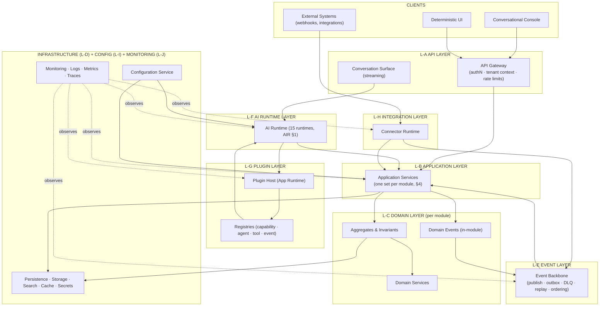
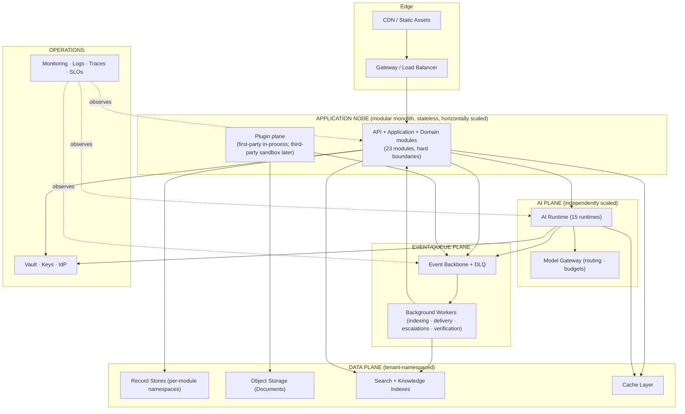

# Nexora — Backend Technical Design

**Product:** Nexora — _Work. Orchestrated by AI._
**Document Type:** Backend Technical Design (BKD)
**Version:** 1.0
**Owner:** Backend Architecture
**Audience:** Backend engineering, platform engineering, security, QA, SRE
**Related documents:** PRD v1.0 · PSD v1.0 · SAD v1.0 · DOMAIN_MODEL v1.0 · AIR v1.0 (AI Runtime Specification)

---

## 0. Purpose & Consistency

### 0.1 Purpose

This document is the **implementation blueprint for backend engineers**: the module structure, component architecture, application/domain/infrastructure services, event processing, CQRS boundaries, integrations, plugin runtime, configuration, security, performance, error handling, observability, deployment readiness, and the evolution path. It contains **no implementation code, no SQL, and no API endpoints** — only backend system design with architectural reasoning.

### 0.2 Consistency contract

Everything here derives from the five prior documents and never contradicts them:

| Anchor                                                        | Used here                                          |
| ------------------------------------------------------------- | -------------------------------------------------- |
| DDD §1–2 (23 bounded contexts, DOM-01…23)                     | **Module map (§3)** — one module per BC            |
| DDD §6–7 (aggregates, domain services)                        | Domain layer (§5), transaction boundaries          |
| DDD §8 (events), PSD §8 (EVT-*), SAD §11                      | Event layer (§7)                                   |
| SAD §5 (13 platform services), §6–7 (App Runtime, Plugin SDK) | Component architecture (§2), plugin runtime (§10)  |
| SAD ADR-001…014, AC-1…16                                      | Cross-cutting decisions (security §12, errors §14) |
| AIR §1 (15 runtimes), §2 (EAO), §10 (Tool Runtime)            | AI Runtime layer (§2.7), module AI-17 (§3)         |
| SAD §14/15 (deployment, scalability), NFR-1…15                | Performance (§13), deployment readiness (§16)      |

**Central decision of this document (modular monolith, then microservices):** v1 ships as a **domain-oriented modular monolith** — every DDD bounded context is a module with hard boundaries (no cross-module storage access, contracts + events only). Extraction into microservices is a _deployment evolution_ (§17.1) that honors the same contracts. This is consistent with the SAD's "independent services" scaling strategy (SAD §15.1): modules are the service seams; the SAD describes the end-state, this document specifies the v1 realization and the safe path between them (§16.3, §17).

---

## 1. Backend Philosophy

### 1.1 Why domain-oriented, not layered CRUD

A classic layered-CRUD architecture (controllers → services → repositories over anemic models) is the wrong shape for Nexora. Five properties of the product force a **domain-oriented architecture**:

| Product property                                                          | Why CRUD fails                                                                                                          | Domain-oriented response                                                                                                                                                         |
| ------------------------------------------------------------------------- | ----------------------------------------------------------------------------------------------------------------------- | -------------------------------------------------------------------------------------------------------------------------------------------------------------------------------- |
| **The unit of value is orchestrated work across domains** (PRD §1, WRK-*) | CRUD serves screens, not cross-domain business processes; workflows would live in orchestration glue, not in the domain | Modules = bounded contexts (DDD §2); workflows run _through_ domain application services; the AI orchestrates, never bypasses (ADR-001)                                          |
| **Business invariants are hard rules** (BR-_, R-_)                        | Anemic models place rules in services that can be skipped; invariants silently rot                                      | Invariants live in **aggregates** (DDD §6); invalid states are unrepresentable (high cohesion)                                                                                   |
| **AI and humans must act under the same governance** (PRM-8, AIR §10)     | Two entry paths (UI + AI) would need duplicate authorization logic                                                      | **Application services** are the single entry; both the API layer and the AI Runtime (via agents → skills → tools) call the same application services through the same contracts |
| **Everything is event-driven and extensible** (PRN-11, FR-16)             | Layered CRUD couples modules via shared services and tables                                                             | Modules communicate by **contracts + events** only; new domains register, never modify (ADR-003/005)                                                                             |
| **Multi-tenant, plugin-based, enterprise-grade** (AC-1…16)                | Layering has no natural isolation seams                                                                                 | Each module enforces tenant context (AC-14); plugin runtime isolates third-party code (§10)                                                                                      |

### 1.2 Architectural style: hexagonal within each module

Every module follows **ports & adapters (hexagonal)**: the **domain core** (aggregates, domain services, domain events) is independent of infrastructure; **ports** are the module's exported contracts; **adapters** (persistence, messaging, external calls, AI tools) plug in from the outside. Consequences:

1. The domain core is testable without infrastructure (fast, deterministic unit tests).
2. Infrastructure choices are swappable per module (SAD §14 — no provider lock-in).
3. The AI's skills and the API's endpoints are both _adapters_ into the same ports — governance is single-sourced (ADR-005).
4. Persistence is per-module: no module reaches another module's store (AC-15); cross-module reads go through published read contracts or projections (CQRS, §8).

### 1.3 Modular monolith posture (reasoning)

| Posture                           | Rule                                                                                                                                                                                                                                                                   |
| --------------------------------- | ---------------------------------------------------------------------------------------------------------------------------------------------------------------------------------------------------------------------------------------------------------------------- |
| **Modular monolith ready**        | All 23 modules compile and deploy as one process group in v1; module boundaries are enforced by build-time rules (no cross-module imports of internals; only contracts)                                                                                                |
| **Microservice ready**            | Every module already exposes only its public contracts; storage is module-owned; events are the cross-module channel — so any module can be extracted to a service without changing other modules (§17.1)                                                              |
| **Independence where it matters** | Even in the monolith, three planes are _deployment-separated_ from day one because they have independent scaling/failure profiles: the **AI Runtime plane**, the **Plugin plane**, and the **event/queue plane** (SAD §15.1: independent AI, independent applications) |

---

## 2. Backend Component Architecture

### 2.1 The ten backend layers

| Layer                        | Responsibility                                                                                               | Key elements                                                                                                      | Source anchor              |
| ---------------------------- | ------------------------------------------------------------------------------------------------------------ | ----------------------------------------------------------------------------------------------------------------- | -------------------------- |
| **L-A API Layer**            | API-first interfaces: request admission, authN, tenant context, rate limits, webhooks out                    | API gateway; context contract enforcement (AC-14); deterministic-UI backend; conversation surface (SSE/streaming) | AP-8, FR-38, FR-4          |
| **L-B Application Layer**    | Use-case coordination: application services; transaction boundaries; no business rules (they live in domain) | Per-module application services (§4)                                                                              | DDD §7, §4 of this doc     |
| **L-C Domain Layer**         | Business logic: aggregates, value objects, domain services, domain events; invariant enforcement             | Module domain cores (DDD §6/7)                                                                                    | DDD §6–7                   |
| **L-D Infrastructure Layer** | Port adapters: persistence, object storage, search, caching, secrets, outbound mail/HTTP                     | Per-module repositories, stores, caches (§6)                                                                      | SAD §14.3                  |
| **L-E Event Layer**          | Durable cross-module messaging: publish API, subscriber runtime, outbox, DLQ, replay, ordering               | Event backbone services (§7)                                                                                      | PSD §8, SAD §11            |
| **L-F AI Runtime Layer**     | The 15 AI runtimes and the orchestration pipeline                                                            | EAO, Planner, Reasoner, Context, Memory, Knowledge, Tools, Approval, Monitoring (AIR §1)                          | AIR §1–2                   |
| **L-G Plugin Layer**         | App Runtime host: load, sandbox, registry fan-out, lifecycle                                                 | Plugin host, manifests, registries (§10)                                                                          | SAD §6–7, ADR-003/012      |
| **L-H Integration Layer**    | Outbound/inbound connector runtime with uniform contract                                                     | Connector registry, adapters (Email, Calendar, Git, Slack, ERP, Payment, Storage — §9)                            | SAD §5.x integration, V1-9 |
| **L-I Configuration Layer**  | Versioned, scoped configuration with safety invariants                                                       | Config service, AI configuration (AIR AIX-15)                                                                     | SAD §5.5, §11 of this doc  |
| **L-J Monitoring Layer**     | Logs, metrics, traces, timelines, health, SLOs                                                               | Telemetry pipeline (AIR §16)                                                                                      | SAD §5.13, AIR §16         |

### 2.2 Component architecture diagram



### 2.3 Layer rules (normative)

1. **Direction:** Application → Domain → Infrastructure; Events cross modules; no module imports another module's internals (only public contracts).
2. **The AI is a first-class caller:** the AI Runtime calls application services through the _same_ ports as the API layer — never through bypass paths (ADR-001).
3. **The Event Layer is the only cross-module awareness channel** (PSD §8.1); synchronous cross-module calls exist only where semantics demand (policy evaluation, directed reads — §8).
4. **Every layer boundary that mutates state writes an audit record** (AC-16, ADR-011).

---

## 3. Backend Modules

The backend is decomposed into **23 modules — exactly the 23 bounded contexts of the domain model** (DOM-01…23). A module is the implementation unit of a BC: it owns its aggregates, application services, domain services, persistence, and events. Module boundaries are **hard** (no cross-module internals, no cross-module storage, contracts + events only — §1.3). The user-facing module names (Identity, Organizations, Workspaces, Projects, HR, …) map onto this catalog as noted.

### 3.1 Module map (DDD alignment)

| User naming                                                                               | Backend module                                               | DDD BC                     |
| ----------------------------------------------------------------------------------------- | ------------------------------------------------------------ | -------------------------- |
| Identity · Organizations · Workspaces                                                     | Tenancy module · Identity & Access module                    | DOM-01, DOM-02             |
| Projects · HR · CRM · Finance · Inventory · Sales · Procurement · Knowledge (+Documents)  | respective App modules                                       | DOM-04…12                  |
| Notifications · Marketplace · Administration · AI Runtime · Policy Engine · Observability | respective platform modules                                  | DOM-15, 18, 19, 17, 03, 23 |
| (added for completeness)                                                                  | Documents, Analytics, Calendar, Search, Configuration, Audit | DOM-11, 13, 14, 20, 21, 22 |

### 3.2 Platform & core modules

| Module                         | Responsibilities                                                                                                                                      | Depends on                                                    | Public contracts                                            | Internal contracts                                                                            | Owned domain | Key events                                                                           | AI ownership                                      |
| ------------------------------ | ----------------------------------------------------------------------------------------------------------------------------------------------------- | ------------------------------------------------------------- | ----------------------------------------------------------- | --------------------------------------------------------------------------------------------- | ------------ | ------------------------------------------------------------------------------------ | ------------------------------------------------- |
| **Tenancy**                    | Organization/Company/Workspace lifecycle, scoping, app enablement, archive                                                                            | —                                                             | Lifecycle commands; context contract                        | Workspace aggregate (WS-R5), enablement aggregate                                             | DOM-01       | `CompanyProvisioned`, `WorkspaceProvisioned`                                         | None (structural)                                 |
| **Identity & Access**          | Users, groups, teams, memberships, roles, guests, external identities, authN                                                                          | Tenancy                                                       | Identity queries; SSO/SCIM hooks; membership grants         | User aggregate (BR-4), role VOs                                                               | DOM-02       | `UserProvisioned`, `UserDeactivated`, `RoleChanged`                                  | None                                              |
| **Policy**                     | 6-level permission evaluation, approval-rule evaluation, AI guardrails; single decision point (ADR-005)                                               | Tenancy, IAM                                                  | `authorize()`, `canApprove()`, guardrail eval (sync)        | PolicyRule aggregate, DecisionLog                                                             | DOM-03       | `PolicyChanged`                                                                      | None (decision authority)                         |
| **Notifications**              | Notifications, Work Inbox, preferences, digests                                                                                                       | Tenancy, IAM, Workflow(read)                                  | Deliver/query; actionable items                             | Notification aggregate, InboxItem projection                                                  | DOM-15       | `NotificationSent`, `ApprovalTaskCreated`                                            | None (AI channel)                                 |
| **App Platform (Marketplace)** | Plugin manifests, registries (capability/agent/tool/event), install/upgrade/remove, catalog                                                           | Tenancy, Policy(read), Configuration                          | Manifest contract (frozen, ADR-003); registration fan-out   | PluginInstall aggregate (DDD §6), registry records                                            | DOM-18       | `PluginInstalled`, `AgentRegistered`, `PluginUpgraded`                               | None (hosts agents)                               |
| **Administration**             | Admin surfaces, delegated admin, app lifecycle control, audit access                                                                                  | All (read)                                                    | Admin query/command surface                                 | AdminTask, Delegation                                                                         | DOM-19       | `PolicyChanged`, `RoleChanged`                                                       | None; admin skills only with confirmation (BR-16) |
| **Search**                     | Unified cross-App index; permission-filtered queries                                                                                                  | All apps (event-driven ingest)                                | Query API (BR-7 filtered)                                   | SearchIndexEntry projection                                                                   | DOM-20       | `IndexUpdated` (internal)                                                            | None                                              |
| **Configuration**              | Versioned scoped config; safety invariants (R-35)                                                                                                     | Tenancy                                                       | Get/set/version/validate                                    | ConfigDocument aggregate                                                                      | DOM-21       | `ConfigChanged`                                                                      | None                                              |
| **Audit**                      | Append-only tamper-evident record; retention; export                                                                                                  | All (facts)                                                   | Write API; query/export (AUD-8)                             | AuditRecord (write-once)                                                                      | DOM-22       | `AuditRecordWritten`                                                                 | None; records AI decisions (AUD-4)                |
| **Observability**              | Logs, metrics, traces, timelines, SLOs                                                                                                                | All                                                           | Telemetry intake; SLO queries                               | LogEntry/Metric/Trace/Timeline projections                                                    | DOM-23       | `SloEvent`, `AnomalyDetected`                                                        | None; observes agents (AIR §16)                   |
| **Workflow**                   | Definitions, executions, journals, human tasks, escalations, compensation                                                                             | Tenancy, Notifications, Policy(read)                          | Run/control; definition registry; trigger intake            | WorkflowDefinition + WorkflowExecution aggregates, journal                                    | DOM-16       | `WorkflowStarted/Completed/Failed`, `StepCompleted`                                  | None (executes AI plans; AIR §1-R7)               |
| **AI Platform (AI Runtime)**   | The 15 runtimes: EAO, Planner, Reasoner, Context, Memory, Knowledge, Conversation, Prompt, Tools, Approval, Capability Discovery, Monitoring (AIR §1) | Workflow, App Platform (discovery), Policy, Knowledge, Search | Orchestration entry (WRK-15); explainability API; AI Studio | Plan aggregate, Conversation aggregate, ApprovalRequest aggregate, MemoryEntry, PromptVersion | DOM-17       | `AgentExecuted`, `OrchestrationPlanProposed`, `ApprovalGranted`, `AiAnomalyDetected` | **Enterprise AI Orchestrator**                    |

### 3.3 Application modules (marketplace Apps)

| Module          | Responsibilities                                             | Depends on                                     | Public contracts                               | Internal contracts                                                            | Owned domain | Key events                                              | AI ownership          |
| --------------- | ------------------------------------------------------------ | ---------------------------------------------- | ---------------------------------------------- | ----------------------------------------------------------------------------- | ------------ | ------------------------------------------------------- | --------------------- |
| **HR**          | Employees, hiring, offers, onboarding, leave, org chart      | IAM, Tenancy, Documents(read)                  | Employee/task interfaces; HR skills            | Employee aggregate (BR-1/11/12), HireService                                  | DOM-04       | `EmployeeCreated`, `EmployeeOnboarded`, `LeaveApproved` | **HR Agent**          |
| **Projects**    | Projects, tasks, milestones, resources, timesheets, capacity | IAM, HR(read)                                  | Project/task interfaces; capacity query        | Project aggregate (BR-2), ResourceAllocationService                           | DOM-05       | `ProjectCreated`, `TaskCompleted`, `ResourceAssigned`   | **Projects Agent**    |
| **CRM**         | Accounts, contacts, deals, activities, duplicates            | Tenancy                                        | Account/deal interfaces; duplicate check       | Account + Deal aggregates, DuplicateDetectionService                          | DOM-06       | `CustomerAdded`, `DealWon`                              | **CRM Agent**         |
| **Sales**       | Quotes, orders, pricebook, forecasts                         | CRM, Inventory(read), Finance(read)            | Quote/order interfaces                         | Quote + Order aggregates                                                      | DOM-07       | `QuoteCreated`, `OrderCreated`                          | **Sales Agent**       |
| **Finance**     | Invoices, expenses, budgets, payments, close                 | Projects(read), Sales(read), Procurement(read) | Invoice/expense/budget interfaces; money gates | Invoice + Budget + Expense aggregates, MoneyService, BudgetEnforcementService | DOM-08       | `InvoiceGenerated`, `InvoicePaid`, `BudgetExceeded`     | **Finance Agent**     |
| **Procurement** | Requisitions, POs, vendors, receipts, three-way match        | Finance(read), Tenancy                         | Requisition/PO interfaces; vendor registry     | Requisition + PurchaseOrder + Vendor aggregates, ThreeWayMatchService         | DOM-09       | `PurchaseApproved`, `ReceiptRecorded`                   | **Procurement Agent** |
| **Inventory**   | Items, locations, stock, transfers, counts, reorder          | Procurement(read), Sales(read)                 | Stock interfaces; reorder proposal             | Item aggregate, ReorderService                                                | DOM-10       | `StockAdjusted`, `ReorderProposed`                      | **Inventory Agent**   |
| **Documents**   | Files, versions, templates, sharing, authoritative version   | Tenancy                                        | Document interfaces; version semantics (BR-12) | Document aggregate                                                            | DOM-11       | `DocumentUploaded`, `DocumentApproved`                  | **Documents Agent**   |
| **Knowledge**   | Articles, policies, SOPs, grounding index, retrieval         | Documents(ingest), Tenancy, Policy             | Retrieval API (BR-7); publication flow         | KnowledgeArticle aggregate, RetrievalService                                  | DOM-12       | `KnowledgeUpdated`, `ArticlePublished`                  | **KB Agent**          |
| **Analytics**   | KPIs, reports, narration, Q&A                                | All (read projections)                         | Query API; report scheduling                   | Kpi/Report aggregates                                                         | DOM-13       | `ReportGenerated`, `KpiThresholdBreached`               | **Analytics Agent**   |
| **Calendar**    | Events, availability, scheduling                             | Projects, HR, CRM (contextual reads)           | Scheduling interface; availability             | CalendarEntry aggregate, SchedulingService                                    | DOM-14       | `EventCreated`, `MeetingBooked`                         | **Calendar Agent**    |

---

## 4. Application Services

Realizes: DDD §4 (entities) as entry points; §2.1-LB; the single-entry principle (AIR §1.4-1).

**Application services** are the use-case layer: they coordinate domain objects to fulfill a user/AI request, own the **transaction boundary**, translate between the outside world and the domain, and publish domain events. They contain **no business rules** (those live in aggregates/domain services — DDD §6/7). Every external entry — API, conversational AI, event-triggered task — calls the same application services (ADR-001, §1.1).

### 4.1 Application service catalog (per module)

| Module            | Application services (representative)                                                        | Primary use cases                                                                                                |
| ----------------- | -------------------------------------------------------------------------------------------- | ---------------------------------------------------------------------------------------------------------------- |
| Tenancy           | `CompanyAppService`, `WorkspaceAppService`                                                   | Provision company; provision/archive workspace; enable app                                                       |
| Identity & Access | `UserAppService`, `MembershipAppService`, `InvitationAppService`                             | Provision/deactivate user (BR-4); grant membership; invite guest (BR-8)                                          |
| Policy            | `PolicyAppService`                                                                           | Manage roles/rules/chains; every decision still goes through the domain `PolicyEvaluationService` (§5)           |
| HR                | `EmployeeAppService`                                                                         | Hire (WRK-1), onboard (WRK-2), offboard (WRK-3), leave (WRK-10)                                                  |
| Projects          | `ProjectAppService`                                                                          | Create project (WRK-4), assign resources, status                                                                 |
| CRM               | `AccountAppService`, `DealAppService`                                                        | Add customer (WRK-5), manage pipeline                                                                            |
| Sales             | `QuoteAppService`, `OrderAppService`                                                         | Quote→order (WRK-11)                                                                                             |
| Finance           | `InvoiceAppService`, `ExpenseAppService`, `BudgetAppService`                                 | Invoice (WRK-7), expenses (WRK-9), close (WRK-14)                                                                |
| Procurement       | `RequisitionAppService`, `PurchaseOrderAppService`                                           | Requisition→PO (WRK-6)                                                                                           |
| Inventory         | `StockAppService`, `TransferAppService`                                                      | Reorder (WRK-12), transfers                                                                                      |
| Documents         | `DocumentAppService`                                                                         | Draft/approve (WRK-8), version, share                                                                            |
| Knowledge         | `KnowledgeArticleAppService`                                                                 | Publish article, answer (WRK-13)                                                                                 |
| Notifications     | `NotificationAppService`                                                                     | Deliver, batch, preferences (FR-27/28)                                                                           |
| Workflow          | `WorkflowAppService`                                                                         | Start/pause/resume/cancel runs (FR-25); complete human tasks                                                     |
| AI Platform       | `ConversationAppService`, `PlanAppService`, `ApprovalAppService`, `ExplainabilityAppService` | Conversation sessions (FR-7); plan lifecycle (§6 AIR); approval decisions (AIR §12); explanation queries (FR-36) |
| App Platform      | `PluginAppService`                                                                           | Install/upgrade/remove (FR-14/17); registry fan-out                                                              |
| Administration    | `AdminAppService`                                                                            | Admin commands; delegation (FR-37)                                                                               |
| Search            | `SearchQueryService` (query side)                                                            | Permission-filtered queries (FR-30)                                                                              |
| Configuration     | `ConfigAppService`                                                                           | Versioned config; validation (R-35)                                                                              |
| Audit             | `AuditQueryService` (query side), `AuditExportService`                                       | Query/export (FR-34, AUD-8)                                                                                      |
| Observability     | `TimelineQueryService` (query side)                                                          | AI/Workflow/Activity timelines (OBS-*)                                                                           |

### 4.2 Application service rules (reasoning)

1. **Transaction boundaries live here:** each application service method opens the transaction, loads the aggregate root, invokes domain logic, and commits (DDD §6). Compensation for multi-aggregate work belongs to the Workflow module's saga handling (§14).
2. **One entry, many faces:** the same `EmployeeAppService.hire(...)` is invoked by the conversational path (via the HR Agent's skill → Tool Runtime → application service), the deterministic UI, and the event-triggered workflow — guaranteeing identical governance (ADR-001).
3. **Thin by construction:** any rule found in an application service is a smell; rules are pushed into aggregates/domain services (high cohesion, §1.1).
4. **Authorization is a pre-step:** application services assume the caller is authorized — authorization is decided _before_ invocation by the Policy Engine (sync), including for AI callers (PRM-8).

---

## 5. Domain Services

Realizes: DDD §7 (domain services catalog) — ownership, transaction boundaries.

**Domain services** hold stateless business logic that does not naturally belong to an entity (DDD §7). They live inside their module's domain layer, are invoked by application services, and never cross module boundaries (each module implements its own; cross-module needs are served via events or read contracts).

### 5.1 Domain service ownership map

| Domain service                                 | Module                 | Transaction boundary                  | Notes (reasoning)                                           |
| ---------------------------------------------- | ---------------------- | ------------------------------------- | ----------------------------------------------------------- |
| `PolicyEvaluationService`                      | Policy                 | None (pure decision, sync)            | Single decision point; never split across modules (ADR-005) |
| `ApprovalService`                              | AI Platform            | ApprovalRequest aggregate             | Owns chains, first-decision-wins, superseding (EC-8, BR-15) |
| `CapabilityDiscoveryService`                   | AI Platform            | None (query over registry projection) | Read-model owner per DDD §2.3                               |
| `IntentMatchingService`                        | AI Platform            | None                                  | Stateless matching (AIR §6)                                 |
| `VerificationService`                          | AI Platform            | None                                  | Read-back verification (AI-6); shared by all agents         |
| `ModelGovernanceService`                       | AI Platform            | None                                  | Routing/budgets (NFR-14, ADR-008)                           |
| `MemoryService`                                | AI Platform            | MemoryEntry write                     | Scope-aware memory; user-visible deletion (AIX-5)           |
| `ExplainabilityService`                        | AI Platform            | None                                  | Renders decision records (ADR-011)                          |
| `ExecutionService`                             | Workflow               | WorkflowExecution journal             | Advances runs; honors gates (FR-22…26)                      |
| `TaskRoutingService`                           | Workflow               | None                                  | Routes human tasks to Work Inbox (FR-24)                    |
| `EscalationService`                            | Workflow               | None                                  | SLA-driven escalation; never auto-approval (EC-4)           |
| `CompensationService`                          | Workflow               | Saga per run                          | Reverse-dependency-order rollback (ADR-009)                 |
| `HireService`                                  | HR                     | Employee aggregate                    | Coordinates hire steps (WRK-1)                              |
| `OnboardingOrchestrationService`               | HR                     | OnboardingTask                        | Emits events that trigger cross-module steps (WRK-2)        |
| `ResourceAllocationService`, `CapacityService` | Projects               | Project aggregate                     | Assignment + capacity checks (WRK-1/4)                      |
| `DuplicateDetectionService`                    | CRM / HR / Procurement | None                                  | Similarity matching; merge proposals (EC-7)                 |
| `MoneyService`, `BudgetEnforcementService`     | Finance                | Money VOs; Budget aggregate           | Money invariants (BR-10); no FP drift                       |
| `ThreeWayMatchService`                         | Procurement            | PO aggregate                          | PO↔receipt↔invoice matching (WRK-6)                         |
| `ReorderService`                               | Inventory              | Item aggregate                        | Demand+lead-time computation (WRK-12)                       |
| `VersioningService`                            | Documents              | Document aggregate                    | Authoritative-version resolution (BR-12)                    |
| `RetrievalService`, `IndexingService`          | Knowledge              | None (projection)                     | Access-filtered retrieval (BR-7, ADR-007)                   |
| `SchedulingService`                            | Calendar               | CalendarEntry                         | Availability + booking (external sends gated)               |
| `NotificationRoutingService`                   | Notifications          | None                                  | Preference-aware routing (FR-27)                            |
| `RegistrationService`, `ValidationService`     | App Platform           | PluginInstall aggregate               | Manifest validation + fan-out (§10)                         |

### 5.2 Transaction boundary rules

1. **One aggregate = one transaction** for invariant-bearing operations (DDD §6); application services never span aggregates in one transaction.
2. **Multi-aggregate/multi-module flows** are handled by the Workflow module (journaled saga with compensation — §14.3) — never by distributed transactions (ADR-009).
3. **Projection services** (Search, Knowledge, registries, timelines, Inbox) are eventually consistent, rebuilt from events (EVT-G3).
4. **Pure decision services** (Policy, IntentMatching, Verification) are synchronous and side-effect-free — safe to call from any layer (PRM-8).

---

## 6. Infrastructure Services

Realizes: SAD §14.3 (deployment properties), AC-13/14, NFR-1…10.

Infrastructure is provided as **shared platform services consumed through per-module adapters**. Modules never talk to infrastructure directly; they use ports (repositories, outboxes, caches) whose adapters are owned by the module (hexagonal, §1.2). All infrastructure is tenant-context-aware (AC-14).

| Service           | Responsibility                                                                                    | Tenant/isolation behavior                                                                          | Consumption pattern                                                                                                       |
| ----------------- | ------------------------------------------------------------------------------------------------- | -------------------------------------------------------------------------------------------------- | ------------------------------------------------------------------------------------------------------------------------- |
| **Persistence**   | Durable record stores for aggregates; per-module schemas/namespaces                               | Records namespaced by Company + Workspace; no cross-tenant queries (FR-1); residency-pinned (AC-9) | Repository adapters per aggregate; identity keys carry `companyId`                                                        |
| **Messaging**     | Transport substrate for the Event Layer (§7) and task queues                                      | Tenant-scoped topics; no cross-tenant publish (EVT-G6)                                             | Publishers via outbox; consumers idempotent (EVT-G1)                                                                      |
| **Caching**       | Read-through caches for hot paths: registries, config, permission lookups, capability descriptors | Cache keys always include tenant scope; no cross-tenant cache hits (AC-14)                         | Invalidation via events (`PolicyChanged`, `PluginUpgraded`); **never caches authority for Consequential actions** (PRM-8) |
| **Search**        | Unified cross-App index (module: Search §3.2)                                                     | Query-time permission filtering (BR-7); index rebuildable from events (EVT-G3)                     | Indexing pipeline consumes record events                                                                                  |
| **Storage**       | Object/file storage for Documents (SAD §14.2), large artifacts                                    | Buckets/keys tenant+workspace namespaced; residency-pinned; presigned access with scope            | Documents module writes; other modules read via contract                                                                  |
| **Configuration** | Versioned config service (module: Configuration §3.2)                                             | Company/Workspace scoped; safety invariants (R-35)                                                 | Modules read config on boot + on `ConfigChanged`                                                                          |
| **Secrets**       | Central vault: connector credentials, encryption keys                                             | Scoped leases per Company; no secrets in configs/logs (NFR-5)                                      | Integration adapters and AI gateway request scoped leases                                                                 |
| **Logging**       | Structured, tenant-scoped logs with correlation/trace IDs                                         | `companyId`/`workspaceId` on every entry; no secrets (AC-14)                                       | All layers emit via the monitoring pipeline                                                                               |
| **Monitoring**    | Metrics, traces, timelines, health, SLOs (AIR §16)                                                | Tenant-scoped telemetry (NFR-15)                                                                   | Auto-instrumented boundaries; timeline projections from events                                                            |

### 6.1 Infrastructure rules (reasoning)

1. **Ports over providers:** modules depend on interfaces (ports); adapters bind providers at deployment (SAD §14 — swappable, no lock-in, on-prem capability).
2. **No cross-module storage:** persistence is per-module by contract; cross-module reads use read contracts or projections (AC-15).
3. **Infrastructure never contains domain logic:** any rule in an adapter is a defect (high cohesion).
4. **Outbox pattern for publishing:** module transactions write events to a local outbox in the same transaction as the aggregate change; a relay publishes to the Event Layer — no lost events, no dual-write inconsistency (EVT-G1, §7).
5. **Resilience is layered:** caching → queues → retries → circuit breakers (§14) are provided by shared infrastructure primitives, not reimplemented per module.

---

## 7. Event Processing

Realizes: PSD §8 (EVT-G1…G6); SAD §11 (event backbone); DDD §8 (domain events); ADR-002/010.

The **Event Layer** is the only cross-module awareness channel (PSD §8.1). Its processing guarantees are implementation-critical; this section defines them behaviorally.

### 7.1 Event pipeline (behavior)

| Stage            | Behavior                                                                                                                                                 | Guarantee                             |
| ---------------- | -------------------------------------------------------------------------------------------------------------------------------------------------------- | ------------------------------------- |
| **Publish**      | Domain event written to the module's **outbox** in the aggregate's transaction; relay publishes to the tenant-scoped topic with full envelope (PSD §8.2) | No event loss; no dual-write (EVT-G1) |
| **Subscribe**    | Consumers declare subscriptions (Subscriber Registry, EVT-G5); delivery is at-least-once                                                                 | At-least-once (EVT-G1)                |
| **Idempotency**  | Every consumer processes by `eventId` idempotency key; duplicate delivery has no duplicate effect                                                        | Exactly-once _effect_ (EVT-G1)        |
| **Retry**        | Transient failures retry with backoff; poison after N attempts → Dead Letter Queue                                                                       | Delivery completed or quarantined     |
| **DLQ**          | Dead-lettered events retain envelope + failure history; operations may replay, inspect, or discard — each action audited                                 | No silent loss (SAD §11.2)            |
| **Replay**       | Replay Service re-emits historical events (with new trace IDs, audited) for recovery/re-indexing                                                         | Rebuildability (EVT-G3, FR-26)        |
| **Ordering**     | Partition key = subject (record); per-subject ordering guaranteed; cross-subject ordering not guaranteed (EVT-G2)                                        | Per-subject order                     |
| **Correlation**  | `correlationId` stamped across all events of a workflow/conversation; `traceId` per logical operation                                                    | Join key for timelines (OBS-*)        |
| **Traceability** | Event History Store + Audit Platform join on correlationId                                                                                               | End-to-end reconstructability (AG-7)  |

### 7.2 Processing rules

1. **Trigger-not-action:** consumers never mutate another module's records on an event; they start orchestrated workflows (ADR-002, AIR §1.4-1).
2. **Schema versioning:** event schemas are versioned in a Schema Registry; breaking changes require new types with deprecation windows (AC-13, EVT-G4).
3. **Ordering integrity:** the partition key is derived from the subject ID only — never from fields that can change (EVT-G2).
4. **Dead-letter hygiene:** DLQ is monitored; aging events alert operations (SLO, §15).
5. **No cross-tenant events:** publishing outside the tenant scope is rejected at the Publisher API (EVT-G6).

---

## 8. Command and Query Model (CQRS)

Realizes: DDD §6 (aggregates); PSD §8 (event-derived projections); SAD §5.7/5.8 (Search/Knowledge); ADR-009.

Nexora uses **selective CQRS**: the command side is aggregate-based (strong consistency within a transaction), the query side is projection-based (eventual consistency by design). CQRS is not applied globally — it is applied where read and write shapes genuinely diverge.

### 8.1 Command side (where)

- **Commands** are the domain-mutating operations performed by application services against aggregate roots (DDD §6) inside one transaction per aggregate.
- Command entry points: API layer, AI Runtime (agent skills → application services), event-triggered workflows. All share the same commands (ADR-001).
- On success, the aggregate publishes domain events via the outbox (same transaction, §6.1-4).

### 8.2 Query side (where)

| Projection                           | Built from                                              | Purpose                                    |
| ------------------------------------ | ------------------------------------------------------- | ------------------------------------------ |
| **Search index**                     | Record events (EVT-*)                                   | Unified permission-filtered lookup (FR-30) |
| **Knowledge index**                  | Content events (`KnowledgeUpdated`, `DocumentApproved`) | Access-filtered grounding (BR-7)           |
| **Registry projections**             | `PluginInstalled`, `AgentRegistered`, `PluginUpgraded`  | Capability discovery (DDD §2.3, AIR §5)    |
| **Work Inbox**                       | Approval/task events                                    | Unified approvals & tasks (FR-29)          |
| **Timelines** (AI/Workflow/Activity) | Decision records + journals                             | Observability (OBS-2/3/4)                  |
| **Analytics views**                  | Record events                                           | KPIs/reports (APP-09)                      |
| **Audit views**                      | Audit records (authoritative)                           | Compliance (FR-34)                         |

### 8.3 CQRS rules (reasoning)

1. **Commands never read projections; queries never mutate.** This keeps the command side simple and the query side fast.
2. **Eventual consistency for reads** is acceptable everywhere because cross-module awareness is already event-driven (ADR-002); the Work Inbox and timelines are projections of the same events users already reason about.
3. **Strong consistency where it matters:** aggregate invariants (BR-*) are enforced on the command side within one transaction — no read-your-write violation for decisions that gate actions.
4. **Authorization is decided on both sides** by the same Policy Engine (sync) — projections never bypass permissions (BR-7 filtering at query time).

---

## 9. Integration Architecture

Realizes: PSD V1-9 (email, webhooks, REST baseline); SAD §5.x integration; PRD NG-6/7 (partner engines); APP-10 (calendar sync).

All external integrations flow through the **Integration Layer (L-H)** with a **uniform connector contract** — every connector behaves the same way for governance, resilience, and audit regardless of the external system.

### 9.1 Connector contract (per connector)

| Contract element   | Requirement                                                                                                          |
| ------------------ | -------------------------------------------------------------------------------------------------------------------- |
| Side-effect class  | Read-only / Update / Consequential (BR-13); Consequential external calls require approval (external email, payments) |
| Idempotency        | Idempotency keys for outbound calls; dedupe for inbound webhooks                                                     |
| Scoped credentials | Credentials in the vault, scoped per Company, never in code/config (NFR-5)                                           |
| Health             | Liveness/failure telemetry; degraded connectors route to fallback (§14)                                              |
| Versioning         | Connector versions; schema-versioned payloads (AC-13)                                                                |
| Tenant context     | Every outbound call and inbound event carries Company context (AC-14)                                                |

### 9.2 Connector catalog

| Connector         | Direction | Behavior                                                                                                   | Source anchor |
| ----------------- | --------- | ---------------------------------------------------------------------------------------------------------- | ------------- |
| **External APIs** | Out + In  | The API-first surface (FR-38); webhooks out (V1-9); webhooks in with signature verification                | AP-8          |
| **Email**         | Out + In  | Notifications (FR-27), inbound email actions (V1-9); external sends = Consequential gate                   | V1-9          |
| **Calendar**      | Out       | External calendar sync (APP-10 extension); external attendee sends gated (AIR §11)                         | APP-10        |
| **Git**           | In        | Repository events → release-notes/change context for software customers (PRD §15); ingest-only in v1.x     | PRD §15       |
| **Slack/Teams**   | Out + In  | Chat clients (Phase 1, V1-11); messages enter the same orchestration pipeline (no bypass)                  | FR-4          |
| **ERP**           | Out + In  | Legacy core integration — Nexora orchestrates _around_, never rebuilds (PRD NG-7); read + delegated writes | NG-7          |
| **Payment**       | Out       | Payment scheduling (Finance) via partner engines (NG-6); money movement always approved + audited          | NG-6, BR-19   |
| **Storage**       | In        | Object/file storage for Documents (SAD §14.2); presigned, tenant-scoped                                    | SAD §14.2     |

### 9.3 Integration rules (reasoning)

1. **Connectors are adapters, not domains** — they implement a port; domain logic never leaks into them (§1.2).
2. **Every external side effect is governed:** outbound email, payment, and order placement are Consequential-class and gated (BR-13); the gate is architectural, not a connector convention.
3. **Inbound events are treated as triggers** — they start orchestrated workflows rather than mutating state directly (ADR-002).
4. **Partner engines (payroll/tax/GL) are integrations, not in-house domains** (PRD NG-6/7) — preserving the horizontal platform.

---

## 10. Plugin Runtime

Realizes: SAD §6 (App Container), §7 (Plugin SDK), ADR-003/012; PSD §5.5 (lifecycle); DDD §14.8 (plugin lifecycle).

The **Plugin Runtime** (L-G) is how Apps are loaded and run. It is the operational realization of the frozen App Contract (ADR-003): the platform never compiles or links App code at install time, and App internals never touch platform stores.

### 10.1 Loading model (two modes, one contract)

| Mode                           | Who                                               | Runtime behavior                                                                                                                             | When            |
| ------------------------------ | ------------------------------------------------- | -------------------------------------------------------------------------------------------------------------------------------------------- | --------------- |
| **In-process modules**         | First-party Apps (HR, Projects, Documents, KB, …) | Implemented as modules (§3.3) inside the monolith, but **must honor the same manifest/registry contract** as any plugin (dogfooding, PRD P5) | v1              |
| **Sandboxed plugin processes** | Third-party Apps (public SDK, Phase 2+)           | Loaded into isolated plugin processes with quotas, no platform-store access, rate limits                                                     | Phase 2 (V1-12) |

Both modes register identically: manifest → validation → registry fan-out → discovery (AIR §5). This is what makes the transition from first-party modules to third-party plugins a packaging change, not an architectural one (SAD §6.3).

### 10.2 Plugin runtime behaviors

| Concern                 | Behavior                                                                                                                                                          |
| ----------------------- | ----------------------------------------------------------------------------------------------------------------------------------------------------------------- |
| **Lifecycle**           | `Install → Validate → Register → Enable → Run → Upgrade → Remove` (PSD §5.5, DDD §14.8); every transition audited (FR-14/17)                                      |
| **Isolation**           | Per-Company + per-App sandbox: process/tenant isolation, quotas (compute, memory, egress, event rate), storage only via the Storage Contract boundary (SAD §7.13) |
| **Versioning**          | Semantic versions; breaking contract changes = major version + re-approval + rollback retained (FR-17, AC-13)                                                     |
| **Registration**        | Registration fan-out into the five registries (capability/agent/tool/event/knowledge) with write-ownership in App Platform (DDD §2.3)                             |
| **Dependencies**        | Declared read-only dependencies resolved at install; missing dependencies reject install; no runtime cross-App call graph (PSD §5.5)                              |
| **Failure containment** | A crashing/looping plugin affects only its own App instances (NFR-13, ER-5); plugin health feeds Monitoring (EC-5)                                                |
| **Uninstall**           | Export confirmation → grace → unregister → quarantine data → audit completion (PSD §5.5, EC-3)                                                                    |

### 10.3 Plugin runtime rules (reasoning)

1. **The contract, not the runtime, is the constant** — modes change, contracts don't (ADR-003/012).
2. **Isolation is by construction** — sandboxes, quotas, and the Storage Contract make third-party code safe by design (R3 mitigation, SAD §7.13).
3. **Discovery happens at registration** — the AI never learns about an App by code or config, only by registry records (ADR-005, AIR §5).
4. **First-party dogfooding** guarantees the plugin contract stays honest while the platform is young (PRD P5).

---

## 11. Configuration Architecture

Realizes: SAD §5.5 (Configuration Platform); PSD AIX-15 (AI configuration); R-35 (safety invariants); DDD §13.

Configuration is **data with schema, scope, and version** — never code (SAD §5.5). It is served by the Configuration module and consumed by every other module through typed ports.

### 11.1 Configuration hierarchy (resolution order: most specific wins)

| Level            | Scope                          | Examples                                                                       | Validated against                                                                 |
| ---------------- | ------------------------------ | ------------------------------------------------------------------------------ | --------------------------------------------------------------------------------- |
| **Global**       | Platform defaults              | Default autonomy tier, default retention, default approval chains              | Platform invariants (AC-*)                                                        |
| **Company**      | One tenant                     | Residency, retention, AI budgets, SSO settings, company-wide approval defaults | Company invariants (NFR-10)                                                       |
| **Workspace**    | One Workspace                  | App enablement, autonomy tier, knowledge visibility, workflow defaults (WS-*)  | Workspace invariants (WS-R*)                                                      |
| **Plugin (App)** | One App in a Company/Workspace | Skill toggles, app thresholds (leave limits, budget tiers)                     | App manifest schema (AC-13)                                                       |
| **AI**           | AI behavior                    | Model tiers/routing, prompt overrides, budgets, evaluation gates (AIX-15)      | **Safety invariants (AC-3/4/5, R-35)** — weakening config is rejected, not stored |

### 11.2 Configuration behaviors

| Behavior                     | Specification                                                                                                                          |
| ---------------------------- | -------------------------------------------------------------------------------------------------------------------------------------- |
| **Typed schemas**            | Every config key has a schema (from the module, App manifest, or AI Studio); unknown or invalid config is rejected                     |
| **Versioning & rollback**    | Config documents are versioned; rollback restores prior state; changes are audited (`ConfigChanged`, AUD-1)                            |
| **Event-driven propagation** | `ConfigChanged`/`PolicyChanged` invalidate caches and trigger re-evaluation (§13.3 AIR, §6 caching)                                    |
| **Merge semantics**          | Effective config = resolved hierarchy with explicit overrides; provenance (which level set the value) is recorded for audit            |
| **Safety invariant layer**   | AI configuration cannot weaken human-approval, isolation, or audit guarantees (R-35, AC-3/4/5) — enforced at write time, not read time |

**Reasoning:** a single configuration service with per-level schemas and safety invariants removes the class of bugs where a tenant misconfigures itself into an unsafe state — and keeps every module's settings auditable and revertible (ADR-011 alignment).

---

## 12. Security

Realizes: SAD §13 (security architecture), AC-1…5; NFR-5…10; PRM-_; AUD-_; BR-8.

Security is enforced at the **platform layer, outside any module or configuration's reach** (SAD §13.3). The backend realizes the SAD's security model as concrete mechanisms.

| Area                 | Backend realization                                                                                                                                                                                                | Source    |
| -------------------- | ------------------------------------------------------------------------------------------------------------------------------------------------------------------------------------------------------------------ | --------- |
| **Authentication**   | API gateway terminates authN: SSO (SAML/OIDC), MFA, SCIM (FR-18); short-lived sessions; per-request revalidation for sensitive operations (USR-R2); immediate revocation on deactivation (BR-4)                    | SAD §13.1 |
| **Authorization**    | Single Policy module decision point (ADR-005): 6-level model, deny-wins, fresh evaluation per request; enforced at API, application-service, and tool boundaries (PRM-8)                                           | SAD §13.1 |
| **Encryption**       | At rest (AES-256, key-per-tenant where required) and in transit (TLS 1.2+); key management with rotation; residency-pinned data plane (NFR-5/10)                                                                   | NFR-5     |
| **Secrets**          | Central vault; scoped leases; rotation; no secrets in configs, logs, or client code; connector credentials per Company (NFR-5)                                                                                     | §6        |
| **Tenant isolation** | Tenant context (companyId/workspaceId) required on every request, event, job, and query (AC-14); namespaced storage/search/cache; no cross-tenant path under any configuration (FR-1)                              | AC-1/14   |
| **Audit**            | Append-only tamper-evident audit at every mutating boundary (AC-16, AUD-1/2); AI decisions recorded with plan/prompt/sources (AUD-4); export with residency honor (FR-34)                                          | AUD-*     |
| **Compliance**       | SOC 2 Type II, ISO 27001, GDPR, CCPA (NFR-6); retention (AUD-7); Auditor role read-only & non-excludable (AUD-8); evidence bundles (FR-34)                                                                         | NFR-6     |
| **AI security**      | Prompt-injection defense (structural instruction separation, AIR §1-R14); schema-validated tools; side-effect gating (BR-13); verification before claims (AI-6); budgets (NFR-14); no ungoverned actions (ADR-001) | AIR §13.2 |
| **Plugin security**  | Sandbox isolation, quotas, validation gates (§10, §7.12 SAD), no platform-store access (AC-15)                                                                                                                     | SAD §7.13 |

### 12.1 Backend security rules

1. **Fail closed:** default-deny; any missing context or invalid scope denies the request (AC-14).
2. **Defense in depth:** gateway → Policy module → application service → aggregate → tool runtime; each boundary re-validates what it can (PRM-8).
3. **No security by convention:** isolation, audit, and approval guarantees are enforced by platform mechanisms, never by module discipline (SAD §13.3).
4. **Least privilege by construction:** roles grant the minimum; guests/externals are read-only and time-boxed (BR-8, USR-9/10/11).

---

## 13. Performance

Realizes: NFR-1…4; SAD §15 (scalability); AIR §16 (latency budgets).

Performance is an architectural budget, not an afterthought: latency targets (NFR-1/2) are allocated per layer, and the mechanisms below are shared infrastructure primitives.

| Mechanism              | Architecture                                                                                                            | Latency/scale impact                                              |
| ---------------------- | ----------------------------------------------------------------------------------------------------------------------- | ----------------------------------------------------------------- |
| **Caching**            | Read-through caches for registries, config, permission lookups, capability descriptors; event-driven invalidation (§6)  | Cuts hot-path reads; never caches Consequential authority (PRM-8) |
| **Queues**             | Durable task queues for background work (indexing, notifications, escalations, verification)                            | Request path never blocks on long work (SAD §15.1)                |
| **Background jobs**    | Schedulers for close tasks, reports, digests, retention, SLO checks                                                     | Predictable load off the hot path                                 |
| **Concurrency**        | Per-aggregate serialization; per-subject event ordering (EVT-G2); optimistic concurrency with conflict detection (EC-9) | Correctness under load; no lost updates                           |
| **Horizontal scaling** | Stateless modules scale out; state lives in durable stores + event backbone (SAD §15.1)                                 | Linear scale for API/AI/worker planes                             |
| **Async execution**    | Workflow steps execute asynchronously; conversational response streams progress (NFR-1 perceived latency)               | AI feels responsive while work proceeds                           |

### 13.1 Performance rules (reasoning)

1. **Latency budget per stage** (NFR-1/2): conversational p95 ≤ 2s (excluding streamed perception), orchestration hop ≤ 500ms — each stage's budget is tracked in AI observability (AIR §16).
2. **Scale independently:** the AI plane, plugin plane, and event/queue plane scale separately even inside the monolith deployment (SAD §15.1, §1.3).
3. **Cost-aware scaling:** per-tenant automation cost is observable (NFR-14) so growth is economically governed (PRD §18.1).
4. **Correctness over raw speed:** ordering and idempotency guarantees are never traded for throughput (EVT-G1/G2).

---

## 14. Error Handling

Realizes: AIR §2.6 (EAO failure behavior), PSD ER-1…8 (error taxonomy), NFR-13 (containment), ADR-009 (compensation).

The backend implements a **global error-handling strategy** with layered resilience. Every error is classified (ER-1…8), recorded, and surfaced — never silent, never destructive (PSD §14.2).

### 14.1 Global strategy

| Strategy             | Behavior                                                                                                                                    | Applies to                |
| -------------------- | ------------------------------------------------------------------------------------------------------------------------------------------- | ------------------------- |
| **Classification**   | Errors classified into intent / plan / step / agent / tool / integration / approval / concurrency / timeout classes (ER-*)                  | All layers                |
| **Retries**          | Idempotent operations retry with backoff; non-idempotent operations never auto-retry (FR-13); retry budget per operation                    | Tools, connectors, events |
| **Compensation**     | Multi-step work runs as a journaled saga; on failure, compensation executes in reverse dependency order (ADR-009)                           | Workflow module           |
| **Circuit breaking** | Degraded connectors/tools open circuits after thresholds; traffic fails fast and routes to fallback (§14.2); health feeds suspension (EC-5) | Integration, Tool Runtime |
| **Fallback**         | Deterministic-UI fallback for AI failures (FR-8); manual-mode for blocked workflows; graceful degradation to clarifying questions (ER-1)    | AI Runtime, Workflow      |
| **Containment**      | A failing agent/tool/plugin never cascades into unrelated workflows (NFR-13)                                                                | All planes                |

### 14.2 Resilience layers (ordered)

```
Caching → Queues → Retries → Circuit breakers → Fallbacks → Human escalation
```

Each layer absorbs the previous one's failure; escalation to a human is the terminal (and legitimate) outcome (§2.7 AIR).

### 14.3 Error-handling rules (reasoning)

1. **Idempotency is the backbone** — every retryable operation carries an idempotency key; retries are safe by construction (EVT-G1).
2. **Never auto-approve, never auto-destroy** — timeouts escalate (EC-4); failures never cause data loss (ER-2, FR-26 journaling).
3. **Visible by default** — every failure appears in the Workflow Timeline, conversation, and monitoring (PSD §14.2, OBS-4).
4. **Circuit breakers are per-connector/per-tool** — isolation preserves tenant blast radius (NFR-13).

---

## 15. Observability

Realizes: AIR §16 (AI observability), SAD §16, PSD §16 (OBS-*), NFR-15.

The backend emits **logs, metrics, traces, and health** through one telemetry pipeline; timelines are projections of decision records and journals (ADR-011) — one source of truth.

| Surface        | Backend realization                                                                               | Key signals                                          |
| -------------- | ------------------------------------------------------------------------------------------------- | ---------------------------------------------------- |
| **Logs**       | Structured, tenant-scoped, correlation/trace IDs on every entry; no secrets (AC-14)               | Request/event/job lifecycle logs                     |
| **Metrics**    | RED (rate/errors/duration) per service + product metrics (PRD §18)                                | automation value, escalation rate, guardrail metrics |
| **Tracing**    | Distributed traces across layers, event hops, and AI calls (NFR-15)                               | end-to-end request reconstructability                |
| **Health**     | Liveness/readiness probes per module plane; plugin/agent health (EC-5); SLO burn-rate alerts      | degraded entity routing, alerts                      |
| **Monitoring** | Dashboards per plane (API, AI, plugins, events, integrations) with tenant-scoped access (AIR §16) | AI timelines, workflow timelines, cost tracking      |

### 15.1 Observability rules

1. **Decision-time recording** (ADR-011): AI timelines, explainability, and audit share the same records — no second telemetry source.
2. **Tenant-scoped telemetry** (NFR-15): no cross-tenant visibility; Auditor roles included (AUD-8).
3. **Timelines are projections** (OBS-2/3/4): rebuilt from events and journals; replayable (EVT-G3).
4. **SLOs drive capacity** (NFR-1…4): scaling and alerting follow measured budgets, not guesswork.

---

## 16. Deployment Readiness

Realizes: SAD §14 (deployment architecture), NFR-3/9/10; §1.3 (monolith posture).

### 16.1 Deployment model

| Model                 | v1         | Target  | Details                                                                              |
| --------------------- | ---------- | ------- | ------------------------------------------------------------------------------------ |
| **Multi-tenant SaaS** | ✅ default | ✅      | Logical isolation; tenant-namespaced everything (AC-14)                              |
| **Dedicated/VPC**     | —          | Phase 2 | Packaged deployment with the same contracts; residency as deployment property (AC-9) |
| **On-premise**        | —          | Phase 2 | Same packaged unit behind the customer firewall (NFR-9)                              |
| **Regions**           | ✅         | ✅      | Per-region deployment; residency pinning selects the data plane (EC-16)              |

### 16.2 v1 deployment topology (modular monolith)



### 16.3 Containerization, scaling, high availability

| Concern               | Architecture                                                                                                                                           |
| --------------------- | ------------------------------------------------------------------------------------------------------------------------------------------------------ |
| **Containerization**  | One deployable image family (app node, AI plane, workers, plugin sandboxes); immutable artifacts; health probes per plane (SAD §14.3)                  |
| **Cloud**             | Default SaaS; per-region deployment; managed data plane with residency pinning (AC-9)                                                                  |
| **On-premise**        | Same image family behind the firewall; vault/keys/IdP externalized per deployment (NFR-9)                                                              |
| **Scaling**           | Stateless nodes scale horizontally; AI plane, plugin plane, and workers scale independently (SAD §15.1); data plane scales per store                   |
| **High availability** | Multi-node per plane; RPO ≤ 15 min / RTO ≤ 1 hr (NFR-3); event replay for recovery (EVT-G3); zero-single-point-of-failure for state via durable stores |

---

## 17. Future Evolution

Realizes: SAD §18, PRD §17; ADR-003/012 (contracts make evolution safe).

The backend is built so every evolution is a **deployment/packaging change**, not a rewrite — because modules expose only contracts and communicate by events (§1.3).

| Evolution                      | Path                                                                                                                                                                                                              | What stays constant                                                                     |
| ------------------------------ | ----------------------------------------------------------------------------------------------------------------------------------------------------------------------------------------------------------------- | --------------------------------------------------------------------------------------- |
| **Migration to microservices** | Extract modules one at a time along BC seams: module → deployed service (same public contracts, same events, same owned storage). Order by scaling/failure need (AI plane first, then Workflow, then App modules) | Contracts, events, storage ownership, tenant context (AC-14)                            |
| **Independent AI Runtime**     | The AI plane becomes a standalone service (its own deployment, scaling, and failure domain); the Model Gateway externalizes                                                                                       | Orchestration pipeline, decision boundaries (AIR §2), decision-time recording (ADR-011) |
| **Independent Plugin Runtime** | Third-party plugins move to out-of-process sandboxes (§10.1) with per-App quotas; plugin hosts scale independently                                                                                                | The frozen App Contract and registries (ADR-003/005)                                    |
| **Public SDK**                 | The Plugin SDK + Agent SDK become public (V1-12, Phase 2); validation and isolation already exist (§10)                                                                                                           | Manifest validation, isolation, discovery                                               |
| **Developer Platform**         | Sandboxes, CI, publishing pipelines, extension analytics on existing seams (SAD §18)                                                                                                                              | No contract changes                                                                     |

### 17.1 Microservice extraction criteria (reasoning)

A module is ready to extract when: (1) it depends only on public contracts of other modules (always true by construction — §1.3); (2) its storage is exclusively owned (true — AC-15); (3) it consumes cross-module data via events or read contracts (true — ADR-002); (4) its scaling/failure profile justifies the operational cost. Because all four hold from v1, extraction is a mechanical operation, not an architectural project (SAD §15.1 end-state compatibility).

---

## Appendix A — Traceability index

| This document                   | Prior anchor                        |
| ------------------------------- | ----------------------------------- |
| §1 Philosophy (domain-oriented) | DDD §1–2, ADR-001, AC-15            |
| §2 Component architecture       | SAD §5, §14; AIR §1–2               |
| §3 Modules (23 = DOM-01…23)     | DDD §1–3, PSD APP-*, SAD §5         |
| §4 Application services         | DDD §4, AIR §1.4-1 (single entry)   |
| §5 Domain services              | DDD §7, §5.2 transaction rules      |
| §6 Infrastructure               | SAD §14.3, AC-13/14, NFR-1…10       |
| §7 Event processing             | PSD §8, SAD §11, ADR-002/010        |
| §8 CQRS                         | DDD §6, PSD §8 projections, ADR-009 |
| §9 Integrations                 | PSD V1-9, PRD NG-6/7, BR-13         |
| §10 Plugin runtime              | SAD §6–7, ADR-003/012, DDD §14.8    |
| §11 Configuration               | SAD §5.5, PSD AIX-15, R-35          |
| §12 Security                    | SAD §13, AC-1…5, NFR-5…10, AUD-*    |
| §13 Performance                 | NFR-1…4, SAD §15, AIR §16           |
| §14 Error handling              | PSD ER-*, AIR §2.6, ADR-009, NFR-13 |
| §15 Observability               | AIR §16, SAD §16, PSD §16           |
| §16 Deployment                  | SAD §14, NFR-3/9/10                 |
| §17 Future evolution            | SAD §18, PRD §17, ADR-003/012       |

_End of document — Nexora Backend Technical Design v1.0. Successor artifacts: module-level implementation plans, data design, API contracts, and connector specifications — derived from this design and the Domain Model._
