# Nexora — Domain Model (DDD)

**Product:** Nexora — _Work. Orchestrated by AI._
**Document Type:** Domain-Driven Design (DDD) Domain Model Document
**Version:** 1.0
**Owner:** Domain Architecture
**Audience:** Engineering (backend, data, AI agents, events), Architecture review, Product
**Related documents:** PRD v1.0 (`PRD.md`) · PSD v1.0 (`PRODUCT_SPEC.md`) · SAD v1.0 (`ARCHITECTURE.md`)

---

## 0. Purpose & Consistency

### 0.1 Purpose

This document defines the **complete business domain model** of Nexora using Domain-Driven Design. It is the foundation for database design, APIs, backend architecture, AI agents, the event system, and business logic. It contains **no implementation code, no database schemas, no API endpoints, and no SQL** — only business domain architecture.

### 0.2 Consistency contract

This document is fully derived from, and never contradicts, the PRD, PSD, and SAD. Every domain below exists because of an approved product requirement (§16). All normative IDs from the prior documents are reused verbatim (APP-_, AIX-_, EVT-_, WRK-_, BR-_, PRM-_, AUD-_, OBS-_, AC-_, ADR-_, PRN-_, USR-_, V1-*). Where the domain design surfaces an ambiguity or a sharper decomposition than the SAD, it is **documented as a resolution** (§2.3, §16.4) that preserves backward compatibility.

### 0.3 DDD convention used

- **Bounded Context (BC)** — a semantic boundary within which a model is coherent (SAD platform services map to BCs; Apps map to BCs; see §2).
- **Entity** — has identity and continuity across time.
- **Value Object (VO)** — defined by attributes, immutable, interchangeable.
- **Aggregate** — a cluster of entities/VOs with one root; the transaction boundary.
- **Domain Service** — stateless business logic that doesn't naturally belong to an entity.
- **Domain Event** — a fact the domain publishes; cross-BC communication is event-driven (PRN-11, PSD §8).
- **Agent** — each BC owns one AI agent (PRN-4) as its _intelligence façade_.

---

## 1. Business Domains

### 1.1 Domain taxonomy

Nexora's domains fall into three categories, following DDD's core/supporting/generic classification:

| Category               | Meaning                                                                         | Domains                                                                                                                                            |
| ---------------------- | ------------------------------------------------------------------------------- | -------------------------------------------------------------------------------------------------------------------------------------------------- |
| **Core domain**        | The competitive differentiator — must be built in-house to the highest standard | **AI Platform**, **Workflow** (together: "orchestrated work")                                                                                      |
| **Supporting domains** | Valuable, but pluggable and replaceable — shipped as marketplace Apps           | HR, Projects, CRM, Sales, Finance, Procurement, Inventory, Documents, Knowledge, Analytics, Calendar                                               |
| **Generic subdomains** | Commodity capabilities, solved with standard patterns                           | Tenancy, Identity & Access, Policy, Notifications, App Platform (Plugins/Marketplace), Administration, Search, Configuration, Audit, Observability |

**Why AI Platform + Workflow are the core (reasoning):** the product promise is _"Work. Orchestrated by AI."_ The differentiator is governed, explainable orchestration of work across installable Apps (PRD §1, §2). The Apps (HR, Projects, …) are valuable but are marketplace content (PRD G3); the orchestration intelligence and its durable execution substrate are what competitors cannot copy. This taxonomy also explains investment priority and the ADR-001 (orchestrator-governed execution) decision.

### 1.2 Domain inventory

| ID     | Domain (BC)                              | Type       | Responsibility                                                                                                                              | Derivation                              |
| ------ | ---------------------------------------- | ---------- | ------------------------------------------------------------------------------------------------------------------------------------------- | --------------------------------------- |
| DOM-01 | **Tenancy**                              | Generic    | Organization → Company → Workspace structure, lifecycle, and scoping container model (PSD §3–4, USR-1/2/3)                                  | SAD §5.2 Workspace Platform; CO-_, WS-_ |
| DOM-02 | **Identity & Access**                    | Generic    | Users, Groups, Teams, Guests, external users, memberships, roles, authentication (PSD §9, USR-*)                                            | SAD §5.1 Identity Platform; FR-18       |
| DOM-03 | **Policy**                               | Generic    | Permission rules (6-level model), approval rules, AI guardrails, policy evaluation decisions (PSD §10, §12; PRM-_, BR-_)                    | SAD §5.12 Policy Platform               |
| DOM-04 | **Human Resources (HR)**                 | Supporting | People operations: employees, hiring, onboarding, leave, org chart (PSD §6.1, APP-01)                                                       | PRD §13 HR app                          |
| DOM-05 | **Projects**                             | Supporting | Projects, tasks, milestones, resource allocation, time (PSD §6.2, APP-02)                                                                   | PRD §13 Projects app                    |
| DOM-06 | **CRM**                                  | Supporting | Contacts, companies, deals, activities, account ownership (PSD §6.3, APP-03)                                                                | PRD §13 CRM app                         |
| DOM-07 | **Sales**                                | Supporting | Quotes, orders, pipeline forecasting, pricebook (PSD §6.5, APP-05)                                                                          | PRD §13 Sales app                       |
| DOM-08 | **Finance**                              | Supporting | Invoices, expenses, budgets, payments, close tasks (PSD §6.4, APP-04)                                                                       | PRD §13 Finance app                     |
| DOM-09 | **Procurement**                          | Supporting | Requisitions, purchase orders, vendors, receipts, three-way match (PSD §6.7, APP-07)                                                        | PRD §13 Procurement app                 |
| DOM-10 | **Inventory**                            | Supporting | Items, locations, stock levels, transfers, counts, reorder (PSD §6.6, APP-06)                                                               | PRD §13 Inventory app                   |
| DOM-11 | **Documents**                            | Supporting | Document storage, versions, templates, sharing (PSD §6.8, APP-08)                                                                           | PRD §13 Documents app                   |
| DOM-12 | **Knowledge**                            | Supporting | Articles, policies, SOPs; the grounding corpus and access-filtered retrieval index (PSD §6.11, AIX-6)                                       | PRD §13 KB app; AI-5                    |
| DOM-13 | **Analytics**                            | Supporting | KPIs, reports, narration, natural-language Q&A (PSD §6.9, APP-09)                                                                           | PRD §13 Analytics app                   |
| DOM-14 | **Calendar**                             | Supporting | Events, availability, meeting coordination (PSD §6.10, APP-10)                                                                              | PRD §13 Calendar app                    |
| DOM-15 | **Notifications**                        | Generic    | Notifications, Work Inbox, preferences (PSD §6.12, APP-12; FR-27/28/29)                                                                     | SAD §5.4 Notification Platform          |
| DOM-16 | **Workflow**                             | **Core**   | Workflow definitions, executions, human tasks, escalations, compensation (PSD AIX-9/10; WRK-*; FR-22…26)                                    | SAD §5.10 Workflow Platform             |
| DOM-17 | **AI Platform**                          | **Core**   | Orchestration, planning, reasoning, memory, conversations, approval engine, explainability, model governance, monitoring (PSD §7, AIX-1…19) | SAD §5.9 AI Platform                    |
| DOM-18 | **App Platform (Plugins & Marketplace)** | Generic    | Apps as plugins: manifests, registries (capability/agent/tool/event), install lifecycle, marketplace catalog (PSD §5, §7; FR-14…17, FR-39)  | SAD §5.3, §5.11                         |
| DOM-19 | **Administration**                       | Generic    | Company/Workspace administration surfaces, delegated admin, app lifecycle control (PSD §6.13, APP-13; FR-37)                                | SAD §5.x administration                 |
| DOM-20 | **Search**                               | Generic    | Unified cross-App index, permission-filtered queries (PSD FR-30)                                                                            | SAD §5.7 Search Platform                |
| DOM-21 | **Configuration**                        | Generic    | Versioned, scoped configuration with safety invariants (PSD §5.5, AIX-15)                                                                   | SAD §5.5 Configuration Platform         |
| DOM-22 | **Audit**                                | Generic    | Append-only, tamper-evident record of all actions (PSD §15, AUD-1…8)                                                                        | SAD §5.6 Audit Platform                 |
| DOM-23 | **Observability**                        | Generic    | Logs, metrics, traces, timelines, system health (PSD §16, OBS-1…5)                                                                          | SAD §5.13 Observability Platform        |

---

## 2. Bounded Contexts

### 2.1 Context design principles (reasoning)

1. **One BC per business capability** (AP-14, high cohesion). Each of the 23 domains is a BC; no BC serves two business capabilities.
2. **BCs communicate only through events and published interfaces** (PRN-11, PSD §8.1; §10). Direct coupling exists only where semantics demand it (authorization decisions are synchronous Policy calls; reads may be synchronous queries).
3. **Every BC owns its data** (AC-15): no BC reads another BC's store; it reads through interfaces or derives from events.
4. **Every BC owns one AI agent** (PRN-4) — its intelligence façade (§11).
5. **Contexts map to SAD services and PSD Apps** (§16.4): an SAD platform service and a PSD App are projections of the same business capability, so the DDD BC is the unifying concept.
6. **Generic BCs are reusable kernels**: Tenancy, Policy, Audit, etc. have no domain logic and no industry bias (PRD NG-3).

### 2.2 Context map

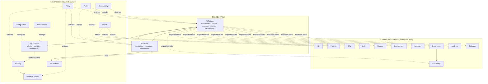

_Dashed lines = dynamic interactions (agent dispatch, enforcement, observation). Solid lines = structural dependencies. The Event Backbone (not drawn, SAD §11) carries all cross-BC facts._

### 2.3 Registry ownership resolution (documented improvement)

The SAD records two related statements: the App Platform performs **registration fan-out** into the Capability/Agent/Tool/Event registries (§7.3), and the AI Platform lists **Agent Registry / Capability Registry** among its components (§8.1). The DDD resolution — preserving both — is:

- **Write ownership:** the App Platform BC owns the _registration records_ (plugin manifests, agent registrations, skills, tools, capability descriptors). It is the only writer.
- **Read ownership:** the AI Platform BC owns the _discovery query model_ (a derived projection of the registries) and the discovery services (§12). It is the only consumer.
- The two BCs share a published contract (the registry record schema), versioned per AC-13. This is a **shared-kernel-lite** relationship: shared schema, split ownership, event-driven updates (`PluginInstalled`, `AgentRegistered`, EVT-31).

This preserves SAD ADR-003 (frozen contract) and ADR-005 (AI never hardcodes apps) and removes the ownership ambiguity before database design begins.

### 2.4 Bounded context cards

| BC                    | Responsibilities                                                                                                         | Owns                                                                                                                      | Public interfaces                                                                 | Depends on                                                    | Key published events                                                                 | AI ownership                                                    |
| --------------------- | ------------------------------------------------------------------------------------------------------------------------ | ------------------------------------------------------------------------------------------------------------------------- | --------------------------------------------------------------------------------- | ------------------------------------------------------------- | ------------------------------------------------------------------------------------ | --------------------------------------------------------------- |
| **Tenancy**           | Company/Workspace lifecycle; scoping containers; type templates; archive                                                 | Company, Workspace, WorkspaceType, AppEnablement                                                                          | Lifecycle commands; context contract (companyId/workspaceId)                      | —                                                             | `CompanyProvisioned`, `WorkspaceProvisioned`, `AppEnabled`                           | No domain agent (structural)                                    |
| **Identity & Access** | Users, groups, teams, memberships, roles, guests, external identities; authentication                                    | User, Group, Team, Membership, Guest, ExternalIdentity, RoleDef                                                           | Identity queries; SSO/SCIM hooks; membership grants                               | Tenancy                                                       | `UserProvisioned`, `UserDeactivated`, `RoleChanged`, `MembershipChanged`             | No domain agent; used by AI context                             |
| **Policy**            | Permission evaluation (6-level), approval-rule evaluation, AI guardrails, prohibited actions                             | PolicyRule, ApprovalChain, SideEffectClassPolicy, DecisionLog                                                             | `authorize()`, `canApprove()`, guardrail evaluation (synchronous)                 | Tenancy, IAM                                                  | `PolicyChanged`                                                                      | No domain agent (decision authority)                            |
| **HR**                | Employees, hiring, offers, onboarding, leave, org chart                                                                  | Employee, Applicant, Offer, Leave, OnboardingTask                                                                         | Employee/task interfaces; HR skills (via agent)                                   | IAM (identity), Tenancy                                       | `EmployeeCreated`, `EmployeeOnboarded`, `LeaveApproved`                              | **HR Agent**                                                    |
| **Projects**          | Projects, tasks, milestones, resource allocation, timesheets, capacity                                                   | Project, Task, Milestone, ResourceAssignment, Timesheet                                                                   | Project/task interfaces; capacity query                                           | IAM, HR (people read)                                         | `ProjectCreated`, `TaskCompleted`, `ResourceAssigned`                                | **Projects Agent**                                              |
| **CRM**               | Contacts, companies, deals, activities, ownership, duplicates                                                            | Account(Customer), Contact, Deal, Activity                                                                                | Account/deal interfaces; duplicate-check                                          | Tenancy                                                       | `CustomerAdded`, `DealStageChanged`, `DealWon`                                       | **CRM Agent**                                                   |
| **Sales**             | Quotes, orders, pricebook, forecasts                                                                                     | Quote, Order, Pricebook, Forecast                                                                                         | Quote/order interfaces                                                            | CRM, Inventory(read), Finance(read)                           | `QuoteCreated`, `OrderCreated`, `OrderFulfilled`                                     | **Sales Agent**                                                 |
| **Finance**           | Invoices, expenses, budgets, payments, close tasks; money invariants                                                     | Invoice, Expense, Budget, Payment, CloseTask                                                                              | Invoice/expense/budget interfaces; money-movement gates                           | Projects(read), Sales(read), Procurement(read)                | `InvoiceGenerated`, `InvoicePaid`, `ExpenseApproved`, `BudgetExceeded`               | **Finance Agent**                                               |
| **Procurement**       | Requisitions, POs, vendors, receipts, three-way match                                                                    | Requisition, PurchaseOrder, Vendor, Receipt                                                                               | Requisition/PO interfaces; vendor registry                                        | Finance(read: budget), Tenancy                                | `RequisitionApproved`, `PurchaseApproved`, `ReceiptRecorded`                         | **Procurement Agent**                                           |
| **Inventory**         | Items, locations, stock, transfers, counts, reorder                                                                      | Item, Location, StockLevel, Transfer                                                                                      | Stock interfaces; reorder proposal                                                | Procurement(read), Sales(read)                                | `StockAdjusted`, `ReorderProposed`, `StockoutDetected`                               | **Inventory Agent**                                             |
| **Documents**         | Files, versions, templates, sharing, authoritative versions                                                              | Document, DocumentVersion, Folder, Template                                                                               | Document interfaces; version semantics (BR-12)                                    | Tenancy                                                       | `DocumentUploaded`, `DocumentApproved`, `DocumentRejected`                           | **Documents Agent**                                             |
| **Knowledge**         | Articles, policies, SOPs; grounding index; access-filtered retrieval                                                     | KnowledgeArticle, KnowledgeIndexEntry, ContentSource                                                                      | Retrieval API (permission-filtered, BR-7); publication flow                       | Documents(ingest), Tenancy, Policy                            | `KnowledgeUpdated`, `ArticlePublished`, `AnswerGenerated`                            | **KB Agent**                                                    |
| **Analytics**         | KPIs, reports, narration, Q&A over connected data                                                                        | Kpi, Report, ReportSubscription, MetricDefinition                                                                         | Query API; report scheduling                                                      | All apps (read projections)                                   | `ReportGenerated`, `KpiThresholdBreached`                                            | **Analytics Agent**                                             |
| **Calendar**          | Events, availability, scheduling, meeting coordination                                                                   | CalendarEntry, Availability, MeetingRequest                                                                               | Scheduling interface; availability query                                          | Projects, HR, CRM (contextual reads)                          | `EventCreated`, `MeetingBooked`                                                      | **Calendar Agent**                                              |
| **Notifications**     | Notifications, Work Inbox, preferences, digests                                                                          | Notification, InboxItem, NotificationPreference                                                                           | Deliver/query interface; actionable items (FR-28)                                 | Tenancy, IAM                                                  | `NotificationSent`, `ApprovalTaskCreated`                                            | No domain agent (the AI's channel)                              |
| **Workflow**          | Definitions, executions, journal, human tasks, escalations, compensation                                                 | WorkflowDefinition, WorkflowExecution, StepRun, HumanTask, Escalation                                                     | Run/control interface (pause/resume/cancel); definition registry                  | Tenancy, Notifications, Policy(read)                          | `WorkflowStarted`, `WorkflowCompleted`, `WorkflowFailed`                             | No agent of its own; executes plans from AI Platform            |
| **AI Platform**       | Orchestration, planning, reasoning, memory, conversations, approval engine, explainability, model governance, monitoring | Conversation, Plan, SkillInvocation, ApprovalRequest, MemoryEntry, PromptVersion, AiDecision                              | Orchestration entry (WRK-15); explainability API; AI Studio                       | Workflow, App Platform (discovery), Policy, Knowledge, Search | `AgentExecuted`, `OrchestrationPlanProposed`, `ApprovalGranted`, `AiAnomalyDetected` | **Enterprise AI Orchestrator** (the platform's own agent layer) |
| **App Platform**      | Plugin manifests, registries (capability/agent/tool/event), install lifecycle, marketplace                               | PluginManifest, PluginInstall, AppInstance, CapabilityDescriptor, SkillDef, ToolDef, AgentRegistration, EventRegistration | Manifest contract (frozen, ADR-003); registration fan-out; install/upgrade/remove | Tenancy, Policy(read), Configuration                          | `PluginInstalled`, `AgentRegistered`, `AppDisabled`, `PluginUpgraded`                | No domain agent; hosts other agents                             |
| **Administration**    | Admin surfaces, delegated admin, app lifecycle control, audit access                                                     | AdminSession (view), AdminTask                                                                                            | Admin query/command surface (APP-13)                                              | All generic BCs                                               | `PolicyChanged`, `RoleChanged` (via config/audit)                                    | No domain agent; admin skills only with confirmation (BR-16)    |
| **Search**            | Unified index; permission-filtered queries                                                                               | SearchIndexEntry (projection)                                                                                             | Query API (BR-7-filtered)                                                         | All apps (event-driven index)                                 | `IndexUpdated` (internal)                                                            | No domain agent; serves Context Manager                         |
| **Configuration**     | Versioned scoped config; safety invariants                                                                               | ConfigDocument, ConfigSchema                                                                                              | Get/set with versioning; validation                                               | Tenancy                                                       | `ConfigChanged`                                                                      | No domain agent                                                 |
| **Audit**             | Append-only tamper-evident record; retention; export                                                                     | AuditRecord                                                                                                               | Write API (append); query/export (AUD-8)                                          | All BCs (facts)                                               | `AuditRecordWritten`                                                                 | No domain agent; records AI decisions too (AUD-4)               |
| **Observability**     | Logs, metrics, traces, timelines, SLOs                                                                                   | LogEntry, Metric, Trace, TimelineEntry (projections)                                                                      | Telemetry intake; SLO queries                                                     | All BCs                                                       | `SloEvent`, `AnomalyDetected`                                                        | No domain agent; observes agents (AIX-19)                       |

---

## 3. Domain Ownership

For every BC, ownership is explicit: **one writer, one rule set, one agent, one capability set**. Events are catalogued in §8 (mapped to PSD EVT-*); this section focuses on data, rules, services, policies, agents, and capabilities.

| BC                    | Owned data                                                                                             | Owned rules & policies                                                         | Owned services                                                                                                                                                 | Owned AI agent                 | Owned capabilities (summary)                                  |
| --------------------- | ------------------------------------------------------------------------------------------------------ | ------------------------------------------------------------------------------ | -------------------------------------------------------------------------------------------------------------------------------------------------------------- | ------------------------------ | ------------------------------------------------------------- |
| **Tenancy**           | Company, Workspace, WorkspaceType, AppEnablement                                                       | Lifecycle states; archive rules (WS-R5); default-workspace rule (WS-R1)        | ProvisioningService, ArchiveService                                                                                                                            | —                              | Provision, scope, archive, template                           |
| **Identity & Access** | User, Group, Team, Membership, Guest, ExternalIdentity                                                 | USR-R1…R5; guest containment (BR-8)                                            | ProvisioningService (SCIM), SessionService, InvitationService                                                                                                  | —                              | Provision, deactivate, membership, SSO                        |
| **Policy**            | PolicyRule, ApprovalChain, SideEffectClassPolicy, DecisionLog                                          | PRM-1…10; BR-13/14/15/18                                                       | PolicyEvaluationService, ApprovalRuleService, GuardrailService                                                                                                 | —                              | Evaluate, guard, decide (synchronous)                         |
| **HR**                | Employee, Applicant, Offer, Leave, OnboardingTask                                                      | BR-1 (department), BR-17 (leave); HR policy rules                              | HireService, OnboardingService, OffboardingService, LeaveService, OrgChartService                                                                              | **HR Agent**                   | Hire, onboard, offboard, leave, offer, org chart              |
| **Projects**          | Project, Task, Milestone, ResourceAssignment, Timesheet                                                | BR-2 (owner required); capacity rules                                          | ProjectService, ResourceAllocationService, CapacityService, StatusService                                                                                      | **Projects Agent**             | Create project, assign, capacity, status, report              |
| **CRM**               | Account, Contact, Deal, Activity                                                                       | BR-9 (duplicate detection); ownership rules                                    | DuplicateDetectionService, AccountService, PipelineService                                                                                                     | **CRM Agent**                  | Manage accounts, log activity, pipeline, merge                |
| **Sales**             | Quote, Order, Pricebook, Forecast                                                                      | Discount policy; order→invoice handoff                                         | QuoteService, OrderService, PricebookService, ForecastService                                                                                                  | **Sales Agent**                | Quote, order, forecast, pricebook                             |
| **Finance**           | Invoice, Expense, Budget, Payment, CloseTask                                                           | BR-5 (invoice↔customer), BR-10 (budget), BR-11 (adjustments); money invariants | InvoicingService, ExpenseService, BudgetService, PaymentService, CloseService, MoneyService                                                                    | **Finance Agent**              | Invoice, expense, budget, payment, close                      |
| **Procurement**       | Requisition, PurchaseOrder, Vendor, Receipt                                                            | BR-6 (PO↔requisition); value tiers; three-way match                            | RequisitionService, PurchaseOrderService, VendorService, ThreeWayMatchService                                                                                  | **Procurement Agent**          | Requisition, PO, vendor, receipt, match                       |
| **Inventory**         | Item, Location, StockLevel, Transfer                                                                   | BR-11 (negative adjustments); reorder rules                                    | StockService, TransferService, ReorderService, CountService                                                                                                    | **Inventory Agent**            | Stock, transfer, reorder, count                               |
| **Documents**         | Document, DocumentVersion, Folder, Template                                                            | BR-12 (authoritative version); approval flows                                  | VersioningService, TemplateService, SharingService                                                                                                             | **Documents Agent**            | Draft, version, approve, share, template                      |
| **Knowledge**         | KnowledgeArticle, KnowledgeIndexEntry                                                                  | BR-7 (access-filtered retrieval); publication flow                             | IndexingService, RetrievalService, PublicationService                                                                                                          | **KB Agent**                   | Write, publish, search, answer, update policy                 |
| **Analytics**         | Kpi, Report, ReportSubscription                                                                        | Metric definitions; traceability of every number                               | QueryService, NarrationService, SchedulingService                                                                                                              | **Analytics Agent**            | Ask KPI, report, narrate, schedule                            |
| **Calendar**          | CalendarEntry, Availability, MeetingRequest                                                            | Availability policy; external sends gated                                      | SchedulingService, AvailabilityService                                                                                                                         | **Calendar Agent**             | Book, find time, reschedule, availability                     |
| **Notifications**     | Notification, InboxItem, NotificationPreference                                                        | FR-27/28; digests; quiet hours                                                 | DeliveryService, InboxService, DigestService                                                                                                                   | —                              | Deliver, inbox, batch, preferences                            |
| **Workflow**          | WorkflowDefinition, WorkflowExecution, StepRun, HumanTask                                              | FR-22…26; WRK-16 invariants; escalation chains                                 | ExecutionService, JournalService, TaskRoutingService, EscalationService, CompensationService                                                                   | — (executes AI plans)          | Define, run, control, escalate, compensate                    |
| **AI Platform**       | Conversation, Plan, SkillInvocation, ApprovalRequest, MemoryEntry, PromptVersion, AiDecision           | AI-1…12; BR-13/14; autonomy tiers (PSD §7.20)                                  | OrchestrationService, PlanningService, VerificationService, MemoryService, ApprovalService, ExplainabilityService, ModelGovernanceService, AiMonitoringService | **Enterprise AI Orchestrator** | Understand, plan, execute, verify, explain, approve, remember |
| **App Platform**      | PluginManifest, PluginInstall, AppInstance, CapabilityDescriptor, SkillDef, ToolDef, AgentRegistration | FR-14…17; ADR-003; validation & isolation rules (§7.12–7.13 SAD)               | RegistrationService, LifecycleService, ValidationService, CatalogService                                                                                       | — (hosts agents)               | Install, validate, register, upgrade, remove, discover        |
| **Administration**    | AdminTask (view), scoped admin config                                                                  | FR-37; BR-16 (admin skills need confirmation)                                  | AdminService, DelegationService                                                                                                                                | —                              | Admin, delegate, audit-access                                 |
| **Search**            | SearchIndexEntry (derived)                                                                             | BR-7 filtering; index freshness                                                | IndexingService, QueryService                                                                                                                                  | —                              | Index, query, filter                                          |
| **Configuration**     | ConfigDocument, ConfigSchema                                                                           | AC-4/5 safety invariants; versioning                                           | ConfigService, ValidationService                                                                                                                               | —                              | Get, set, version, validate                                   |
| **Audit**             | AuditRecord                                                                                            | AUD-1…8; NFR-8                                                                 | AuditWriteService, ExportService, RetentionService                                                                                                             | —                              | Record, export, retain                                        |
| **Observability**     | LogEntry, Metric, Trace, TimelineEntry                                                                 | NFR-15; tenant-scoped telemetry                                                | LogPipelineService, MetricsService, TracingService, TimelineService, SloService                                                                                | —                              | Log, measure, trace, timeline, SLO                            |

---

## 4. Entities

Entities have identity and a lifecycle. This section lists the entities of each BC with their responsibility. **This is not a data model** — persistence and schemas are out of scope (PSD §0.1).

### 4.1 Tenancy

| Entity            | Responsibility                                                                                      |
| ----------------- | --------------------------------------------------------------------------------------------------- |
| **Company**       | The tenant: lifecycle, settings, residency, retention, subscription (CO-2, USR-2).                  |
| **Workspace**     | The scoping container owning apps, agents, permissions, knowledge, workflows (WS-1).                |
| **WorkspaceType** | Configurable template pack (Engineering, HR, Finance, …) with no special platform behavior (WS-R4). |
| **AppEnablement** | Records that a Company/Workspace has an App enabled or disabled (EC-3).                             |
| **Organization**  | Optional multi-Company grouping for consolidated administration (CO-1, USR-1).                      |

### 4.2 Identity & Access

| Entity               | Responsibility                                                                     |
| -------------------- | ---------------------------------------------------------------------------------- |
| **User**             | A human identity with status lifecycle (USR-5).                                    |
| **Group**            | Reusable bundle of memberships + roles (USR-6).                                    |
| **Team**             | Intra-Workspace grouping for resource scoping (USR-4).                             |
| **Membership**       | A user's role-bearing relationship to a Workspace/Team (WS-R2).                    |
| **Guest**            | Time-boxed, read-only external identity (USR-9).                                   |
| **ExternalIdentity** | Vendor/Customer portal identity (USR-10/11).                                       |
| **RoleDef**          | Named, scoped role definition (USR-7, PRM-1).                                      |
| **Session**          | Authenticated interaction context (short-lived, per-request revalidation, USR-R2). |

### 4.3 HR / Projects / CRM / Sales

| BC           | Entities                                                                                                                                     |
| ------------ | -------------------------------------------------------------------------------------------------------------------------------------------- |
| **HR**       | **Employee** (status lifecycle §14), **Applicant**, **Offer**, **Leave**, **LeaveBalance**, **OnboardingTask**, **Department**, **JobTitle** |
| **Projects** | **Project** (root, §6), **Task**, **Milestone**, **ResourceAssignment**, **Timesheet**, **ProjectTeam**                                      |
| **CRM**      | **Account** (customer/company), **Contact**, **Deal**, **Activity**, **AccountOwnership**, **DuplicatePair**                                 |
| **Sales**    | **Quote**, **Order**, **PricebookEntry**, **Forecast**, **DiscountApproval**                                                                 |

### 4.4 Finance / Procurement / Inventory

| BC              | Entities                                                                                                                              |
| --------------- | ------------------------------------------------------------------------------------------------------------------------------------- |
| **Finance**     | **Invoice** (lifecycle §14), **InvoiceLine**, **Expense**, **Budget**, **Payment**, **CloseTask**, **FinancialAccount** (ledger link) |
| **Procurement** | **Requisition**, **PurchaseOrder**, **PO Line**, **Vendor**, **Receipt**, **MatchException**                                          |
| **Inventory**   | **Item**, **Location**, **StockLevel**, **Transfer**, **CycleCount**, **ReorderProposal**                                             |

### 4.5 Documents / Knowledge / Analytics / Calendar

| BC            | Entities                                                                                                           |
| ------------- | ------------------------------------------------------------------------------------------------------------------ |
| **Documents** | **Document** (lifecycle §14), **DocumentVersion**, **Folder**, **Template**, **ShareGrant**                        |
| **Knowledge** | **KnowledgeArticle**, **ArticleVersion**, **ContentSource**, **KnowledgeIndexEntry** (derived), **AnswerCitation** |
| **Analytics** | **Kpi**, **KpiDefinition**, **Report**, **ReportSubscription**, **MetricSnapshot**                                 |
| **Calendar**  | **CalendarEntry**, **AvailabilityWindow**, **MeetingRequest**, **AttendeeState**                                   |

### 4.6 Workflow / AI Platform

| BC                      | Entities                                                                                   | Responsibility |
| ----------------------- | ------------------------------------------------------------------------------------------ | -------------- |
| **WorkflowDefinition**  | Versioned, immutable workflow template (FR-23).                                            |
| **WorkflowExecution**   | A durable run with its journal and timeline (lifecycle §14).                               |
| **StepRun**             | One executed step within a run (agent, human, condition, integration, notification).       |
| **HumanTask**           | Work-Inbox work item with owner, deadline, escalation (FR-24).                             |
| **Escalation**          | Record of SLA-driven re-routing (EC-4).                                                    |
| **Conversation**        | A durable multi-turn session with its context (AIX-16).                                    |
| **ConversationMessage** | A message within a conversation.                                                           |
| **Plan**                | An AI-generated, versioned execution plan with steps and gates (AIX-3).                    |
| **SkillInvocation**     | One executed skill call with its verification evidence (AIX-4).                            |
| **ApprovalRequest**     | A human authorization request bound to a specific action+inputs (BR-15; lifecycle §14).    |
| **MemoryEntry**         | Tenant-isolated, user-visible AI memory record (AIX-5).                                    |
| **PromptVersion**       | Immutable governed prompt version (AIX-13).                                                |
| **AiDecision**          | Decision-time record: intent, plan ref, sources, prompt version, outcome (AUD-4, ADR-011). |

### 4.7 App Platform / Notifications / Generic

| BC                 | Entities                                                                                                                                                                                          |
| ------------------ | ------------------------------------------------------------------------------------------------------------------------------------------------------------------------------------------------- |
| **App Platform**   | **PluginManifest**, **PluginInstall**, **AppInstance**, **CapabilityDescriptor**, **SkillDef**, **ToolDef**, **AgentRegistration**, **EventRegistration**, **CatalogEntry** (marketplace listing) |
| **Notifications**  | **Notification**, **InboxItem**, **NotificationPreference**, **Digest**                                                                                                                           |
| **Policy**         | **PolicyRule**, **ApprovalChain**, **RoleGrant**, **DecisionLog**                                                                                                                                 |
| **Configuration**  | **ConfigDocument**, **ConfigSchema**                                                                                                                                                              |
| **Audit**          | **AuditRecord**                                                                                                                                                                                   |
| **Search**         | **SearchIndexEntry** (derived projection)                                                                                                                                                         |
| **Observability**  | **LogEntry**, **MetricPoint**, **Trace**, **TimelineEntry** (derived projections)                                                                                                                 |
| **Administration** | **AdminTask**, **Delegation**                                                                                                                                                                     |

---

## 5. Value Objects

Value Objects are immutable, attribute-defined, and reusable across BCs. Grouped by concern:

| Group                       | Value Objects                                                                                                                                                                                                                                                                                     | Reused by                                                                  |
| --------------------------- | ------------------------------------------------------------------------------------------------------------------------------------------------------------------------------------------------------------------------------------------------------------------------------------------------- | -------------------------------------------------------------------------- |
| **Identity & scope**        | `CompanyId`, `WorkspaceId`, `UserId`, `TeamId`, `MembershipId`, `EntityRef` (typed record reference), `SkillId`, `EventType`, `CorrelationId`, `TraceId`                                                                                                                                          | Every BC (AC-14 context contract)                                          |
| **Money & commerce**        | `Money` (amount + `Currency`), `Currency`, `Price`, `Quantity`, `Percentage`, `TaxRate`, `DiscountRate`, `BillingTerms`, `BudgetAmount`                                                                                                                                                           | Finance, Sales, Procurement, Inventory, Analytics                          |
| **Contact & location**      | `Email`, `Phone`, `Address`, `Coordinates`, `Locale`, `Language`, `TimeZone`, `Region` (residency)                                                                                                                                                                                                | IAM, HR, CRM, Tenancy, Sales                                               |
| **Time & scheduling**       | `DateRange`, `WorkingHours`, `AvailabilityWindow`, `CronSchedule`, `Deadline`, `RetentionPeriod`, `Sla`                                                                                                                                                                                           | Calendar, Workflow, HR (leave), Audit (retention), Notifications (digests) |
| **Status & lifecycle**      | Per-BC status VOs — `EmployeeStatus`, `ProjectStatus`, `TaskStatus`, `DocumentStatus`, `InvoiceStatus`, `QuoteStatus`, `OrderStatus`, `RequisitionStatus`, `PoStatus`, `LeaveStatus`, `DealStage`, `WorkflowStatus`, `ApprovalStatus`, `PluginStatus` — each an enumerated, transition-guarded VO | Their BCs (§14 transitions)                                                |
| **AI-specific**             | `SideEffectClass` (Read-only/Update/Consequential, BR-13), `AutonomyTier` (Assist/Confirm/Approve-with-rules/Supervised-autonomous), `ConfidenceScore`, `SourceCitation`, `PlanStep`, `SkillInput/Output` (typed envelopes), `PromptVersionRef`                                                   | AI Platform, Policy, Workflow, all agents                                  |
| **Permission & governance** | `Permission` (resource class + action + scope + conditions, PRM-1), `Role` (applied role on a membership), `ApprovalChain`, `Scope` (own/team/workspace/company)                                                                                                                                  | Policy, IAM, all BCs                                                       |
| **Configuration**           | `ConfigKey`, `ConfigValue`, `ConfigScope`, `ConfigVersion`, `FeatureFlag`                                                                                                                                                                                                                         | Configuration, all BCs                                                     |
| **Observability**           | `Severity`, `MetricKey`, `SloTarget`, `TimelineKind` (Activity/AI/Workflow), `TenantLabel`                                                                                                                                                                                                        | Observability, Audit                                                       |
| **Misc business**           | `Priority`, `ReorderPoint`, `LeadTime`, `Capacity`, `Utilization`, `Progress`, `Version` (documents), `Hash` (integrity)                                                                                                                                                                          | Projects, Inventory, Documents, Finance                                    |

**VO design rules (reasoning):** (1) All VOs are immutable and validated at creation — invalid states are unrepresentable (high cohesion with invariants). (2) Shared VOs (`Money`, `Email`, `SideEffectClass`, scope types) live as **published language** between BCs — the same VO type crosses BC boundaries so no translation layer is needed for core concepts (ADR-013 context contract). (3) Status VOs are transition-guarded: the entity enforces legal transitions (§14).

---

## 6. Aggregates

An **aggregate** is a consistency boundary: its root is the only entry point, and its invariants hold transactionally. The list below is the authoritative aggregate map for Nexora.

| Aggregate root         | BC            | Why it is a root (invariants held)                                                                                       | Transaction boundary                       |
| ---------------------- | ------------- | ------------------------------------------------------------------------------------------------------------------------ | ------------------------------------------ |
| **Company**            | Tenancy       | Tenant identity, residency, lifecycle (suspended companies must not accept actions); settings consistency                | Company + its settings/subscription        |
| **Workspace**          | Tenancy       | Scoping invariants (WS-R3); archive requires no active workflows (BR-3)                                                  | Workspace + enablements + scoping          |
| **User**               | IAM           | Identity uniqueness; membership integrity (one membership per user+workspace); deactivation revokes all authority (BR-4) | User + memberships + external identities   |
| **Employee**           | HR            | Employment status transitions; leave balance invariants (BR-17); department validity (BR-1)                              | Employee + leave + onboarding tasks        |
| **Project**            | Projects      | Owner required (BR-2); milestone/task consistency; capacity sanity                                                       | Project + tasks + milestones + assignments |
| **Account**            | CRM           | Customer identity; duplicate merging (BR-9); contacts belong to one account                                              | Account + contacts                         |
| **Deal**               | CRM           | Pipeline stage transitions; deal must reference an account; won/lost exclusivity                                         | Deal + activities                          |
| **Quote**              | Sales         | Line items against pricebook; discount within policy; quote→order conversion integrity                                   | Quote + lines                              |
| **Order**              | Sales         | Order references a customer and (optionally) an approved quote; status transitions (BR-9 dedupe)                         | Order + lines                              |
| **Invoice**            | Finance       | Must reference a customer (BR-5); line/amount consistency; no double payment                                             | Invoice + lines + payment allocations      |
| **Budget**             | Finance       | Commitment invariant (BR-10): commitments never exceed available budget without authorization                            | Budget + commitments                       |
| **Expense**            | Finance       | Policy compliance; receipt requirements; duplicate prevention                                                            | Expense + approvals history                |
| **Requisition**        | Procurement   | Approval-chain state; budget check result (BR-6); value-tier routing                                                     | Requisition + approval state               |
| **PurchaseOrder**      | Procurement   | PO references an approved requisition (BR-6); line/pricing consistency; match state                                      | PO + lines + receipts                      |
| **Vendor**             | Procurement   | Vendor identity; duplicate detection; onboarding approval state                                                          | Vendor + bank/contact VOs                  |
| **Item**               | Inventory     | Item identity; stock-level consistency per location; reorder parameters                                                  | Item + stock levels                        |
| **Transfer**           | Inventory     | Source/destination consistency; quantity conservation; stock adjustment invariant (BR-11)                                | Transfer + lines                           |
| **Document**           | Documents     | Version chain; authoritative-version rule (BR-12); approval state                                                        | Document + versions                        |
| **KnowledgeArticle**   | Knowledge     | Publication flow; version consistency; visibility policy (BR-7)                                                          | Article + versions                         |
| **WorkflowDefinition** | Workflow      | Immutability of published versions (FR-23); approval-logic change requires review (PRD §16.9)                            | Definition + steps                         |
| **WorkflowExecution**  | Workflow      | Journal integrity (FR-26); step ordering; timeout/escalation state                                                       | Execution + step runs + human tasks        |
| **Conversation**       | AI Platform   | Multi-turn context integrity; scope binding (WS-R3); history completeness                                                | Conversation + messages                    |
| **Plan**               | AI Platform   | Step dependency ordering; permission validation before execution; replanning history                                     | Plan + steps + gates                       |
| **ApprovalRequest**    | AI Platform   | Bound to one action+inputs (BR-15); first-decision-wins (EC-8); superseded preserved; no auto-approval (EC-4)            | ApprovalRequest + decision history         |
| **PluginInstall**      | App Platform  | Install/enable/upgrade/remove state machine (§14); registry consistency at each transition                               | PluginInstall + registrations              |
| **Notification**       | Notifications | Preference-aware routing; deduplication; actionable state                                                                | Notification + delivery state              |
| **PolicyRule**         | Policy        | Versioning; deny-wins evaluation; safety invariants non-relaxable (AC-3)                                                 | PolicyRule + versions                      |
| **ConfigDocument**     | Configuration | Scoped versioning; safety invariant validation (AC-4/5)                                                                  | ConfigDocument + versions                  |
| **AuditRecord**        | Audit         | Append-only; tamper-evidence (AUD-2); immutable (no edit path)                                                           | Single record (write-once)                 |

**Aggregate design reasoning:** (1) **Consistency over convenience** — each root holds the smallest cluster whose invariants must be transactional; anything not in the cluster lives in another aggregate reached by reference or event. (2) **References are by ID** — aggregates never hold object graphs of other aggregates (loose coupling, AP-13). (3) **Status transitions are guarded** — each root's lifecycle is enforced by the root itself (§14). (4) **No god-aggregates** — e.g., `Project` does not contain `Timesheet`; a timesheet belongs to its own aggregate (an employee's time entries), and `ResourceAssignment` links them by ID. (5) The `ApprovalRequest` root deliberately sits in the **AI Platform** BC (per PSD AIX-11/18) while its _routing_ becomes HumanTasks in the Workflow BC and its _rules_ come from the Policy BC — a documented three-way ownership split (§13.3).

---

## 7. Domain Services

Services hold stateless business logic that doesn't naturally belong to an entity or aggregate.

| Service                            | BC                     | Responsibility                                                                                               | Why a service (not an entity)                                                   |
| ---------------------------------- | ---------------------- | ------------------------------------------------------------------------------------------------------------ | ------------------------------------------------------------------------------- |
| **PolicyEvaluationService**        | Policy                 | Synchronous evaluation of permissions/approval/guardrails at every action boundary (PRM-8)                   | Pure decision function; no state; must be the single evaluation point (ADR-005) |
| **ApprovalService**                | AI Platform            | Creates gated ApprovalRequests, routes chains, applies first-decision-wins, supersedes late decisions (EC-8) | Cross-aggregate orchestration of the approval lifecycle                         |
| **CapabilityDiscoveryService**     | AI Platform            | Queries the registry projection with permission filtering; returns candidate capabilities for planning (§12) | Stateless query over derived registry data (ADR-005)                            |
| **IntentMatchingService**          | AI Platform            | Maps intent → candidate capabilities/skills with confidence (AI-1)                                           | Stateless matching; no natural owner entity                                     |
| **VerificationService**            | AI Platform            | Read-back verification of executed actions; classifies unverified outcomes (AI-6, ER-3)                      | Spans entities across BCs; no ownership                                         |
| **ModelGovernanceService**         | AI Platform            | Model routing, budgets, rate limits, prompt version enforcement (AI-11, NFR-14)                              | Platform policy applied to every AI call                                        |
| **MemoryService**                  | AI Platform            | Scope-aware memory write/read; user visibility and deletion (AIX-5)                                          | Cross-conversation, tenant-isolated logic                                       |
| **ExplainabilityService**          | AI Platform            | Renders plan/source/verification explanations; links audit records (AIX-17, FR-36)                           | Renders decision-time records; no entity                                        |
| **ExecutionService**               | Workflow               | Advances runs through steps; honors checkpoints; journal writes (FR-22…26)                                   | Orchestrates the run aggregate's transitions                                    |
| **TaskRoutingService**             | Workflow               | Routes HumanTasks to Work Inbox with assignees, deadlines, SLAs (FR-24/28)                                   | Cross-entity routing decision                                                   |
| **EscalationService**              | Workflow               | Reminder + escalation chains on SLA expiry; never auto-approves (EC-4)                                       | Timer-driven cross-entity logic                                                 |
| **CompensationService**            | Workflow               | Reverses partial progress in reverse dependency order (saga, §12.3)                                          | Spans steps of a run; no owner entity                                           |
| **HireService**                    | HR                     | Coordinates hire: applicant→offer→employee with policy checks                                                | Multi-entity process logic                                                      |
| **OnboardingOrchestrationService** | HR                     | Builds onboarding checklist; publishes events that trigger cross-BC steps (WRK-2)                            | Cross-BC coordination via events                                                |
| **ResourceAllocationService**      | Projects               | Assigns resources with capacity checks; proposes alternatives on conflict (WRK-1)                            | Cross-entity allocation math                                                    |
| **CapacityService**                | Projects               | Computes utilization/availability across assignments                                                         | Aggregation across assignments                                                  |
| **DuplicateDetectionService**      | CRM / HR / Procurement | Detects duplicate accounts/employees/vendors/items; proposes merges (BR-9, EC-7)                             | Similarity matching over many records                                           |
| **MoneyService**                   | Finance                | Money arithmetic and validation (no floating-point drift); multi-currency conversions                        | Pure value logic                                                                |
| **BudgetEnforcementService**       | Finance                | Checks commitments vs budget; raises exceptions (BR-10)                                                      | Cross-aggregate enforcement                                                     |
| **ThreeWayMatchService**           | Procurement            | PO↔receipt↔invoice matching; flags exceptions (WRK-6)                                                        | Multi-aggregate comparison                                                      |
| **ReorderService**                 | Inventory              | Computes reorder quantities from demand + lead time (WRK-12, BR-9 dedupe)                                    | Analytic computation; no owner                                                  |
| **VersioningService**              | Documents              | Version creation, compare, authoritative-version resolution (BR-12)                                          | Cross-version logic                                                             |
| **RetrievalService**               | Knowledge              | Access-filtered grounding retrieval; conflict surfacing (BR-7, EC-6)                                         | Query-time permission filtering (ADR-007)                                       |
| **IndexingService**                | Knowledge / Search     | Event-driven index maintenance and rebuild (EVT-G3)                                                          | Projection-building logic                                                       |
| **SchedulingService**              | Calendar               | Finds available time; books meetings; respects policy (external sends gated)                                 | Cross-calendar optimization                                                     |
| **NotificationRoutingService**     | Notifications          | Preference-aware routing and deduplication (FR-27)                                                           | Stateless routing function                                                      |
| **InvitationService**              | IAM                    | Guest/external invitations with time-boxes and scoped grants (BR-8)                                          | Cross-entity onboarding of outsiders                                            |
| **ExportService**                  | Audit                  | Machine-readable audit exports honoring residency (FR-34, AUD-7)                                             | Stateless formatting + policy check                                             |
| **RegistrationService**            | App Platform           | Manifest validation + registration fan-out into registries (§2.3)                                            | Cross-registry process logic                                                    |
| **ValidationService**              | App Platform           | Plugin validation: manifest, permissions, side-effect truthfulness, security scan (§7.12 SAD)                | Stateless verification                                                          |

---

## 8. Domain Events

Cross-BC communication is **event-driven** (PRN-11, §10). Every event below is a fact with a publisher, subscribers, and a business meaning; all conform to the event envelope and guarantees of PSD §8.2/8.4 (EVT-G1…G6). PSD EVT-* IDs are cited where the event is already normative.

| Domain event                 | Publisher BC  | Subscribers                                              | Business meaning                                      | PSD map                       |
| ---------------------------- | ------------- | -------------------------------------------------------- | ----------------------------------------------------- | ----------------------------- |
| **CompanyCreated**           | Tenancy       | IAM, Configuration, Notifications, Audit                 | A new tenant begins its lifecycle (FR-3)              | `CompanyProvisioned` (EVT-31) |
| **WorkspaceCreated**         | Tenancy       | IAM, Configuration, App Platform, Notifications          | A scoping container is provisioned (WS-R5)            | `WorkspaceProvisioned`        |
| **WorkspaceArchived**        | Tenancy       | Workflow, Notifications                                  | Archive suspends triggers/agents; workflows react     | `WorkspaceProvisioned` family |
| **EmployeeJoined**           | HR            | Projects, Calendar, Notifications, Analytics             | An employee becomes active (resource pool change)     | `EmployeeOnboarded` (EVT-3)   |
| **EmployeeCreated**          | HR            | Workflow (onboarding), Finance, Projects                 | A hire record exists → onboarding begins (WRK-2)      | EVT-1                         |
| **EmployeeOffboarded**       | HR            | Workflow (offboarding), IAM, Projects, Finance           | Offboarding workflow triggers (WRK-3)                 | EVT-4                         |
| **LeaveApproved**            | HR            | Calendar, Projects, Notifications                        | Leave affects availability and coverage               | EVT-5                         |
| **ProjectCreated**           | Projects      | Analytics, Notifications, Finance                        | A delivery unit is established (WRK-4)                | EVT-6                         |
| **TaskAssigned**             | Projects      | Analytics, Notifications, Workflow                       | Work is owned by a person (WRK-1)                     | `ResourceAssigned` (EVT-10)   |
| **TaskCompleted**            | Projects      | Analytics, Workflow continuations                        | Progress fact (WRK-2/4)                               | EVT-8                         |
| **MilestoneReached**         | Projects      | Notifications, Analytics, (exec reporting)               | Significant progress signal                           | EVT-9                         |
| **CapacityConflictDetected** | Projects      | AI Platform (replan), HR, Notifications                  | Assignment conflict needs decision                    | EVT-10 family                 |
| **CustomerCreated**          | CRM           | Sales, Documents, Analytics                              | A customer account exists (WRK-5)                     | `CustomerAdded` (EVT-11)      |
| **DealWon**                  | CRM           | Sales, Finance, Analytics                                | Revenue opportunity converts → order/invoice (WRK-11) | EVT-12                        |
| **QuoteCreated**             | Sales         | CRM, Finance, Inventory                                  | Quote enters the funnel                               | EVT-35                        |
| **OrderCreated**             | Sales         | Finance (invoicing), Inventory (availability), Analytics | Commitment to fulfill                                 | EVT-35                        |
| **InvoiceGenerated**         | Finance       | Procurement (match), Analytics, Notifications            | A bill exists (WRK-7)                                 | EVT-13                        |
| **InvoicePaid**              | Finance       | Analytics, Notifications, (cash position)                | Money settled                                         | EVT-14                        |
| **ExpenseApproved**          | Finance       | Notifications, HR (reimbursement)                        | Reimbursement queued (WRK-9)                          | EVT-15                        |
| **BudgetExceeded**           | Finance       | Workflow (block), AI Platform (replan), Procurement      | Commitment guard fired (BR-10)                        | EVT-15 family                 |
| **RequisitionApproved**      | Procurement   | Finance, Workflow continuation                           | Purchase may proceed (WRK-6)                          | EVT-19                        |
| **PurchaseApproved**         | Procurement   | Finance (commitment), Inventory, Analytics               | PO is authorized                                      | EVT-16                        |
| **PurchaseOrderSent**        | Procurement   | Vendors (integration), Inventory                         | Supplier notified                                     | EVT-17                        |
| **ReceiptRecorded**          | Procurement   | Inventory (stock in), Finance (match), Analytics         | Goods/services arrived (WRK-6)                        | EVT-18                        |
| **ReorderProposed**          | Inventory     | Workflow (replenishment), Procurement                    | Stock below point → purchase intent (WRK-12)          | EVT-21                        |
| **StockAdjusted**            | Inventory     | Analytics, Procurement                                   | Stock level changed (BR-11 gated)                     | EVT-20                        |
| **DocumentUploaded**         | Documents     | Knowledge (index), Workflow, Search                      | Content entered the corpus (WRK-8)                    | EVT-22                        |
| **DocumentApproved**         | Documents     | Workflow continuations, Knowledge                        | Authoritative version established (BR-12)             | EVT-23                        |
| **DocumentRejected**         | Documents     | Workflow (return to author)                              | Content rejected with reason                          | EVT-24                        |
| **KnowledgeUpdated**         | Knowledge     | AI Platform (re-index), Search                           | Grounding corpus changed (WRK-13)                     | EVT-25                        |
| **KnowledgeIndexed**         | Knowledge     | Observability                                            | A content source is queryable                         | `KnowledgeUpdated` projection |
| **WorkflowStarted**          | Workflow      | AI Platform, Notifications, Analytics, Audit             | A run begins                                          | EVT-30                        |
| **WorkflowCompleted**        | Workflow      | AI Platform, Analytics, Audit                            | A run ends successfully                               | EVT-30                        |
| **WorkflowFailed**           | Workflow      | AI Platform, Notifications, Observability                | A run failed with explanation (ER-8)                  | EVT-30                        |
| **ApprovalRequested**        | AI Platform   | Notifications (inbox), Workflow                          | A human gate is pending (FR-28)                       | `ApprovalRequested` (AIX-11)  |
| **ApprovalGranted**          | AI Platform   | Workflow continuation, Notifications                     | Authorization given (first-decision-wins)             | EVT-27                        |
| **ApprovalRejected**         | AI Platform   | Workflow continuation, Notifications                     | Authorization refused with reason                     | EVT-28                        |
| **AgentExecuted**            | AI Platform   | Audit, Observability, Analytics                          | An agent performed a verified action (AUD-1)          | EVT-26                        |
| **AgentRegistered**          | App Platform  | AI Platform (discovery refresh), Audit                   | A plugin's agent is discoverable (§2.3)               | EVT-31 family                 |
| **PluginInstalled**          | App Platform  | Tenancy (enablement), Configuration, Audit               | An App is available to a Company (FR-14)              | EVT-31                        |
| **PluginUpgraded**           | App Platform  | Registries (re-index), Notifications                     | App contract changed (FR-17)                          | EVT-31                        |
| **NotificationSent**         | Notifications | Audit, Observability                                     | A user was notified (FR-27)                           | EVT-29                        |
| **PolicyChanged**            | Policy        | Configuration, App Platform, Observability               | Rules changed → re-evaluate (FR-20)                   | EVT-31                        |

**Event design reasoning:** (1) Events are **facts about the past** — no commands, no expected outcomes (AP-2). (2) Naming follows the ubiquitous language of each BC (`EmployeeJoined` is HR language; `PurchaseApproved` is Procurement language). (3) Every event carries the context contract (`companyId`, `workspaceId`, `correlationId`, `traceId` — PSD §8.2) so subscribers can trace and scope (AC-14). (4) Subscribers react by starting orchestrated workflows (trigger-not-action, ADR-002) — no subscriber mutates another BC's records directly.

---

## 9. Business Rules

All rules below are **shall** statements. They reuse the PSD BR-* catalog where applicable and add domain-model-level rules. Every rule is owned by exactly one BC (§13) and enforced within that BC's aggregates (§6) or by the Policy BC at action boundaries.

| Rule | BC            | Statement                                                                                                                                     | Source              |
| ---- | ------------- | --------------------------------------------------------------------------------------------------------------------------------------------- | ------------------- |
| R-01 | Tenancy       | A Company shall be unique and own all its Workspaces; no cross-Company data access under any configuration                                    | FR-1, CO-2          |
| R-02 | Tenancy       | A Workspace shall not be archived while owning active workflows or unfinalized approvals                                                      | BR-3, WS-R5         |
| R-03 | Tenancy       | An Organization shall never imply cross-Company data access                                                                                   | CO-1, USR-1         |
| R-04 | IAM           | A User shall belong to exactly one Company and may belong to multiple Workspaces                                                              | USR-R2/3, WS-R2     |
| R-05 | IAM           | Deactivating a User shall immediately revoke all permissions and agent authority, including mid-workflow                                      | BR-4, EC-1          |
| R-06 | IAM           | Guests and external users shall have read-only, time-boxed, record-scoped access only                                                         | BR-8, USR-9/10/11   |
| R-07 | Policy        | Permission grants shall be additive with explicit deny winning; effective permission is re-evaluated per request                              | PRM-2/3/5, PRM-8    |
| R-08 | Policy        | The authority to request and the authority to approve shall be separated (SoD); self-approval shall route to a backup                         | PRM-6, BR-18, EC-10 |
| R-09 | Policy        | An agent shall never exceed the invoking user's authority, further constrained by tenant policy and autonomy tier                             | PRM-8, AC-6         |
| R-10 | HR            | An Employee shall not belong to a deleted or archived Department                                                                              | BR-1                |
| R-11 | HR            | Leave shall respect balance and policy; insufficient balance shall not be auto-approved                                                       | BR-17               |
| R-12 | HR            | A hire's compensation and offer are Consequential; offer issuance requires approval                                                           | WRK-1, BR-13        |
| R-13 | Projects      | A Project shall have an owner before activation                                                                                               | BR-2                |
| R-14 | Projects      | Resource assignment shall pass a capacity check or be explicitly authorized                                                                   | WRK-1               |
| R-15 | CRM           | A Deal shall reference an existing Account; duplicate accounts shall be merged, not duplicated                                                | BR-9, BR-5-analog   |
| R-16 | Sales         | A Quote's discount shall respect pricebook policy; over-policy discounts require Consequential approval                                       | WRK-11              |
| R-17 | Finance       | An Invoice shall reference an existing customer; an invoice without a customer shall not exist                                                | BR-5                |
| R-18 | Finance       | A commitment shall not exceed available budget unless explicitly authorized                                                                   | BR-10               |
| R-19 | Finance       | Money movements are Consequential and always require human approval                                                                           | BR-13               |
| R-20 | Procurement   | A PurchaseOrder shall reference an approved Requisition (or authorized direct-buy) and a budget check                                         | BR-6                |
| R-21 | Inventory     | Negative stock adjustments shall require approval                                                                                             | BR-11               |
| R-22 | Documents     | The authoritative version of a Document is its latest approved version; unapproved drafts shall not be used as grounding or contractual input | BR-12               |
| R-23 | Knowledge     | Retrieval shall never expose content the requesting user cannot read; answers shall be grounded only in accessible approved sources           | BR-7, ADR-007       |
| R-24 | Knowledge     | Conflicting sources shall be surfaced as a conflict, never silently asserted                                                                  | EC-6                |
| R-25 | Workflow      | Consequential steps always require approval; approval logic changes require template re-review                                                | BR-13, PRD §16.9    |
| R-26 | Workflow      | No approval shall be auto-granted on timeout; timeouts escalate                                                                               | EC-4                |
| R-27 | Workflow      | An approval binds to the specific action+inputs; it is never a blanket authorization                                                          | BR-15               |
| R-28 | AI Platform   | The AI shall not perform destructive actions without approval; the rule is non-configurable and not learnable-around                          | BR-13, AC-3         |
| R-29 | AI Platform   | Prohibited actions shall be refused with explanation; agents shall never plan around them                                                     | BR-14               |
| R-30 | AI Platform   | AI claims shall be grounded; unverified outcomes shall be reported as unverified, never as done                                               | AI-6, AC-7          |
| R-31 | App Platform  | A PluginInstall shall not enable capabilities beyond its validated manifest and approved permissions                                          | FR-15, §7.12        |
| R-32 | App Platform  | App versions are semantic; breaking contract changes require re-approval and rollback retention                                               | FR-17, AC-13        |
| R-33 | Audit         | Every action (user, agent, approval, refusal, access) shall produce an append-only tamper-evident record                                      | AUD-1/2, AC-4       |
| R-34 | Audit         | AI decisions shall record plan ID, prompt version, sources, and verification evidence                                                         | AUD-4               |
| R-35 | Configuration | Configuration that would weaken mandatory safety invariants shall be rejected, not stored                                                     | AC-3/4/5, PSD §7.15 |
| R-36 | Observability | All telemetry shall be tenant-scoped; no cross-tenant visibility                                                                              | NFR-15              |

---

## 10. Cross-Domain Communication

### 10.1 Communication contract

1. **Events are the default channel.** Domains publish facts and react to facts through the Event Backbone (PSD §8, §11). No domain calls another domain's internals (AC-15).
2. **Published interfaces for reads and commands.** A domain exposes defined read interfaces and agent Skills; other domains and the AI use those interfaces — never the store (PSD §5.3).
3. **Synchronous calls exist only where semantics demand them** (ADR-002): **Policy evaluation** (authorization must be decided before an action proceeds — PRM-5) and **directed reads** (e.g., Finance reading a Project's billing context). These are narrow, versioned, and audited.
4. **Trigger-not-action.** An event that requires work starts an orchestrated workflow (§8.2 AI pipeline) — the AI Platform plans it, the Workflow BC executes it, owning BCs' agents perform the actions (ADR-001/002).
5. **No agent-to-agent calls.** Collaboration is orchestrator-mediated (§9.5 SAD, WRK-15).

### 10.2 Sequence — Hire & Assign (WRK-1)

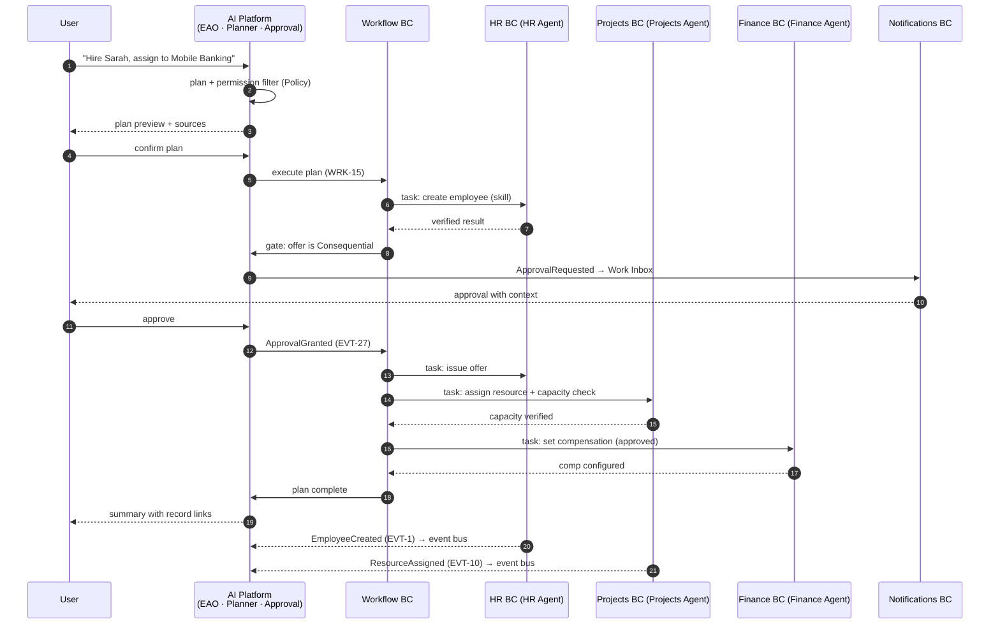

### 10.3 Sequence — Event-driven onboarding (WRK-2)

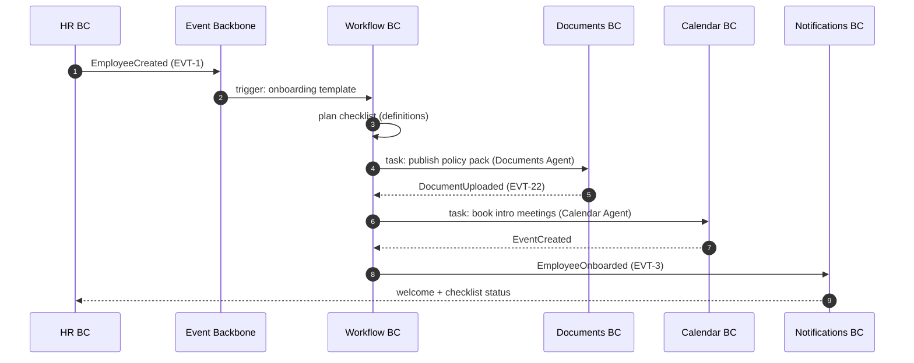

### 10.4 Sequence — Purchase-to-pay coordination (WRK-6)

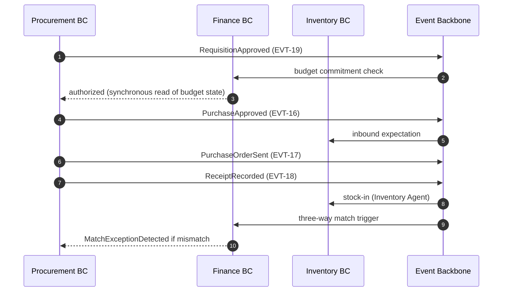

### 10.5 Ownership of the event bus

The Event Backbone itself is **platform infrastructure, not a domain** (SAD §5.14, §11): the schema, guarantees (EVT-G1…G6), DLQ, and replay belong to the platform; the **facts** belong to the publishing BCs. No BC owns another BC's events.

---

## 11. AI Domain Mapping

Every business BC owns one AI agent (PRN-4). The agent is the BC's **intelligence façade**: the only way AI enters that BC, executing only the BC's skills under delegated user authority (PRM-8, ADR-001).

| Agent (BC)                                   | Responsibilities                                                  | Capabilities (Skills)                                                                                                                           | Owned tools                                                     | Knowledge scope                                          | Permissions                                                                   | Human approval requirements                                                                               |
| -------------------------------------------- | ----------------------------------------------------------------- | ----------------------------------------------------------------------------------------------------------------------------------------------- | --------------------------------------------------------------- | -------------------------------------------------------- | ----------------------------------------------------------------------------- | --------------------------------------------------------------------------------------------------------- |
| **HR Agent** (HR)                            | People operations: hire, onboard, offboard, leave, org visibility | `create_employee`, `create_offer`, `create_onboarding_checklist`, `submit_leave`, `check_balance`, `initiate_offboarding`, `org_lookup`         | Employee, offer, leave, onboarding-task tools; org chart read   | HR policies (KB), org structure, employment records      | HR roles (Recruiter, People Manager, HR Admin, Employee); delegated envelope  | Hire/offer/comp = **Consequential** (4-eyes); termination = Consequential; leave = Configurable (manager) |
| **Projects Agent** (Projects)                | Delivery: projects, tasks, resources, status, time                | `create_project`, `create_task`, `create_milestone`, `assign_resource`, `check_capacity`, `update_status`, `log_time`, `generate_status_report` | Project/task/milestone/assignment tools; capacity query         | Project wikis, status context, org resource pool         | Projects roles (PM, Resource Manager, Contributor, Viewer)                    | Assignment conflicts surfaced for decision; budget-scoped work gated by Finance policy                    |
| **CRM Agent** (CRM)                          | Relationships: accounts, contacts, deals, activities              | `create_contact`, `create_company`, `update_deal`, `log_activity`, `search_account`, `merge_duplicates`, `draft_followup`, `deal_summary`       | Account/contact/deal/activity tools; duplicate matcher          | Account knowledge, deal context                          | CRM roles (Account Owner, SDR, Sales Admin, Viewer)                           | Duplicate merges = Configurable (owner confirm); external customer emails = Consequential                 |
| **Sales Agent** (Sales)                      | Revenue: quotes, orders, forecast                                 | `create_quote`, `approve_quote`, `convert_to_order`, `update_order`, `forecast_summary`, `pricebook_lookup`                                     | Quote/order/pricebook tools; forecast model                     | Pricebook, deal context (via CRM read)                   | Sales roles (Rep, Manager, Admin)                                             | Over-policy discounts = Consequential (Manager); order = Consequential (Finance/credit)                   |
| **Finance Agent** (Finance)                  | Money: invoices, expenses, budgets, payments, close               | `create_invoice`, `submit_expense`, `approve_expense`, `schedule_payment`, `budget_check`, `close_task`, `expense_summary`, `cash_position`     | Invoice/expense/budget/payment tools; money-service integration | Finance policies (KB), budget context                    | Finance roles (Preparer, Approver, Finance Admin); SoD enforced               | **All money movements Consequential** (BR-19); expense beyond policy = Finance approval                   |
| **Procurement Agent** (Procurement)          | Purchasing: requisitions, POs, vendors, receipts                  | `create_requisition`, `validate_budget`, `route_approval`, `create_po`, `create_vendor`, `record_receipt`, `three_way_match`, `po_status`       | Requisition/PO/vendor/receipt tools; budget-check client        | Vendor registry, procurement policy (KB)                 | Procurement roles (Requester, Buyer, Approver)                                | PO above threshold = Consequential (4-eyes); new vendor onboarding = Vendor Admin approval                |
| **Inventory Agent** (Inventory)              | Stock: items, levels, transfers, reorder                          | `create_item`, `stock_check`, `propose_reorder`, `create_transfer`, `record_count`, `adjust_stock`, `stockout_alert`                            | Stock/transfer/count tools; reorder computation                 | Item master, location context                            | Inventory roles (Warehouse Operator, Inventory Admin)                         | Negative adjustments = Consequential (BR-21); reorders above threshold = approval                         |
| **Documents Agent** (Documents)              | Content: drafts, versions, templates, approvals                   | `upload_document`, `create_from_template`, `draft_document`, `request_approval`, `search_documents`, `summarize_document`, `extract_fields`     | Document/version/template tools                                 | Document libraries (Workspace scope)                     | Document roles (Editor, Reviewer, Admin); BR-12 authoritative version         | Contract/legal-type approvals per chain; external sharing = Consequential                                 |
| **KB Agent** (Knowledge)                     | Institutional memory: articles, policies, grounded answers        | `write_article`, `publish_article`, `search_kb`, `answer_from_kb`, `update_policy`                                                              | Article/policy tools; access-filtered retrieval (BR-23)         | KB corpus (Workspace scope); never unauthorized content  | KB roles (Editor, Reviewer, Admin, Viewer)                                    | Publication = Configurable (reviewer); answers = Read-only (no approval)                                  |
| **Analytics Agent** (Analytics)              | Insight: KPIs, reports, narration, Q&A                            | `ask_kpi`, `generate_report`, `narrate_variance`, `schedule_report`, `explain_metric`                                                           | Query/report/schedule tools                                     | Metric definitions, connected data projections           | Analytics roles (Viewer, Creator, Admin)                                      | Report publication/share = Configurable (approver); no consequential actions                              |
| **Calendar Agent** (Calendar)                | Time: events, availability, coordination                          | `create_event`, `find_time`, `suggest_times`, `reschedule_event`, `availability_lookup`                                                         | Calendar/availability tools                                     | Workspace calendar context                               | Calendar roles (Member own, Admin)                                            | External attendee sends = Consequential (no external sends without confirmation)                          |
| **Enterprise AI Orchestrator** (AI Platform) | Coordination of all agents; owns no domain data                   | intent parse, plan, agent selection, dispatch, verify, narrate (orchestration skills only)                                                      | Discovery projection, Plan/WF tools; **no domain tools**        | Registry descriptors + access-filtered knowledge (BR-23) | Delegated envelope = invoking user ∩ tenant AI policy ∩ autonomy tier (PRM-8) | Every Consequential step passes Approval Engine (BR-28); plan preview at Confirm tier                     |

**Domains without a domain agent (reasoning):** structural and platform BCs (Tenancy, IAM, Policy, Notifications, Workflow, App Platform, Search, Configuration, Audit, Observability) have no business facts of their own to act on. **Administration** is the one platform BC exposing agent-accessible skills — and only under explicit admin confirmation (BR-16). The EAO composes all agents; agents never bypass it (ADR-001).

---

## 12. Capability Model

A **capability** is the semantic, business-level statement of what a BC can achieve ("Hire Employee"); a **skill** is its typed, executable form (`create_employee`); a **tool** is the underlying executable. Capabilities are the AI's vocabulary; skills are its hands (PSD §7.7, SAD §10).

### 12.1 Capability catalog (representative)

| BC              | Capabilities (business language)                                         | Skill(s)                                                                             | Tool(s)                              |
| --------------- | ------------------------------------------------------------------------ | ------------------------------------------------------------------------------------ | ------------------------------------ |
| **Projects**    | Create Project · Assign Task · Close Sprint · Generate Burndown          | `create_project` · `assign_resource` · `update_status` · `generate_status_report`    | project/task/milestone tools         |
| **HR**          | Hire Employee · Approve Leave · Payroll Summary · Generate Offer Letter  | `create_employee`/`create_offer` · `approve_leave` · (report skill) · `create_offer` | employee/leave/offer tools           |
| **CRM**         | Add Customer · Update Deal Stage · Log Activity · Merge Duplicates       | `create_company` · `update_deal` · `log_activity` · `merge_duplicates`               | account/deal/activity tools          |
| **Sales**       | Create Quote · Convert to Order · Refresh Forecast                       | `create_quote` · `convert_to_order` · `forecast_summary`                             | quote/order/pricebook tools          |
| **Finance**     | Generate Invoice · Approve Expense · Run Budget Check · Schedule Payment | `create_invoice` · `approve_expense` · `budget_check` · `schedule_payment`           | invoice/expense/budget/payment tools |
| **Procurement** | Submit Requisition · Create PO · Onboard Vendor · Three-Way Match        | `create_requisition` · `create_po` · `create_vendor` · `three_way_match`             | requisition/PO/vendor tools          |
| **Inventory**   | Check Stock · Propose Reorder · Transfer Stock · Cycle Count             | `stock_check` · `propose_reorder` · `create_transfer` · `record_count`               | stock/transfer tools                 |
| **Documents**   | Draft from Template · Request Approval · Summarize Document              | `create_from_template` · `request_approval` · `summarize_document`                   | document/version/template tools      |
| **Knowledge**   | Publish Article · Answer from KB · Update Policy                         | `publish_article` · `answer_from_kb` · `update_policy`                               | article/retrieval tools              |
| **Analytics**   | Ask a KPI · Generate Report · Narrate Variance                           | `ask_kpi` · `generate_report` · `narrate_variance`                                   | query/report tools                   |
| **Calendar**    | Book Meeting · Find Time · Reschedule                                    | `create_event` · `find_time` · `reschedule_event`                                    | calendar/availability tools          |

### 12.2 How Enterprise AI discovers capabilities

```
Plugin manifest (declares capabilities + skills + tools + permissions)
        │
        ▼
App Platform: ValidationService → RegistrationService
        │
        ▼
Capability Registry (CapabilityDescriptor, SkillDef, ToolDef, AgentRegistration)  ── writes owned by App Platform (§2.3)
        │  event: PluginInstalled / AgentRegistered / PluginUpgraded
        ▼
AI Platform: CapabilityDiscoveryService consumes the registry projection (read model)
        │  filter: invoking user's permissions (PRM-8) + workspace + autonomy tier
        ▼
Planner: intent → candidate capabilities → plan over skills (AI-2)
        ▼
Dispatch: Agent Registry → owning agent executes tools → verified results (AI-6)
```

**Discovery guarantees (from SAD §10.4):** no hardcoding (ADR-005) · permission-filtered visibility · versioned freshness with deprecation windows (AC-13) · semantic descriptors validated at install (§7.12) · every query traced (NFR-15). The AI therefore automatically discovers any new domain — a marketplace App, an industry pack, or a future first-party App — the moment it registers (PRD FR-16, §15).

---

## 13. Policy Ownership

**Policy definition** (what the rule is) and **policy enforcement** (that the rule holds) are separated: each BC **owns and defines** the policies of its domain; the **Policy BC** provides the single evaluation engine and records decisions (ADR-005, PRM-10). Security invariants are platform-level and non-configurable (AC-3/4/5, R-35).

| Policy                         | Definer (owner BC)                     | Enforcer                                         | Examples                                                                                                       |
| ------------------------------ | -------------------------------------- | ------------------------------------------------ | -------------------------------------------------------------------------------------------------------------- |
| **Tenancy policies**           | Tenancy                                | Policy BC                                        | Workspace archive rules (R-02), scoping (WS-R3), Company lifecycle                                             |
| **Workspace policies**         | Tenancy                                | Policy BC                                        | App enablement per Workspace; autonomy tier assignment per Workspace (WS-*)                                    |
| **Identity & access policies** | IAM                                    | Policy BC                                        | Guest/external containment (BR-8, R-06), deactivation revocation (R-05), membership rules                      |
| **Security policies**          | Platform (AC-*)                        | Policy BC + platform invariants                  | Zero-trust, least privilege (PRM-4), residency (EC-16), no cross-tenant access (R-01)                          |
| **HR policies**                | HR                                     | Policy BC                                        | Leave balances & limits (BR-17), department validity (BR-10→R-10), hiring/onboarding rules (WRK-1/2)           |
| **Finance policies**           | Finance                                | Policy BC                                        | Budget enforcement (BR-10), expense thresholds, close rules (WRK-7/9/14)                                       |
| **Procurement policies**       | Procurement                            | Policy BC                                        | Value-tier approval chains, vendor onboarding (WRK-6)                                                          |
| **Sales policies**             | Sales                                  | Policy BC                                        | Discount limits (R-16), quote/order authority                                                                  |
| **Knowledge policies**         | Knowledge                              | Policy BC + RetrievalService (BR-7)              | Visibility scoping, publication flow, conflict handling (EC-6, R-23/24)                                        |
| **Documents policies**         | Documents                              | Policy BC                                        | Authoritative-version rule (BR-12), sharing approval, contract-type chains                                     |
| **Approval policies**          | Policy (chains) + owning BC (criteria) | Approval Engine (AI Platform) + Policy BC        | Chains per side-effect class and value tier (L6, PRM-6, BR-15/18)                                              |
| **AI policies**                | AI Platform                            | Policy BC + Approval Engine + guardrails (AIX-*) | Side-effect classes (BR-13), prohibited actions (BR-14), autonomy tiers (PSD §7.20), no learning-around (R-28) |
| **Data residency & retention** | Tenancy + Audit                        | Configuration + Audit platforms                  | Region pinning (NFR-10), retention (AUD-7), export (FR-34)                                                     |
| **Notification policies**      | Notifications                          | Notifications BC                                 | Channel preferences, quiet hours, digests (FR-27)                                                              |
| **Configuration policies**     | Configuration                          | Configuration BC (R-35)                          | Safety invariants non-relaxable (AC-3/4/5)                                                                     |

**Reasoning:** single-point enforcement (ADR-005) guarantees every domain's rules hold uniformly — including inside AI-driven flows, where the same Policy evaluation gates agent actions (PRM-8). No App enforces its own permissions (PSD §5.3, §10).

---

## 14. Lifecycle Models

Lifecycles are **guarded state machines** enforced by their aggregate roots (§6). Cross-cutting lifecycle principles: no illegal transitions are representable; every transition is audited (AUD-1) and, where relevant, published as an event (EVT-*).

### 14.1 Employee lifecycle

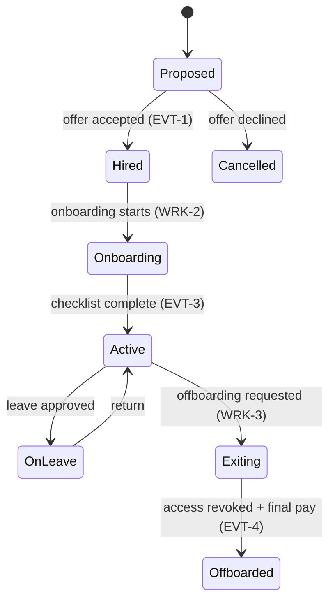

### 14.2 Project lifecycle

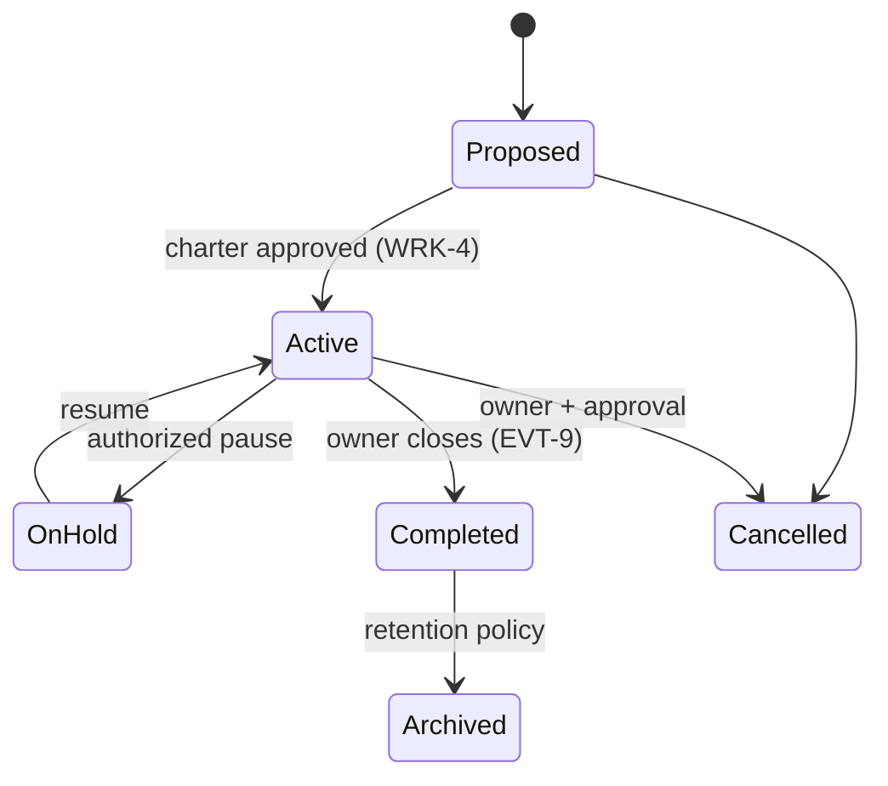

### 14.3 Document lifecycle

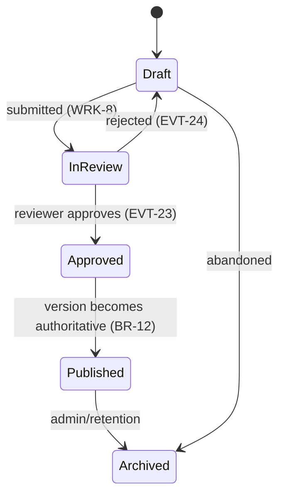

### 14.4 Invoice lifecycle

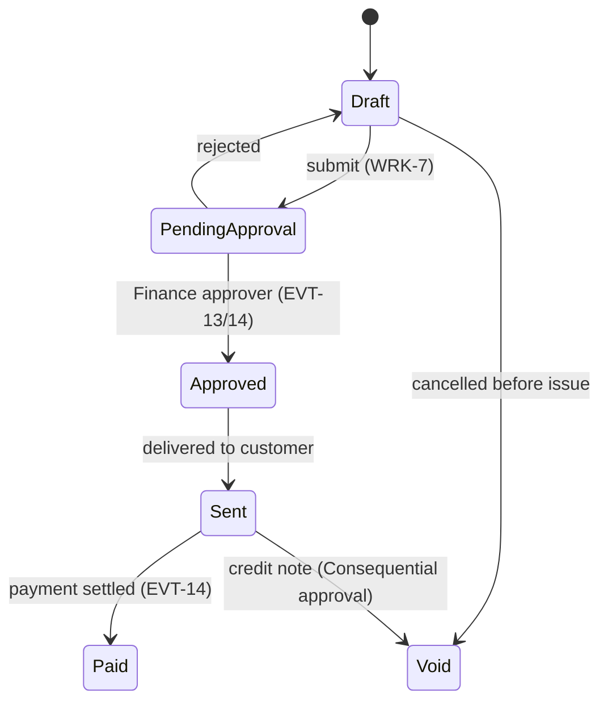

### 14.5 Approval lifecycle

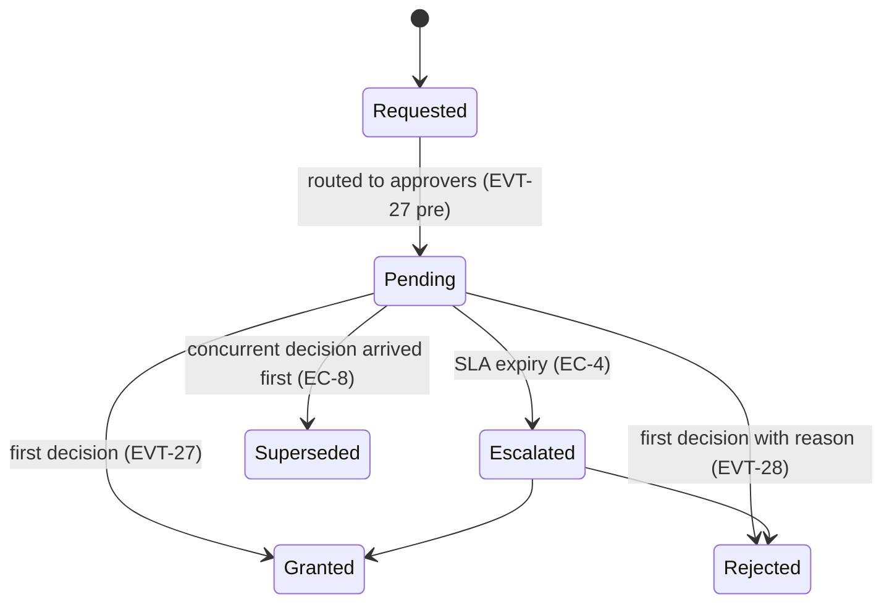

### 14.6 Workflow lifecycle

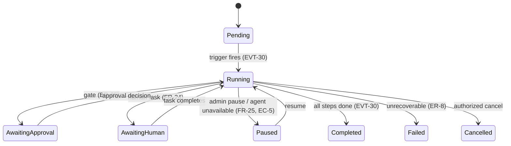

### 14.7 AI agent lifecycle

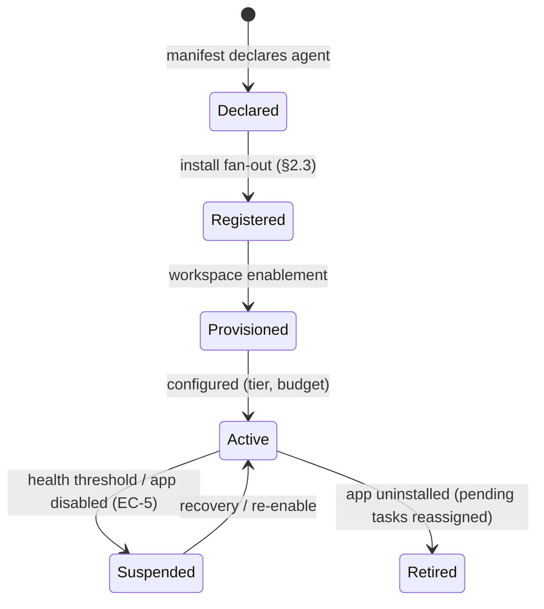

### 14.8 Plugin lifecycle

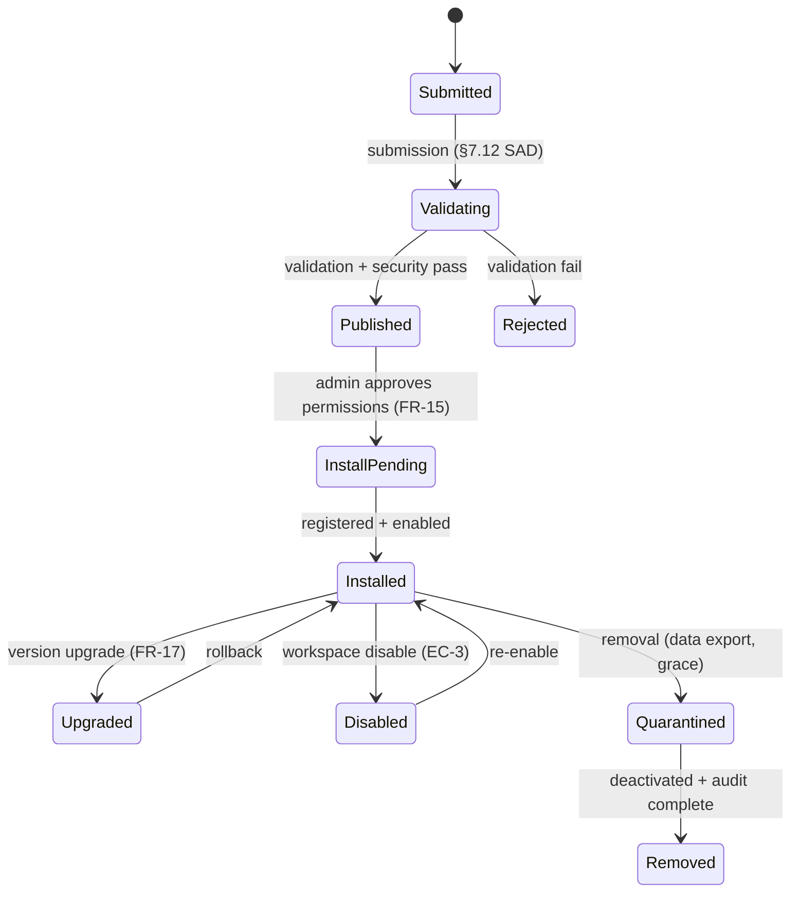

---

## 15. Future Extensibility

### 15.1 Adding a new domain without modifying existing ones

A new business domain (e.g., **Field Service**, **Legal**, **ITSM**, **Payroll**) is added as a **new bounded context behind a new marketplace App** — a content operation, never a platform rewrite (SAD ADR-003/005, PRD FR-16):

| Step                    | Mechanism                                                                                                        | What existing BCs must change |
| ----------------------- | ---------------------------------------------------------------------------------------------------------------- | ----------------------------- |
| 1. Author the App       | Plugin SDK: manifest declares capabilities, skills, tools, events, knowledge, permissions, UI, config (PSD §5.2) | Nothing                       |
| 2. Validate & publish   | App Platform ValidationService (§7.12 SAD)                                                                       | Nothing                       |
| 3. Install per Company  | Marketplace → registration fan-out into registries (§2.3)                                                        | Nothing                       |
| 4. Enable per Workspace | AppEnablement (Tenancy)                                                                                          | Nothing                       |
| 5. The AI discovers it  | Capability Discovery (§12) — permission-filtered, versioned                                                      | Nothing (ADR-005)             |
| 6. It interoperates     | Publishes/subscribes events (EVT-*) · read interfaces · orchestrator-dispatched agents                           | Nothing (ADR-001/002)         |

**Why this holds (reasoning):** BCs are coupled only through frozen contracts — the App Contract (PSD §5.3), event types (AC-13), and the context contract (AC-14). A new BC registers _into_ those contracts; it never alters them. Existing BCs subscribe to new events only if they care (new publisher, old contracts). Industry packs (PRD NG-3) are **configuration**: Workspace-type templates + preinstalled App sets + workflow templates — no code and no new BCs.

### 15.2 Marketplace evolution (SAD §18)

| Evolution                  | DDD impact                                                                | Backward compatibility                                             |
| -------------------------- | ------------------------------------------------------------------------- | ------------------------------------------------------------------ |
| **Enterprise Marketplace** | New _distribution_ content (App listings, versioned catalogs) — no new BC | Catalog is content in App Platform BC                              |
| **Public Plugin SDK**      | App Platform BC's contracts become public; validation rules shared        | Contracts already frozen (AC-13)                                   |
| **Agent Marketplace**      | Third-party agents register into the Agent Registry; governed by PRM-8    | Same discovery + delegation rules (§11)                            |
| **Workflow Marketplace**   | WorkflowDefinition templates as distributable content (Workflow BC)       | Definitions versioned; approval-logic review gate preserved (R-25) |
| **Knowledge Marketplace**  | Grounding content packs ingested by Knowledge BC                          | Access-filtered retrieval inherited (R-23)                         |
| **Industry Packs**         | Configuration + templates; no new platform behavior                       | Config-only (WS-R4)                                                |
| **Developer Platform**     | Tooling around existing SDK/registries/observability                      | No contract changes                                                |

### 15.3 Extensibility invariants

1. No new BC modifies an existing BC's aggregate or event schema (AC-13).
2. New capabilities are discoverable, never hardcoded (ADR-005).
3. New agents inherit the delegated-authority envelope (R-09).
4. New domains that need money/people/contracts semantics reuse the shared VOs (`Money`, side-effect classes) and Policy evaluation (R-07).

---

## 16. Architecture Alignment

### 16.1 Traceability: PRD → PSD → SAD → DDD

Every domain exists **because of an approved product requirement**. The table proves the chain for each BC.

| DDD BC (DOM)           | PRD (why)                         | PSD (what)                  | SAD (how it's built)            |
| ---------------------- | --------------------------------- | --------------------------- | ------------------------------- |
| Tenancy (01)           | FR-1/2/3, §8                      | §3–4 (CO-_, WS-_)           | §5.2 Workspace Platform         |
| Identity & Access (02) | FR-18, §14                        | §9 (USR-*)                  | §5.1 Identity Platform          |
| Policy (03)            | FR-19/20/21, §14.3                | §10 (PRM-_), §12 (BR-_)     | §5.12 Policy Platform           |
| HR (04)                | §13 HR app, §20 MVP               | §6.1 (APP-01), WRK-1/2/3    | App Runtime (SAD §6)            |
| Projects (05)          | §13 Projects app, §20 MVP         | §6.2 (APP-02), WRK-4        | App Runtime                     |
| CRM (06)               | §13 CRM app (Phase 1)             | §6.3 (APP-03), WRK-5/11     | App Runtime                     |
| Sales (07)             | §13 Sales app (Phase 2)           | §6.5 (APP-05), WRK-11       | App Runtime                     |
| Finance (08)           | §13 Finance app (Phase 1)         | §6.4 (APP-04), WRK-6/7/9/14 | App Runtime                     |
| Procurement (09)       | §13 Procurement app (Phase 1)     | §6.7 (APP-07), WRK-6/12     | App Runtime                     |
| Inventory (10)         | §13 Inventory app (Phase 1)       | §6.6 (APP-06), WRK-12       | App Runtime                     |
| Documents (11)         | §13 Documents app, §20 MVP, FR-31 | §6.8 (APP-08), BR-12        | App Runtime + Knowledge ingest  |
| Knowledge (12)         | §13 KB app, AI-5, FR-31           | §6.11 (APP-11), AIX-6, BR-7 | §5.8 Knowledge Platform         |
| Analytics (13)         | §13 Analytics app (Phase 1), NG-5 | §6.9 (APP-09)               | App Runtime + read projections  |
| Calendar (14)          | §13 Calendar app (Phase 1)        | §6.10 (APP-10)              | App Runtime                     |
| Notifications (15)     | FR-27/28/29                       | §6.12 (APP-12)              | §5.4 Notification Platform      |
| Workflow (16)          | FR-22…26, §16                     | AIX-9/10, WRK-*, FR-24      | §5.10 Workflow Platform         |
| AI Platform (17)       | §12 (AI-1…12), FR-9/10            | §7 (AIX-1…19), §7.20        | §5.9 AI Platform, §8 AI Runtime |
| App Platform (18)      | FR-14…17, FR-39, G3               | §5, §7 (App Contract, SDK)  | §5.3/5.11, §7 Plugin SDK        |
| Administration (19)    | FR-37                             | §6.13 (APP-13), BR-16       | §5.x admin surfaces             |
| Search (20)            | FR-30                             | BR-7 (filtering)            | §5.7 Search Platform            |
| Configuration (21)     | FR-37, AI-11                      | AIX-15, R-35                | §5.5 Configuration Platform     |
| Audit (22)             | FR-33/34, NFR-8                   | §15 (AUD-*)                 | §5.6 Audit Platform             |
| Observability (23)     | NFR-15, §18 metrics               | §16 (OBS-*)                 | §5.13 Observability Platform    |

### 16.2 Alignment invariants

1. **One BC = one capability.** SAD platform services and PSD Apps are _projections_ of BCs — a service may implement part of a BC; an App delivers a BC's marketplace expression; neither creates a new domain. (Example: the `Knowledge` BC is expressed by the KB App (APP-11) _and_ the SAD Knowledge Platform §5.8 — the same business capability.)
2. **Events align.** DDD domain events (§8) and PSD EVT-* (§8.3 PSD) are the same facts; the DDD publisher/subscriber model is the source, the SAD Event Backbone (§11 SAD) is the transport.
3. **Rules align.** DDD R-01…R-36 are the behavioral expression of PSD BR-1…18, PRM-1…10, AUD-1…8, EC-_, and ER-_; no rule is invented or lost.
4. **Aggregates align with audits and events.** Every aggregate root's guarded transitions (§14) produce the audit records (AUD-_) and events (EVT-_) the SAD requires (ADR-011).

### 16.3 Consistency status

The domain model introduces **no new capabilities, no removed capabilities, and no altered contracts** relative to the PRD/PSD/SAD. It only _sharply divides ownership_ so that database design, API design, backend modules, AI agents, and the event system have a single authoritative source: this document.

### 16.4 Documented resolutions (preserving backward compatibility)

| Ambiguity                             | Resolution (this document)                                                                                     | Backward compatible because…                                                                         |
| ------------------------------------- | -------------------------------------------------------------------------------------------------------------- | ---------------------------------------------------------------------------------------------------- |
| Registry ownership (SAD §7.3 vs §8.1) | App Platform writes; AI Platform owns the discovery read-model (§2.3)                                          | Both SAD statements honored: registration fan-out (App Platform) + discovery component (AI Platform) |
| Approval Engine placement             | `ApprovalRequest` aggregate in AI Platform BC; routing via Workflow HumanTasks; rules from Policy BC (§6, §13) | Matches PSD AIX-11/18, FR-24, PRM-6 exactly                                                          |
| Platform service vs App projection    | BC is the unifying concept (§16.2-1)                                                                           | SAD services and PSD Apps both remain valid artifacts of the same BC                                 |
| Knowledge BC boundaries               | Documents (content) vs Knowledge (grounding index) are separate BCs with event-driven ingestion                | Matches SAD §5.8 (Knowledge ingests from Documents) and PSD APP-08 vs APP-11                         |

---

_End of document — Nexora Domain Model v1.0. Successor artifact: data design (schemas), API design, and agent skill contracts — all to be derived from this domain model._
