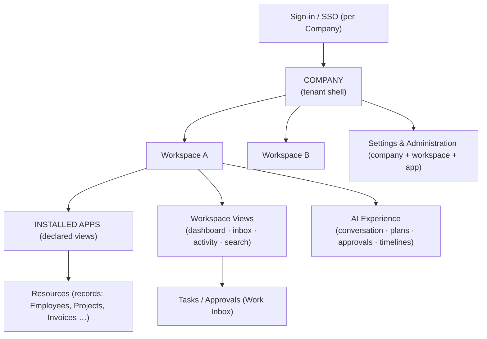

# Nexora — Frontend Architecture & UX Blueprint

**Product:** Nexora — _Work. Orchestrated by AI._
**Document Type:** Frontend Architecture & UX Blueprint (FEX)
**Version:** 1.0
**Owner:** Frontend & UX Architecture
**Audience:** Frontend engineering, product design, design systems, QA
**Related documents:** PRD v1.0 · PSD v1.0 · SAD v1.0 · DOMAIN_MODEL v1.0 · AIR v1.0 · BKD v1.0 · API v1.0 · PERSISTENCE v1.0

---

## 0. Purpose & Consistency

### 0.1 Purpose

This document is the **frontend architecture and interaction model** for Nexora: how the product _feels_ like an AI Operating System — conversation-first, workspace-scoped, command-driven, minimal — and how the frontend is structured to stay thin, fast, plugin-rendering, and enterprise-grade. It contains **no implementation code, no components, and no framework discussion** — only frontend architecture and UX behavior with reasoning.

### 0.2 Consistency contract

| Anchor                                                                                                                          | Used here                                        |
| ------------------------------------------------------------------------------------------------------------------------------- | ------------------------------------------------ |
| SAD §4 (L2 Frontend: conversational console primary, deterministic UI fallback — FR-8), §14.3 (thin clients, no business logic) | §1, §12 — server-authoritative thin client       |
| PSD §5.3/§6 (declarative Navigation registration per App); SAD §6.2-3 (shell renders navigation as data)                        | §3, §7–8 — plugin-rendered shell                 |
| PSD §4 (Workspaces), WS-R3 (scope-bound context)                                                                                | §2, §4–5 — workspace-first experience            |
| AIR §6 (plan preview), §12 (approvals), §14 (ten explainability elements), §16 (timelines)                                      | §6 — AI experience                               |
| PSD §16 (OBS-*), FR-27/28/29 (inbox/notifications)                                                                              | §10 — notification experience                    |
| API §11 (streaming, cursor pagination), §13 (request IDs)                                                                       | §9, §13 — search & performance                   |
| PERSISTENCE §7 (read models: dashboard, inbox, timelines)                                                                       | §5, §12 — UI reads projections, never aggregates |
| PRM-*, BR-13/15 (authorization, approval gates)                                                                                 | §14 — security UX                                |

---

## 1. Frontend Philosophy

### 1.1 Nexora is an Operating System, not a collection of pages (reasoning)

| Page-based ERP assumption                             | Nexora's OS model                                                                                                                        | Why (source)                                    |
| ----------------------------------------------------- | ---------------------------------------------------------------------------------------------------------------------------------------- | ----------------------------------------------- |
| Navigation = list of modules (HR page, Finance page…) | Navigation = **the user's work and the AI's view** — one shell, workspace-scoped, with a persistent command surface                      | PRN-1 (AI First), FR-8                          |
| Each module owns its chrome and layout                | The **shell owns everything outside the content pane**; Apps contribute _content, views, widgets, and commands_ — declared, never chrome | PSD §5.3-3 (declarative navigation), SAD §6.2-3 |
| Users hunt across pages to complete a task            | Users **describe the outcome**; the AI plans and executes; screens exist as the power layer                                              | PRD §1, §3.1 (module fragmentation)             |
| State lives per page                                  | State is **workspace-scoped and server-authoritative**; the client is a thin projection (get dashboard, get inbox, get timelines)        | SAD §14.3, PERSISTENCE §7                       |
| Apps are monolithic silos                             | Apps are **plugins to the shell**: installable, declarative, consistent UX by contract                                                   | SAD §6, §10 BKD                                 |

**Design consequence:** the frontend has one persistent shell, one global command surface (conversation + palette), one search, one inbox, one timeline system — and any number of App-contributed content views. This is what makes Nexora feel like Notion/Linear/Figma/Slack rather than an ERP: **consistency comes from the OS, variety comes from content.**

### 1.2 UX principles (normative)

| #      | Principle              | Behavior                                                                                                                        |
| ------ | ---------------------- | ------------------------------------------------------------------------------------------------------------------------------- |
| FEX-1  | **AI First**           | The conversation is the primary surface; every capability is reachable in words; the deterministic UI is the power layer (FR-8) |
| FEX-2  | **Workspace First**    | Every screen is bound to a Workspace context; switching Workspaces switches the world (WS-R3)                                   |
| FEX-3  | **Conversation First** | Natural language is always available: inline, in the command bar, in panels — never only in a chat page                         |
| FEX-4  | **Command Driven**     | Keyboard-first: palette, quick switcher, slash commands, shortcuts — speed is a feature                                         |
| FEX-5  | **Minimal**            | Show the current context and the next action; hide everything else behind progressive disclosure                                |
| FEX-6  | **Fast**               | Perceived latency budget (NFR-1): streaming responses, optimistic updates, instant navigation                                   |
| FEX-7  | **Keyboard Friendly**  | Every action reachable by keyboard; palette-first navigation (Linear-style)                                                     |
| FEX-8  | **Accessible**         | WCAG 2.1 AA; keyboard + screen-reader complete (NFR-12)                                                                         |
| FEX-9  | **Responsive**         | Full experience on desktop, adapted experience on tablet/mobile (§15)                                                           |
| FEX-10 | **Modular**            | The shell is composed of independent regions; no region is App-specific                                                         |
| FEX-11 | **Plugin Friendly**    | Apps contribute views/widgets/commands/search entries via declarations — the shell never hardcodes an App (ADR-005 analog)      |
| FEX-12 | **Enterprise Grade**   | Permission-aware, auditable, governed — the UI reflects policy, it never enforces it (§14)                                      |

---

## 2. Information Architecture

### 2.1 The information hierarchy

### 2.2 Hierarchy rules

| Level         | Scope                  | Behavior                                                                                             | Source         |
| ------------- | ---------------------- | ---------------------------------------------------------------------------------------------------- | -------------- |
| **Company**   | One tenant             | The outer shell: identity, billing, residency, global settings, Workspace switcher                   | CO-2, FR-1     |
| **Workspace** | One Workspace          | The primary context: pinned Apps, workspace views, workspace knowledge, workspace AI scope           | WS-1, WS-R3    |
| **Apps**      | Installed App views    | Content panes contributed by Apps; navigation declared in manifests                                  | PSD §5.3-3     |
| **Views**     | Cross-App surfaces     | Dashboard, Work Inbox, Activity, Search, Timelines — owned by the shell                              | FR-29, OBS-*   |
| **Resources** | Records                | App-owned records (Employee, Project, Invoice…) rendered in App views; unified record lookup (FR-30) | FR-30          |
| **Tasks**     | Work items             | Approvals and human tasks surfaced centrally in the Inbox, regardless of owning App                  | FR-29          |
| **AI**        | Cross-App intelligence | Conversation, plans, approvals, explainability, timelines — accessible from anywhere in the shell    | AIR §2/§12/§14 |
| **Settings**  | Configuration          | Company, Workspace, App, AI configuration surfaces (APP-13)                                          | FR-37          |

**Reasoning:** the hierarchy puts **Workspace before Apps** (workspace-first) and **Tasks before records** (work-first): the user's mental model is "my workspace, my work, my records" — not "which module owns this". This matches the product promise of orchestrated work (PRD §1) and keeps App variety from fragmenting the model (FEX-10/11).

---

## 3. Navigation Architecture

Realizes: PSD §5.3-3 (declarative navigation), SAD §6.2-3, WS-R3. Navigation is **data, not chrome**: every level below is rendered from declarations (App manifests, workspace config, platform views), so the shell never hardcodes an App (FEX-11).

| Navigation level           | Behavior                                                                                                               | Source                               |
| -------------------------- | ---------------------------------------------------------------------------------------------------------------------- | ------------------------------------ |
| **Global navigation**      | Company-scoped: Workspace switcher, global search, notification center, settings, profile — constant across Workspaces | CO-2                                 |
| **Workspace navigation**   | The Workspace's pinned Apps, Views, and AI entry; defined per Workspace (enablement, WS-*)                             | WS-1, WS-R3                          |
| **Application navigation** | Views contributed by each App from its manifest; every App view renders inside the shell's content pane                | PSD §5.3-3                           |
| **Context navigation**     | Record-level: related items, references (by ID), audit trail, AI context for the record (explainability, history)      | FR-30, DDD §6 refs                   |
| **Breadcrumbs**            | Company / Workspace / App view / record — collapsible; every crumb is a valid destination                              | §2 hierarchy                         |
| **Quick Switcher**         | Fuzzy jump to any Workspace, App view, record, command, or conversation (Linear-style)                                 | FEX-4                                |
| **Favorites**              | Per-user pinned Apps, views, records, and conversations; workspace-scoped                                              | FEX-4                                |
| **Recent Items**           | Recency-ranked list of records/conversations the user touched; per-user, per-Workspace                                 | PERSISTENCE §7 (activity projection) |

### 3.1 Navigation rules (reasoning)

1. **Declared, never hardcoded** — an App's navigation appears because its manifest registers views (SAD §6.2-3); the shell renders entries, not App-specific code.
2. **One way to find anything** — quick switcher + global search cover all destinations; deep menu paths are avoided (minimal, FEX-5).
3. **Context is preserved** — navigation always carries the Workspace context; switching Workspaces re-resolves navigation (WS-R3).
4. **Keyboard-first** — every navigation level has a shortcut; the palette is the fastest path (FEX-4/7).

---

## 4. Shell Architecture

The **shell** is the persistent application frame — the same regions in every view, across every App (FEX-10/11). Nine regions, each with one responsibility:

| Region                  | Responsibility                                                         | Behavior                                                         |
| ----------------------- | ---------------------------------------------------------------------- | ---------------------------------------------------------------- |
| **Sidebar**             | Workspace navigation + pinned Apps/views + favorites                   | Collapsible; rendered from declarations; per-Workspace           |
| **Top Bar**             | Current context (Workspace + view), breadcrumbs, share/status, profile | Always visible; title reflects the active destination            |
| **AI Command Bar**      | Persistent conversational entry — the primary input surface (FEX-1/3)  | Focusable anywhere; inline results; expands to full conversation |
| **Notification Center** | Inbox + toasts + mentions + approvals (§10)                            | Slide-over panel; badge counts; actionable items                 |
| **Activity Feed**       | Live Activity Timeline (OBS-2) for the current scope                   | Side panel or tab; streams updates                               |
| **Workspace Switcher**  | Jump between Workspaces (WS-R3)                                        | In global nav; switch = context switch                           |
| **Command Palette**     | Every command: actions, navigation, AI prompts (§6)                    | Keyboard-first; fuzzy; slash-aware                               |
| **Search**              | Global unified search (§9)                                             | Overlay; permission-filtered results; deep links                 |
| **Status Bar**          | System + session state: sync state, AI activity, model status, region  | Subtle; never blocks                                             |

**Shell rules (reasoning):** (1) The shell owns **all chrome**; Apps own only content — consistent UX by construction (FEX-11). (2) The AI Command Bar is the **same surface everywhere** — conversation is ambient, not a destination (FEX-3). (3) Every region reads **projections** (inbox, activity, timelines — PERSISTENCE §7), never aggregates (server-authoritative thin client, SAD §14.3). (4) Regions are **composable and hideable** — users and Workspace configs can reduce chrome; nothing is fixed except the command surface.

---

## 5. Workspace Experience

Realizes: WS-1/WS-R3/R4, PERSISTENCE §7 (dashboard projection), FR-29. The Workspace home is the **OS desktop** — composed of the Workspace's Apps, widgets, and AI, never a generic page (FEX-2).

| Surface             | Behavior                                                                                                                 | Source                        |
| ------------------- | ------------------------------------------------------------------------------------------------------------------------ | ----------------------------- |
| **Pinned Apps**     | The Workspace's enabled Apps presented as launchable views; ordering per Workspace config                                | WS-*, EC-3                    |
| **Widgets**         | App-declared and platform widgets (approvals pending, my tasks, project status) on the home canvas                       | PSD §5.3 (declarative UI)     |
| **Dashboards**      | Default home = Workspace dashboard: widgets + AI summary                                                                 | PERSISTENCE §7 (GetDashboard) |
| **AI Suggestions**  | Workspace-scoped proactive suggestions (reorder alerts, approvals due, over-budget flags) — actionable, never surprising | AI-8, FEX-1                   |
| **Recent Activity** | Activity Timeline (OBS-2) filtered to the Workspace                                                                      | OBS-2                         |
| **Goals**           | Workspace-level goals surfaced from Projects/HR context (configurable)                                                   | WRK-4/14                      |
| **Projects**        | Active projects as a work-focused view                                                                                   | Projects module               |
| **Notifications**   | Workspace-scoped inbox view (approvals, tasks, exceptions)                                                               | FR-29                         |

**Workspace rules (reasoning):** (1) **One desktop per Workspace** — switching swaps the entire surface (Apps, widgets, knowledge, AI scope), reinforcing the mental model (WS-R3). (2) **Config over code** — everything on the home is workspace configuration (PRN-14). (3) **Work before records** — the home leads with tasks/approvals/suggestions, not lists (FEX-5).

---

## 6. AI Experience

Realizes: AIR §2/§6/§12/§14/§16; FR-4…8; OBS-3/4. The AI experience is the product's soul — ambient, trustworthy, and always under human control (PRN-2).

| Surface                  | Behavior                                                                                                                  | Source          |
| ------------------------ | ------------------------------------------------------------------------------------------------------------------------- | --------------- |
| **Natural Conversation** | Multi-turn conversation with sources on every claim (FR-6); clarify loop on ambiguity (FR-5); streaming responses (NFR-1) | FR-4…7, AIR §7  |
| **Inline AI**            | AI actions inside any view: select records → "summarize / assign / approve" — inline, without leaving context             | FEX-1/3         |
| **AI Command Palette**   | Slash-driven prompts fused with navigation palette ("→ move Acme to Closed Won")                                          | FEX-4/7, AIR §6 |
| **AI Suggestions**       | Contextual suggestions in views ("3 approvals due", "capacity conflict") with one-tap actions                             | AI-8, FEX-1     |
| **AI Side Panel**        | Per-record AI panel: summary, related knowledge, suggested actions, explainability                                        | FR-6, AIX-17    |
| **Explainability View**  | The ten elements (AIR §14) with drill-down to records and audit                                                           | FR-36, AIX-17   |
| **Approval Requests**    | Actionable approvals with full context — approve/reject/comment/modify in place (FR-28)                                   | FR-28, BR-15    |
| **Execution Timeline**   | Live view of a running plan: steps, gates, delays (OBS-4)                                                                 | OBS-4           |
| **Decision Timeline**    | AI Timeline (OBS-3): intent → plan → approvals → actions → verification                                                   | OBS-3           |

**AI UX rules (reasoning):** (1) **Plan before action** — consequential intents show their plan and gates before execution (AIR §6, BR-13). (2) **Trust by transparency** — every answer cites sources; every action is explainable (PRN-10, ADR-011). (3) **Control is constant** — pause/cancel/undo where the domain allows; approvals are one-tap with context (PRN-2). (4) **The AI is ambient, not a page** — conversation exists everywhere via the Command Bar and inline surfaces (FEX-3).

---

## 7. Application Experience

Realizes: PSD §5 (App model), §6 (app anatomy); SAD §6 (App Container); EC-3 (disable). Apps are **views inside the OS**, not separate products: the shell provides the frame, App manifests provide the content and behavior (FEX-11).

| Aspect            | Behavior                                                                                                                | Source               |
| ----------------- | ----------------------------------------------------------------------------------------------------------------------- | -------------------- |
| **Installation**  | Admin-driven, permission review (FR-15); the user-visible result is a new set of App views + skills in the Workspace    | FR-14/15             |
| **Navigation**    | App views register via manifest (PSD §5.3-3); the shell renders them in the sidebar + palette + search                  | SAD §6.2-3           |
| **Lifecycle**     | Enable/disable per Workspace (EC-3): disabling hides views, idles agents, retains data — the UI reflects state honestly | WS-*, EC-3           |
| **Configuration** | App settings surface in the Settings region per Workspace; typed, validated, versioned (R-35)                           | Configuration module |
| **Permissions**   | The UI renders what the user may access (permission-aware, §14); roles and scopes configure what is visible             | PRM-*                |
| **Context**       | Every App view is bound to the Workspace; records reference each other across Apps with deep links (FR-30)              | WS-R3, FR-30         |
| **Notifications** | App-generated notifications flow through the platform Inbox (FR-29) — Apps never ship their own notification chrome     | FR-27/29             |

**App experience rules (reasoning):** (1) **One chrome, many contents** — an App's UX is its content + declared interactions; the shell guarantees consistency (FEX-10/11). (2) **Honest lifecycle UX** — disabled/updating/removed Apps show clear state; no zombie views (EC-3). (3) **Notifications are platform, not App** — so the Inbox stays unified (FR-29). (4) **First-party Apps dogfood the same contract** — the App experience is identical for first-party and third-party (PRD P5).

---

## 8. Plugin UX

Realizes: PSD §7 (Plugin SDK), BKD §10, FR-14…17. The marketplace and plugin lifecycle are **first-class UX** — installing an App is a deliberate, transparent, reversible act.

| Surface           | Behavior                                                                                                             | Source               |
| ----------------- | -------------------------------------------------------------------------------------------------------------------- | -------------------- |
| **Marketplace**   | Browse/install/uninstall Apps with permission previews, ratings, versions; within the shell's Settings               | FR-14, PSD §5.11 SAD |
| **Installation**  | Explicit permission review screen (what it can access, its skills, its data) → admin approves → per-Workspace enable | FR-15                |
| **Updates**       | Update preview showing changed permissions/skills/contracts; rollback available (FR-17)                              | FR-17                |
| **Permissions**   | Every plugin surfaces its permission usage; admins can restrict per Workspace (PRM-*)                                | PRM-8                |
| **Configuration** | Plugin config appears in the Settings region with the same typed config UX as platform config                        | Configuration module |
| **Removal**       | Export confirmation → quarantine status → removal; the UI shows the grace state honestly (EC-3)                      | PSD §5.5             |

**Plugin UX rules (reasoning):** (1) **Transparency at every step** — installs, updates, and removals show consequences before the user commits (BR-15 analog for apps). (2) **Same UX as first-party** — the marketplace is the same surface Apps already use (PRD P5). (3) **Quarantine is visible** — removed Apps show their data state until purge; no silent loss (EC-3).

---

## 9. Search Experience

Realizes: FR-30, PERSISTENCE §12 (search fabric), API §4 (queries), BR-7. One **global search overlay** across every surface, with type-aware results and permission-filtered outcomes (the UI shows what the user may see — it never leaks what they can't).

| Surface              | Results                                  | Behavior                                                                     |
| -------------------- | ---------------------------------------- | ---------------------------------------------------------------------------- |
| **Knowledge Search** | Grounded answers with citations (BR-7)   | Hybrid lexical+vector; citation chips deep-link to source+version (AIR §9)   |
| **Command Search**   | Commands + AI prompts matching the query | Same palette UX; runs commands or drafts AI prompts (FEX-4)                  |
| **People Search**    | Employees/contacts within scope          | Identity + HR projections; availability hints where allowed                  |
| **Projects**         | Projects/tasks within scope              | Work-typed results with status; deep links (FR-30)                           |
| **Documents**        | Approved versions primary (BR-12)        | Version-aware results; authoritative badge                                   |
| **Plugins**          | Apps and their capabilities              | Capability discovery results (AIR §5) — what the AI can do                   |
| **AI Memory**        | User/workspace memory matches (opt-in)   | Semantic recall; shows what the AI remembers, with delete affordance (AIX-5) |

**Search rules (reasoning):** (1) **One overlay, type-aware** — a single command surface returns people/records/commands/knowledge, ranked by relevance and permission (API §11). (2) **Permission-filtered, never hidden-leaked** — results reflect the caller's scope (BR-7); absence is the only signal. (3) **Cursor pagination + keyboard-first** — results stream in, arrows navigate, Enter deep-links (API §11, FEX-7).

---

## 10. Notification Experience

Realizes: FR-27/28/29, OBS-2, AIR §12 (approvals). Notifications are **work, not noise**: everything actionable, everything routed by preference, everything traceable to its source.

| Surface                | Behavior                                                                                                          | Source          |
| ---------------------- | ----------------------------------------------------------------------------------------------------------------- | --------------- |
| **Inbox (Work Inbox)** | The unified home for approvals, tasks, exceptions (FR-29); batch actions; filters                                 | FR-29           |
| **Toasts**             | Transient, non-blocking confirmations (workflow completed, document approved)                                     | FEX-6           |
| **Mentions**           | People/record/workspace mentions linking into context; routed via notification preferences                        | FR-27           |
| **Approvals**          | Actionable from the notification itself: approve/reject/comment with full context (FR-28)                         | FR-28, AIR §12  |
| **AI Alerts**          | AI-originated alerts (anomalies, suggestions, completion) — clearly marked as AI-generated with explanation links | AIR §16, AIX-17 |
| **Workflow Updates**   | Run progress and completions via Execution Timeline links (OBS-4)                                                 | OBS-4           |

**Notification rules (reasoning):** (1) **Actionable or silent** — a notification that can't be acted on inline is suppressed or routed to feed only (FR-28). (2) **Preference-driven** — channel, frequency, and quiet hours per user (FR-27); digests for low-urgency. (3) **Traceable** — every item links to its record, approval, and audit context (OBS-2, ADR-011). (4) **AI notifications are labeled** — users can always distinguish AI-originated content (trust, PRN-10).

---

## 11. Design System Architecture

Realizes: NFR-12 (WCAG 2.1 AA), FEX-8, SAD §14.3 (thin clients). One **design system** powers the shell, every App view, and every plugin — so third-party content inherits platform quality automatically (FEX-11).

| Element              | Architecture                                                                                                        | Reasoning                                                   |
| -------------------- | ------------------------------------------------------------------------------------------------------------------- | ----------------------------------------------------------- |
| **Spacing**          | 4px base scale; space tokens (xs→3xl); consistent rhythm across shell, content, and panels                          | Predictable density; scales to all breakpoints              |
| **Typography**       | Type scale (display → caption) with role tokens; system font stack; numeric tabular alignment for tables            | Readability at all sizes; data alignment (Finance/tables)   |
| **Color tokens**     | Semantic tokens (background, surface, text, border, accent, danger, success, warning) mapped to light/dark palettes | Theming without rebranding; accessibility contrast (NFR-12) |
| **Icons**            | One icon set (outline/duotone); App icons follow platform rules; AI-origin markers use a distinct glyph family      | Visual consistency across Apps and AI surfaces              |
| **Elevation**        | Shadow/overlay tokens for overlays, panels, toasts, command palette                                                 | Clear hierarchy without chrome noise (minimal, FEX-5)       |
| **Motion**           | Duration/easing tokens; purposeful motion (entrance, focus, progress, state change) reduced-motion honored          | Clarity over decoration; accessibility (NFR-12)             |
| **Layout grid**      | 8-column mobile → 12-column desktop grid; content max-width with comfortable measure                                | Responsive by construction (§15)                            |
| **Responsive rules** | Breakpoint tokens; regions collapse/adapt (§15); command surface remains reachable on every size                    | OS feel on every device                                     |
| **Accessibility**    | WCAG 2.1 AA tokens and patterns: focus rings, contrast pairs, screen-reader labels, keyboard order                  | Enterprise requirement (NFR-12, FEX-8)                      |
| **Dark mode**        | First-class theme pair from the same semantic tokens; user + system preference; per-Workspace override              | Enterprise polish; no separate design pass                  |

**Design system rules (reasoning):** (1) **Tokens, not components, are the contract** — the design system defines behavior-agnostic tokens that Apps consume; components are implementation. (2) **AI surfaces are styled distinctly** — AI-originated content, suggestions, and alerts share a recognizable visual language (trust, PRN-10). (3) **Accessibility is tokenized** — contrast and focus are properties of the token set, not per-screen fixes (NFR-12).

---

## 12. State Management Philosophy

Realizes: SAD §14.3 (thin client, no business logic), PERSISTENCE §7 (read models), API §11 (streaming). The client is a **server-authoritative projection**: it holds presentation state and optimistic intent, never business truth.

| State                  | Owner                              | Behavior                                                                                                             |
| ---------------------- | ---------------------------------- | -------------------------------------------------------------------------------------------------------------------- |
| **Global (company)**   | Client (derived from server)       | Identity, region, theme, session — cached from authenticated context; never authoritative                            |
| **Workspace state**    | Client (per workspace)             | Active Workspace, pinned Apps, workspace config cache — swapped on switch (WS-R3); invalidated on `ConfigChanged`    |
| **Application state**  | Client (per App view)              | View-local presentation; data fetched via projections (PERSISTENCE §7); never mutates domain state directly          |
| **Session state**      | Client (short-lived)               | Authn tokens, request IDs, offline buffer (API §13); refreshed via Auth APIs                                         |
| **AI state**           | Client (conversation/plan mirrors) | Streaming conversation, plan preview, execution timeline — mirrors of server records (OBS-3/4); never a second truth |
| **Optimistic updates** | Client (bounded)                   | Commands apply optimistically with rollback on failure; idempotency keys on retries (API-P7)                         |
| **Offline handling**   | Client (graceful)                  | Read cache + queued commands with clear sync state in the Status Bar; domain writes require connectivity (NG-8)      |

### 12.1 State rules (reasoning)

1. **Server is the source of truth** — the client renders projections and outcomes; no client-side business rules (SAD §14.3, AC-15).
2. **Optimistic with honesty** — optimistic updates are labeled "pending" and roll back cleanly; the Status Bar shows sync state (FEX-6).
3. **Cache is disposable** — every client cache rebuilds from projections/events; nothing authoritative lives client-side (EVT-G3 analog).
4. **Conversation mirrors** — the AI conversation UI is a projection of Conversation History (AIX-16); refresh never loses content.

---

## 13. Performance

Realizes: NFR-1/2 (latency budgets), API §11 (streaming), PERSISTENCE §11 (caches). Performance is a UX principle (FEX-6): the product must feel instant even while heavy work runs behind it.

| Mechanism                 | Behavior                                                                                                                              | Budget impact                             |
| ------------------------- | ------------------------------------------------------------------------------------------------------------------------------------- | ----------------------------------------- |
| **Loading**               | Skeleton shells per region; route-level code splitting; critical shell first                                                          | First paint ≈ instant; content streams in |
| **Streaming**             | Conversational responses and long operations stream tokens/progress (NFR-1); the perceived budget excludes streamed latency (API §11) | Feels responsive during long AI work      |
| **Progressive rendering** | Priority content (context, actions) before secondary (feed, analytics); lazy panels                                                   | Usable before fully loaded                |
| **Caching**               | Client caches mirror server caches (PERSISTENCE §11) with the same event-driven invalidation; stale-while-revalidate                  | Instant revisits; freshness disclosed     |
| **Prefetching**           | Hover/focus prefetch of destinations (quick switcher, breadcrumbs, record links)                                                      | Navigation feels instant (FEX-4)          |
| **Virtualization**        | Windowed lists for records, activities, timeline entries                                                                              | Smooth at 10k+ rows (NFR-4)               |

**Performance rules (reasoning):** (1) **Perceived latency is the metric** — streaming and skeletons optimize what users _feel_, per NFR-1. (2) **Prefetch is scoped** — only likely destinations (switcher candidates, links under cursor); no speculative loads of heavy data. (3) **Virtualize large surfaces** — inbox, timelines, and search results never render unbounded DOM (NFR-4). (4) **Honest freshness** — cached views disclose staleness where it matters (knowledge, analytics — API §11).

---

## 14. Security UX

Realizes: PRM-*, BR-13/15, SAD §13 (server-enforced), FR-28. **The UI reflects policy; it never enforces it** — every rendering decision is driven by what the server returns (permission-filtered queries, API §4), and every consequential action passes the server's approval gate (BR-13).

| Surface                 | Behavior                                                                                                                                                   | Reasoning                                       |
| ----------------------- | ---------------------------------------------------------------------------------------------------------------------------------------------------------- | ----------------------------------------------- |
| **Permission-based UI** | Features the user can't use are absent or visibly disabled — driven by permission-filtered responses, never client checks                                  | Honest UI; server remains the authority (PRM-*) |
| **Hidden features**     | Sensitive capabilities are not merely disabled but hidden for scopes that must not reveal them (audit, credentials)                                        | No information leakage via UI (BR-7 analog)     |
| **Approval dialogs**    | Consequential actions show a purpose-built approval dialog: what, on which records, who approves, what happens next, rejection path (FR-28, BR-15)         | Users decide with full context (PRN-2)          |
| **Sensitive actions**   | Destructive/irreversible actions require explicit confirmation phrasing + typed confirmation where domain policy demands                                   | Accidental-loss prevention; audit-friendly      |
| **AI warnings**         | AI-originated suggestions/alerts are visually distinct and carry explanation links; consequential AI plans are never executed without the approval surface | Trust + transparency (PRN-10, AIR §14)          |

**Security UX rules (reasoning):** (1) **Server truth, UI mirror** — the client renders only what the server's permission-filtered responses provide (SAD §13, API §8). (2) **Consequential = visible gate** — approvals are never a background toast; they are deliberate dialogs with context (BR-15). (3) **No secret leakage** — the UI never implies the existence of what the user cannot see (BR-7). (4) **Everything auditable from the UI** — explanation and audit links appear where actions occurred (ADR-011).

---

## 15. Mobile & Tablet Strategy

Realizes: FR-4 (mobile clients), V1-11 (mobile Phase 1), FEX-9. The experience adapts by **capability, not by rewrite**: one product, three tiers of surface.

| Tier       | Devices                   | Experience                                                                                                                             | Source       |
| ---------- | ------------------------- | -------------------------------------------------------------------------------------------------------------------------------------- | ------------ |
| **Full**   | Desktop                   | Complete shell: all regions, all Apps, full AI surfaces                                                                                | V1 (primary) |
| **Tablet** | Tablet landscape/portrait | Full shell with adaptive regions: sidebar collapses, inbox and approval surfaces prioritized                                           | FEX-9        |
| **Mobile** | Phone                     | Conversation-first: AI Command Bar is the home; approvals, notifications, search, and quick views; heavy record work defers to desktop | FR-4, V1-11  |

**Mobile rules (reasoning):** (1) **Conversation-first on mobile** — the OS is a chat you can act on (approvals, toasts, alerts), matching the product's core promise (PRN-1). (2) **No feature orphans** — every mobile action is backed by the same server contracts (API); mobile never re-implements business logic (SAD §14.3). (3) **Notifications are the entry** — actionable notifications (FR-28) drive mobile usage without a heavy shell.

---

## 16. Future Evolution

Realizes: PRD §17 (Phase 1–3), AIR §17 (vision/speech), FR-4. Every evolution is an **addition to the shell**, never a rewrite — because the shell is declarative, conversation-first, and server-authoritative (FEX-10/11).

| Evolution                 | UX seam                                                                                               | What stays constant                                   |
| ------------------------- | ----------------------------------------------------------------------------------------------------- | ----------------------------------------------------- |
| **Multi-window**          | Regions become movable/detachable (conversation, inbox, timelines as independent windows)             | One shell model; per-window Workspace context (WS-R3) |
| **Desktop App**           | The web shell packaged as a desktop client with native notification/window integration                | All contracts; the thin-client model (SAD §14.3)      |
| **Voice Interface**       | Voice joins the conversation surface as another input modality into the same pipeline (AIR §17)       | Ambient conversation; clarify loop (FR-5)             |
| **Vision Interface**      | Vision-enabled knowledge (images in documents) surfaces in search/AI answers with citations (AIR §17) | Grounded answers; citation discipline (BR-7)          |
| **AI Canvas**             | A persistent visual surface for plans, workflows, and multi-agent progress (beyond timelines)         | Plan-before-action; approval gates (BR-13)            |
| **Collaborative Editing** | Multi-user presence on records/documents with conflict surfacing (EC-9)                               | Server-authoritative state; optimistic updates (§12)  |

**Evolution invariants:** (1) conversation stays ambient; (2) the shell never hardcodes an App; (3) the client stays thin — no business rules migrate client-side; (4) every new surface inherits the design system, security UX, and observability contracts (FEX-8/12, §14).

---

## Readiness Checklist

| #   | Readiness item                                                      | Status     |
| --- | ------------------------------------------------------------------- | ---------- |
| 1   | OS-over-pages philosophy ratified (§1)                              | ✅ Defined |
| 2   | Information architecture with hierarchy rules (§2)                  | ✅ Defined |
| 3   | Navigation architecture (5 levels + switcher/favorites/recent) (§3) | ✅ Defined |
| 4   | Shell regions specified with responsibilities (§4)                  | ✅ Defined |
| 5   | Workspace desktop experience defined (§5)                           | ✅ Defined |
| 6   | AI interaction model: 9 surfaces with rules (§6)                    | ✅ Defined |
| 7   | App + plugin UX lifecycle defined (§7–8)                            | ✅ Defined |
| 8   | Search + notification experiences defined (§9–10)                   | ✅ Defined |
| 9   | Design system token architecture defined (§11)                      | ✅ Defined |
| 10  | State philosophy + performance mechanisms defined (§12–13)          | ✅ Defined |
| 11  | Security UX rules ratified (§14)                                    | ✅ Defined |
| 12  | Mobile/tablet strategy tiered (§15)                                 | ✅ Defined |

## Dependencies

| Dependency                                     | From              | Consumed by    |
| ---------------------------------------------- | ----------------- | -------------- |
| Conversational + deterministic-UI requirements | PRD FR-4…8        | §1, §6         |
| Declarative navigation + App contract          | PSD §5.3, SAD §6  | §3, §7–8       |
| Workspace model                                | PSD §4 (WS-*)     | §2, §5         |
| AI pipeline, plans, approvals, explainability  | AIR §2/§6/§12/§14 | §6             |
| Read models (dashboard, inbox, timelines)      | PERSISTENCE §7    | §5, §10, §12   |
| API contracts (commands/queries/streaming)     | API v1.0          | §6, §9, §12–13 |
| Permission model + audit                       | PSD §10, §15      | §14            |

## Documents Enabled Next

1. **Design system token reference** (concrete token values, type scale, color pairs). 2. **Shell wireframe & region spec** per platform. 3. **Conversation UX flow spec** (clarify loop, plan preview, approvals). 4. **Accessibility conformance plan** (WCAG 2.1 AA mapping). 5. **Mobile surface spec** (conversation-first flows).

## Remaining Risks

| Risk                                        | Mitigation                                                                               |
| ------------------------------------------- | ---------------------------------------------------------------------------------------- |
| Conversation-first adoption vs. power users | Deterministic UI remains a first-class power layer (FR-8); palette-first speed (FEX-4/7) |
| Plugin UX inconsistency                     | Token-based design system + declarative contribution contract (FEX-11)                   |
| Perceived latency on AI-heavy flows         | Streaming + skeletons + progress timelines (NFR-1, §13)                                  |
| Workspace-switch confusion                  | Clear context signaling in Top Bar/Status Bar; one-desktop-per-workspace (WS-R3)         |
| Mobile feature parity expectations          | Tiered surface strategy with explicit parity boundaries (§15)                            |
| Accessibility debt in App/plugin views      | Tokenized contrast/focus + conformance gates (NFR-12)                                    |

## Implementation Readiness Score

**8 / 10 — Ready for design-system build-out and shell prototyping.**

- **Strong (fully specified):** information architecture, shell regions, navigation model, AI interaction model, security UX, state philosophy.
- **To reach 9+ before full build:** (1) ratify concrete design tokens (spacing/type/color pairs) against the accessibility plan; (2) approve the App-view contribution contract (which UI pieces Apps may declare); (3) validate conversation-flow spec against the AI pipeline (plan preview + approval timing); (4) scope the mobile v1 surface against V1-11 (chat clients Phase 1).

---

_End of document — Nexora Frontend Architecture & UX Blueprint v1.0. Successor artifact: design tokens, shell wireframes, and per-surface UX flow specs._
