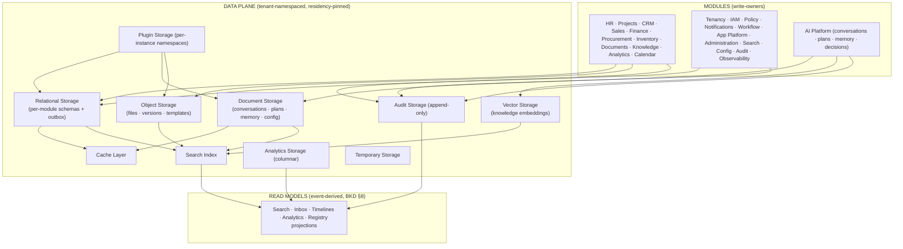

# Nexora — Database Architecture & Persistence Design

**Product:** Nexora — _Work. Orchestrated by AI._
**Document Type:** Enterprise Persistence Architecture (PSA)
**Version:** 1.0
**Owner:** Data & Persistence Architecture
**Audience:** Database engineering, backend, data platform, SRE, security
**Related documents:** PRD v1.0 · PSD v1.0 · SAD v1.0 · DOMAIN_MODEL v1.0 · AIR v1.0 · BKD v1.0 · API v1.0

---

## 0. Purpose & Consistency

### 0.1 Purpose

This document is the **blueprint for every database implementation** in Nexora: storage layers, database boundaries, aggregate persistence, entity/value-object catalogs, read models, tenant isolation, AI persistence, plugin persistence, caching, search, audit storage, backup/recovery, performance, and the evolution path. It contains **no SQL, no table definitions, and no ORM models** — only persistence architecture with reasoning.

### 0.2 Consistency contract

| Anchor                                                                          | Used here                                      |
| ------------------------------------------------------------------------------- | ---------------------------------------------- |
| DDD §6 (aggregates = transaction boundaries), §4/§5 (entities, VOs)             | §3–6 — persistence follows aggregate ownership |
| BKD §6 (per-module persistence, outbox), §8 (CQRS projections)                  | §2, §7 — projections rebuildable from events   |
| SAD §14.2 (data plane), AC-15 (no cross-module storage), AC-14 (tenant context) | §2, §8 — isolation & boundaries                |
| AIR §8 (memory), §9 (knowledge), §16 (timelines)                                | §9 — AI persistence                            |
| PSD §8 (EVT-G1…G6 event history), §15 (AUD-1…8 retention)                       | §13, §14 — audit & retention                   |
| NFR-3 (RPO/RTO), NFR-8 (audit retention), NFR-10 (residency)                    | §8, §14 — recovery & residency                 |
| API §13 (observability)                                                         | §13 — audit fields                             |

---

## 1. Persistence Philosophy

### 1.1 Persistence follows aggregate ownership, not CRUD tables (reasoning)

| Principle                                                           | Why it holds for Nexora                                                                                                                                                                     |
| ------------------------------------------------------------------- | ------------------------------------------------------------------------------------------------------------------------------------------------------------------------------------------- |
| **One aggregate = one transaction boundary** (DDD §6)               | Business invariants (BR-_, R-_) are enforced transactionally inside the aggregate; a CRUD-shaped table design would expose partial states and invite invariant violations                   |
| **Databases serve domains, not applications**                       | Each module owns its persistence (BKD §6, AC-15); the schema is the module's private implementation detail — other modules and the API never touch it, only the module's contracts (API §1) |
| **Writes are command-shaped; reads are projection-shaped** (BKD §8) | Aggregate stores are write-optimized and invariant-safe; read models (search, inbox, timelines) are projections — this split is _persistence-native_, not an afterthought                   |
| **Events are the cross-module contract**                            | Modules never read each other's stores; they learn from events (ADR-002). Persistence therefore has no cross-module joins — by construction                                                 |
| **Tenant isolation is a schema-level and query-level invariant**    | `companyId`/`workspaceId` are part of the persistence model (AC-14), enforced at the boundary, never by convention                                                                          |

**Consequence:** there is no "Nexora database"; there are **per-domain persistence units** — 23 modules, each owning its data behind its aggregate roots, sharing only references and events.

### 1.2 Multi-model by necessity (reasoning)

Different business data has different access and consistency needs, so Nexora uses **purpose-built storage per data class** (ADR-P5) instead of forcing everything into one engine:

| Data class                                                | Storage                          | Why                                                                |
| --------------------------------------------------------- | -------------------------------- | ------------------------------------------------------------------ |
| Aggregate state (invariants, transactions)                | Relational                       | ACID + strong consistency where invariants live                    |
| Semi-structured (conversations, plans, AI memory, config) | Document                         | Flexible schemas, high write throughput, natural JSON-shaped reads |
| Files (documents, artifacts)                              | Object                           | Immutable blobs, presigned access, versioned                       |
| Knowledge embeddings (grounding)                          | Vector                           | Semantic retrieval for RAG (AIR §9) with access-filtering          |
| Read projections                                          | Search index / analytics / cache | Query-shaped, rebuildable from events (EVT-G3)                     |
| Audit                                                     | Append-only store                | Immutability + retention (AUD-2, NFR-8)                            |

---

## 2. Storage Architecture

### 2.1 The ten storage layers

| Layer                  | Responsibility                                                                              | Owner-writers                            | Key properties                                                            |
| ---------------------- | ------------------------------------------------------------------------------------------- | ---------------------------------------- | ------------------------------------------------------------------------- |
| **Relational Storage** | Aggregate state and transactional integrity; per-module schemas; outbox tables (BKD §6.1-4) | All 23 modules (their own schemas)       | ACID; strong consistency within aggregate transactions; tenant-namespaced |
| **Document Storage**   | Conversations, plans, memory entries, config docs, decision records, plugin metadata        | AI Platform, Configuration, App Platform | Flexible schema; high write throughput; TTL-friendly                      |
| **Object Storage**     | Document files, versions, templates, plugin assets, exports                                 | Documents, App Platform, Audit (exports) | Immutable versioned blobs; presigned scoped access; residency-pinned      |
| **Vector Storage**     | Knowledge embeddings and semantic retrieval index                                           | Knowledge (via Knowledge Runtime)        | Approximate-NN retrieval; access-filtered at query (BR-7); version-aware  |
| **Cache**              | Hot reads: registries, config, permissions, capability descriptors, conversation context    | All (via BKD §6 caching)                 | Event-driven invalidation; never caches Consequential authority (PRM-8)   |
| **Search Index**       | Unified cross-App projection (FR-30)                                                        | Search (consumes events)                 | Query-time permission filtering; rebuildable (EVT-G3)                     |
| **Audit Storage**      | Append-only tamper-evident records (AUD-1/2)                                                | Audit (writes only)                      | Immutable; retention-based deletion only; SIEM export (NFR-8)             |
| **Analytics Storage**  | KPI snapshots, metric definitions, report data (columnar)                                   | Analytics (consumes events)              | Aggregation-friendly; traceable to definitions                            |
| **Temporary Storage**  | Scratch data: streamed artifacts, eval sandboxes, exports-in-progress                       | Any (short TTL)                          | Ephemeral; region-pinned; auto-expiring                                   |
| **Plugin Storage**     | Namespaced data of plugin App instances (§10)                                               | Each plugin instance (own namespace)     | Isolated; migration-versioned; deletion-on-removal                        |

### 2.2 Storage architecture diagram

### 2.3 Storage rules (normative)

1. **One writer per store region:** each aggregate/entity is written by exactly one module; readers use projections or contracts (AC-15).
2. **Outbox in the same transaction:** events are written to the outbox in the aggregate's transaction; the relay publishes to the Event Layer (BKD §6.1-4, EVT-G1).
3. **Tenant context is stored, not implied:** every record carries `companyId` (+ `workspaceId` where scoped); queries enforce it (AC-14).
4. **Residency is a deployment property:** the data plane is pinned per Company (NFR-10, EC-16).
5. **Projections are disposable:** search, analytics, and timelines rebuild fully from events (EVT-G3) — no projection is a system of record.

---

## 3. Database Boundaries

Realizes: DDD §1–3 (23 BCs), BKD §3 (modules), AC-15. Every domain owns its persistence; boundaries are **hard** — no cross-module queries, no shared tables, no foreign-key joins across modules (references are by ID; facts flow by events).

### 3.1 Platform & core boundaries

| Module                | Owned data                                                                                                                              | Shared references                           | Isolation rules                                                      | Transaction boundary                 | Retention rules                                            | Archival rules                                              |
| --------------------- | --------------------------------------------------------------------------------------------------------------------------------------- | ------------------------------------------- | -------------------------------------------------------------------- | ------------------------------------ | ---------------------------------------------------------- | ----------------------------------------------------------- |
| **Tenancy**           | Company, Workspace, WorkspaceType, AppEnablement                                                                                        | companyId/workspaceId used by all           | Company-scoped schema; no cross-company access (FR-1)                | Company/Workspace lifecycle commands | Per Company policy                                         | Archived workspaces retained, queryable, restorable (WS-R5) |
| **Identity & Access** | User, Group, Team, Membership, Guest, ExternalIdentity, Session                                                                         | user IDs referenced by all modules          | Company-scoped; sessions short-TTL                                   | User lifecycle, membership grants    | Sessions purge on expiry; identities per Company policy    | Deactivated users retained for audit                        |
| **Policy**            | PolicyRule, ApprovalChain, RoleGrant, DecisionLog                                                                                       | rule IDs referenced by AI/approval          | Company-scoped; decisions logged                                     | Rule versioning                      | DecisionLog per retention policy (AUD-3)                   | Archived rule versions retained                             |
| **Notifications**     | Notification, InboxItem, NotificationPreference                                                                                         | user/workspace refs                         | Company-scoped; inbox per user                                       | Notification delivery                | Inbox items per preference (auto-purge/snooze)             | Archived notifications for audit                            |
| **Workflow**          | WorkflowDefinition, WorkflowExecution, StepRun, HumanTask, Escalation                                                                   | run refs to all modules                     | Company-scoped; journal append-only                                  | One run = one journal lineage        | Runs per Company policy (7-yr default, EVT-G3 align)       | Completed runs archive to cold storage                      |
| **AI Platform**       | Conversation, ConversationMessage, Plan, SkillInvocation, ApprovalRequest, MemoryEntry, PromptVersion, AiDecision                       | plan/decision refs in audit & timelines     | Company + Workspace scoped; memory user-visible/deletable (AIX-5)    | Plan lifecycle; approval decisions   | Conversations/memory per policy; prompt versions immutable | AI decisions retained for explainability & audit            |
| **App Platform**      | PluginManifest, PluginInstall, AppInstance, CapabilityDescriptor, SkillDef, ToolDef, AgentRegistration, EventRegistration, CatalogEntry | plugin IDs referenced by registry consumers | Company-scoped; registrations write-owned by App Platform (DDD §2.3) | Install/upgrade/remove (DDD §14.8)   | Manifests per catalog policy; install records per Company  | Removed plugins quarantined then expired (EC-3)             |
| **Administration**    | AdminTask, Delegation                                                                                                                   | admin/user refs                             | Company-scoped                                                       | Admin commands                       | Per Company policy                                         | Archived for compliance                                     |
| **Search**            | SearchIndexEntry (projection only)                                                                                                      | record refs                                 | Query-time permission filtering (BR-7)                               | None (rebuildable, EVT-G3)           | Same as source retention                                   | Rebuildable — no archival needed                            |
| **Configuration**     | ConfigDocument, ConfigSchema                                                                                                            | module/app refs                             | Company + Workspace scoped                                           | Config versioning                    | Versions per Company policy                                | Old versions archived                                       |
| **Audit**             | AuditRecord (append-only)                                                                                                               | correlation/trace refs                      | Company-scoped; immutable (AUD-2)                                    | Write-once                           | **7-year default** (configurable, NFR-8, AUD-7)            | Retention-based expiry only; export before expiry           |
| **Observability**     | LogEntry, MetricPoint, Trace, TimelineEntry (projections)                                                                               | trace/correlation refs                      | Tenant-scoped telemetry (NFR-15)                                     | None                                 | Log/metric retention per Company policy                    | Hot → warm → cold tiering                                   |

### 3.2 Application (domain) boundaries

| Module          | Owned data                                                           | Shared references                              | Isolation rules                             | Transaction boundary                | Retention rules                                    | Archival rules                             |
| --------------- | -------------------------------------------------------------------- | ---------------------------------------------- | ------------------------------------------- | ----------------------------------- | -------------------------------------------------- | ------------------------------------------ |
| **HR**          | Employee, Applicant, Offer, Leave, OnboardingTask, Department        | user refs (identity), employee refs (projects) | Company + Workspace scoped                  | Employee lifecycle (WRK-1/2/3)      | Employee records per Company policy (7-yr default) | Offboarded records archived (BR-1 safety)  |
| **Projects**    | Project, Task, Milestone, ResourceAssignment, Timesheet              | employee/resource refs                         | Workspace scoped                            | Project aggregate (BR-2)            | Completed projects per policy                      | Closed projects archive to cold storage    |
| **CRM**         | Account, Contact, Deal, Activity, DuplicatePair                      | user (owner) refs                              | Company + Workspace scoped                  | Account & Deal aggregates           | Accounts per Company policy                        | Archived accounts retained (audit)         |
| **Sales**       | Quote, Order, PricebookEntry, Forecast                               | account/deal refs                              | Workspace scoped                            | Quote & Order aggregates            | Orders per policy (tax/legal)                      | Fulfilled orders archive                   |
| **Finance**     | Invoice, Expense, Budget, Payment, CloseTask                         | customer/vendor/order refs                     | Company scoped; money data sensitive        | Invoice, Budget, Expense aggregates | **Financial records per legal policy (7+ yrs)**    | Invoices/payments archive with legal holds |
| **Procurement** | Requisition, PurchaseOrder, Vendor, Receipt, MatchException          | vendor/finance refs                            | Company scoped                              | Requisition, PO, Vendor aggregates  | POs per policy                                     | Completed POs archive                      |
| **Inventory**   | Item, Location, StockLevel, Transfer, CycleCount, ReorderProposal    | item refs across ops                           | Company + Workspace scoped                  | Item aggregate (BR-11)              | Stock history per policy                           | Aged stock records archive                 |
| **Documents**   | Document, DocumentVersion, Folder, Template, ShareGrant              | workspace/creator refs                         | Workspace scoped; version chain             | Document aggregate (BR-12)          | Versions per policy (BR-12 authoritative)          | Old versions tier to object cold storage   |
| **Knowledge**   | KnowledgeArticle, ArticleVersion, ContentSource, KnowledgeIndexEntry | document/source refs                           | Workspace scoped; retrieval filtered (BR-7) | Article aggregate                   | Articles per Company policy                        | Archived articles excluded from grounding  |
| **Analytics**   | Kpi, KpiDefinition, Report, ReportSubscription, MetricSnapshot       | KPI/definition refs                            | Company + Workspace scoped                  | Report scheduling                   | Snapshots per policy                               | Old snapshots archived/rolled              |
| **Calendar**    | CalendarEntry, AvailabilityWindow, MeetingRequest, AttendeeState     | attendee/user refs                             | User + Workspace scoped                     | CalendarEntry aggregate             | Events per policy (privacy)                        | Past events auto-expire                    |

**Boundary rules (reasoning):** (1) **References are by ID only** — cross-module joins are forbidden at the persistence layer (AC-15); join-in-application via contracts or projections. (2) **Retention is per-Company configurable** with legal minimums (Finance 7+, AUD-7); the platform enforces, never the module. (3) **Archival is tiering, not deletion** — archived data is queryable, exportable, and restorable (RPO/RTO, NFR-3).

---

## 4. Aggregate Persistence

Realizes: DDD §6 (aggregate roots + transaction boundaries), BKD §5.2 (transaction rules). Each row defines how the root is persisted and what the persistence layer must guarantee.

### 4.1 Platform & core aggregates

| Aggregate root         | Persistence owner | Lifecycle                                                     | Consistency requirements                                      | Relationships             | Business invariants (persisted)                                           | Concurrency rules                                                     |
| ---------------------- | ----------------- | ------------------------------------------------------------- | ------------------------------------------------------------- | ------------------------- | ------------------------------------------------------------------------- | --------------------------------------------------------------------- |
| **Company**            | Tenancy           | Provisioning → Active → Suspended → Retired (CO-3)            | Strong: settings/subscription within one transaction          | owns Workspaces (ref)     | Residency pin; unique tenant identity (R-01)                              | Serialized lifecycle commands (optimistic version)                    |
| **Workspace**          | Tenancy           | Provisioned → Active → Archived (WS-R5)                       | Strong: enablements + scoping consistent                      | refs Company              | Archive blocks active workflows (BR-3); context scope (WS-R3)             | Lifecycle serialized; enablements versioned                           |
| **User**               | IAM               | Invited → Active → Suspended → Deactivated                    | Strong: identity + memberships                                | refs Company, Workspaces  | One membership per user+workspace; deactivation revokes all (BR-4)        | Optimistic concurrency on memberships (EC-9)                          |
| **PolicyRule**         | Policy            | Draft → Published → Superseded                                | Strong: rule version atomic                                   | refs modules              | Deny-wins semantics; safety invariants non-relaxable (R-35)               | Published versions immutable; only supersede                          |
| **WorkflowDefinition** | Workflow          | Draft → Published → Superseded (FR-23)                        | Strong: definition + steps atomic                             | refs templates            | Immutability of published versions; approval-logic re-review (R-25)       | Publish serialized; steps versioned                                   |
| **WorkflowExecution**  | Workflow          | Pending → Running → … → Completed/Failed (DDD §14.6)          | Strong per-step (journal append); aggregate = journal lineage | refs definition, actors   | Journal integrity; step ordering (FR-26)                                  | Append-only journal; per-run serialization; optimistic on control ops |
| **Conversation**       | AI Platform       | Open → Active → Closed                                        | Strong: session + messages order                              | refs workspace, user      | Scope binding (WS-R3); history completeness (FR-7)                        | Message append serialized per conversation                            |
| **Plan**               | AI Platform       | Draft → Proposed → Approved → Executing → Completed (AIR §6)  | Strong: steps + gates atomic at commitment                    | refs conversation, agents | Immutable once committed (PLN-6); gates mandatory (BR-13)                 | Commitment serialized; replans versioned                              |
| **ApprovalRequest**    | AI Platform       | Requested → Pending → Granted/Rejected/Superseded (DDD §14.5) | Strong: decision atomic; first-decision-wins                  | refs plan, action         | Bound to one action+inputs (BR-15); superseded preserved (EC-8)           | First-decision-wins enforced at decision write                        |
| **PluginInstall**      | App Platform      | Install → Enable → Upgrade → Remove (DDD §14.8)               | Strong: install + registrations consistent                    | refs manifest, company    | Registry consistency at each transition (R-31); rollback retained (FR-17) | Lifecycle serialized; version transitions optimistic                  |
| **Notification**       | Notifications     | Queued → Delivered → Read/Expired                             | Strong: delivery state; at-least-once (EVT-G1)                | refs user                 | Dedupe; preference-aware routing (FR-27)                                  | Delivery claims idempotent (eventId keys)                             |
| **ConfigDocument**     | Configuration     | Draft → Active → Superseded                                   | Strong: version + validation atomic                           | refs modules              | Safety invariants at write (R-35)                                         | Writes versioned; no in-place mutation (AC-13)                        |
| **AuditRecord**        | Audit             | Write-once (AUD-2)                                            | Strong: append atomic; tamper-evident chain                   | refs correlation/trace    | Immutability; retention-based expiry only                                 | Append-only; no update/delete paths                                   |

### 4.2 Business aggregates

| Aggregate root       | Persistence owner | Lifecycle                                                                 | Consistency requirements                           | Relationships            | Business invariants (persisted)                             | Concurrency rules                                    |
| -------------------- | ----------------- | ------------------------------------------------------------------------- | -------------------------------------------------- | ------------------------ | ----------------------------------------------------------- | ---------------------------------------------------- |
| **Employee**         | HR                | Proposed → Hired → Onboarding → Active → Exiting → Offboarded (DDD §14.1) | Strong: employee + leave + onboarding tasks        | refs user, department    | Department validity (BR-1); leave balances (BR-17)          | Employee transitions serialized; balances optimistic |
| **Project**          | Projects          | Proposed → Active → OnHold → Completed → Archived (DDD §14.2)             | Strong: project + tasks + milestones + assignments | refs owner, workspace    | Owner required (BR-2); capacity sanity (R-14)               | Task graph versioned; assignment writes optimistic   |
| **Account**          | CRM               | Prospect → Active → Merged/Archived                                       | Strong: account + contacts                         | refs owner               | Customer identity; merge atomicity (BR-9)                   | Merge serialized; contact writes optimistic          |
| **Deal**             | CRM               | Pipeline stages → Won/Lost (exclusive)                                    | Strong: deal + activities                          | refs account             | Won/Lost exclusivity; stage transitions                     | Stage moves versioned; activities append             |
| **Quote**            | Sales             | Draft → Approved → Converted/Expired                                      | Strong: quote + lines                              | refs account, pricebook  | Discount policy (R-16)                                      | Conversion serialized (no double convert)            |
| **Order**            | Sales             | Created → Fulfilled → Archived                                            | Strong: order + lines                              | refs quote, account      | References customer/quote; dedupe (BR-9)                    | Fulfillment transitions optimistic                   |
| **Invoice**          | Finance           | Draft → PendingApproval → Approved → Sent → Paid/Void (DDD §14.4)         | Strong: invoice + lines + allocations              | refs customer, order     | Customer required (BR-5); no double payment (R-17)          | Payment allocation serialized; status versioned      |
| **Budget**           | Finance           | Draft → Active → Closed                                                   | Strong: budget + commitments                       | refs workspace           | Commitments never exceed budget (BR-10)                     | Commitment writes serialized per budget              |
| **Expense**          | Finance           | Submitted → Approved/Rejected → Paid                                      | Strong: expense + approval history                 | refs employee            | Policy compliance; duplicate prevention (R-9)               | Approval write atomic; first decision wins           |
| **Requisition**      | Procurement       | Created → Approved/Rejected → PO-issued                                   | Strong: requisition + approval state               | refs requester, budget   | Budget check recorded (BR-6); value-tier routing            | Approval state versioned                             |
| **PurchaseOrder**    | Procurement       | Created → Approved → Sent → Matched → Closed                              | Strong: PO + lines + receipts                      | refs requisition, vendor | PO↔requisition binding (BR-6); match consistency            | Match updates serialized per PO                      |
| **Vendor**           | Procurement       | Proposed → Approved → Active → Suspended                                  | Strong: vendor identity + onboarding               | refs company             | Duplicate detection (BR-9); onboarding approval             | Onboarding state versioned                           |
| **Item**             | Inventory         | Active → Discontinued                                                     | Strong: item + stock levels per location           | refs locations           | Stock-level consistency; negative adjustments gated (BR-11) | Stock writes serialized per item-location            |
| **Transfer**         | Inventory         | Created → InTransit → Completed/Cancelled                                 | Strong: quantity conservation                      | refs items, locations    | Conservation invariant                                      | Transfer state versioned; no partial applies         |
| **Document**         | Documents         | Draft → InReview → Approved → Published → Archived (DDD §14.3)            | Strong: document + version chain                   | refs folder, workspace   | Authoritative version (BR-12)                               | Version appends serialized; approvals atomic         |
| **KnowledgeArticle** | Knowledge         | Draft → Published → Archived                                              | Strong: article + versions                         | refs content sources     | Publication flow; visibility (BR-7)                         | Publication serialized; versions immutable           |

**Aggregate persistence rules (reasoning):** (1) **One root = one store region** — the aggregate's records live together so invariants hold within one transaction (DDD §6). (2) **Optimistic concurrency with versioned roots** — conflicts are detected and surfaced (EC-9), never silently overwritten. (3) **Lifecycles are stored state machines** — persisted status + guard tables make illegal transitions unrepresentable (DDD §14). (4) **Append-only journals** for runs and decisions — the substrate for replay, timelines, and compensation (ADR-009/011).

---

## 5. Entity Catalog

Realizes: DDD §4 (full entity inventory). Frequency legend: **VH** very high · **H** high · **M** medium · **L** low · **C** cold. "Archival" refers to the retention policy (per-Company configurable, legal minimums honored — §3).

### 5.1 Platform & core entities

| Entity                                             | Purpose                            | Owned by      | Lifecycle                 | Relationships          | Read / Write | Archival                   |
| -------------------------------------------------- | ---------------------------------- | ------------- | ------------------------- | ---------------------- | ------------ | -------------------------- |
| **Organization**                                   | Multi-company grouping (CO-1)      | Tenancy       | Active → Retired          | owns Companies         | L / L        | Company policy             |
| **Company**                                        | Tenant (CO-2)                      | Tenancy       | Provisioning → Retired    | owns Workspaces        | H / L        | Policy; legal holds        |
| **Workspace**                                      | Scoping container (WS-1)           | Tenancy       | Provisioned → Archived    | refs Company           | H / M        | Archived + restorable      |
| **WorkspaceType**                                  | Config template (WS-R4)            | Tenancy       | Published → Superseded    | —                      | L / L        | Forever (metadata)         |
| **AppEnablement**                                  | App usage per Workspace (EC-3)     | Tenancy       | Enabled → Disabled        | refs Workspace, Plugin | M / M        | Policy                     |
| **User**                                           | Identity (USR-5)                   | IAM           | Invited → Deactivated     | memberships            | H / M        | Deactivated retained       |
| **Group**                                          | Role bundle (USR-6)                | IAM           | Active → Archived         | members                | M / L        | Policy                     |
| **Team**                                           | Scoping group (USR-4)              | IAM           | Active → Archived         | refs Workspace         | M / L        | Policy                     |
| **Membership**                                     | Role-bearing link (WS-R2)          | IAM           | Active → Revoked          | User ↔ Workspace       | H / M        | Audit-forever refs         |
| **Guest**                                          | Time-boxed external (USR-9)        | IAM           | Invited → Expired         | refs records           | L / L        | Policy                     |
| **ExternalIdentity**                               | Vendor/Customer portal (USR-10/11) | IAM           | Provisioned → Deactivated | refs Vendor/Customer   | L / L        | Policy                     |
| **RoleDef**                                        | Role definition (PRM-1)            | IAM/Policy    | Published → Superseded    | grants                 | M / L        | Versioned forever          |
| **Session**                                        | AuthN context (USR-R2)             | IAM           | Issued → Expired          | refs User              | VH / H       | Purged on expiry           |
| **PolicyRule**                                     | Permission/guardrail rule (PRM-*)  | Policy        | Published → Superseded    | refs modules           | H / L        | Versioned forever          |
| **DecisionLog**                                    | Policy evaluation record (AUD-3)   | Policy        | Append-only               | refs request           | M / H        | Per retention policy       |
| **Notification**                                   | Delivery record (FR-27)            | Notifications | Queued → Expired          | refs User              | H / H        | Purge per preference       |
| **InboxItem**                                      | Work-Inbox entry (FR-29)           | Notifications | Pending → Done            | refs approval/task     | H / M        | Per policy                 |
| **NotificationPreference**                         | Channel config (FR-27)             | Notifications | Active → Changed          | refs User              | M / L        | Current only               |
| **WorkflowDefinition**                             | Template (FR-23)                   | Workflow      | Published → Superseded    | steps                  | M / L        | Versioned forever          |
| **WorkflowExecution**                              | Run with journal (FR-26)           | Workflow      | Pending → Failed          | refs Definition        | H / M        | Policy (7-yr default)      |
| **StepRun**                                        | Executed step                      | Workflow      | Pending → Done            | refs Execution         | H / H        | Same as run                |
| **HumanTask**                                      | Inbox work item (FR-24)            | Workflow      | Open → Completed          | refs Execution         | H / M        | Same as run                |
| **Escalation**                                     | SLA re-route (EC-4)                | Workflow      | Triggered → Resolved      | refs task              | L / L        | Same as run                |
| **Conversation**                                   | Multi-turn session (AIX-16)        | AI Platform   | Open → Closed             | refs Workspace         | H / M        | Per policy (privacy)       |
| **ConversationMessage**                            | Message in session (FR-7)          | AI Platform   | Append-only               | refs Conversation      | VH / H       | Same as conversation       |
| **Plan**                                           | Execution plan (AIR §6)            | AI Platform   | Draft → Completed         | refs Conversation      | H / M        | Per policy                 |
| **SkillInvocation**                                | Verified skill call (AI-6)         | AI Platform   | Append-only               | refs Plan              | M / H        | Audit-forever refs         |
| **ApprovalRequest**                                | Human gate (AIR §12)               | AI Platform   | Requested → Decided       | refs Plan              | H / M        | Audit-forever refs         |
| **MemoryEntry**                                    | Scoped AI memory (AIX-5)           | AI Platform   | Written → Expired/Deleted | refs User/Workspace    | M / M        | User-deletable; TTL        |
| **PromptVersion**                                  | Governed prompt (AIX-13)           | AI Platform   | Immutable                 | refs modules           | M / L        | Versioned forever          |
| **AiDecision**                                     | Decision-time record (ADR-011)     | AI Platform   | Append-only               | refs Plan, audit       | M / M        | Policy (explainability)    |
| **PluginManifest**                                 | Plugin contract (PSD §5.3)         | App Platform  | Published → Superseded    | —                      | L / L        | Catalog policy             |
| **PluginInstall**                                  | App lifecycle (DDD §14.8)          | App Platform  | Install → Removed         | refs Manifest          | M / M        | Quarantine then expire     |
| **CapabilityDescriptor / SkillDef / ToolDef**      | Discovery records (AIR §5)         | App Platform  | Registered → Deprecated   | refs Plugin            | H / L        | Deprecation window (AC-13) |
| **AgentRegistration**                              | Agent discovery (AIR §5)           | App Platform  | Registered → Retired      | refs Plugin            | H / L        | Registry history           |
| **ConfigDocument**                                 | Scoped config (R-35)               | Configuration | Active → Superseded       | refs modules           | H / L        | Versioned                  |
| **AuditRecord**                                    | Append-only record (AUD-1)         | Audit         | Write-once                | refs correlation       | L / H        | **7-yr default** (NFR-8)   |
| **LogEntry / MetricPoint / Trace / TimelineEntry** | Telemetry (NFR-15)                 | Observability | Append-only               | refs trace/correlation | M / VH       | Hot→warm→cold tiering      |
| **SearchIndexEntry**                               | Search projection (FR-30)          | Search        | Derived                   | refs records           | VH / H       | Rebuildable — none         |

### 5.2 Application entities

| Entity                                                                      | Purpose                                | Owned by    | Lifecycle                   | Relationships         | Read / Write | Archival                     |
| --------------------------------------------------------------------------- | -------------------------------------- | ----------- | --------------------------- | --------------------- | ------------ | ---------------------------- |
| **Employee**                                                                | Person record (DDD §14.1)              | HR          | Proposed → Offboarded       | refs User, Department | H / M        | Offboarded archived          |
| **Applicant / Offer / OnboardingTask / Leave / Department**                 | Hiring & people ops (WRK-1/2/3, BR-17) | HR          | per-flow states             | refs Employee         | M / M        | Policy                       |
| **Project**                                                                 | Delivery unit (BR-2)                   | Projects    | Proposed → Archived         | refs Owner            | H / M        | Closed → cold storage        |
| **Task / Milestone / ResourceAssignment / Timesheet**                       | Delivery tracking (WRK-4)              | Projects    | per-flow states             | refs Project          | H / H        | With project                 |
| **Account / Contact / Deal / Activity / DuplicatePair**                     | Customer relationships (WRK-5)         | CRM         | per-flow states             | Deal → Account        | H / M        | Archived accounts retained   |
| **Quote / Order / PricebookEntry / Forecast**                               | Revenue ops (WRK-11)                   | Sales       | per-flow states             | Order → Quote         | H / M        | Orders per legal policy      |
| **Invoice / InvoiceLine / Expense / Budget / Payment / CloseTask**          | Money ops (WRK-7/9, BR-5/10)           | Finance     | per-flow states             | Invoice → Customer    | H / M        | **7+ yrs legal**             |
| **Requisition / PurchaseOrder / Vendor / Receipt / MatchException**         | Purchasing (WRK-6)                     | Procurement | per-flow states             | PO → Requisition      | M / M        | POs per policy               |
| **Item / Location / StockLevel / Transfer / CycleCount / ReorderProposal**  | Stock ops (WRK-12, BR-11)              | Inventory   | per-flow states             | Stock → Item+Location | H / H        | Aged records archived        |
| **Document / DocumentVersion / Folder / Template / ShareGrant**             | Content (BR-12)                        | Documents   | per-flow states (DDD §14.3) | Version → Document    | H / M        | Old versions → cold tier     |
| **KnowledgeArticle / ArticleVersion / ContentSource / KnowledgeIndexEntry** | Grounding (BR-7)                       | Knowledge   | per-flow states             | Article → Sources     | M / M        | Archived articles ungrounded |
| **Kpi / KpiDefinition / Report / ReportSubscription / MetricSnapshot**      | Analytics (APP-09)                     | Analytics   | per-flow states             | Report → KPI          | M / M        | Snapshots rolled             |
| **CalendarEntry / AvailabilityWindow / MeetingRequest / AttendeeState**     | Time ops (APP-10)                      | Calendar    | per-flow states             | refs attendees        | M / M        | Past events expire           |

**Entity persistence rules (reasoning):** (1) **Status is stored, transitions are guarded** — persisted lifecycle state makes illegal transitions unrepresentable (DDD §14). (2) **Frequency drives placement** — hot read entities (sessions, index entries) sit in cache/optimized stores; cold data tiers to archive (§15). (3) **Retention is policy-driven and centralized** — no module decides retention; the platform enforces per-Company policy with legal minimums (AUD-7).

---

## 6. Value Object Catalog

Realizes: DDD §5 (VO inventory). VOs are immutable by definition; their **persistence strategy** is one of three patterns, chosen per VO class (reasoning below).

| VO group                    | Examples                                                                                                                    | Persistence strategy                                                       | Notes                                                                       |
| --------------------------- | --------------------------------------------------------------------------------------------------------------------------- | -------------------------------------------------------------------------- | --------------------------------------------------------------------------- |
| **Identity & scope**        | `CompanyId`, `WorkspaceId`, `UserId`, `EntityRef`, `SkillId`, `EventType`, `CorrelationId`, `TraceId`                       | **Embedded** (stored inline on owning records)                             | Structural: part of every record; indexed for tenant filtering (AC-14)      |
| **Money & commerce**        | `Money`, `Currency`, `Price`, `Quantity`, `Percentage`, `TaxRate`, `DiscountRate`, `BillingTerms`                           | **Embedded as canonical scalar pairs** (amount + currency)                 | Money stored without float drift (MoneyService, DDD §7); never JSON-blobbed |
| **Contact & location**      | `Email`, `Phone`, `Address`, `Coordinates`, `Locale`, `Language`, `TimeZone`, `Region`                                      | **Embedded typed columns** where used; normalized only if queried          | Email normalized (case, domain) at write for matching                       |
| **Time & scheduling**       | `DateRange`, `WorkingHours`, `AvailabilityWindow`, `CronSchedule`, `Deadline`, `RetentionPeriod`, `Sla`                     | **Embedded typed ranges**                                                  | Bounds-checked at write; UTC canonical + display TZ                         |
| **Status & lifecycle**      | `EmployeeStatus`, `ProjectStatus`, `DocumentStatus`, `InvoiceStatus`, `ApprovalStatus`, `WorkflowStatus`, `PluginStatus`, … | **Embedded enumerated code** (+ transition guard table at aggregate level) | Codes are stable; guard tables make transitions legal-only (DDD §14)        |
| **AI-specific**             | `SideEffectClass`, `AutonomyTier`, `ConfidenceScore`, `SourceCitation`, `PlanStep`, `SkillInput/Output`, `PromptVersionRef` | **Embedded** on decisions/plans; **document-embedded** on conversations    | Citation stored with source+version for explainability (AIR §14)            |
| **Permission & governance** | `Permission`, `Role` (applied), `ApprovalChain`, `Scope`                                                                    | **Embedded on grants; referenced by policies**                             | Role/permission codes stable; chain definitions stored with PolicyRule      |
| **Configuration**           | `ConfigKey`, `ConfigValue`, `ConfigScope`, `ConfigVersion`, `FeatureFlag`                                                   | **Document-embedded** (typed config documents)                             | Validated at write (R-35)                                                   |
| **Observability**           | `Severity`, `MetricKey`, `SloTarget`, `TimelineKind`, `TenantLabel`                                                         | **Embedded on telemetry records**                                          | Codes stable for dashboards                                                 |
| **Misc business**           | `Priority`, `ReorderPoint`, `LeadTime`, `Capacity`, `Progress`, `Version` (docs), `Hash`                                    | **Embedded typed columns**                                                 | Validation at aggregate write                                               |

### 6.1 VO persistence rules (reasoning)

1. **Embed by default** — VOs live inside their aggregate's records (high cohesion, one transaction); they are not separate tables unless queried independently.
2. **Canonical, typed, validated** — money as canonical pairs, statuses as stable codes, emails normalized — so comparisons and filters are safe (DDD §5).
3. **No floating-point money** and no timezone ambiguity (UTC canonical) — the persistence layer rejects non-canonical forms at write (MoneyService).
4. **Shared VOs are published language** — the same VO types cross module boundaries as typed references, never as loose JSON (API §1.3, DDD §5).

---

## 7. Read Models

Realizes: BKD §8.2 (query side), EVT-G3 (rebuildable), API §4 (queries), OBS-* (timelines). **Why projections exist (reasoning):** aggregate stores are optimized for invariant-safe writes; user-facing reads (search, dashboards, timelines, inbox) have different shapes and frequencies. Projections decouple the two: reads never touch aggregates (CQRS), and projections are rebuildable from events — disposable, never authoritative (PSA-2 rule 5).

| Projection                          | Built from                               | Purpose                                        | Freshness                | Rebuildable          |
| ----------------------------------- | ---------------------------------------- | ---------------------------------------------- | ------------------------ | -------------------- |
| **Dashboard** (user home)           | Inbox + timeline + task events           | GetDashboard (API §4)                          | Near-real-time           | Yes (EVT-G3)         |
| **Search**                          | Record events (EVT-*)                    | Unified permission-filtered search (FR-30)     | Near-real-time           | Yes                  |
| **Analytics**                       | Record events + metric snapshots         | KPIs, reports, narration (APP-09)              | Scheduled/batch          | Yes                  |
| **AI Context**                      | Conversation, memory, knowledge excerpts | Context assembly for AI calls (AIR §7 stage 2) | Per-interaction assembly | Derived at call time |
| **Notifications / Work Inbox**      | Approval/task events                     | Inbox feed + approvals (FR-28/29)              | Near-real-time           | Yes                  |
| **Activity Timeline**               | Audit + event projections                | User feed (OBS-2)                              | Near-real-time           | Yes                  |
| **Workflow History**                | Workflow journals                        | Run history/status (OBS-4)                     | Strong per run           | Yes (from journal)   |
| **Knowledge Search**                | Knowledge index (vector + lexical)       | Grounded retrieval with citations (BR-7)       | Event-driven re-index    | Yes                  |
| **Registry projections**            | Registration records                     | Capability/agent/tool discovery (AIR §5)       | Event-driven             | Yes                  |
| **Timelines (AI/Reasoning/Policy)** | Decision-time records (ADR-011)          | Explainability + monitoring (AIR §16)          | Strong (decision-time)   | From records         |

### 7.1 Read-model rules (reasoning)

1. **Write-once source of truth:** the authoritative facts live in aggregate stores, journals, and audit; every projection is derived (BKD §8.3).
2. **Query-time authorization:** projections apply permission filtering at read time (BR-7, PRM-7) — never store denormalized access beyond the caller's scope.
3. **Disposable by design:** any projection can be dropped and rebuilt from the event history without data loss (EVT-G3) — enabling safe schema evolution (§15).
4. **Freshness is disclosed:** near-real-time projections expose staleness metadata where it matters (knowledge, analytics — API §11).

---

## 8. Multi-Tenant Strategy

Realizes: FR-1/2/3, NFR-9/10, AC-1/14, PRM-7, WS-R3; SAD §13 (tenant isolation). Isolation is **logical by default, physical on demand** (ADR-004) — enforced at the persistence layer, never by convention.

### 8.1 Isolation dimensions

| Dimension                 | Strategy                                                                                                                                       | Enforcement                                                                           |
| ------------------------- | ---------------------------------------------------------------------------------------------------------------------------------------------- | ------------------------------------------------------------------------------------- |
| **Company isolation**     | Every record carries `companyId`; all queries are company-scoped at the boundary (AC-14); no cross-company path under any configuration (FR-1) | Persistence adapter enforces scope; boundary rejections tested (isolation test suite) |
| **Workspace isolation**   | Records carry `workspaceId` where scoped (WS-R3); cross-workspace access requires explicit grants                                              | Scope enforced in repository ports + query rewriting (PRM-7)                          |
| **Permission boundaries** | Read models filter at query time (BR-7); aggregate writes pass Policy Engine before persistence (PRM-8)                                        | Query-time filtering + write-time authorization                                       |
| **Data ownership**        | One module writes each record (AC-15); ownership is encoded in the schema namespace, not in code                                               | Per-module schema ownership + build-time rules                                        |
| **Shared metadata**       | Platform metadata (schemas, manifests, prompt versions, catalogs) is Company-neutral or Company-scoped explicitly; never mixes tenant data     | Clear metadata namespace separation                                                   |
| **Plugin data**           | Each plugin instance stores in its own namespace (§10); no plugin sees another plugin's or platform's data                                     | Namespaced plugin storage + sandbox (BKD §10)                                         |

### 8.2 Physical isolation options

| Option                       | When                      | Architecture                                                           |
| ---------------------------- | ------------------------- | ---------------------------------------------------------------------- |
| **Shared logical (default)** | Most tenants              | Tenant-namespaced schemas/keys in shared stores; isolation tests in CI |
| **Dedicated/VPC**            | Regulated tenants (NFR-9) | Company-pinned data plane; same contracts (SAD §14.1)                  |
| **On-premise**               | Highest assurance         | Full deployment package; residency by construction (AC-9)              |

### 8.3 Tenant lifecycle effects on persistence

| Lifecycle event | Persistence behavior                                                                  |
| --------------- | ------------------------------------------------------------------------------------- |
| Provisioning    | Company namespace created; default Workspace; retention defaults applied (CO-B1)      |
| Suspension      | Writes blocked; reads limited per policy; audit remains readable (EC-12)              |
| Export (FR-3)   | Full, machine-readable export honoring residency (AUD-7)                              |
| Deletion        | Retention-policy-driven purge after export; audit records retained per policy (AUD-7) |

**Reasoning:** a single enforced tenant-context contract (AC-14) at every persistence boundary is what makes logical isolation safe at 10M+ workflows/day (NFR-4) — and what makes physical isolation a deployment property rather than a redesign (ADR-004).

---

## 9. AI Persistence

Realizes: AIR §8 (memory), §9 (knowledge), §16 (timelines), §14 (explainability); AIX-5/6/13/16; ADR-011. AI data is **persistence-critical**: it must be durable, tenant-isolated, explainable, and cost-aware — and it grows fast.

| AI data                    | Store                         | Lifecycle                               | Consistency                     | Isolation                                           | Notes                                       |
| -------------------------- | ----------------------------- | --------------------------------------- | ------------------------------- | --------------------------------------------------- | ------------------------------------------- |
| **Conversation History**   | Document                      | Session → archived per policy           | Append-ordered per conversation | Company + Workspace                                 | Feeds context + AI Timeline (AIX-16)        |
| **Agent State**            | Relational (per agent)        | Two-plane lifecycle (AIR §4)            | Strong per agent                | Company + Workspace                                 | Health + runtime state; quota tracking      |
| **Execution Plans**        | Document                      | Draft → committed → superseded (AIR §6) | Atomic at commitment            | Company + Workspace                                 | Immutable once committed (PLN-6)            |
| **Reasoning Records**      | Document                      | Append-only                             | Per-stage ordered               | Company + Workspace                                 | Stage inputs/outputs (AIR §7)               |
| **Memory**                 | Document (TTL-aware)          | Written → expired/deleted (MEM-1…7)     | Per-scope                       | Company + Workspace; user-visible/deletable (AIX-5) | No memory is authoritative (MEM-2)          |
| **Knowledge**              | Vector + document (sources)   | Event-driven indexing (BR-7)            | Eventually consistent           | Workspace; retrieval filtered (BR-7)                | Versioned; citation-bearing (AIR §9)        |
| **Prompt Registry**        | Document (immutable versions) | Published → superseded                  | Immutable versions              | Company/global metadata                             | PromptVersionRef on every decision (AUD-4)  |
| **Capability Registry**    | Relational + cache            | Registered → deprecated (AC-13)         | Strong per registration         | Company + Workspace                                 | Write-owned by App Platform (DDD §2.3)      |
| **Tool Registry**          | Relational + cache            | Registered → disabled                   | Strong                          | Company + Workspace                                 | Health + side-effect classes (AIR §10)      |
| **Policy Records**         | Relational                    | Published → superseded                  | Strong per rule                 | Company + Workspace                                 | DecisionLog per evaluation (AUD-3)          |
| **Explainability Records** | Document (decision-time)      | Append-only                             | At decision time (ADR-011)      | Company + Workspace                                 | The ten elements (AIR §14)                  |
| **Decision History**       | Document + event history      | Append-only                             | Ordered                         | Company + Workspace                                 | AiDecision + correlation to audit/timelines |

### 9.1 AI persistence rules (reasoning)

1. **Decision-time recording** — explainability and decision records are written when the decision happens, never retrofitted (ADR-011); this makes audit and timelines share one source of truth (AIR §16).
2. **Memory is disposable context, not truth** — memory carries TTLs and user-deletion (MEM-3); it never gates authority (MEM-2).
3. **Knowledge is access-filtered at retrieval, not at index time** — index-wide, filter-per-query (ADR-007), so revocation is immediate (USR-R2).
4. **Growth is governed** — conversations, plans, and decision records have per-Company budgets and tiering so AI data cost stays visible (NFR-14, PRD §18.1).
5. **Prompt and registry records are immutable/versioned** — reproducibility of every AI decision depends on them (AC-13, AUD-4).

---

## 10. Plugin Persistence

Realizes: BKD §10 (plugin runtime), PSD §5.5 (lifecycle), SAD §7.13 (isolation), ADR-012. Plugins own their data **inside platform-managed namespaces** — isolation and lifecycle are platform guarantees, never plugin responsibilities.

| Concern        | Architecture                                                                                                                                                                                                  |
| -------------- | ------------------------------------------------------------------------------------------------------------------------------------------------------------------------------------------------------------- |
| **Ownership**  | Each plugin _instance_ (per Company) gets its own storage namespace (schemas/containers/keys) within its App's storage contract (PSD §5.2-12); the platform never reads plugin data for its own purposes      |
| **Isolation**  | Namespace isolation + sandbox (no platform-store access, AC-15); no plugin instance can query another plugin's or platform's data (FR-1, §8.1); quotas on volume and IOPS                                     |
| **Migration**  | Schema migrations ship with the plugin version and run inside the namespace during upgrade (preview + rollback, FR-17); migrations are validated and reversible; never touch platform schemas                 |
| **Versioning** | Plugin data schema version = plugin version lineage; downgrade compatibility declared in the manifest; data written by a newer major is quarantined on downgrade with an explicit compatibility check (AC-13) |
| **Deletion**   | Removal = export confirmation → quarantine (data preserved but inaccessible) → grace period → purge per policy (PSD §5.5, EC-3); audit records survive deletion (AUD-2)                                       |
| **Backup**     | Plugin namespaces are covered by the platform's backup/recovery (snapshot + PITR, §14) — restore is per namespace (tenant+plugin-instance), keeping plugin data consistent with the platform's                |

### 10.1 Plugin persistence rules (reasoning)

1. **Namespace = isolation** — per-instance namespaces make "plugin data" a deployment primitive, not a convention (ADR-012).
2. **Migrations are versioned and reversible** — rollback safety (FR-17) depends on migration reversibility, never on destructive one-way scripts.
3. **Deletion is staged** — quarantine before purge protects against accidental loss while honoring retention and audit (EC-3).
4. **First-party dogfooding** — first-party modules use the same storage-contract discipline (BKD §10.1), keeping the plugin persistence contract honest.

---

## 11. Caching Strategy

Realizes: BKD §6 (caching), §13 (performance); PRM-8 (no cached authority); NFR-1/2. Caches are **read-through with event-driven invalidation** — never a source of truth, never a source of authority.

| Cache                   | Contents                                                  | Invalidated by                                                | TTL strategy                                           | Notes                                                     |
| ----------------------- | --------------------------------------------------------- | ------------------------------------------------------------- | ------------------------------------------------------ | --------------------------------------------------------- |
| **Read cache**          | Hot aggregates/records (session-hot, frequently read)     | Record events + write-through                                 | Short TTL + event invalidation                         | Keyed by tenant context (AC-14)                           |
| **Permission cache**    | Resolved grants/scopes for hot paths                      | `RoleChanged`, `PolicyChanged`, `UserDeactivated` (EVT-31/32) | Short TTL; **never for Consequential actions** (PRM-8) | Authorization still evaluated fresh at decision points    |
| **Knowledge cache**     | Retrieved passage corpora per (role, workspace) hot paths | `KnowledgeUpdated`, `DocumentApproved`                        | Medium TTL; version-aware (BR-12)                      | Access-filtered at build; re-filtered at query (ADR-007)  |
| **Agent cache**         | Agent state, health, skill availability                   | Agent lifecycle events, health telemetry                      | Short TTL                                              | Two-plane state (AIR §4)                                  |
| **Configuration cache** | Effective config with provenance                          | `ConfigChanged`, `PolicyChanged`                              | Version-keyed; no TTL needed beyond invalidation       | Safety invariants checked at write (R-35), never at cache |
| **Search cache**        | Frequent query result sets                                | Index update events                                           | Short TTL                                              | Query-time permission filter still applies (BR-7)         |

### 11.1 Cache rules (reasoning)

1. **Event-driven invalidation is primary, TTL is safety** — invalidation events (`PolicyChanged`, `PluginUpgraded`, `RoleChanged`) keep caches correct; TTLs bound drift (BKD §6).
2. **Authority is never cached** — permission and approval decisions are re-evaluated fresh at every gate (PRM-8, USR-R2); only _resolution hints_ are cached.
3. **Tenant-scoped keys** — cache keys always include Company/Workspace; no cross-tenant hits (AC-14).
4. **Cache is disposable** — any cache can be dropped and rebuilt from stores; no state survives only in cache (EVT-G3).
5. **Cost-governed** — cache hit ratios are measured per tenant to keep AI/knowledge caching economically sound (NFR-14).

---

## 12. Search Architecture

Realizes: BKD §8 (projections), FR-30, BR-7, AIR §9 (knowledge search). One **unified search fabric** with per-source indexing, permission filtering at query time, and event-driven rebuildability.

| Search surface | Source records            | Indexed from                                                             | Query characteristics                                | Filtering                            |
| -------------- | ------------------------- | ------------------------------------------------------------------------ | ---------------------------------------------------- | ------------------------------------ |
| **Projects**   | Project/Task/Milestone    | Record events                                                            | Structured + full-text (find by name, status, owner) | Project:read scope                   |
| **Employees**  | Employee (+identity)      | Record events                                                            | People lookup (name, dept, status)                   | HR:read scope                        |
| **CRM**        | Account/Contact/Deal      | Record events                                                            | Account/deal find + merge suggestions                | CRM:read scope                       |
| **Documents**  | Document + versions       | `DocumentUploaded`/`DocumentApproved` (BR-12: approved versions primary) | Full-text + metadata                                 | Documents:read scope                 |
| **Knowledge**  | Articles, approved docs   | `KnowledgeUpdated`, `DocumentApproved`                                   | Hybrid lexical + **vector** (grounding, AIR §9)      | BR-7 filtered at query               |
| **Workflows**  | Workflow runs + journals  | Run events                                                               | Run status/history lookup                            | Workflow:read scope                  |
| **AI Memory**  | Memory entries (semantic) | Memory writes                                                            | Semantic recall for context (MEM-*)                  | User/workspace scope; user-deletable |
| **Plugins**    | Plugin records + registry | Registration events                                                      | Capability/app discovery (AIR §5)                    | Capability:read scope                |

### 12.1 Search architecture rules (reasoning)

1. **One index fabric, many sources** — a single search projection with typed sources avoids N ad-hoc indexes and keeps permission semantics uniform (FR-30).
2. **Query-time permission filtering** — the index stores no authorization; every query is filtered by the Policy Engine's scope for the caller (BR-7, ADR-007).
3. **Event-driven, rebuildable** — the index is a projection (EVT-G3); reindexing is a routine operation, never a migration (BKD §8).
4. **Hybrid retrieval for knowledge** — lexical + vector retrieval with version-aware citations supports grounded answers (AIR §9.3) and conflict surfacing (EC-6).
5. **Authoritative-version discipline** — documents index approved versions first (BR-12); unapproved drafts never surface as authoritative.

---

## 13. Audit Storage

Realizes: AUD-1…8, NFR-8, ADR-011, API §13. Audit is a **separate, append-only, tamper-evident store** — never mixed with operational data — because its integrity requirements (immutability, retention) differ from operational stores (ADR-P6).

Every audit record captures:

| Field         | Meaning                                                             | Example                                         |
| ------------- | ------------------------------------------------------------------- | ----------------------------------------------- |
| **Who**       | Actor identity (user, agent+invoker, system, external)              | `user:u_123`; `agent:hr` (invoker `user:u_123`) |
| **When**      | Timestamp (UTC, monotonic)                                          | event-time + record-time                        |
| **Why**       | Reason at the time (user reason, policy ref, AI explanation ref)    | "Approved per PO-88 policy"                     |
| **Source**    | Action + resource class + layer                                     | `finance.invoice.approve`                       |
| **Tenant**    | `companyId` (+ `region` for residency)                              | `c_77`                                          |
| **Workspace** | `workspaceId` (where scoped)                                        | `w_3`                                           |
| **Agent**     | AI participation: plan ID, prompt version, sources (AUD-4)          | `plan_p_9`, `prompt_v_4`                        |
| **Approval**  | Full chain: approvers, inputs, decision, reason, superseded (AUD-5) | chain refs + first-decision flag                |
| **Result**    | Outcome + references + verification evidence                        | success/refusal + record refs                   |

### 13.1 Audit storage rules

| Rule                  | Architecture                                                                                             |
| --------------------- | -------------------------------------------------------------------------------------------------------- |
| **Append-only**       | No update/delete paths; retention-based expiry only (AUD-2)                                              |
| **Tamper-evidence**   | Chained integrity; detection on read (NFR-8)                                                             |
| **Write-at-boundary** | Audit written at the action boundary in the same logical flow (AC-16, ADR-011)                           |
| **Retention**         | 7-year default, per-Company configurable with legal minimums (AUD-7); exports before expiry              |
| **Residency**         | Audit store pinned per Company region (NFR-10)                                                           |
| **Access**            | Auditor read-only, non-excludable (AUD-8); SIEM export (NFR-8)                                           |
| **AI completeness**   | Every AI action records plan/prompt/sources/verification (AUD-4) — no AI action without its audit record |

**Reasoning:** audit integrity is a product guarantee (PRN-5) and a compliance obligation (NFR-6/8). Placing it in its own immutable store — written at decision time (ADR-011) — makes tampering detectable and makes every workflow's story reconstructable (AG-7).

---

## 14. Backup & Recovery

Realizes: NFR-3 (RPO ≤ 15 min, RTO ≤ 1 hr), FR-26 (journaled recovery), EVT-G3 (replay). Recovery is layered: **backups for stores, events for consistency, journals for workflow resumption** — each layer restores a different failure mode.

| Capability                        | Architecture                                                                                               | Targets                            |
| --------------------------------- | ---------------------------------------------------------------------------------------------------------- | ---------------------------------- |
| **Snapshots**                     | Periodic full snapshots of the data plane (aggregate stores, audit, projections' sources)                  | Baseline for restore               |
| **Incremental backup**            | Continuous/frequent incremental backups between snapshots                                                  | Bounded RPO                        |
| **Point-in-Time Recovery (PITR)** | Transaction-log-based recovery to any point within the retention window                                    | RPO ≤ 15 min (NFR-3)               |
| **Event-based rebuild**           | Projections rebuild from the event history (EVT-G3) — faster and independent of store backups              | Projections recover to consistency |
| **Tenant restore**                | Company-scoped restore: restore one tenant's namespace to a PIT without affecting others (isolation-first) | Per-tenant RPO/RTO                 |
| **Plugin restore**                | Per-namespace restore for plugin data (snapshot + PITR within the plugin namespace, §10)                   | Plugin consistency with platform   |
| **Journal replay**                | Workflow runs resume from their journals (FR-26) — no re-execution of completed steps                      | In-flight workflow recovery        |
| **Cross-region recovery**         | Regional failover with residency constraints; recovery plan per region (NFR-10)                            | RTO ≤ 1 hr                         |

### 14.1 Recovery rules (reasoning)

1. **Layered defense** — backups protect stores; event replay protects projections; journals protect in-flight work; each layer covers what the others cannot (BKD §7).
2. **Tenant-scoped recovery** — restore is namespaced per Company/Workspace/plugin-instance, preserving isolation (FR-1) and avoiding cross-tenant restore incidents.
3. **Restores are rehearsed** — recovery drills run on schedule; RPO/RTO are measured, not assumed (NFR-3).
4. **Audit integrity survives restore** — audit records restore with tamper-evidence intact; a restore is itself an audited event.

---

## 15. Performance Strategy

Realizes: NFR-1/2/4, BKD §13, AIR §16 (latency budgets). Performance is engineered per data class: aggregates are write-safe and transactional; projections are read-optimized; hot and cold data are separated by construction.

| Strategy               | Architecture                                                                                                                              | Reasoning                                                                                           |
| ---------------------- | ----------------------------------------------------------------------------------------------------------------------------------------- | --------------------------------------------------------------------------------------------------- |
| **Partitioning**       | Tenant-aware partitioning of large stores (by Company, then Workspace/record class)                                                       | Scales reads/writes per tenant; supports tenant-scoped restore (§14); aligns with isolation (AC-14) |
| **Indexing strategy**  | Indexes per access pattern: tenant-scope prefix, aggregate lookups, projection query shapes; bounded sortable/filterable fields (API §11) | Indexes follow declared query surfaces — no ad-hoc index creep (BKD §13)                            |
| **Connection pooling** | Pooled connections per store with tenant-scoped multiplexing; no unbounded connections                                                    | Predictable resource usage at 100k concurrent users (NFR-4)                                         |
| **Archiving**          | Policy-driven tiering: hot → warm → cold (§3 retention)                                                                                   | Keeps hot stores small and fast; legal retention honored (AUD-7)                                    |
| **Hot vs cold data**   | Hot: aggregates in active stores; Warm: recent history; Cold: archives (queryable, exportable)                                            | Read performance + cost (PRD §18.1)                                                                 |
| **Read optimization**  | Projections, caches, search index absorb read load; aggregates rarely read for UI (CQRS, BKD §8)                                          | Reads never compete with invariant-safe writes                                                      |
| **Write optimization** | Append-mostly designs (journals, outbox, audit, conversations); batching for projections; idempotency keys                                | High write throughput with correct semantics (EVT-G1)                                               |

### 15.1 Performance rules (reasoning)

1. **Latency budgets per API class** (NFR-1/2) are honored by store placement: conversational reads come from cache/context projections; commands write aggregates and return outcomes.
2. **Partition key = tenant scope first** — every large store's partition strategy begins with Company (isolation + scaling + restore alignment).
3. **Write amplification is visible** — projection lag and journal growth are monitored (AIR §16), so archiving is proactive, not reactive.
4. **Projections scale separately** — search, analytics, and timelines scale independently of aggregate stores (BKD §13.1-2).

---

## 16. Future Evolution

Realizes: SAD §15/§18, BKD §17, NFR-4. The persistence architecture evolves by **adding layers and extraction**, never by rewriting ownership or contracts (AC-13, ADR-P1).

| Evolution                      | Seam                                                                                                                | What stays constant                                         |
| ------------------------------ | ------------------------------------------------------------------------------------------------------------------- | ----------------------------------------------------------- |
| **Sharding**                   | Partitioning already begins with Company (§15); sharding is a deployment of the same partition key                  | Tenant-scope-first partition key; isolation semantics       |
| **Multi-region**               | Regional data planes with residency pinning (§8.2); cross-region recovery (§14)                                     | Per-Company residency; tenant restore; RPO/RTO (NFR-3/10)   |
| **Independent AI storage**     | The AI data plane (conversations, plans, memory, decisions — §9) extracts as its own store group when scale demands | Decision-time recording (ADR-011); memory isolation (AIX-5) |
| **Independent plugin storage** | Plugin namespaces (§10) graduate to per-plugin storage services                                                     | Namespace isolation; versioned migrations; deletion staging |
| **Data lake**                  | Cold archives and event history feed an analytics lake for cross-tenant-aggregate insights (privacy-safe)           | Retention policy; residency; tenant scoping                 |
| **Warehouse**                  | Analytics store scales into a dedicated warehouse for heavy reporting (APP-09)                                      | Metric traceability; projection disposability               |
| **Event store**                | The Event History Store matures into a first-class event-sourced substrate for new projections                      | EVT-G1…G6; correlation; replay                              |

**Evolution invariants:** (1) ownership never moves — one writer per record, always (AC-15); (2) projections stay rebuildable (EVT-G3); (3) isolation and residency never weaken (FR-1, NFR-10); (4) audit stays immutable (AUD-2).

---

## 17. Architecture Decision Records (Persistence)

Normative: engineering must not reverse these without a new ADR.

### ADR-P1 — Aggregate-owned per-module persistence

| Field             | Content                                                                                                                                                                        |
| ----------------- | ------------------------------------------------------------------------------------------------------------------------------------------------------------------------------ |
| **Decision**      | Persistence is owned per bounded context (module); each module owns its schemas and stores; cross-module access is by contracts/events only (AC-15).                           |
| **Reason**        | DDD §6 transaction boundaries, BKD §6, AC-15; invariants must be enforceable transactionally without cross-module coupling.                                                    |
| **Alternatives**  | (a) Shared operational database for all modules (rejected: cross-module joins, invariant erosion); (b) microservice-per-module from v1 (rejected: operational cost, BKD §1.3). |
| **Trade-offs**    | Some cross-domain queries require joins-in-application or projections instead of DB joins; compensated by CQRS read models (§7).                                               |
| **Benefits**      | Invariant safety, isolation, independent evolution, extraction-ready seams (BKD §17.1).                                                                                        |
| **Future impact** | Microservice extraction is a packaging change, not a data redesign (BKD §17.1).                                                                                                |

### ADR-P2 — Event-driven projections (CQRS read models)

| Field             | Content                                                                                                                                                         |
| ----------------- | --------------------------------------------------------------------------------------------------------------------------------------------------------------- |
| **Decision**      | All read surfaces (search, inbox, timelines, analytics, registries) are projections derived from events; aggregate stores are never queried for UI (BKD §8).    |
| **Reason**        | Read/write shape divergence (API §4); projections are rebuildable (EVT-G3), keeping schema evolution safe (§15).                                                |
| **Alternatives**  | (a) Query aggregates directly (rejected: contention, shape mismatch); (b) materialized views in the same store (rejected: couples read optimization to writes). |
| **Trade-offs**    | Eventual consistency for reads (disclosed via freshness metadata, API §11); strong consistency reserved for aggregates (§4).                                    |
| **Benefits**      | Fast reads, safe schema evolution, disposable indexes, permission filtering at query time (BR-7).                                                               |
| **Future impact** | Event-store evolution (§16) strengthens projections without changing them.                                                                                      |

### ADR-P3 — Outbox pattern for transactional event publishing

| Field             | Content                                                                                                                                        |
| ----------------- | ---------------------------------------------------------------------------------------------------------------------------------------------- |
| **Decision**      | Domain events are written to a per-module outbox in the aggregate's transaction; a relay publishes to the Event Layer (BKD §6.1-4).            |
| **Reason**        | No dual-write inconsistency between aggregate state and events (EVT-G1); no lost events.                                                       |
| **Alternatives**  | (a) Publish-after-commit (rejected: lost events on crash); (b) event-sourced aggregates (rejected: not needed for all aggregates, complexity). |
| **Trade-offs**    | One extra table region per module + relay latency (bounded, non-critical).                                                                     |
| **Benefits**      | At-least-once with no loss; replayable; auditors see the same events as consumers (EVT-G3).                                                    |
| **Future impact** | Event store evolution consumes the same outbox-relayed stream.                                                                                 |

### ADR-P4 — Tenant context as data + logical isolation default

| Field             | Content                                                                                                                                                                                 |
| ----------------- | --------------------------------------------------------------------------------------------------------------------------------------------------------------------------------------- |
| **Decision**      | `companyId`/`workspaceId` are stored on records and enforced at every persistence boundary; logical isolation is the default, physical isolation is a deployment option (NFR-9, AC-14). |
| **Reason**        | FR-1, ADR-004: shared economics with enterprise-grade isolation; residency as deployment property (AC-9).                                                                               |
| **Alternatives**  | (a) Database-per-tenant (rejected: cost, operational burden at 10M workflows/day); (b) isolation by convention (rejected: unsafe).                                                      |
| **Trade-offs**    | Logical isolation requires disciplined boundary enforcement + continuous isolation testing; accepted as platform invariant.                                                             |
| **Benefits**      | Scale economics, tenant-scoped restore, uniform residency control.                                                                                                                      |
| **Future impact** | Sharding and multi-region reuse the same tenant-first partition key (§16).                                                                                                              |

### ADR-P5 — Multi-model storage (purpose-built engines per data class)

| Field             | Content                                                                                                                                                             |
| ----------------- | ------------------------------------------------------------------------------------------------------------------------------------------------------------------- |
| **Decision**      | Relational for aggregates, document for semi-structured, object for files, vector for embeddings, columnar for analytics, dedicated audit store (§2).               |
| **Reason**        | Data classes have fundamentally different consistency/access/shape needs (§1.2); one engine forces bad compromises (AIR §9, SAD §14.2).                             |
| **Alternatives**  | (a) One relational store for everything (rejected: conversations/plans/embeddings poorly served); (b) one document store for everything (rejected: aggregate ACID). |
| **Trade-offs**    | Operational diversity; mitigated by uniform ports/adapters per module (BKD §6) and provider-neutral contracts (SAD §14).                                            |
| **Benefits**      | Correctness where invariants live; flexibility where shapes are fluid; performance per class (NFR-1/2).                                                             |
| **Future impact** | New data classes (vision, speech — AIR §17) slot into the model without re-platforming.                                                                             |

### ADR-P6 — Separate append-only audit store

| Field             | Content                                                                                                                                      |
| ----------------- | -------------------------------------------------------------------------------------------------------------------------------------------- |
| **Decision**      | Audit lives in its own immutable, append-only, tamper-evident store with retention-based expiry (AUD-2, NFR-8).                              |
| **Reason**        | Audit integrity is a product guarantee (PRN-5) and compliance obligation; mixing with operational data invites coupling and tamper paths.    |
| **Alternatives**  | (a) Audit as table per module (rejected: fragmented, harder to secure/export); (b) log-file based (rejected: not queryable, weak integrity). |
| **Trade-offs**    | A dedicated store + SIEM export pipeline; accepted for integrity guarantees.                                                                 |
| **Benefits**      | Immutability by construction, uniform query/export (FR-34), 7-year retention (AUD-7).                                                        |
| **Future impact** | Evidence bundles and compliance regimes (HIPAA later) are free riders (ADR-011).                                                             |

### ADR-P7 — AI data persistence separation

| Field             | Content                                                                                                                                                                    |
| ----------------- | -------------------------------------------------------------------------------------------------------------------------------------------------------------------------- |
| **Decision**      | AI data (conversations, plans, memory, reasoning, decisions) persists in dedicated document-oriented stores separate from business aggregates (§9).                        |
| **Reason**        | Different shape (semi-structured, append-heavy), growth profile, and privacy requirements (AIX-5/16, AIR §8); isolation keeps AI cost and retention governable.            |
| **Alternatives**  | (a) AI data inside module relational stores (rejected: schema rigidity, cross-module coupling); (b) ephemeral only (rejected: loses explainability and history — ADR-011). |
| **Trade-offs**    | A separate data plane with its own tiering; accepted for cost governance (NFR-14) and privacy.                                                                             |
| **Benefits**      | Reproducible decisions (prompt/plan records), user-deletable memory, explainability at scale.                                                                              |
| **Future impact** | Independent AI storage evolution (§16) is already the layout.                                                                                                              |

### ADR-P8 — Plugin storage namespaces with versioned migrations

| Field             | Content                                                                                                                                                      |
| ----------------- | ------------------------------------------------------------------------------------------------------------------------------------------------------------ |
| **Decision**      | Each plugin instance owns a platform-managed storage namespace; migrations ship versioned with the plugin and are reversible (FR-17, §10).                   |
| **Reason**        | Third-party Apps (FR-39) require isolation and safe evolution without touching platform schemas (ADR-012).                                                   |
| **Alternatives**  | (a) Plugins share module schemas (rejected: isolation breach); (b) plugins manage their own external stores (rejected: ungovernable, residency/backup gaps). |
| **Trade-offs**    | Migration framework cost; bounded plugin schema freedom (contract-constrained, AC-13).                                                                       |
| **Benefits**      | Isolation, rollback safety, backup/restore coverage, deletion staging (EC-3).                                                                                |
| **Future impact** | Independent plugin storage (§16) is namespace extraction.                                                                                                    |

### ADR-P9 — Vector storage for knowledge grounding

| Field             | Content                                                                                                                                       |
| ----------------- | --------------------------------------------------------------------------------------------------------------------------------------------- |
| **Decision**      | Knowledge embeddings live in vector storage; retrieval is hybrid (lexical + vector) and access-filtered at query time (ADR-007, AIR §9).      |
| **Reason**        | Grounded answers (AC-7) and semantic recall need vector similarity; permission filtering must be per-query for immediate revocation (USR-R2). |
| **Alternatives**  | (a) Lexical-only search (rejected: weak semantic recall); (b) index-time ACL filtering (rejected: revocation gaps, ADR-007).                  |
| **Trade-offs**    | Embedding cost and index freshness; mitigated by event-driven indexing and per-tenant budgets (NFR-14).                                       |
| **Benefits**      | High-quality grounding, citation-bearing answers (BR-7), conflict surfacing (EC-6).                                                           |
| **Future impact** | Vision/speech knowledge (AIR §17) extends the same vector substrate.                                                                          |

### ADR-P10 — Hot/warm/cold tiering with policy-driven archiving

| Field             | Content                                                                                                                                  |
| ----------------- | ---------------------------------------------------------------------------------------------------------------------------------------- |
| **Decision**      | Data tiers by access frequency per Company retention policy: hot aggregates → warm history → cold archive (queryable, exportable) (§15). |
| **Reason**        | Performance (NFR-1/2) and cost (PRD §18.1) at 10M workflows/day; legal retention honored (AUD-7).                                        |
| **Alternatives**  | (a) Keep everything hot (rejected: cost/performance); (b) delete old data (rejected: retention/compliance).                              |
| **Trade-offs**    | Tiering complexity + cold-query latency; mitigated by archive semantics (export/restore) and disclosed freshness.                        |
| **Benefits**      | Predictable hot-store size, compliant retention, controlled cost.                                                                        |
| **Future impact** | Data-lake feed (§16) consumes cold archives.                                                                                             |

### ADR-P11 — Tenant-scoped Point-in-Time Recovery & restore

| Field             | Content                                                                                                                |
| ----------------- | ---------------------------------------------------------------------------------------------------------------------- |
| **Decision**      | PITR within retention window; restore is tenant-scoped (Company/Workspace/plugin-instance) and rehearsed (NFR-3, §14). |
| **Reason**        | RPO ≤ 15 min / RTO ≤ 1 hr (NFR-3); tenant-scoped restore preserves isolation and limits blast radius.                  |
| **Alternatives**  | (a) Whole-plane restore only (rejected: cross-tenant impact, slow); (b) no PITR (rejected: RPO breach).                |
| **Trade-offs**    | Log retention cost; restore tooling investment; accepted for the SLA.                                                  |
| **Benefits**      | Compliance-grade recovery, per-tenant drills, audit-preserving restores.                                               |
| **Future impact** | Multi-region failover (NFR-10) composes with tenant-scoped recovery.                                                   |

### ADR-P12 — Event history as the rebuild source for projections

| Field             | Content                                                                                                                           |
| ----------------- | --------------------------------------------------------------------------------------------------------------------------------- |
| **Decision**      | The Event History Store (retained per Company policy, EVT-G3) is the authoritative rebuild source for every projection (§7).      |
| **Reason**        | Projection disposability requires a complete, replayable fact stream; audit covers who/why, events cover what (DDD §8, PSD §8).   |
| **Alternatives**  | (a) Rebuild from aggregate stores (rejected: coupling, incomplete history); (b) no rebuild (rejected: schema evolution dead end). |
| **Trade-offs**    | Event retention cost (7-yr default aligns with audit, AUD-7); replay compute during rebuilds (background, BKD §13).               |
| **Benefits**      | Safe schema evolution, reindexing, tenant recovery, timeline reconstruction (OBS-*).                                              |
| **Future impact** | Event-store evolution (§16) is a strengthening, not a change.                                                                     |

### ADR-P13 — Columnar analytics store separate from OLTP

| Field             | Content                                                                                                                                        |
| ----------------- | ---------------------------------------------------------------------------------------------------------------------------------------------- |
| **Decision**      | Analytics data (metric snapshots, report data) lives in a columnar analytics store fed by events, separate from aggregate stores (APP-09, §2). |
| **Reason**        | Aggregation-heavy reads would degrade OLTP; traceable metrics need their own retention (PRD §18).                                              |
| **Alternatives**  | (a) Analytics on the same store (rejected: query contention); (b) external warehouse only (rejected: latency for in-app analytics).            |
| **Trade-offs**    | Duplication of derived data; acceptable because it is projection-derived (EVT-G3) and traceable.                                               |
| **Benefits**      | Fast dashboards, independent scaling, warehouse-ready exports (§16).                                                                           |
| **Future impact** | Warehouse evolution (§16) replaces/extends this store transparently.                                                                           |

### ADR-P14 — Authority is never cached

| Field             | Content                                                                                                                                       |
| ----------------- | --------------------------------------------------------------------------------------------------------------------------------------------- |
| **Decision**      | Permission and approval decisions are evaluated fresh at every gate; caches hold only resolution hints, never authority (PRM-8, USR-R2, §11). |
| **Reason**        | Immediate revocation (BR-4), Consequential-action safety (BR-13), and audit truth (AUD-3).                                                    |
| **Alternatives**  | (a) Cache grants with TTL (rejected: stale authority window); (b) no cache at all (rejected: hot-path latency).                               |
| **Trade-offs**    | Slightly higher evaluation cost on hot paths; mitigated by scope-resolution hints keyed by tenant.                                            |
| **Benefits**      | Revocation immediacy, zero stale-authority incidents, single decision point (ADR-005).                                                        |
| **Future impact** | Autonomy tiers (Phase 2) keep the same fresh-evaluation guarantee.                                                                            |

---

## Readiness Checklist

| #   | Readiness item                                              | Status     |
| --- | ----------------------------------------------------------- | ---------- |
| 1   | Module-to-store ownership map complete (§3)                 | ✅ Defined |
| 2   | Aggregate persistence contracts for all roots (§4)          | ✅ Defined |
| 3   | Entity + VO catalogs with placement and retention (§5–6)    | ✅ Defined |
| 4   | Read-model inventory with rebuild sources (§7)              | ✅ Defined |
| 5   | Tenant isolation enforcement model + physical options (§8)  | ✅ Defined |
| 6   | AI data plane layout (§9)                                   | ✅ Defined |
| 7   | Plugin storage namespace + migration rules (§10)            | ✅ Defined |
| 8   | Cache map with invalidation and TTL strategy (§11)          | ✅ Defined |
| 9   | Search architecture across all surfaces (§12)               | ✅ Defined |
| 10  | Audit record anatomy + retention (§13)                      | ✅ Defined |
| 11  | Backup/recovery design with RPO/RTO targets (§14)           | ✅ Defined |
| 12  | Performance strategy: partitioning, indexing, tiering (§15) | ✅ Defined |
| 13  | 12 ADRs ratified (§17)                                      | ✅ Defined |

## Dependencies

| Dependency                               | From                  | Consumed by  |
| ---------------------------------------- | --------------------- | ------------ |
| Domain Model (aggregates, entities, VOs) | DOMAIN_MODEL v1.0     | §4–6         |
| Module boundaries & transaction rules    | BKD v1.0 (§3, §5, §6) | §3–4         |
| Event model & guarantees (EVT-G*)        | PSD v1.0 (§8)         | §7, §12, §14 |
| Data plane & residency                   | SAD v1.0 (§14)        | §2, §8       |
| AI data contracts                        | AIR v1.0 (§8–9, §14)  | §9           |
| Audit & retention rules                  | PSD v1.0 (§15), NFR-8 | §13          |
| API read semantics                       | API v1.0 (§11)        | §7, §12      |

## Documents Enabled Next

1. **Logical schema design per module** — the first artifact this document enables (tables/collections per aggregate, key design, indexes) — implementation-level, out of scope here. 2. **Projection schemas & rebuild procedures.** 3. **Migration/archiving runbooks.** 4. **Isolation test suite design.** 5. **Storage provider evaluation** (SAD §14 — provider-neutral).

## Remaining Risks

| Risk                                          | Mitigation                                                                |
| --------------------------------------------- | ------------------------------------------------------------------------- |
| Multi-model operational complexity            | Uniform ports/adapters (BKD §6); provider-neutral contracts (SAD §14)     |
| Logical-isolation boundary drift              | CI isolation test suite; tamper-evident audit (NFR-8)                     |
| Projection lag on high write volumes          | Per-surface lag SLOs; background worker scaling (BKD §13)                 |
| Embedding/vector cost growth                  | Per-tenant budgets (NFR-14); tiered indexing; cache-first retrieval (§11) |
| Archive/restore correctness at legal minimums | Rehearsed drills (NFR-3); export-before-expiry (AUD-7)                    |
| Plugin migration reversibility                | Validation gates (FR-17); downgrade compatibility checks (§10)            |

## Implementation Readiness Score

**7.5 / 10 — Ready for logical schema design.**

- **Strong (what's fully specified):** ownership boundaries (§3), aggregate persistence contracts (§4), tenant isolation model (§8), audit storage (§13), backup/recovery design (§14), cache & search strategy (§11–12).
- **To reach 9+ before implementation begins:** (1) ratify storage-provider choice per layer (SAD §14 allows provider-neutral until now); (2) approve per-module retention defaults against legal review; (3) sign off the isolation test suite scope; (4) validate vector-store permission-filtering design against the evaluation framework (AIR §15).

---

_End of document — Nexora Persistence Architecture v1.0. Successor artifact: per-module logical schemas, projection designs, and migration/archiving runbooks._
