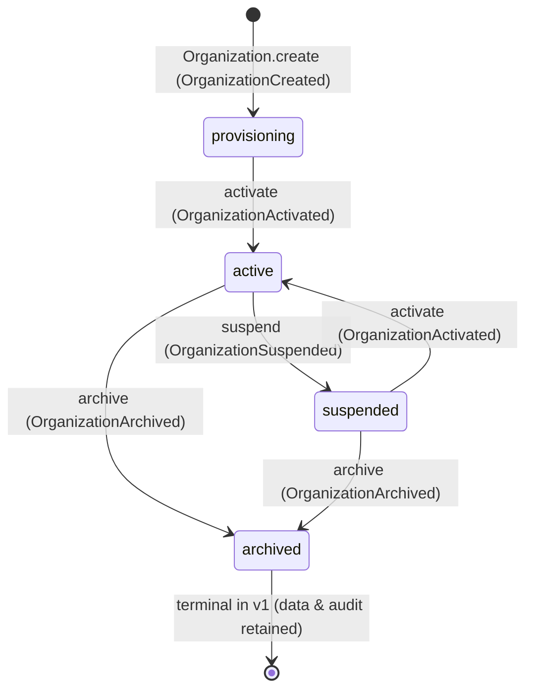
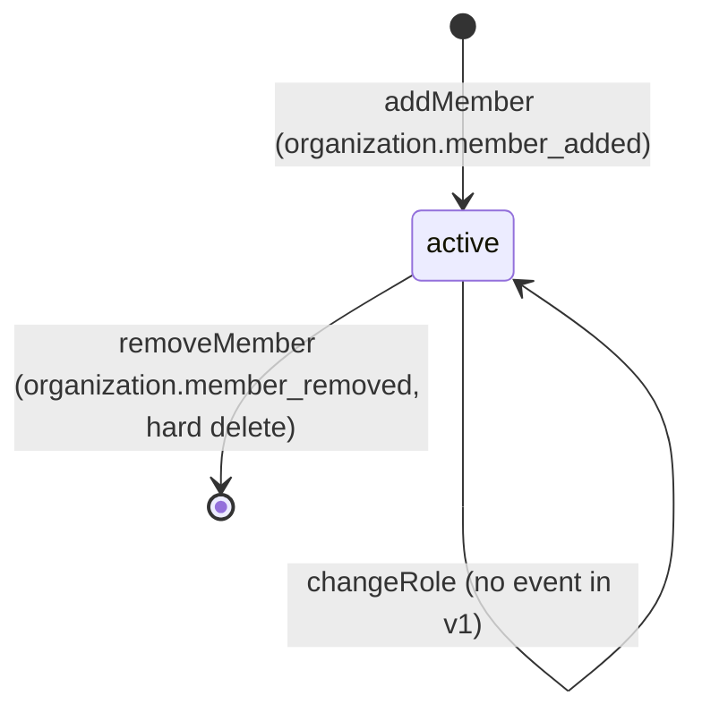

# Lifecycle Diagrams

State machines implemented by `@nexora/domain-organizations` (PSD.md CO-3).
Transitions are enforced by `OrganizationLifecyclePolicy` /
`OrganizationArchivalPolicy`; the terminal state `archived` stands in for PSD
`Retired` per the domain task naming.

## Organization

| From         | To                 | Allowed | Event emitted            |
| ------------ | ------------------ | ------- | ------------------------ |
| provisioning | active             | ✅      | `organization.activated` |
| provisioning | suspended/archived | ❌      | —                        |
| active       | suspended          | ✅      | `organization.suspended` |
| active       | archived           | ✅      | `organization.archived`  |
| active       | active             | ❌      | —                        |
| suspended    | active             | ✅      | `organization.activated` |
| suspended    | archived           | ✅      | `organization.archived`  |
| archived     | _any_              | ❌      | —                        |

## OrganizationMembership

Membership gating by organization status:

| Organization status | addMember | changeRole / removeMember |
| ------------------- | --------- | ------------------------- |
| provisioning        | ❌        | ✅ (cleanup)              |
| active              | ✅        | ✅                        |
| suspended           | ❌        | ✅                        |
| archived            | ❌        | ❌                        |

Last-owner rule: an `owner` membership may be removed or demoted only when at
least one other `owner` remains (`MembershipPolicy.assertCanRemoveOwner`).
