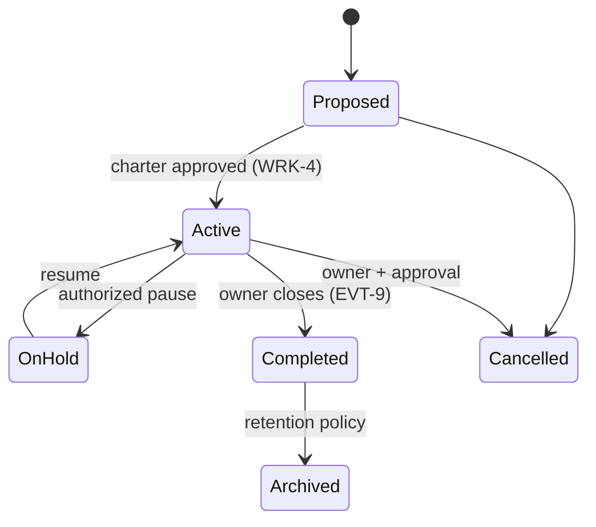
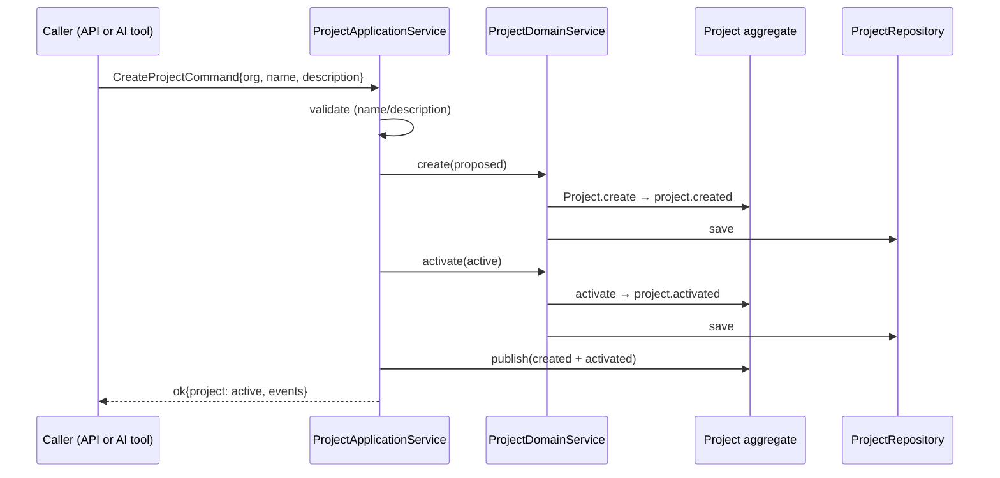

# Projects Domain — Lifecycle

The project lifecycle is defined by DOMAIN_MODEL.md §14.2. The transition
table below is the **single authoritative definition**; the aggregate and
every policy consult `PROJECT_TRANSITIONS`.

## State machine

## Transition table

| From        | To          | Trigger                     | Event               |
| ----------- | ----------- | --------------------------- | ------------------- |
| `proposed`  | `active`    | Charter approved (WRK-4)    | `project.activated` |
| `proposed`  | `cancelled` | Owner withdraws the charter | `project.cancelled` |
| `active`    | `on_hold`   | Authorized pause            | `project.on_hold`   |
| `on_hold`   | `active`    | Resume                      | `project.resumed`   |
| `active`    | `completed` | Owner closes (EVT-9)        | `project.completed` |
| `active`    | `cancelled` | Owner + approval            | `project.cancelled` |
| `completed` | `archived`  | Retention policy            | `project.archived`  |

`archived` and `cancelled` are **terminal**: no outgoing transitions.

## v1 create flow

In the vertical slice the **CreateProject** use case runs
`create (proposed) → activate (active)` in one transaction:

The aggregate still exposes the full lifecycle (`hold`, `resume`, `complete`,
`archive`, `cancel`) so future workflows can transition projects without
domain changes.
