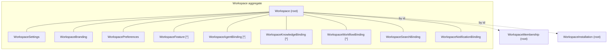

# Aggregate design — Workspaces

The Workspaces bounded context owns three aggregate roots. Boundaries follow
the rule: **an aggregate mutates only itself; invariants that span aggregates
live in domain services.**

## Aggregate map

## Why these roots

| Aggregate               | Root because                                                                                                                                      | Owned by repository               |
| ----------------------- | ------------------------------------------------------------------------------------------------------------------------------------------------- | --------------------------------- |
| `Workspace`             | Owns settings, branding, preferences, features, and the five bindings; its status gates every other aggregate's operations.                       | `WorkspaceRepository`             |
| `WorkspaceMembership`   | Carries its own identity (`mbr_…`), role, and join time; the last-owner rule spans memberships and cannot be an invariant of the Workspace alone. | `WorkspaceMembershipRepository`   |
| `WorkspaceInstallation` | Carries its own identity (`ins_…`) and installed plugin version; independent install/remove lifecycle from the Workspace.                         | `WorkspaceInstallationRepository` |

## Transaction boundaries

- **Workspace mutations** (settings, branding, preferences, features,
  bindings, lifecycle) are single-aggregate transactions. A rejected update
  leaves the aggregate unchanged (validate-before-mutate, regression-tested).
- **Membership add/remove/role-change** is a two-aggregate workflow owned by
  `WorkspaceMembershipService`: it reads the Workspace (status gating) and
  membership counts (last-owner rule), then mutates only the membership
  aggregate. The last-owner check runs against `countOwners` before removal
  or demotion.
- **Installation** is likewise owned by `WorkspaceInstallationService`:
  workspace status gating (install requires `active`), then a single
  installation-aggregate mutation.

## Removal semantics

Membership and installation removal are **hard deletes owned by the
services**: the service emits `workspace.member_removed` /
`workspace.plugin_removed` and then removes the aggregate from its
repository. The aggregate itself has no `remove` method — deletion is a
service-level workflow because it spans the Workspace status gate.

## Event context contract

Every emitted event carries `actor`, `correlationId`, and `organizationId`
(tenant), and the workspace id (`workspaceId` on the envelope — resolved from
the mutated workspace when the caller could not supply it). This satisfies the
PSD.md WS-R3 context contract and keeps events traceable end-to-end
(AI_RUNTIME.md §14 explainability).

## First-owner provisioning flow

Members can only be added to **active** workspaces (`WorkspaceMembershipPolicy`),
so a workspace has no members during `provisioning`. The intended flow:
platform creates the workspace (`provisioning`) → platform provisions default
installations/bindings → `activate` → the application layer adds the first
`owner` (with any additional members). The domain does not require a first
owner at creation — the invariants only guarantee that at least one owner
exists once members exist.
