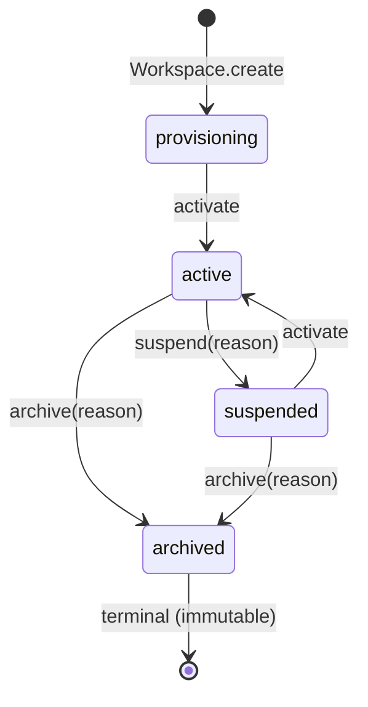
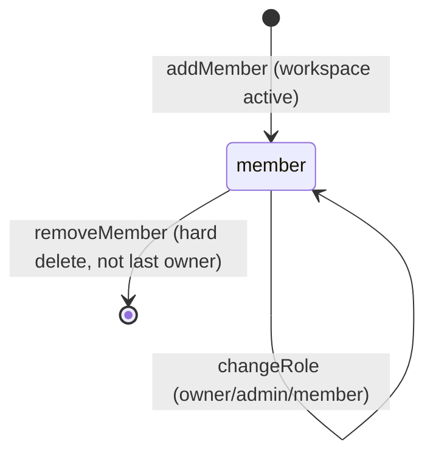
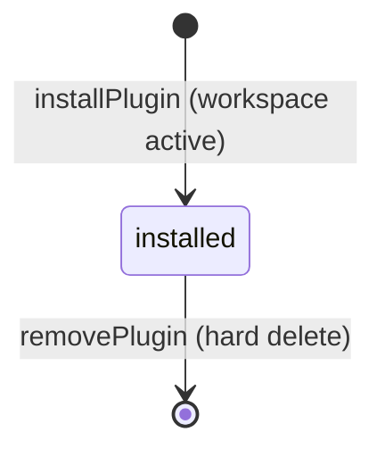

# Lifecycle — Workspaces

## Workspace status lifecycle

Rules enforced by `WORKSPACE_TRANSITIONS` (single authoritative table):

| From           | To                      |
| -------------- | ----------------------- |
| `provisioning` | `active`                |
| `active`       | `suspended`, `archived` |
| `suspended`    | `active`, `archived`    |
| `archived`     | — (terminal)            |

Execution eligibility: only `active` workspaces may execute workflows; a
suspended workspace is frozen; an archived workspace is immutable and
rejects every mutation.

## Membership lifecycle

## Installation lifecycle

## Event emission map

| Transition              | Event                                                           |
| ----------------------- | --------------------------------------------------------------- |
| create                  | `workspace.created`                                             |
| activate                | `workspace.activated`                                           |
| suspend                 | `workspace.suspended`                                           |
| archive                 | `workspace.archived`                                            |
| member add              | `workspace.member_added`                                        |
| member remove           | `workspace.member_removed`                                      |
| plugin install          | `workspace.plugin_installed`                                    |
| plugin remove           | `workspace.plugin_removed`                                      |
| agent bind/unbind       | `workspace.agent_bound` / `workspace.agent_unbound`             |
| knowledge attach/detach | `workspace.knowledge_attached` / `workspace.knowledge_detached` |
| workflow attach/detach  | `workspace.workflow_attached` / `workspace.workflow_detached`   |
| search provider         | `workspace.search_provider_attached`                            |
| notification provider   | `workspace.notification_provider_attached`                      |
| settings update         | `workspace.settings_updated`                                    |
| branding update         | `workspace.branding_updated`                                    |

All events ride the shared envelope with category `platform` (Tenancy =
DOM-01 Generic) and carry `actor`, `correlationId`, `organizationId`, and the
workspace id.
